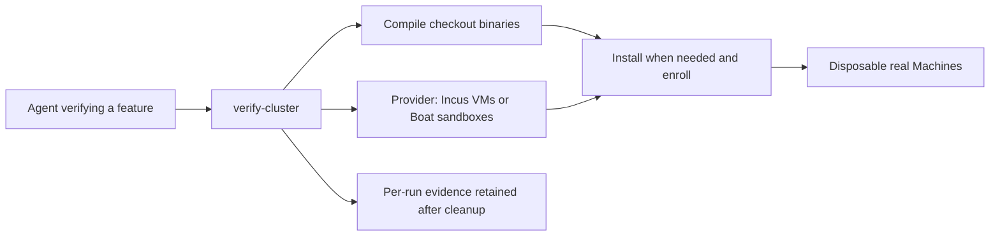

# Verify a server feature

Run from `core/` on the Linux development host. From a Mac, SSH to that host and run the same commands there. `up` boots one Machine. Pass `--machines N` only when a check needs N distinct Machines, for example a move that needs a source and a target, or a refusal that needs a Machine holding no copy, and name that check in your evidence. Each VM costs 2 GiB of RAM and two vCPUs on a host that other sessions share. Choose the checks from the feature being implemented; the helper provides the environment. Read `DESIGN.md` and the relevant `../docs/user/` behavior before choosing expected outcomes.



## Launch and doctor

Choose `stable` for dashboard or client work against a published daemon. Use `checkout` when the feature changes daemon behavior; use `beta` or an exact version when that is the required baseline. Each Machine can run its own daemon: `--daemon` takes `[MACHINE=]SOURCE` and repeats. A bare source sets every Machine and a named one overrides it, so `--daemon checkout --daemon machine-2=0.2.3` runs machine-1 on this checkout and machine-2 on the 0.2.3 release.

```bash
run=$(scripts/verify-cluster up --daemon stable)
scripts/verify-cluster doctor "$run"
```

`--daemon checkout` is the command's default; it builds and installs this checkout's runtime. `PLOYZ_VERIFY_CARGO_ARGS` appends to that `cargo build`; `PLOYZ_VERIFY_CARGO_ARGS="--features ployz/verify-faults,ployzd/verify-faults"` builds the fault hooks and `ployz debug volume-rpc` that Volume switch verification drives. When every Machine boots the same release, the run uses that release's cached image and skips daemon compilation, per-Machine binary uploads and installation. A mixed run boots the shared base image and installs each Machine's daemon. Channel selection resolves to an exact version, recorded per Machine in the manifest. The host CLI still comes from this checkout because the released CLI enrolls through Cloud rather than supporting standalone enrollment.

`up` returns an absolute manifest path on stdout. Each invocation creates a separate cluster, SSH credentials, CLI context, Config Store and application workspace. The manifest records each Machine's daemon source, version and binary hashes, and the run's artifact hashes and timings. Incus is the default provider; its image, bridge and VM commands stay in `scripts/verify/incus.py`. `--provider boat` runs each Machine as a Boat sandbox instead; see [Boat sandboxes](#boat-sandboxes).

The first run for an image recipe prepares Ubuntu with Docker, real ZFS, Corrosion, Caddy and the scenario workload images (nginx, Postgres, Alpine, whoami), so checks do not pull them from Docker Hub. Later runs boot clones with cached dependencies. Published daemons and their systemd units stay installed in release images; checkout runs install their own binaries and units. The host CLI drives both and reads each Entry Machine over SSH. Machine identities are created after cloning. Compilation overlaps image preparation and VM boot; installation and enrollment wait for the required binaries. Phase timings overlap; `total` records elapsed startup time.

`doctor` checks active services, each Machine's running daemon executable hash and reported version against its own selection, ZFS, and each Entry Machine's observation of the expected peers. Run it before driving and after an unexpected failure. A deliberate fault can make doctor fail; restore that fault or start a fresh run before continuing unrelated checks.

A committed enrollment can return a startup follow-up failure. The helper retains that failure in `setup_follow_up_errors`, checks readiness for up to 30 seconds and completes the public ingress recovery command. It reports setup failures in stderr and evidence; inspect and report these when enrollment itself is the feature under verification.

## Drive the feature

```bash
scripts/verify-cluster cli "$run" -- --json server ls
scripts/verify-cluster cli "$run" -- project new verify
scripts/verify-cluster cli "$run" -- service add web --image nginx:1.29-alpine
scripts/verify-cluster cli "$run" -- deploy
scripts/verify-cluster cli "$run" -- --json ps
scripts/verify-cluster exec "$run" machine-1 -- zpool status
scripts/verify-cluster exec "$run" machine-2 -- journalctl -u ployz --no-pager -n 100
```

Managed Volumes work on every run. Enrollment says `--storage none` only because `--no-install` requires it; the image already ran the real installer with `--storage zfs`. As on a real Server, the daemon creates the file-backed `ployz` Machine Pool under `/var/lib/ployz-machine-pool` when the first managed Volume deploys. Do not create a pool yourself. Each Machine's 24 GiB root disk bounds the Pool. Pass `--memory` and `--disk` to `up` with Incus sizes, such as `--memory 4GiB --disk 40GiB`, when a check needs a larger Volume or workload. The defaults are 2 GiB of RAM and a 24 GiB disk. The manifest records both under `provider_state`, so `update` and `power on` keep them. Larger VMs take more of the shared host, so size them only for the check that needs it.

Use `cli` for product actions; it isolates ambient Ployz credentials and runs in the manifest's sibling `workspace/`. Use `exec` for diagnostics or faults inside a selected Machine. Arguments are passed directly; use `-- bash -ec '...'` when a shell is needed. Both commands capture stdout, stderr and exit status and return the underlying command's status. Read the current CLI's `--help` for the feature's actual interface.

Select checks that can expose the feature's failures. For a ZFS migration, run a stateful workload with durable numbered writes and an external request trace, trigger the actual migration, then compare acknowledged writes with destination data and measure the outage. Exercise relevant transfer interruption, destination capacity, startup and retry cases against the intended contract. Report observed downtime; a migration that finishes does not alone prove minimal downtime. A recipe for a feature still being implemented comes from its requirements and current interface.

## Faults and the ack probe

```bash
scripts/verify-cluster probe "$run" db &        # numbered inserts into Postgres Service db
probe=$!
scripts/verify-cluster power off "$run" machine-1
scripts/verify-cluster power on "$run" machine-1
scripts/verify-cluster partition on "$run" machine-2
scripts/verify-cluster partition off "$run" machine-2
scripts/verify-cluster runner kill "$run"       # --cloud runs only
scripts/verify-cluster runner start "$run"
kill "$probe"; wait "$probe"                   # prints the report; exits 1 when an acknowledged id is lost
```

`power off` cuts the VM's power with no shutdown, so unflushed writes are lost as on a real power failure. `power on` boots it and returns once Docker and `ployz` are active; it fails if the Machine's address changed. `partition on` drops the Machine's traffic with every peer's address, which carries WireGuard and so the whole mesh. The host can still reach the Machine, so `exec`, `cli --connect` and Cloud keep working. The rules do not survive a reboot. Each action is idempotent.

`runner kill` sends SIGKILL to the Inngest worker that the dashboard of a `--cloud` run started. Inngest keeps its function runs, and a step the worker was running is retried after a worker connects again. `runner start` starts the worker again with `../dashboard/scripts/verify/worker.sh` and waits until it connects.

`probe` streams `INSERT … RETURNING id` through `ployz exec -T <service> -- psql` into table `ackprobe`, 200 per second by default (`--rate`). Postgres's default `synchronous_commit=on` holds a commit's reply until the commit is durable. An id counts as acknowledged only after psql prints its row, and each one is logged with its time in `evidence/ackprobe-<service>-<time>.jsonl`. A session that dies or waits longer than `--stall` seconds is replaced, and the ids it left in flight are not retried, so they count as unknown. Each new session runs through `ployz exec`, so it reaches the Service on whichever Machine runs it now. On SIGINT or SIGTERM the probe reads the table back from the current writer and prints one JSON report: `lost` lists acknowledged ids missing there, and `longest_gap_seconds` with `longest_gap_between` gives the longest wait between two acknowledgements, a measure of downtime. While the writer is unreachable a session hangs until `--stall` ends it, so the gap can overstate the outage by up to `--stall` (2 s by default) plus one reconnect through `ployz exec`. A new session gets 15 s to answer its first query before it is replaced, so a reconnect that hangs while the writer comes back can add up to 15 s more. `scripts/test-verify-faults.py [daemon] [--cloud]` runs the power-cut case under the probe and, with `--cloud`, kills the runner while a Deploy is `running` and checks that the Deploy applies after `runner start`.

After correcting the implementation, keep the Machines and their data while updating binaries. `update` keeps each Machine's daemon source; a channel is resolved again:

```bash
scripts/verify-cluster update "$run"
```

`update` takes the same `--daemon [MACHINE=]SOURCE` choices, and Machines it does not name keep their source. `scripts/verify-cluster update "$run" --daemon checkout` moves a release cluster to the modified daemon; `--daemon machine-2=0.2.3` moves only machine-2, downgrades included.

## Scenario scripts

Each script under `scripts/` boots or takes a run, prints its verdicts and exits nonzero on a failure. Run the ones whose behavior your change touches.

- `test-verify-cluster.py` checks a two-Machine run, a managed Volume and cleanup. Run it after changing `verify-cluster` or Machine startup.
- `test-verify-faults.py` checks that a power cut loses no acknowledged write and, with `--cloud`, that a Deploy survives a killed runner. Run it after changing storage durability or the Cloud runner.
- `test-verify-merge-removals.py --cloud` checks that a PR merge removes Services and never Volume data. Run it after changing merges or removals.
- `test-verify-volume-move.py run <manifest>` checks one Move under faults in each RPC step; `--soak` adds a large Volume. Run it after changing the Move steps or `SetVolumeCopy`.
- `test-verify-volume-fences.py <manifest>` checks that a readonly slot stays hidden from Docker. Run it after changing the volume plugin or slot handling.
- `test-verify-warm-move.py [check ...]` checks Restore, Server removal and rejoin, demotion of a returning copy, deletion, stale `SetVolumeCopy` replays, deploys held mid-Move, Release, mirror reuse and slow or failing starts. `--list` names the checks and the Machines each needs; with no `--manifest` it boots that many under `/tmp/ployz-warm-move-vc.lock` and takes them down. `--provider boat` boots Boat sandboxes and skips the lock. Run it after changing Warm Move, Volume runs or `server rm`.

The three volume scripts need the fault build, `PLOYZ_VERIFY_CARGO_ARGS='--features ployz/verify-faults,ployzd/verify-faults'`. A fault build reads its armed fault from `/run/ployz/fault` on every check, so a script arms one by writing that file on a Machine and disarms it by removing the file, with no restart. A daemon refuses to start when the file holds something that is not a fault point. `leak-memory` is read only at start. A `--manifest` run for the Move and Warm Move scripts must also come from `up --cloud`.

## Evidence and cleanup

Every helper command saves its argv, exit code, duration, stdout and stderr beside the manifest in `evidence/`. Save client traffic traces, feature-specific assertions and any additional proof there too. Capture each Entry Machine separately when replicated observations matter. Name the behavior exercised and report failures or untested cases precisely.

```bash
scripts/verify-cluster down "$run"
```

Run cleanup after failed attempts as well as successful verification. It collects journals, ZFS and WireGuard state where reachable, deletes only this run's provider resources and private credentials, and retains the manifest and evidence. Confirm the evidence remains after teardown. Shared prepared images and the storage pool remain cached.

The Incus host needs KVM, passwordless sudo, Python 3, Rust, `strip`, OpenSSH, Incus, QEMU/OVMF and btrfs-progs (`mkfs.btrfs`). The backend uses the shared `ployz-verify-btrfs` pool, a 100 GiB loop-backed btrfs pool that its first run creates. The launch preflight counts free space as the smaller of the pool's and the host filesystem's under the loop file. btrfs clones each VM root from the pool's copy of the image; a directory pool unpacks the whole image per VM. Loop-backed ZFS made complete VM startup slower on this VM. Set `PLOYZ_VERIFY_INCUS_POOL` before launch to use another existing Incus pool; the manifest binds subsequent commands to that pool. Prepared images and the first pool import are shared cache costs. Agents may install missing development dependencies under this VM's environment instructions. Docker's host forwarding rules can block guest networking; the Incus backend adds and removes rules scoped to this run's bridge. The lab enrolls standalone by default.

## Shared host

`up` refuses to launch when the host cannot hold the new Machines. It counts each running guest's memory limit as promised, because guests grow to their limit and earlyoom then kills QEMU. The refusal lists every run with its owner. It does not wait; retry after runs end, or down your own. `PLOYZ_VERIFY_MEMORY_RESERVE` and `PLOYZ_VERIFY_DISK_RESERVE` override the headroom kept free (a tenth of RAM, and a twentieth of the disk that backs the pool; for a loop-file pool that is the host disk).

```bash
scripts/verify-cluster ls                      # every run on the host: owner, age, Machines, RAM, checkout
scripts/verify-cluster reap                    # dry run: what would be removed and why
scripts/verify-cluster reap --yes              # remove the runs marked remove
scripts/verify-cluster reap <run-id> ...       # consider only these runs
```

Each run records its checkout, manifest, creation time, agent session and owner process in the manifest and on its Incus project. `reap` removes runs whose checkout or manifest is gone or that are older than `--older-than` hours (24). It keeps a run whose owner process still lives unless `--force`. To remove one of your own runs whose manifest you lost, pass `<run-id> --older-than 0 --force --yes`.

When `cli`, `exec`, `probe` or `doctor` finds a Machine stopped that `power off` did not stop, it exits 75 and prints an infrastructure failure, not a product result. The message names the killer QEMU logged (usually earlyoom; `sudo journalctl -u earlyoom` shows why) and the `power on` line that restarts the Machine. Rerun the check after restarting; do not report it as a feature failure. A Machine that `power off` stopped is not an infrastructure failure: `cli` and `probe` return the product's result, and `doctor` or `exec` on that Machine exit 1 with the same restart line.

## Boat sandboxes

```bash
run=$(scripts/verify-cluster up --provider boat --machines 3)
```

`--provider boat` runs each Machine as a small Boat sandbox (2 vCPU, 4 GB, 69 GB disk) cloned from a baked `ployz-verify-boat-<hash>` snapshot (see below), so it uses no RAM or disk on this host. Every command after `up` takes the same manifest and behaves as with Incus. The host needs the `boat` CLI on `PATH` (override with `BOAT_CLI`), logged in with a key that may create, read, exec, stop and delete its own sandboxes, and read, write and remove snapshots. `--memory` and `--disk` are refused. `up` checks `boat limits` first and refuses a run that exceeds the active-sandbox headroom, or that the start budget cannot cover: one start per Machine this minute, and three per Machine this hour and day for relaunches off a shared node. A create that still hits the limit waits 15 seconds and retries. Each Boat run gets its own sandboxes, so it never takes `/tmp/ployz-warm-move-vc.lock`; Incus runs still do.

The host reaches each sandbox over root SSH at its IPv4 `sshEndpoint`; Machines peer over their public IPv6 addresses. The first `up` of a recipe bakes `ployz-verify-boat-<hash>` from `ployz-verify-024` once: it disables UFW, pulls the scenario images and Corrosion, installs zstd and authorizes a bootstrap key kept in `~/.cache/ployz/verify/boat/bootstrap`. A Boat snapshot drops images no container uses, so the bake leaves one created, never started `ployz.verify.hold=1` container per image; leave them. The hash covers the snapshot, the bake script, the image list, the Corrosion image and the bootstrap key, so changing any of them bakes again, and the next bake first removes all but the newest two older bakes. It removes only bakes listed in `~/.cache/ployz/verify/boat/bakes.ledger`, which records the bakes this host made, and never one a live run in that directory uses. Later runs clone the bake, pull nothing and push only the checkout binaries, zstd-compressed. A warm three-Machine `up` takes about 50 seconds: about 22 to boot and install, the rest enrolling the Machines one after another. Each new sandbox costs one of the account's starts (200 a day, 60 an hour, 12 a minute), as does each relaunch off a node another Machine uses; a sandbox reused from the pool (below) costs none. Drive every check you need on one run rather than one run per check. Parallel `--cloud` runs from one checkout share its dashboard, so run them one at a time. `power off` resets the guest with sysrq after disabling the Ployz and Docker units, so the sandbox keeps its address, as `incus stop --force` does. Sandboxes carry a one-hour auto-stop (`PLOYZ_VERIFY_BOAT_TTL` in seconds), and every `verify-cluster` command that takes the manifest renews it to a full hour, so a long suite keeps its Machines while an abandoned run stops within the hour. Each run records its sandbox ids in `~/.cache/ployz/verify/boat/<run>.json`, which `ls` and `reap` read; `down` deletes or parks only those ids. When the key lacks `sandbox.delete-own`, `down` stops each sandbox instead, keeps it in that file and says so.

`down` reuses healthy sandboxes rather than deleting them. It resets each one to its bake (stops and removes what ployz and the run made: units, containers other than the holders, volumes, networks, images the bake lacked, zpools, ployz links and paths, then restores the bake's own ployz install and SSH key), reboots it in place, which costs no start, and compares a fingerprint of the guest with the one the first fresh clone of that bake recorded in `~/.cache/ployz/verify/boat/<bake>.fingerprint`: containers, volumes, networks, zpools, links, ployz paths and units, enabled units and listening ports. A sandbox that matches is parked in `~/.cache/ployz/verify/boat/pool.ledger` with a fresh hour; any difference, or any reset, reboot or SSH error, deletes it as before and names what differed. The next `up` of the same bake claims parked sandboxes first, one per node, checks each against the fingerprint again and launches fresh ones only for the rest, so `up`'s start budget counts only those. A warm three-Machine `up` from the pool takes about 40 seconds and no starts; each `down` takes about 30 seconds. `PLOYZ_VERIFY_BOAT_POOL` caps the pool (6 by default); `0` turns reuse off. `ls` shows the pool per bake, and `reap` also deletes parked sandboxes that are stopped, gone or of an older bake (`--force` empties the pool).

## Cloud pairing

```bash
run=$(scripts/verify-cluster up --daemon stable --cloud)
```

`--cloud` starts this checkout's dashboard (`../dashboard/scripts/verify/up.sh`) with Inngest and the worker. It then enrolls the Machines through it with the seed's Organization Token rather than `--standalone`. `cli` then goes through Cloud with that token, and `doctor` also checks that Cloud lists exactly this run's Machines. `down` stops the dashboard it started. It skips the dashboard's idle stop, since a cluster's CLI calls are too brief to count as a connection. When the dashboard's `SERVERS=N up.sh` started the cluster instead, the dashboard owns it and its `down.sh` removes the cluster. Cloud enrollment needs a daemon that speaks this checkout's CLI protocol and reports its version. A release qualifies only when this checkout is that release's tagged commit; a release with the same version string can still predate the checkout's protocol. Any other release Machine enrolls on the checkout daemon, which `up` then compiles, and gets its release installed right after enrollment. Any `--daemon` choice therefore works with `--cloud`, mixed ones included, and `doctor` also checks that Cloud reports each Machine's daemon version. In this mode the daemon advertises its discovered endpoints, so the provider's `--public-ip` and `--wg-endpoint` choices do not apply.
