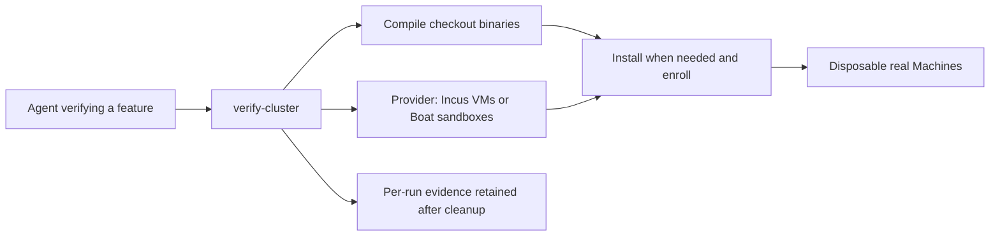

# Verify a server feature

Run from `core/` on the Linux development host. From a Mac, SSH to that host and run the same commands there. `up` boots one Machine. Pass `--machines N` only when a check needs N distinct Machines, for example a move that needs a source and a target, or a refusal that needs a Machine holding no copy, and name that check in your evidence. An Incus VM costs 2 GiB of RAM and two vCPUs on a host that other sessions share; a Boat sandbox costs one of the account's daily starts and its run time. Choose the checks from the feature being implemented; the helper provides the environment. Read `DESIGN.md` and the relevant `../docs/user/` behavior before choosing expected outcomes.



## Choose a provider

Use Boat, the default, for every run, long ones included. A short run fits the sandboxes' one-hour auto-stop: one `up`, the checks for the feature, then `down`. A run expected to keep its Machines past an hour extends each sandbox up front with `boat extend`; see [Long runs and stopped sandboxes](#long-runs-and-stopped-sandboxes). Don't ask before a long Boat run.

Use Incus, with `--provider incus`, only for what Boat can't model: a Machine with less than 4 GB of RAM, custom IPv6 or router networks, and distros Boat lacks. A Boat sandbox is Ubuntu 24.04 with 4 GB and a 69 GB disk. Read `free -g` and `scripts/verify-cluster ls` before an Incus run, since its VMs share this host.

## Launch and doctor

Choose `stable` for dashboard or client work against a published daemon. Use `checkout` when the feature changes daemon behavior; use `beta` or an exact version when that is the required baseline. Each Machine can run its own daemon: `--daemon` takes `[MACHINE=]SOURCE` and repeats. A bare source sets every Machine and a named one overrides it, so `--daemon checkout --daemon machine-2=0.2.3` runs machine-1 on this checkout and machine-2 on the 0.2.3 release.

```bash
run=$(scripts/verify-cluster up --daemon stable)
scripts/verify-cluster doctor "$run"
```

`--daemon checkout` is the command's default; it builds and installs this checkout's runtime. `PLOYZ_VERIFY_CARGO_ARGS` appends to that `cargo build`; `PLOYZ_VERIFY_CARGO_ARGS="--features ployz/verify-faults,ployzd/verify-faults"` builds the fault hooks and `ployz debug volume-rpc` that Volume switch verification drives. `PLOYZ_BUILD_LOCK=<file>` makes that build, and the dev SDK build a dashboard `up.sh` runs, wait for a flock on the file and hold it only while compiling. Worktrees that must build one at a time, such as a soak's workers, set it instead of wrapping `up` in `flock`, which holds the lock through boot and enrollment. When every Machine boots the same release, the run uses that release's cached image and skips daemon compilation, per-Machine binary uploads and installation. A mixed run boots the shared base image and installs each Machine's daemon. Channel selection resolves to an exact version, recorded per Machine in the manifest. When every Machine runs the same release, `up` fetches that release's CLI the same way and it enrolls and drives the run, since this checkout's CLI asks for wire, such as `ployz.serving.routes.v1`, that an older daemon cannot serve. Checkout, main and mixed runs use this checkout's CLI; a mixed run's release daemons may refuse it, and `up` says so. `update` picks the CLI again from the new daemons.

`up` returns an absolute manifest path on stdout. Each invocation creates a separate cluster, SSH credentials, CLI context, Config Store and application workspace. The manifest records each Machine's daemon source, version and binary hashes, and the run's artifact hashes and timings. Boat is the default provider: each Machine is a Boat sandbox, so a run uses no RAM or disk on this host; see [Boat sandboxes](#boat-sandboxes). `--provider incus` runs each Machine as an Incus VM on this host instead; its image, bridge and VM commands stay in `scripts/verify/incus.py`.

The first run for an image recipe prepares Ubuntu with Docker, real ZFS, Corrosion, Caddy and the scenario workload images (nginx, Postgres, Alpine, whoami), so checks do not pull them from Docker Hub. Later runs boot clones with cached dependencies. Published daemons and their systemd units stay installed in release images; checkout runs install their own binaries and units. The host CLI drives both and reads each Entry Machine over SSH. Machine identities are created after cloning. Compilation overlaps image preparation and VM boot; installation and enrollment wait for the required binaries. Phase timings overlap; `total` records elapsed startup time.

`doctor` checks active services, each Machine's running daemon executable hash and reported version against its own selection, ZFS, and each Entry Machine's observation of the expected peers. Run it before driving and after an unexpected failure. A deliberate fault can make doctor fail; restore that fault or start a fresh run before continuing unrelated checks.

A committed enrollment can return a startup follow-up failure. The helper retains that failure in `setup_follow_up_errors`, checks readiness for up to 30 seconds and completes the public ingress recovery command. It reports setup failures in stderr and evidence; inspect and report these when enrollment itself is the feature under verification.

## Drive the feature

```bash
scripts/verify-cluster cli "$run" -- --json server ls
scripts/verify-cluster cli "$run" -- project new verify
scripts/verify-cluster cli "$run" -- service add web --image nginx:1.29-alpine
scripts/verify-cluster cli "$run" -- deploy
scripts/verify-cluster cli "$run" -- --json ps
scripts/verify-cluster exec "$run" machine-1 -- zpool status
scripts/verify-cluster exec "$run" machine-2 -- journalctl -u ployz --no-pager -n 100
```

Managed Volumes work on every run. Enrollment says `--storage none` only because `--no-install` requires it; the image already ran the real installer with `--storage zfs`. As on a real Server, the daemon creates the file-backed `ployz` Machine Pool under `/var/lib/ployz-machine-pool` when the first managed Volume deploys. Do not create a pool yourself. An Incus Machine's 24 GiB root disk bounds the Pool. With `--provider incus`, pass `--memory` and `--disk` to `up` with Incus sizes, such as `--memory 4GiB --disk 40GiB`, when a check needs a larger Volume or workload; a Boat sandbox already has 4 GB and a 69 GB disk. The Incus defaults are 2 GiB of RAM and a 24 GiB disk. The manifest records both under `provider_state`, so `update` and `power on` keep them. Larger VMs take more of the shared host, so size them only for the check that needs it.

Use `cli` for product actions; it isolates ambient Ployz credentials and runs in the manifest's sibling `workspace/`. Use `exec` for diagnostics or faults inside a selected Machine. Arguments are passed directly; use `-- bash -ec '...'` when a shell is needed. Both commands capture stdout, stderr and exit status and return the underlying command's status. Read the current CLI's `--help` for the feature's actual interface.

`cli` gives the command no TTY and prints its output only when it exits. So `org approval approve` refuses for want of a terminal, and a deploy waiting on an approval shows nothing meanwhile. On a `--cloud` run, answer an approval with `approve` or `deny`, which act with the Organization Token. `approve` types the Organization's name for you under `script`:

1. Start the waiting command in the background, and find its approval's id with `cli "$run" -- --json org approval ls`.
2. While the waiter is still alive, run `scripts/verify-cluster approve "$run" <id>`, or `scripts/verify-cluster deny "$run" <id> --reason "<why>"`. Approving after the waiter has died does nothing; its rerun opens a new approval.

Select checks that can expose the feature's failures. For a ZFS migration, run a stateful workload with durable numbered writes and an external request trace, trigger the actual migration, then compare acknowledged writes with destination data and measure the outage. Exercise relevant transfer interruption, destination capacity, startup and retry cases against the intended contract. Report observed downtime; a migration that finishes does not alone prove minimal downtime. A recipe for a feature still being implemented comes from its requirements and current interface.

## Faults and the ack probe

```bash
scripts/verify-cluster probe "$run" db &        # numbered inserts into Postgres Service db
probe=$!
scripts/verify-cluster power off "$run" machine-1
scripts/verify-cluster power on "$run" machine-1
scripts/verify-cluster partition on "$run" machine-2
scripts/verify-cluster partition off "$run" machine-2
scripts/verify-cluster runner kill "$run"       # --cloud runs only
scripts/verify-cluster runner start "$run"
kill "$probe"; wait "$probe"                   # prints the report; exits 1 when an acknowledged id is lost
```

`power off` cuts the VM's power with no shutdown, so unflushed writes are lost as on a real power failure. `power on` boots it and returns once Docker and `ployz` are active; it fails if the Machine's address changed. `partition on` drops the Machine's traffic with every peer's address, which carries WireGuard and so the whole mesh. The host can still reach the Machine, so `exec`, `cli --connect` and Cloud keep working. The rules do not survive a reboot. Each action is idempotent.

`runner kill` sends SIGKILL to the Inngest worker that the dashboard of a `--cloud` run started. Inngest keeps its function runs, and a step the worker was running is retried after a worker connects again. `runner start` starts the worker again with `../dashboard/scripts/verify/worker.sh` and waits until it connects.

`probe` streams `INSERT … RETURNING id` through `ployz exec -T <service> -- psql` into table `ackprobe`, 200 per second by default (`--rate`). Postgres's default `synchronous_commit=on` holds a commit's reply until the commit is durable. An id counts as acknowledged only after psql prints its row, and each one is logged with its time in `evidence/ackprobe-<service>-<time>.jsonl`. A session that dies or waits longer than `--stall` seconds is replaced, and the ids it left in flight are not retried, so they count as unknown. Each new session runs through `ployz exec`, so it reaches the Service on whichever Machine runs it now. On SIGINT or SIGTERM the probe reads the table back from the current writer and prints one JSON report: `lost` lists acknowledged ids missing there, and `longest_gap_seconds` with `longest_gap_between` gives the longest wait between two acknowledgements, a measure of downtime. While the writer is unreachable a session hangs until `--stall` ends it, so the gap can overstate the outage by up to `--stall` (2 s by default) plus one reconnect through `ployz exec`. A new session gets 15 s to answer its first query before it is replaced, so a reconnect that hangs while the writer comes back can add up to 15 s more.

`ployz exec` and `port-forward` need a person's approved device, which an Organization Token can't have. So after a `--cloud` run enrolls, `up` signs a second CLI in as the seeded owner, approves that sign-in with the seed's session, and approves its device on every Server over SSH. `probe` runs as that device. `cli --device` runs any command as it, such as `cli --device "$run" -- exec -T db -- psql -U postgres`. The device CLI keeps its own link, so run `cli --device "$run" -- link --project <name>` once, as for `cli`. If the approval fails, `up` says so and carries on without it, and then `probe` and `cli --device` refuse.

The probe covers one Postgres Service on a Managed Volume. It doesn't cover Docker volumes, other stateful Services, or the first deploy after a heal, so a fault row varies the Volume kind and checks the deploy that follows.

A fault row records when the fault started and the peer's state (up, suspect or down) when the check acts, and repeats the check in each state window. A pass that arrives only after a background timeout, such as suspect turning Down or retries running out, is a finding, not a pass.

After correcting the implementation, keep the Machines and their data while updating binaries. `update` keeps each Machine's daemon source; a channel is resolved again:

```bash
scripts/verify-cluster update "$run"
```

`update` takes the same `--daemon [MACHINE=]SOURCE` choices, and Machines it does not name keep their source. `scripts/verify-cluster update "$run" --daemon checkout` moves a release cluster to the modified daemon; `--daemon machine-2=0.2.3` moves only machine-2, downgrades included. Either way `update` restarts every Machine's daemon, not only the one named. A "rolling" upgrade driven one Machine at a time is therefore a cluster-wide restart at each step: a harsher test than a real roll, and not a model of one. Say so in its evidence. To make a given Server the Entry Machine for a command, pass `--connect ssh://root@<sandbox>` with the run's `private/id_ed25519` loaded in ssh-agent.

## Fault builds

A fault build reads its armed fault from `/run/ployz/fault` on every check, so a check arms one by writing that file on a Machine and disarms it by removing the file, with no restart. A daemon refuses to start when the file holds something that is not a fault point. `leak-memory` is read only at start.

## Evidence and cleanup

Every helper command saves its argv, exit code, duration, stdout and stderr beside the manifest in `evidence/`. Save client traffic traces, feature-specific assertions and any additional proof there too. Capture each Entry Machine separately when replicated observations matter. Name the behavior exercised and report failures or untested cases precisely. A fix proof cites the manifest's `revision`, the checkout commit it built, which must equal the PR head, and lists every case it skipped or cut. A coordinator rejects a proof that lacks either. A `--cloud` fix proof also shows `dashboard/.verify/run/sdk.log` fetching or building the SDK for that head, never `stale main@`; `up.sh` builds it exact for real Servers, and `SDK=exact core/scripts/build-cloud-sdk.sh` builds it by hand.

```bash
scripts/verify-cluster down "$run"
```

Run cleanup after failed attempts as well as successful verification. It collects journals, ZFS and WireGuard state where reachable, deletes only this run's provider resources and private credentials, and retains the manifest and evidence. Confirm the evidence remains after teardown. Shared prepared images and the storage pool remain cached.

The Incus host needs KVM, passwordless sudo, Python 3, Rust, `strip`, OpenSSH, Incus, QEMU/OVMF and btrfs-progs (`mkfs.btrfs`). The backend uses the shared `ployz-verify-btrfs` pool, a 100 GiB loop-backed btrfs pool that its first run creates. The launch preflight counts free space as the smaller of the pool's and the host filesystem's under the loop file. btrfs clones each VM root from the pool's copy of the image; a directory pool unpacks the whole image per VM. Loop-backed ZFS made complete VM startup slower on this VM. Set `PLOYZ_VERIFY_INCUS_POOL` before launch to use another existing Incus pool; the manifest binds subsequent commands to that pool. Prepared images and the first pool import are shared cache costs. Agents may install missing development dependencies under this VM's environment instructions. Docker's host forwarding rules can block guest networking; the Incus backend adds and removes rules scoped to this run's bridge. The lab enrolls standalone by default.

## Shared host

`up` refuses to launch when the host cannot hold the new Machines. It counts each running guest's memory limit as promised, because guests grow to their limit and earlyoom then kills QEMU. The refusal lists every run with its owner. It does not wait; retry after runs end, or down your own. `PLOYZ_VERIFY_MEMORY_RESERVE` and `PLOYZ_VERIFY_DISK_RESERVE` override the headroom kept free (a tenth of RAM, and a twentieth of the disk that backs the pool; for a loop-file pool that is the host disk).

```bash
scripts/verify-cluster ls                      # every run on the host: owner, age, Machines, RAM, checkout
scripts/verify-cluster reap                    # dry run: what would be removed and why
scripts/verify-cluster reap --yes              # remove the runs marked remove
scripts/verify-cluster reap <run-id> ...       # consider only these runs
```

Each run records its checkout, manifest, creation time, agent session and owner process in the manifest and on its Incus project. `reap` removes runs whose checkout or manifest is gone or that are older than `--older-than` hours (24). It keeps a run whose owner process still lives unless `--force`. To remove one of your own runs whose manifest you lost, pass `<run-id> --older-than 0 --force --yes`.

When `cli`, `exec`, `probe` or `doctor` finds a Machine stopped that `power off` did not stop, it exits 75 and prints an infrastructure failure, not a product result. The message names the killer QEMU logged (usually earlyoom; `sudo journalctl -u earlyoom` shows why) and the `power on` line that restarts the Machine. Rerun the check after restarting; do not report it as a feature failure. A Machine that `power off` stopped is not an infrastructure failure: `cli` and `probe` return the product's result, and `doctor` or `exec` on that Machine exit 1 with the same restart line.

## Boat sandboxes

```bash
run=$(scripts/verify-cluster up --machines 3)
```

By default `up` runs each Machine as a small Boat sandbox (2 vCPU, 4 GB, 69 GB disk) cloned from a baked `ployz-verify-boat-<hash>` snapshot (see below), so it uses no RAM or disk on this host. Every command after `up` takes the same manifest and behaves as with Incus. The host needs the `boat` CLI on `PATH` (override with `BOAT_CLI`), logged in with a key that may create, read, exec, stop and delete its own sandboxes, and read, write and remove snapshots. Without it `up` fails and names `--provider incus`. `--memory` and `--disk` are refused unless `--provider incus` is given. `up` checks `boat limits` first and refuses a run that exceeds the active-sandbox headroom, or that the start budget cannot cover: one start per Machine this minute, and three per Machine this hour and day for relaunches off a shared node. A create that still hits the limit waits 15 seconds and retries.

The host reaches each sandbox over root SSH at its IPv4 `sshEndpoint`; Machines peer over their public IPv6 addresses. A sandbox's only IPv4 is private behind the Boat node's NAT, so `up` sets each Server's public IP to its IPv6, the address Cloud's ingress probe and generated domains must reach; the daemon's own lookup would find the node's shared IPv4, where port 80 is closed. The first `up` of a recipe bakes `ployz-verify-boat-<hash>` from `ployz-verify-024` once: it pulls the scenario images and Corrosion, installs zstd and authorizes a bootstrap key kept in `~/.cache/ployz/verify/boat/bootstrap`. A Boat snapshot drops images no container uses, so the bake leaves one created, never started `ployz.verify.hold=1` container per image; leave them. The hash covers the snapshot, the bake script, the image list, the Corrosion image and the bootstrap key, so changing any of them bakes again, and the next bake first removes all but the newest two older bakes. It removes only bakes listed in `~/.cache/ployz/verify/boat/bakes.ledger`, which records the bakes this host made, and never one a live run in that directory uses. Later runs clone the bake, pull nothing and push only the checkout binaries, zstd-compressed. Boat turns UFW back on in every clone, so each Machine's start disables it again; without that, ingress on 80 and 443 times out. Boat's restore also replaces Docker's `volumes/metadata.db` under the running dockerd, which would drop every Volume's labels at the next reboot (#3384), so each start waits for the restore's hydration and then restarts Docker. A warm three-Machine `up` takes about 50 seconds: about 22 to boot and install, the rest enrolling the Machines one after another. Each new sandbox costs one of the account's starts (200 a day, 60 an hour, 12 a minute), as does each relaunch off a node another Machine uses; a sandbox reused from the pool (below) costs none. Drive every check you need on one run rather than one run per check. Parallel `--cloud` runs from one checkout share its dashboard, so run them one at a time. `power off` resets the guest with sysrq after disabling the Ployz and Docker units, so the sandbox keeps its address, as `incus stop --force` does. Sandboxes carry a one-hour auto-stop (`PLOYZ_VERIFY_BOAT_TTL` in seconds), and a `verify-cluster` command that takes the manifest renews it to a full hour once half of it has passed, so a long suite keeps its Machines while an abandoned run stops within the hour. Each run records its sandbox ids in `~/.cache/ployz/verify/boat/<run>.json`, which `ls` and `reap` read; `down` deletes or parks only those ids. When the key lacks `sandbox.delete-own`, `down` stops each sandbox instead, keeps it in that file and says so.

`down` reuses healthy sandboxes rather than deleting them. It resets each one to its bake, then reboots it in place, which costs no start. Reset stops and removes what ployz and the run made: units, containers other than the holders, volumes, networks, zpools, ployz links and paths, and `/etc/default/ployz*`. It puts back each image tag the bake held, untags and removes every image the bake lacked, and empties the build cache. It restores the bake's own ployz install, its `/usr/bin/runc` (dropping any `runc.*` a wrapper left) and SSH key. It deletes what a run added under `/root`, `/srv` and `/var/tmp`, keeping systemd's private dirs and the Boat agent's `/var/tmp/ariana`. Last it drops the journal's archives, so the next claim logs only its own boot. `down` then compares a fingerprint of the guest with the one the first fresh clone of that bake recorded in `~/.cache/ployz/verify/boat/<bake>.<key>.fingerprint`, where the key hashes the fingerprint script and changes when the script does. Pruning a bake removes its fingerprints under every key. The fingerprint covers containers, image tags, build cache, volumes, networks, zpools, links, ployz paths and units, enabled units, listening ports, runc and the scratch dirs. A sandbox that matches is parked in `~/.cache/ployz/verify/boat/pool.ledger` with a fresh hour; any difference, or any reset, reboot or SSH error, deletes it as before and names what differed. The next `up` of the same bake claims parked sandboxes first, one per node, checks each against the fingerprint again and launches fresh ones only for the rest. It checks the start budget again for those after the claim, since a parked sandbox that fails its check needs a start too. Claim and park read which sandboxes live and which runs own them under the pool lock, and every change to a run's registry file takes `registry.lock` beside it. A warm three-Machine `up` from the pool takes about 40 seconds and no starts; each `down` takes about 30 seconds. `PLOYZ_VERIFY_BOAT_POOL` caps the parked sandboxes of all bakes together (6 by default); a full pool makes room by deleting the oldest sandboxes of bakes older in `bakes.ledger`, never the current bake's or a newer one's. A sandbox still being deleted holds its slot until Boat confirms the delete, so a full pool parks the new one only after that; a pool under the cap parks it at once. `0` turns reuse off. `ls` shows the pool per bake. `reap`, `up` and `down` delete parked sandboxes that are stopped or gone, or whose bake neither `bakes.ledger` nor any run keeps; `reap --force` empties the pool. A sandbox being deleted moves from `pool.ledger` to `retiring.ledger`, where no claim looks, and stays there until Boat confirms its delete, so a failed delete is retried next time instead of leaking. A key without `sandbox.delete-own` stops such a sandbox instead and drops it from the ledger once it stops; a failed stop leaves it retiring for the next try.

### Long runs and stopped sandboxes

- **Idle runs stop at the hour.** Only a `verify-cluster` command that takes the manifest renews the auto-stop. A run left alone, such as a `SERVERS=1` dashboard lab you drive only in the browser, stops at the hour even with `VERIFY_IDLE_TIMEOUT=0`. For a session longer than about 50 minutes, set each sandbox's lifetime up front: `boat extend <id> --hours <n>`, with the ids from `~/.cache/ployz/verify/boat/<run>.json`.
- **Replace a stopped run; resume none of it.** `boat resume` brings a sandbox back on a new host with a new address. `power on` then refuses it, and the mesh stays split until each peer's WireGuard endpoint is set by hand. `down` it and `up` a fresh run.
- **Recheck findings made after `power on`.** `power on` can start Docker before the volume plugin's socket is up (#2240), so a Volume error right after it may be the lab. Reproduce it on a fresh `up` before filing.
- **Keep one `up` to 12 Machines or fewer.** That fits the per-minute start cap, and `up` deletes every sandbox of a run when one fails readiness, so a 32-Machine `up` that loses one box spends 32 starts.
- **Save results as a long run goes.** A load generator that writes its report only at exit loses all of it when its sandbox stops. Write each interval to a file and fetch the files during the run.

### Lab topology

The lab's network differs from production in ways that can pass for product bugs. Label any address-family finding `lab topology?` until it reproduces on a dual-stack path.

- Boat Machines are public on IPv6 only; their IPv4 is private behind the node's NAT.
- This host and the lab Cloud are IPv4-only, and reach the Machines over SSH.
- Lab daemons use the production relay, so a relay outage fails every enrollment. When all of them time out, check the relay first.
- No lab path exercises NAT64.
- A bare host reports the node's shared IPv4 until `server set --public-ip`; see [Bare hosts](#bare-hosts).

## Cloud pairing

```bash
run=$(scripts/verify-cluster up --daemon stable --cloud)
```

A fix proof on the product path runs `--cloud` and names its mode in the evidence. Without `--cloud` the cluster is Standalone, a test-only mode users don't run.

`--cloud` starts this checkout's dashboard (`../dashboard/scripts/verify/up.sh`) with Inngest and the worker. It then enrolls the Machines through it with the seed's Organization Token rather than `--standalone`. `cli` then goes through Cloud with that token, and `doctor` also checks that Cloud lists exactly this run's Machines. `down` stops the dashboard it started. It skips the dashboard's idle stop, since a cluster's CLI calls are too brief to count as a connection. When the dashboard's `SERVERS=N up.sh` started the cluster instead, the dashboard owns it and its `down.sh` removes the cluster. Cloud enrollment needs a daemon that speaks this checkout's CLI protocol and reports its version. A release qualifies only when this checkout is that release's tagged commit; a release with the same version string can still predate the checkout's protocol. Any other release Machine enrolls on the checkout daemon, which `up` then compiles, and gets its release installed right after enrollment. It keeps the state the checkout made at enrollment, such as the Sealing Key and firewall rules, so it is not a genuine N-1 Server. For one, use `--bare` and enroll with the old release's install line or `server add --command`. Because it enrolled with this checkout's CLI, that run keeps this checkout's CLI. Any `--daemon` choice therefore works with `--cloud`, mixed ones included, and `doctor` also checks that Cloud reports each Machine's daemon version. Cloud enrollment pins the provider's `--public-ip` and `--wg-endpoint` as a direct join does (#3516). A release CLI before 0.3.8 drops them, so `up` also sets a Boat Machine's public IP with `server set` after it enrolls.

## Bare hosts

```bash
run=$(scripts/verify-cluster up --bare --machines 1 --daemon checkout)
run=$(scripts/verify-cluster up --bare --distro debian-12)
```

`--bare` boots fresh Boat hosts for installer work: plain sandboxes, not the bake, with this run's daemon binaries on `PATH` (`/usr/local/bin`, staged in `/opt/ployz-verify`) and nothing installed, enrolled or started. Boat keeps UFW on there, so `up` allows ports 80 and 443 through it; bare sandboxes are deleted at `down`, never pooled. A bare host you enroll yourself still reports the node's shared IPv4; run `ployz server set <server> --public-ip <address>` with the manifest's `address` before checking a domain. Before a release is published, the printed `server add --command` line and `server add ssh://` both 404 on GitHub. Install the staged binary first with `ployzd install --version <version> --storage zfs`, then join with `server add --no-install --storage none`. Only the published release proves the real install path; see soak's [Release phases](../soak/SKILL.md#release-phases). The plain base is Ubuntu 24.04 with Docker already running. Boat has no Debian base, so `--distro debian-12` boots the Debian 12 cloud image under KVM inside a default sandbox (4 vCPU, 8 GB) and reaches it through that sandbox; it adds under a minute to `up`. Debian 12's glibc is 2.36, older than a checkout build on this host links against, so a staged checkout `ployzd` won't run there. Build one for that glibc with `cargo zigbuild -p ployzd --target x86_64-unknown-linux-gnu.2.36`, outside kache, and push it to `/usr/local/bin` with `exec`. `exec`, `cli`, `update` and `down` work as on any run; `update` restages the binaries without installing them, and `doctor` does not apply. With `--cloud` or `--cloud-attach`, each host gets `PLOYZ_CLOUD_URL` in `/etc/environment` and no token, since it has not enrolled. The URL is this host's `http://localhost:<port>`, so `up` holds an SSH reverse forward of that port open for each Machine and checks that `curl` reaches the Cloud through it; `down` ends the forward.
