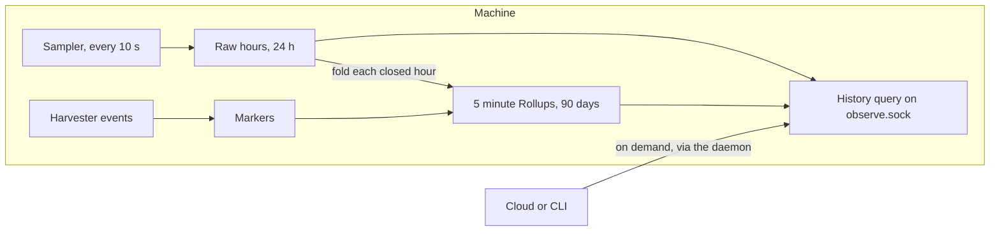

# Ployz design

Ployz is a distributed deployment engine and the Config Store that holds what
it deploys. The CLI and the dashboard are equal surfaces over the same core
operations: every change to authored configuration goes through the Config
Store, which Cloud hosts for each Organization. A
Deploy Intent is derived from Saved State when a Deploy is admitted; there is no
second authoring format.

Ployz runs containerized services across a Cluster of user-owned Docker Machines
joined by a flat WireGuard mesh. There is no central control plane: every Machine
is an equal Entry Machine, state replicates between Machines as CRDTs, and a
Cluster Observation is what one Entry Machine sees — never a globally
authoritative entity.

Vocabulary: capitalized terms (Machine, Deploy, Cluster, …) carry the exact
meanings defined in [CONTEXT.md](CONTEXT.md).

## How to use this document

Judge every new feature against the bets below before designing it. Each bet states
the position, why Ployz holds it, and the red flags that signal a design fighting
it. A change that fights a bet needs a new bet here justifying the exception —
or a redesign. A red flag is not an automatic no; it is a demand for
that justification. The Boundaries section at the end lists what Ployz
deliberately does not provide; a feature that needs one of those is fighting the
design, not filling a gap.

## Stable promise

From 0.2.0: a daemon keeps working, and can be upgraded, across every later
0.x release without re-enrolling or reinstalling. Versions follow semver; only a
new major line (1.0 first) may break the promise, and it says so. The promise covers what a
daemon carries or speaks — the replicated store and its bodies, the local
Machine record, Machine RPC within `PROTOCOL_MAJOR`, the enrollment protocol,
the release source, the `/run/ployz/dns.json` spec a daemon hands its Internal
DNS process, and `ployzd dns --probe` exiting 0 when a binary can serve it. The CLI surface is a client courtesy with ordinary
deprecation, not a guarantee. Branch Sync broke it on purpose, with no users yet:
`env save` and `env update` are gone, and the JSON field `save` is now
`conditional_sync`. Warm Move broke it on purpose too, with no users yet: switch
requests no longer carry `not_after_unix_seconds`, and AdoptLease is gone.
The Log Store release makes one approved exception while the user base is small:
`TailLogs` replaces `ContainerLogs` and `MachineLogs`, and `LogHistory` replaces
`ContainerLogHistory`. Clients and daemons need the matching log RPCs. The release
also removes `ForgetLogs`; deleting an Environment leaves its logs under the
normal retention limits. These two read RPCs are the log contract going forward.

Frozen formats evolve **additively with tolerant readers**: rows and bodies only
gain fields; every new field is optional with a default; nothing is renamed or
repurposed; readers ignore unknown fields. Replicated bodies never use
`deny_unknown_fields` — a newer Machine's row must remain readable by an older
one in the same Cluster. Authored config and unrelated trust boundaries stay
strict. Within frozen formats, explicit security refusals are the only
exception, and never on replicated bodies: a section holding secret or key material, or
a request mode that selects verification, may refuse fields it does not
recognize and fail closed. There are no version gates and no store migrations;
a change that cannot be expressed additively waits for `PROTOCOL_MAJOR` 2.

The Observe Store is outside the promise. It holds the Log Store, Metric
Samples, and Rollups, all of it disposable Machine-local state. A daemon that finds a format version it does not know
deletes it and starts again, so the Observe Store needs no migrations.

A breaking release protects older Clusters from its own side. Daemons follow
their own line's channel pointer (`ployz.sh/v0/stable`), so a new line never
reaches them unasked. The breaking release's CLI refuses to init or add a
Machine into a Cluster on another line, and its daemon rejects older-line
joiners. An older release never has to know about a newer one.

Machine RPC changes within a major by seven rules:

1. A new feature is a new catalog row with a new capability name. A name never
   gets different semantics.
2. A new response, stream, or watch field is optional. Absent means unknown and
   claims no capability.
3. A new request field is added only when a daemon that ignores it does no
   harm. Otherwise the change is a new route.
4. Changed semantics get a new versioned route, `.vN`. The old row keeps
   serving until a major bump.
5. A new stream variant is opt-in through a request field. Old readers reject
   unknown variants.
6. A removed verb is shimmed to its replacement within the major. Otherwise the
   daemon stops advertising it and refuses with `details.capability`.
7. Every refusal of a catalogued route names its capability in
   `details.capability`.

A capability name decides what a client does. Nothing compares versions. Each
Machine record lists the capabilities its binary serves. An Entry Machine older
than a peer decodes that peer's record into its own struct and drops fields it
does not know, so a client attached through it sees no capabilities for the
peer until the entry upgrades. The live refusal still decides, so nothing wrong
runs.

Under rule 6's second branch, these Machine RPC verbs are removed within the
major with no shim: InspectWireguard, CreateVolume, InspectVolume,
InspectMachineUpgrade, RemoveImages, EndBuildGrant, Initialize, Join,
MachineToken, Reset, RemoveLocalMachine, RemoveMachine, CreateContainer,
StartContainer, MarkContainerStopping, StopContainer, RemoveContainer,
GetContainerObservations, GetIngressProxyConfig. A daemon without one stops
advertising its capability and refuses the route. A client that sends one names
the capability from its own catalog.

**Red flags:** a required new field, a migration step, a reader that rejects
unknown fields on replicated data, a daemon behaviour that depends on every
peer being upgraded.

## 1. Observer-relative truth

**The bet.** Every view of a Cluster is one Machine's observation at a point in
time. No component is entitled to declare authoritative cluster state, and none
exists.

**Why.** Without a central control plane, "the" cluster state would require
consensus we refuse to pay for. Commands act on an observer's snapshot and report
what that observer saw; different observers may legitimately disagree until their
observations converge. Weak semantics stated honestly beat strong semantics
enforced badly.

**Expected copies.** A Volume Run is a sequence of `SetVolumeCopy` requests
driven by one operator, and that operator's own late or retried requests can
arrive after a Machine has moved on. Each request names the copy the operator
last saw on that Machine and the copy it wants there. The Machine compares the
expected copy with its own. A match takes the one allowed transition, a copy
already at the want answers success, and anything else is refused. Every reply
reports the Machine's copy as it is now. A Writer reports its epoch, and the
Machine never checks it. No Machine keeps a record of the run, claims the
Cluster's view of the Volume, or reads another Machine's copy.

**One lease, one fence.** Fencing and leases are allowed in one shape. The
operator's lease is a Volume's open run, numbered in Postgres as its `gen`. A
Machine keeps a floor for its own copy, raised and checked only by the
operator's `SetVolumeCopy` calls to it, and refuses a `gen` below the newest it
accepted. The floor lets a newer run stop an older run's late cut, which the
expected copy alone cannot do until the newer run has already changed the copy.
Neither number goes in Corrosion, and no Machine sends, asks for or checks
another Machine's number. The lease never has to reach a Machine the run does
not touch (bet 6).

**Red flags:** any other fencing token, lease, leader election or quorum read,
and any API or message claiming a complete or canonical Cluster view. A request
that names the copy it expects on one Machine is none of these.

## 2. AP over C — inside the Cluster

**The bet.** Availability and partition tolerance win over consistency. A
partitioned Cluster stays operable: each partition can be managed on its own, and
state converges eventually once the partition heals.

**Boundary.** Cloud-side organization state (enrollment, pairing) may be
consistency-first, because it lives in one hosted service rather than the mesh.
That exception stops at the Cloud boundary and never extends into the Cluster.

**Red flags:** a Cluster operation that blocks on quorum or consensus, treating a
partition as an error state rather than a working condition, importing Cloud-style
consistency into mesh behavior.

## 3. Bounded imperative commands

**The bet.** A Deploy is a bounded attempt: calculate against an observer-relative
snapshot, execute, report, stop. No Service placement process runs forever.
Global Services are placed by Deploy and by bounded catch-up when a Machine joins.
Catch-up rejects partial Live Observations before planning, reads fresh target
storage evidence, reports unknown eligibility or
incomplete placement, and stops; it does not leave work for a background loop.
Deleted slots, later eligibility changes, and transient failures require an
explicit redeploy. A Deploy of any Project also fills the Ingress Proxy's
missing or stopped slots on every ingress Server. It creates or starts them, and
never replaces, upgrades or removes one.

**Why.** Imperative errors surface predictably at the caller that can act on them.
Declarative reconciliation decouples components but multiplies edge cases and
hides failures behind "it will fix itself later." Docker restarts containers on a
Machine; Ployz does not move them between Machines on its own.

A Volume Run (Mirror, Sync, Move, Release, Delete Mirror) is the one durable
workflow, and it is still a bounded attempt. An operator runs it as a fixed list
of steps a user requested. It ends done, failed, cancelled or lost, and never
runs again on its own. A retry reads every copy live and continues from what the
disks show. A Cluster with no operator to drive it keeps its Volumes where they
are.

A removal is the one persisted intent the Store keeps. `remove` marks an
Environment or a Project. The Store admits its removal Deployments through
`due()`, and admits a failed one again only on new evidence or a member's retry,
until nothing of it runs or a member cancels. A removal with nothing new to try
is reported stalled with its reason, never retried on a timer. Servers Ployz does
not own can be gone for days, so removal cannot finish inside one command. Branch
closing was the first case.

A requested operation that Cloud steps (drain, upgrade, cleanup, server removal,
a Service restart, start or stop) is a bounded command, not a durable workflow.
It is admitted once per request key through the outbox, writes a receipt per
leg, never resends an uncertain leg unless the leg is idempotent, and never runs
again on its own. A leg that names the state it wants, and carries either its
expected prior state or a key that finds its own earlier effect, is idempotent
and may be resent. The Machine replies with its current state either way.

The Observe Store runs continuously, and it only observes the Machine it runs
on. It never places, moves, restarts, or removes a container, and no Deploy
waits on it. Its 10 second metric loop does file reads only. A source that can
block, such as `zfs list`, runs on its own 60 second tick with a timeout, so a
slow source drops a metric and never stalls the loop.

**Red flags:** controllers, persisted desired state other than a removal mark,
durable workflows other than a requested Volume Run, cluster-wide reconcilers, any
behavior that continues after its command returns other than a removal finishing.

## 4. Partial results are outcomes

**The bet.** A fan-out returns successes together with per-target failures and
omissions — an expected outcome, not a failed transaction. A Deploy may complete
only a prefix of its plan; there is no atomicity and no general rollback, only
narrow, explicit compensation. A failed Upgrade that already replaced the daemon
restores the prior release: Replacement Compensation, allowed only within one
release line, where the Stable promise keeps everything the newer daemon wrote
readable by the older one.

**Volume handover.** At the cut, the source becomes a Mirror at its final
Snapshot G. It stops its Container and keeps it. Until Cloud sends the target
`Writer{start}`, undo sets the source back to Writer at G and starts that same
Container. That request is the point of no return, and Cloud enforces it, not a
Machine. One Inngest step reads the full spec from the source's stopped
Container and hands it to the target's `Writer{start}`, and Cloud removes the
source Container once the target starts. If the source dies between the cut and
that step, its spec cannot be read. The target stays a Mirror at G and the run
stops. Once the source answers, running the Move again finishes it. If the
source is gone for good, `server rm` it and then `volume restore --from` the
target. The source's Mirror is the reverse mirror. Moving
back is another Move, with that Mirror as its base.

**Why.** Pretending a multi-Machine operation is atomic requires either lying in
the result or coordination machinery bet 1 forbids. Reporting the true
prefix/suffix lets the operator or a retry act on facts.

**Red flags:** all-or-nothing semantics, automatic rollback, results that collapse
per-target detail into one boolean.

## 5. Two-tier identity

**The bet.** Entities (Machines, Containers) are entity-keyed: their creator mints
an opaque durable ID unilaterally, and Machine Name or Service Name collisions
coexist forever — Name Ambiguity is preserved, never repaired. Declared,
replicated facts (certificates, service groupings) are name-keyed:
concurrent writes converge to one last-writer-wins winner, losing a merge silently
is expected, and the winner's generated ID endures as the handle that lineage and
history attach to.

**Why.** Without a global authority nobody can enforce unique names or arbitrate
concurrent creates, so ambiguity and merge loss are embraced rather than
half-prevented. Durable, unilaterally minted IDs make provenance (clones, lineage)
possible later without any new coordination machinery.

**Red flags:** an ID-minting authority or registry, fencing on merge loss,
assuming a name resolves to exactly one thing, using a name as an identity or an
ID as a grouping key, treating an ID's absence from one view as proof of
non-existence.

## 6. Machine-local authority

**The bet.** Each Machine is authoritative over what is on itself, and over
nothing else. Volumes, subnets and addresses belong to one Machine, and their
names mean something only together with that Machine. A Machine decides from its
own Pool, its own Docker and its own records. It never decides by reading
another Machine's. Work that spans Machines, such as moving a Volume, is a
sequence driven by one operator. Cloud is that operator when the Cluster has it,
with its database as the operator's store. The operator orders its own steps.
Each Machine admits or refuses each step against its own facts. Ployz assumes
one operator drives a given Cluster at a time. It does not enforce that, and two
at once may collide.

**Why.** In an eventually consistent Cluster a Machine can know only itself for
certain. Anything it reads about another Machine is an observation that may
already be stale (bet 1). A global allocator, a Cluster-wide lease, or a barrier
that waits for every Machine is a consistency dependency in disguise, and it
turns every partition into an outage. A single writer inside the Cluster would
need the consensus bet 2 refuses. A single operator outside it is free: Cloud
already has Postgres, and a CLI has the person's own disk.

Allocation is optimistic. An operator serializes its own enrollment commands
with durable allocation history, including assignments not yet visible in an
observation. History is saved before publication and Join and retained after
failures. It is not runtime truth and has no automatic expiry or reclamation.
Different computers, independent stores, and direct CLI and Cloud operators can
still select overlapping subnets from incomplete observations. No cross-store
synchronization or subnet repair system is provided.

Volume Runs follow the same rule. The operator keeps one run open per Volume,
and that is the only lock. Each Machine takes a step only if its own copy
matches the step's expected copy (bet 1). A Writer keeps its own newest two run
Snapshots and never prunes by another Machine's copy. A late request from a
dead run is refused once its expected copy is gone. If it still matches, the
worst case is a Volume with no Writer until the next plan, never two Writers.
Two operators driving the same Volume may collide, and that risk is documented,
not refused. Neither Machine waits for the other.

Cloud smooths what it can see, and promises nothing. A Machine that was removed
without a reset, while its Volume was restored elsewhere, may come back still
holding a writable copy and running its Container. That copy decides nothing on
its own. When Cloud next sees both copies, it will name the one with the older
writer epoch as old and demote it to a Mirror. That demotion ships with Restore. Until then both
copies can take writes, and the old one's writes are lost when it is demoted.
That window is accepted and documented, not prevented.

A container's output is Machine-local too. It lives on the Machine that ran the
container and outlives it. That Machine deletes it once it passes the size or
age cap. Cloud reads it through the daemon and never copies it (bet 7).
Deleting an Environment does not delete its retained logs. Reusing its Namespace
and Service names can show the earlier Environment's output until retention removes
it. Deployment and Container selectors distinguish that output by their identities.

Metrics follow the same rule. Each Machine samples only its own Containers and
itself, every 10 seconds, and keeps raw Metric Samples for 24 hours and 5 minute
Rollups per Service and Deployment, and for the Machine itself, for 90 days. Logs and metrics share one disk
budget, so both go sooner, oldest hour first, when the Observe Store passes its
size cap or the disk its free floor. A removed Container's history stays under
its Service until its Rollups expire. Cloud reads metrics through the daemon on
demand and never copies them (bet 7). A value a Machine could not read is a
named gap, never zero. A Cloud copy of metrics, such as a paid
long-term store, breaks this rule and needs its own amendment here first.

**Red flags:**

- A Machine deciding by reading another Machine's records. A replicated
  observation of other Machines may narrow what a Machine does, by refusing or
  naming a better command. It never authorizes an effect.
- A lease that must be above every Machine's record to be safe, so a run has to
  reach, fan out to, or wait for Machines it does not touch.
- A barrier across Machines, such as refusing to remove one Server while
  another's state is pending.
- A clock-based safety wait. That includes a deadline, a budget, or a grace
  period whose expiry is what makes an effect safe. A driver bounding its own
  patience is fine. A drain that a driver asks a Machine to wait before stopping
  its own Container is patience, not a safety wait.
- A resource identity meaningful without its Machine, or a required round trip
  to an allocator.
- A Cluster-side single writer, or machinery that prevents two operators instead
  of documenting the risk.

## 7. Cloud drives, never owns

**The bet.** Cloud hosts each Organization's Config Store and drives its Deploys,
whether a user works in the dashboard or the CLI, but it is not a Cluster
controller and holds no runtime truth. SSH and the Management Capability use the
same Machine RPC connection seam. The daemon serves Machine RPC in-process on its
Management Identity, an iroh key that is not a mesh peer; clients reach it through
the Ployz-hosted Ployz Relay, which sees ciphertext only, or a direct path.

**Why.** Reusing transport primitives removes a hosted protocol to maintain.
Cloud stores encrypted, Organization-scoped connection candidates associated with
the current Cluster pairing. A saved candidate is neither membership nor presence;
only a successful connection confirms reachability and the intended Machine.
The Cluster remains independently operable without Cloud.

Volume Runs need an operator to start and step them. With Cloud, that operator
is Cloud: its per-Volume Inngest singleton and its `volume_run` rows keep one
run open per Volume. That is the operator's bookkeeping, like allocation history
in bet 6. It serializes Cloud's own runs, and it is not runtime truth. Each
Machine checks every step against its own copy. Cloud reads what Machines
report, each Writer's epoch included, to plan a run and to notice an old copy,
but no Machine waits for Cloud's view. At the cut, one Inngest step reads the
source's full Container spec and hands it to the target's `Writer{start}`, so
the spec's secrets never land in a step result or a row. Without an operator, a
Volume stays put. No Cluster operation's correctness depends on
Cloud, only the availability of Volume Runs.

Removing Cloud access disables that pairing's connections immediately. Endpoint
revocation is confirmed separately; an offline Machine remains unconfirmed.
Management Capabilities grant shared administrative access: rotation affects every
old holder, while Cloud logout does not revoke direct capabilities or SSH keys.

Cloud forgets a Cluster it can no longer reach only when a user says its Servers
were deleted, and only while none of them answers; a failed connection may gate
that decision, never make it.

**Cloud-published commands.** Some verbs exist only because Cloud exists: the
Organization's upgrade policy, its pending Approvals, and whatever Cloud adds
next. The rule for where a verb lives: would a cloudless Cluster need it? If
yes, it is compiled into `ployz` and works against a local Store. If no, Cloud
publishes it in a command manifest and `ployz` runs it as data: one generic
module turns the manifest into clap leaves, MCP tools and one HTTP call, and
never names a published feature. Cloud owns their names, shapes and
deprecation; a compiled command wins any name collision; a published command
may fail with `unknown_command` when Cloud no longer has it. This keeps the
CLI surface a client courtesy (Stable promise) and keeps the Cluster's own
verbs free of Cloud.

**Red flags:** Cloud-held runtime truth, a connection catalog treated as
membership, absence or transport failure used to reset a founder, Cluster
operations whose correctness depends on Cloud reachability, a Volume Run step
whose safety needs Cloud's rows to be the Cluster's truth, a Cloud copy of the
Observe Store's logs or metrics.

## 8. Evidence over claims

**The bet.** Report exactly what was observed, completed, failed, and never
attempted. A diagnosis names only the earliest proven failure stage and may remain
Unknown; a 503 alone is not capacity evidence.

**Why.** In a system where every view is partial, confident guesses are lies with
good posture. Honest evidence lets a human or a retry make the next decision;
fabricated certainty makes it for them, wrongly.

**Red flags:** inferring certainty the observer lacks, error messages that guess
at causes, success indicators that hide unattempted work.

## 9. Lean on proven primitives

**The bet.** Ployz composes boring, battle-tested components — Docker for
containers, WireGuard for the mesh, SQLite-backed CRDT replication for state,
Caddy for ingress, systemd for lifecycle — and writes only the thin coordination
between them. Caddy is the only Ingress Proxy; its implementation is not a
Cluster setting.
A Container leaves every Ingress Proxy before it stops: the client marks it
stopping and waits until each proxy's loaded config drops it, instead of tuning
proxy retries to cover traffic sent to a Container that is already gone.

**Why.** Every primitive we own is a primitive we patch, secure, and debug
forever. The maintenance budget belongs to the coordination semantics above, which
nobody else will build.

The Log Store reads the files Docker's `local` log driver writes, a format
Docker does not document. The installer does not pin a Docker release, so CI runs
the reader's test against the latest one. The reader skips a frame it cannot
parse, records the skipped bytes as corrupt, and keeps reading.

**Red flags:** hand-rolled consensus, custom overlay networking, bespoke TLS,
reimplementing behavior a shipped, proven component already provides.

## 10. Client-first, daemon when forced

**The bet.** Behavior lands in the client first. The daemon owns only behavior
that must continue without a client, enforce a Machine-local safety boundary, or
manage a Machine-local resource — Machine lifecycle, networking, local Docker
operations and observations, Machine-local serving infrastructure. New daemon
policy needs one of those reasons.

**Why.** Client changes are cheaper to distribute than daemon changes: a daemon
change must reach every Machine in every Cluster, while a client update ships
instantly. This is an economic preference, not a rule that all coordination
belongs in the client.

**Machine-local admission.** Before creating a Service Container or hook, or
preparing Service storage, the daemon reassesses placement against fresh local
evidence and ensures mounted Volume readiness, including Provisioned Volumes.
New creation and storage preparation are refused when eligibility is ineligible
or unknown. Machine Labels and acceptance flags gate admission; editing them does
not evict existing Containers or withdraw traffic. Starting, restarting, stopping,
and removing existing Containers remain available. The next explicit Deploy or Drain applies
current eligibility before replacement, including Machine-local Volume locality.
Build admission checks Build acceptance again after queue wait; already-admitted
Builds may finish.
Observer-side eligibility remains advisory, including an Unknown safe hold. A
Global catch-up client reads fresh target evidence, creates and starts eligible
slots, retires definitely ineligible slots, and holds unknown slots unchanged.
These separate observation and lifecycle calls are not atomic; new creation and
storage preparation independently enforce fresh Machine-local admission.
These checks admit work for an already-selected target; they do not schedule
work across Machines.

**Volume copy transitions.** Moving a Provisioned Volume between Machines is ZFS
work on both Pools: snapshots, send and receive, turning a Mirror into a Writer
and back, refusing a late request whose expected copy is gone. That is
Machine-local resource management and a Machine-local safety boundary, so the
daemon owns `SetVolumeCopy`'s transition table and the tasks behind it (a pull
that outlives the request, a Container stop or start), each admitted against
this Machine's own copy. Cloud sequences the requests; it never performs a
transition.

The Container steps are such tasks too: the docker stop of the cut, and the
docker start of an undo or a `Writer{start}`. Docker decides how long they
take, and a caller's deadline cannot know that, so the step runs in a task and
the mount grant lives as long as the task. The request answers within a few
seconds, with Busy while Docker works. The same request again waits on the
task, or reads what Docker answered, and Docker runs once per transition.
`Writer{start}` names its Container with a `creation_key` Cloud supplies, so a
replay or a later Deploy finds that Container instead of creating a second.
Like a pull, this is behavior that continues after its command returns, which
bet 3 flags. It is bounded: the task ends when Docker answers, it never retries
or starts other work, and the Volume Run that asked keeps asking until it does.

**Serving outlives the daemon.** Corrosion, Internal DNS and the Observe Store
are daemon-owned but not daemon-hosted: a daemon stop, restart, crash or upgrade
never stops them. The
daemon derives what they run from the Machine record and converges them on every
start. Corrosion is a Docker container carrying a digest of everything it was
created from, replaced only when that digest changes. Internal DNS is `ployzd
dns` under a runtime unit the daemon writes to `/run/systemd/system`, serving the
spec the daemon publishes in `/run/ployz/dns.json` and parking its port-53
sockets in systemd's fd store, so its own restarts queue queries rather than
refuse them. The daemon restarts it onto new software only after its own
Corrosion is ready. Reset and uninstall are the only paths that stop either one.
The Observe Store is `ployzd observe` under a second runtime unit, which the
daemon starts on every start and restarts when it runs other software. Only
uninstall stops it, since it holds no Membership state. The daemon owns it
because an Upgrade runs the previous release's installer, so a Machine upgraded
from a release that never installed the Observe Store would otherwise run none.
If the installed binary cannot serve DNS (`ployzd dns --probe` fails), the
running DNS process hands port 53 back and stops. This is a process that
continues after the command that started it returns, which bet 3 flags. It is
serving, not reconciling: it reads one spec, answers queries, and does no work
on other Machines or on its own schedule.

**Ingress the Machine already holds starts.** Docker's restart policy restarts an
Ingress Proxy that ran and died, but never one whose start failed, as when
another process held port 80 at enrollment or at boot. A Deploy or catch-up
keeps that container, so the Machine would stay without ingress until someone
redeployed. On each local container scan (Docker events and a 30 second rescan)
the daemon starts the newest local Ingress Proxy when Docker recorded its failed
last start and no other local one is running or restarting. It does so only
while the Machine participates and its own record still accepts ingress, and
only after a scan that inspected every local container, and no container was
created since that scan began, so a newer Ingress Proxy keeps port 80. It decides from its own
Docker and record alone. It never creates, replaces, moves or removes a
container. A stopped Ingress Proxy stays stopped: a requested stop holds the
container down, even one that never ran, until a requested start; the hold lives
in daemon memory, so a daemon restart forgets it, and a stop or an in-flight
stopping mark wins over a scan that races it. A stop-first replacement
therefore stops the old container even at rest. When the replacement fails, it
hands an old Ingress Proxy at rest back with a start, even one a user stopped,
and leaves any other container at rest stopped. This extends Docker's restart
policy to Machine-local serving infrastructure. It is behavior on the daemon's
own schedule, which bet 3 flags, and it is the only Service Container the daemon
starts unasked. Docker also drops a container's network when its start fails, so
every daemon start reattaches the `ployz` network first when the container lost
it.

**Red flags:** daemon-side policy without one of the three reasons, daemon logic
a client could compute from the observations it already gathers, a daemon stop
path that stops serving infrastructure, a second writer of `dns.json` or the DNS
unit, DNS answering before its first load.

## Boundaries

Ployz deliberately does not provide:

- an authoritative global Cluster view;
- a centralized scheduler or control-plane quorum;
- Cluster-wide atomic operations or general rollback;
- automatic correction of every difference between observations;
- a single writer inside the Cluster. Sequences that need one take it from the
  one operator driving them, and two operators at once may collide;
- a generic abstraction over container runtimes — Docker is the runtime;
- continuously replicated persistent storage. A point-in-time mirror of a
  Volume, one per Volume, refreshed on request, is in scope; continuous
  replication is not.

These boundaries keep failure visible and each Machine independently useful. Add
a stronger guarantee only when the product requires it and the system can prove
it.
