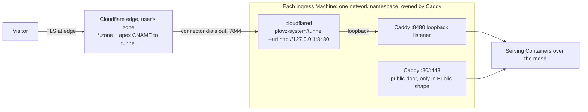

# Cluster ingress modes: synthesized shape (checkpoint, not implemented)

Base: the Claude candidate (`sketch-claude.md`), "the tunnel is a second door on the Ingress Proxy".
Grafts from the Codex candidate (`sketch-codex.md`) are marked [codex]. Measured evidence: `grounding.md`
(prototype 1) and the prototype 2 results below.

## Shape in one picture

## Decisions

1. **A declared Door set, written by the client.** Each ingress Machine has observable doors: Public (Caddy
   publishes 80/443) and Tunnel (a `ployz-system/tunnel` connector joined to that Caddy). The Cluster's Door set
   is what the operator last declared in the replicated `cluster` key `doors`, beside the Cluster Name's `name`.
   The client writes it with `SetClusterDoors` before it fans out `SetIngressDoors`, and every Engine reader
   goes through `cluster_doors(declared, services)`: the declared set when present, else the newest holder and
   newest connector, as before. Both doors at once is a legal transition state, so a switch opens the tunnel
   before closing ports, and only the final set is declared. Nothing converges toward the key. Commands read it.
   _Reversed 2026-11-11_ from "No stored mode", which rejected this key as persisted desired state plus a second
   writer of Caddy's shape. Nine readers each rebuilt the Door set from door Containers with their own rule, and
   most ingress bugs since (#4037, #4039, #4040, #4060, #4061, #4022) were those readers disagreeing. Closed is
   the first state whose only evidence is an absence, so a rule that held while every Door had positive evidence
   failed on it. The key adds no writer of Caddy's shape: the daemon still writes a door's spec only from a
   `SetIngressDoors` request (bet 10), and boot restore may only narrow, never open a door the key lacks.
2. **Caddy gets exactly two canonical specs**, `IngressPorts::{Public, Closed}`. Validation returns which one
   it saw instead of `()`. No new replicated field; the ports already on the row say which door is open.
3. **cloudflared is a reserved Global `ployz-system/tunnel`**, eligible on `accepts_ingress`, canonical spec
   only, never a Serving Container. It runs in Caddy's netns (`NetworkMode: container:<local caddy id>`,
   resolved by the daemon at create).
4. **Origin is `http://127.0.0.1:8480` on every Machine**, fixed in the connector's command, with a
   locally-configured tunnel. One Caddy rendering for both modes: a loopback-only listener that proxies every
   Ingress Hostname with or without Certificate Material, so no Origin CA and no ACME in tunnel mode.
5. **Client IP**: Caddy trusts `127.0.0.1/::1` for `CF-Connecting-IP`, not the bridge range (any user container
   could spoof it). Cloudflare ranges stay trusted for the public door.
6. **Lifecycle**: kernel coupling plus one daemon extension. A stopped Caddy takes the connector's network with
   it. A Caddy restart in place strands the connector, so the daemon starts a stranded connector the same way it
   starts a stranded Caddy today (existing containers only, never create). Planned stops go connector then Caddy.
   Rejected: a systemd supervisor with an HTTP probe [codex]. It covers a hung Caddy, but public mode has no
   such guard either, and it adds a process Ployz owns.
7. **Verb**: `ployz ingress use public|tunnel --token-stdin` (idempotent, per-Server `DoorStep` outcomes, re-run
   converges) and `ployz ingress` (read doors). Cloud calls the same verb through `PloyzSession`.
8. **Cloudflare side**: the Engine makes zero Cloudflare API calls. Cloudless users run
   `cloudflared tunnel create / route dns / token`. Cloud may offer a one-shot provisioning step with the user's
   API token, then forget it. Ployz never deletes the user's tunnel.
9. **Hostnames**: `*.zone` (one level, free Universal SSL) plus apex. Deeper names are refused with the Advanced
   Certificate Manager reason.
10. **Side effects on today's machinery** (Machine-local, from the newest local Caddy shape):
    ACME skipped with the reason "Cloudflare serves the certificate". Hostname Verdict gains "via tunnel" (the
    loopback listener answers verify paths with `Ployz-Door: tunnel`). "Last Server with a public IP" becomes
    "last Server with an open door". Cloud's port probe and A/AAAA sync cover public-door Machines only.

## Prototype 2 (measured, 2026-11-06, locally-configured named tunnel on zenploy.dev, two "Machines" = Caddy + cloudflared joined to Caddy's netns, all resources deleted)

| Test | Result |
|---|---|
| `--url http://127.0.0.1:8480` with `run --token` on a locally-configured tunnel | Served. Settles candidate risk 2. |
| Client IP through loopback trust | `client_ip` = visitor IP, `peer=127.0.0.1`, `xfp=https`. |
| Plain-http visitor | 308 from the edge (`Server: cloudflare`, zone has Always Use HTTPS). Caddy's own `xfp=http` redirect was not exercised. |
| `docker stop` Caddy (graceful) | Connector loses network (`sendmsg: network is unreachable`). 1 failed request, then 19/19 served by the other Machine. Kernel coupling holds. |
| Caddy started again | Connector stays stranded: still `running`, no network, 10/10 requests 502 with the other connector down. |
| `docker restart` the stranded connector | Serving again after 1 s. |
| Caddy crash with restart policy (`kill 1`, restarts in place) | Connector stranded, 502 until restarted. This is the case decision 6's daemon extension exists for. |
| Caddy hung (`docker pause`), connector alive | Requests time out. Neither kernel coupling nor today's public door guards this. |

## Bets touched

- **Stable promise**: new capability `ployz.ingress.tunnel.v1`. An older daemon fails validation of the portless
  Caddy row and treats that Server as not ingress-eligible, which narrows only. The declared Door set adds
  capability `ployz.cluster.doors.v1`, optional `EnrollmentSnapshot.doors` and optional
  `RegisterRequest.capabilities`. An older reader ignores both fields and infers the set as before. An older
  client never writes the key, and a Machine with an older client's joiner refuses it when the Cluster declares
  more than Public (`unsupported`, `details.capability`).
- **Bet 3**: no reconciler. The declared Door set is persisted desired state, the red flag, argued: the newest
  holder's spec already was the persisted intent, written by whichever client came last and read by nine
  differing rules. The key makes that intent explicit with one kind of writer (a client's `SetClusterDoors`),
  and no loop reads it. It has the shape of the removal mark, a replicated fact a command writes and readers
  honor, never a record the daemon drives toward. The stranded-connector start is the accepted "extend Docker's
  restart policy to own serving infra" exception, bounded to an existing container joined to the running local
  Caddy.
- **Bet 4**: switches are per-Server steps with a visible prefix; no rollback. A declared set stays after a
  partial fan-out, the result lists the failures, and a rerun converges.
- **Bet 6**: doors, netns target and the ACME skip are decided from the Machine's own containers. A Register
  is refused against the Machine's own copy of the key, never against Cloud's record.
- **Bet 7**: the verb lives in `ployz`; Cloud keeps no tunnel token and no Cloudflare credential, and reads the
  Door set from the enrollment snapshot instead of inferring it.
- **Bet 9**: Caddy stays the only Ingress Proxy; cloudflared is a hop before it, like a CDN.
- **Bet 10 (red flag, argued)**: "the Ingress Proxy is the only Service Container the daemon starts unasked"
  widens to "and the Tunnel Connector joined to it". Forced by "must continue without a client": measured, a
  Caddy crash-restart leaves a single-Server tunnel Cluster dark until something starts the connector.

## Ports

| Port | Public door | Tunnel door |
|---|---|---|
| TCP 80, TCP+UDP 443 inbound | open (Docker publish) | closed (no publication) |
| UDP 51820 inbound | between Servers | between Servers (no WireGuard relay) |
| UDP 7573 inbound | open | open; closable at the provider (iroh relay fallback) |
| 7844 outbound to Cloudflare | not needed | needed |
| User Service Host ports | unchanged | unchanged, listed by `ployz ingress` |

No `firewall.rs` change. Docs: split the ports table in `servers/add-a-server.md` and fix its claim that Ployz
guards the ports it opens; new `services/cloudflare-tunnel.md`; "via tunnel" in `services/domains.md`; a tunnel
section in `troubleshooting/app-not-reachable.md`.

## Decided at checkpoint (2026-11-06)

1. **Token at rest: sealed.** The token is sealed to the Cluster Sealing Key in a new platform sealing context
   (not `SealedIdentity`, which binds to an authored Environment and Service). The Machine opens it into a
   root-only tmpfs file mounted read-only as `--token-file`. Operator scope can't read it. A cloudless Cluster
   needs a Sealing Key before it can enable tunnel mode.
2. **Managed hostnames: generated under the user's zone.** In tunnel mode Cloud expands managed hostnames as
   `svc-env.<zone>`, one level deep, so the zone's free `*.zone` certificate covers them. This needs a new term,
   e.g. "Tunnel Zone", in `dashboard/CONTEXT.md`, rather than overloading Cluster Domain.
3. **Cloud setup: paste an API token. Cloud stores no Cloudflare credential** (revised after the np1 audit, see
   below). A setup token creates the tunnel and the `*.zone` + apex records. Cloud uses it once and forgets it.
   The `*.zone` wildcard covers every one-level name, including generated hostnames, so most hostname changes
   need no DNS change. A custom name outside the wildcard becomes a DNS effect in the Publish review. The
   approver supplies a zone-scoped token when approving, used once and never stored. Removing a hostname
   removes only the records Ployz created.
4. **Hung Caddy: same as the public door.** No tunnel-only guard. Hung-Caddy detection is a separate problem
   for both doors.

## Compatibility with the np1 hardening plan (thread "Audit np1's Customer Blast Radius")

That plan moves authority from Cloud (np1) to Machine-verified, Device-signed operations. This design does not
implement any of it. It picks shapes the plan can wrap later without a reshape.

1. **Daemon-pinned images for every reserved Service** (plan step 1). The audit found that the Ingress Proxy
   validator builds its expected spec from the submitted image, so Operator can deploy any image as Caddy.
   Neither new reserved spec takes an image from the caller. The daemon picks the Caddy and cloudflared image
   digests pinned in its release, and the tailscale image too (item 4). Today's `caddy_service_spec(image, …)`
   loses its image parameter in the same change.
2. **Each door change is one Machine route carrying one canonical intent** (plan steps 3 and 8). The route is
   `SetIngressDoors { doors, sealed_token }` under capability `ployz.ingress.doors.v1`. It replaces having the
   client fan out several `EnsureContainer` calls for reserved specs. The intent can be hashed, so protected mode
   can later require a Device signature on the route without reshaping it. Switching doors changes where all
   traffic flows and installs a credential, so it belongs in the signed-operation set.
3. **Secrets open only into the pinned executable** (plan step 4). The audit found that sealed values bind to
   Environment and Service scope, not to the executable that receives them. The tunnel token's platform sealing
   context names the purpose (`ingress-tunnel`) and the daemon opens it only into the pinned cloudflared image,
   never into an Operator-supplied spec and never through a Build Grant. Operator can't read it, and swapping the
   image doesn't release it.
4. **Tailscale becomes a reserved integration, not a user Service.** As a user Service, Operator could keep its
   sealed identity, swap the image and steal the auth key (audit finding), which gives tailnet access to users'
   laptops. So the shape becomes `ployz-system/tailscale`: daemon-pinned image, auth key under its own sealing
   purpose, enabled through one route `SetPrivateAccess { routes, sealed_auth_key }` that will need a signature
   later. The dashboard is still one click. The verify-server run tests the mechanics with the same image and
   settings, deployed as a user Global.
5. **No Cloud-held DNS or TLS authority** (plan step 7). The audit lists Cloud-held Hosted DNS tokens and wildcard
   keys as a traffic-hijacking path. Tunnel mode needs no certificate private key anywhere, because Cloudflare
   serves TLS, and decision 3 is revised so that Cloud stores no Cloudflare token. An attacker on np1 can still
   seal their own tunnel token to the Cluster's public key and request a connector. That reaches only hostnames
   in the attacker's own zone, which is no worse than hitting a public door, and the signature requirement on
   `SetIngressDoors` closes it later.

## Private access over Tailscale (direction agreed, not prototyped)

Separate from the ingress doors. It doesn't touch Caddy, and it carries every protocol.

- **Shape** (target: reserved integration, see Compatibility item 4). A Global running `tailscale/tailscale` in userspace mode (`TS_USERSPACE=true`) on the ployz
  bridge. It advertises the Cluster network with `TS_ROUTES` and takes its auth key as a Sealed value. Cloud gets
  a one-click integration: paste a reusable, tagged, ephemeral key, and Cloud fills in the route and deploys.
- **Why a container, not the host.** In userspace mode, tailscaled ends each tailnet connection and opens a new one
  from its own container. Traffic reaches containers the normal way (bridge, or the mesh), so the Docker network
  doesn't need to trust tailscale0 (`network/linux.rs:1692`). DNS queries to the gateway arrive from `-i ployz`,
  which the firewall already allows (`network/firewall.rs:113`). The queries come from a Service Container, so
  they get a Caller Namespace.
- **DNS suffix: `<selector>.<cluster>.ployz.internal`.** Tailnet split DNS sends `<cluster>.ployz.internal` to that
  Cluster's Internal DNS. To parse one, strip `<cluster>.ployz.internal`. If the label matches this Cluster's name,
  the rest goes through today's grammar, so `postgres.prod.acme.ployz.internal` reads as `postgres.prod`. Any other
  cluster label gets NXDOMAIN. Inside the Cluster, existing `.internal` names are unchanged. This needs two things:
  - **Reserve Namespace `ployz`** (decided: nobody uses it). `Namespace::is_reserved` covers `ployz` and
    `ployz-system`; `ployz-*` is worth considering. Without this, `x.ployz.internal` today means Service `x` in
    Namespace `ployz`.
  - **Cluster Name** (new term). A DNS label, required by clients when founding a Cluster: `ployz` asks for it,
    and Cloud defaults it to the Organization slug. It is stored as an optional Corrosion `cluster` key `name`, so
    no replicated field becomes required (stable promise). Existing Clusters set one with a verb. Until then,
    `.ployz.internal` answers NXDOMAIN and `ployz` reminds the user. It is not unique (bet 5). Cloud may enforce
    uniqueness within an Organization. Two Clusters with the same name on one tailnet collide in split DNS.
- **Open.** Can Cloud author `mode: global`? Can gateway addresses act as split-DNS nameservers? Does userspace
  subnet routing work for UDP, and does it fail over between two routers? Settle all three with `verify-server`
  using a tailnet auth key.

## Tailscale verify-server results (measured 2026-11-06, Boat, stable daemon, 2 Machines)

Setup: `tailscale/tailscale:stable` with `TS_USERSPACE=true` and `TS_ROUTES=10.210.0.0/16`, running as a user
Service with `replicas=2`, one per Machine. The Config Store has no Global, so open check 1 is confirmed: a
reserved integration or a new authoring field is needed. Postgres runs on machine-1 and a Python UDP echo on
machine-2. The client is a separate kernel-mode tailscale container on the dev host with `--accept-routes`.
Routes were approved by hand in the admin console.

| Check | Result |
|---|---|
| Postgres on machine-1, router on machine-2 | `select` succeeds; `inet_client_addr()` = 10.210.1.3, the router's Container Address, so traffic crossed the mesh and apps see the router as the client |
| UDP echo on machine-2 | Replies on every packet, through both routers |
| Internal DNS through the subnet route (`@10.210.0.1`, `@10.210.1.1`) | `db.verify-production.internal` resolves, and the short form `db.internal` also resolves through the router's Caller Namespace |
| Failover: `docker stop` the primary router | First successful query about 16 s later, through the other router. Probes ran every ~1 s with a 3 s timeout |
| Failback after the stopped router restarts | Primary stays on the survivor (Tailscale doesn't fail back) |
| Linux tailnet clients | Need `--accept-routes`. Split DNS was not configured, so it wasn't tested end to end |

Lab note: a `socat UDP-RECVFROM,fork` echo answered only the first packet. That was the test server, not the
path, and it was replaced by a Python echo. The auth key reached the run's `commands.jsonl` (passed as a plain
value, since a standalone run has no Device to seal with). It was redacted; revoke the key anyway.

## /interrogate results (2026-11-06; each finding rerun by the coordinator)

| # | Finding | Verified by rerun | Consequence for the design |
|---|---|---|---|
| 1 | **The connector inherits Caddy's reach.** Sharing Caddy's netns, a connector stand-in reached `127.0.0.1:8480` and also another Namespace's private Postgres. cloudflared can route private IPs (`tunnel route ip add`, warp-routing), and a Machine can't tell from the token whether a tunnel is configured locally or remotely. Whoever can edit the tunnel in the user's Cloudflare account, or an np1 attacker using their own sealed token, gets private Cluster access. | yes (`netns_reach.sh`) | Compatibility item 5's "no worse than a public door" is wrong. Candidate fix that keeps kernel coupling: in Caddy's netns, the daemon installs an owner-match egress rule so cloudflared's uid (65532) reaches only `127.0.0.1:8480` and the internet, never cluster or private ranges. The alternative is Codex's two-member bridge, which loses kernel coupling. Either way `SetIngressDoors` must join the signed-operation set. |
| 2 | **The token file can be read through Operator bind mounts.** A normal Service with a host bind mount of the root-only token directory was admitted under Operator scope and printed the token. | yes (`secret_probe.py`) | "Operator can't read it" holds only once np1 plan steps 3 and 4 authorize host mounts. Until then, say so in the doc and in docs/user. The token never touching a host file (an in-memory pipe at create) narrows this but doesn't close it. |
| 3 | **A stranded connector needs `restart`, and nothing restarts it while the daemon is down.** After Caddy restarts, the connector stays `running` in the dead netns. `docker start` doesn't fix it; `docker restart` does. | yes (`docker_probe.py`, matches prototype 2 G) | Decision 6 must say "restart a running connector whose netns owner changed", not "start a stranded one". To cover daemon downtime, either accept the outage window explicitly (bet 10 argument) or have Docker restart the connector itself, e.g. a connector healthcheck on `127.0.0.1:8480` plus an autoheal-style unit. |
| 4 | **The Org slug can be too long for a Cluster Name.** A 64-character Organization name gives a 64-char slug, or 73 chars after a collision suffix, over the 63-char DNS label limit. | yes (`slug_label.mjs`) | Cloud's default Cluster Name must be truncated or validated to 63 characters. |
| 5 | **Same class as 1, for Tailscale.** An np1 attacker could seal their own auth key and enable the reserved Tailscale integration, joining the Cluster to their own tailnet. | inferred from 1 and 2; not run | `SetPrivateAccess` must join the signed-operation set before the integration ships in Cloud. |

Loopback trust held: an ordinary bridge container could neither reach `:8480` nor spoof `CF-Connecting-IP`.
Dropped: one probe showed an older daemon falls back to `accepts_services` eligibility for a portless Caddy rather
than becoming ineligible. That contradicts the Stable-promise note, but no runtime failure was shown. It stays as
a note to fix in the design text.

### Re-rating after review with the user (2026-11-06)

Findings 1, 2 and 5 add no new exposure, so they are not blockers:
- **Cloud holds no Cloudflare credential.** The only party who can edit the tunnel is the user, through their own
  Cloudflare account, and they already own the Servers.
- **Operator can already run any container on the Cluster network** (np1 audit: `EnsureContainer` with any image and
  any bind mount). A rogue connector, a rogue Tailscale node or reading a token file gives an attacker nothing new.
  These close together with the np1 plan, not separately here.
- The cloudflared egress rule (uid 65532 reaches only `127.0.0.1:8480` and the internet) is optional hardening, not
  required for v1.

Real issues that stay: finding 3 (restart, not start, a connector whose netns owner changed) and finding 4 (cap the
default Cluster Name at 63 characters).

### Finding 3 fix: a holder container owns the network (Kubernetes "pause" pattern), measured 2026-11-06

A tiny `pause` container owns the network namespace. Caddy and cloudflared both join it (`container:<holder>`).
Caddy can crash, restart or be replaced, and the namespace survives, so the connector never strands. No daemon
loop and no restart logic are needed.

Local test (pause:3.10 holder, caddy:2 with restart=always, alpine stand-in connector polling 127.0.0.1:8480):
the connector got answers before, after a Caddy crash and auto-restart, after `docker restart caddy`, and after
Caddy was removed and recreated. The connector restarted 0 times.

Consequences:
- The holder carries the bridge endpoint and any published ports (80/443 in Public). It is part of the Ingress
  Proxy, created with it and kept across Caddy replacements. The pause image is pinned by digest, and the holder
  essentially never exits.
- This gives up "the connector dies when Caddy dies". That is fine: a crashed Caddy restarts in place within
  seconds and the connector keeps working, planned stops go connector first, and a hung or permanently dead Caddy
  is accepted as the same risk the public door has today (decision 4).
- Decision 6's daemon extension (restarting stranded connectors) is dropped. Bet 10 no longer needs widening for it.

### Cluster Domain in Cloudflare mode (decided 2026-11-06, replaces "Tunnel Zone")

Cloudflare mode doesn't get a separate term. The Cluster Domain becomes "the base hostname generated names expand
under", and it has one of two sources:
- **Hosted** (today): Ployz reserves `<name>.ployz.app` through Hosted DNS.
- **Cloudflare**: the user picks one of their zones during Cloudflare setup, e.g. `acme.com`, and generated names
  become `svc-env.acme.com`.

The Cloudflare source is a zone name, and generated names sit one level below it. A subdomain source such as
`apps.acme.com` would make generated names two levels deep, and the free Universal SSL certificate doesn't cover those
(prototype 1, finding 8). The setup token's one-time use creates only a `*.zone` wildcard CNAME to the tunnel. Ployz
never touches the apex, so `acme.com` itself keeps pointing wherever it points today. Explicit records in the zone win
over the wildcard, so existing names such as `www` or `mail` keep working. Setup suggests a dedicated zone, such as
`acme-apps.com`, because a wildcard in a shared zone sends every typo'd name to the tunnel. Switching
source changes every generated hostname, so it goes through the Publish review as a Destructive Effect.
`dashboard/CONTEXT.md` "Cluster Domain" is reworded to cover both sources.

### Plan-time corrections (2026-11-07)

Engine exploration for the plan (`docs/agents/design/cluster-ingress/plan.md`) found these. They supersede earlier text.

1. The door state lives on the holder. The holder is the reserved Service `ployz-system/ingress-holder`, not a new
   `ContainerKind`, because that enum rejects unknown variants. Its ports say whether the Public door is open.
2. Decisions 3, 4 and 6 still say `container:<caddy>` and "restart a stranded connector". The holder replaces both.
   Every joined container uses `container:<holder>`, and stranded start covers the holder, then Caddy.
3. An older client does not narrow. It widens: a non-canonical `ployz-system/ingress` falls back to `accepts_services`
   placement. A new daemon translates the old canonical Caddy spec into `SetIngressDoors { Public }` and refuses any
   other spec for a reserved door identity.
4. Reserved Globals are placed only through their routes. Catch-up and `follow_roles` call `SetIngressDoors` or
   `SetPrivateAccess`, never `EnsureContainer` with a copied spec. A copy would carry a peer's image pin during a
   rolling upgrade. So `SetIngressDoors` lands in E1 with the Public door. E2 adds the Tunnel door behind its own
   capability, `ployz.ingress.tunnel.v1`.
5. ACME is daemon-side (`certificates.rs`), not a Caddy flag. A Closed Machine leaves the rank list and the challenge
   IPs.
6. Caddy's `trusted_proxies` block is global today. Loopback trust is scoped to a `servers :8480` block.
7. The DNS parser is a pure function of the name. E3 threads the Cluster Name in and adds an NXDOMAIN outcome.
