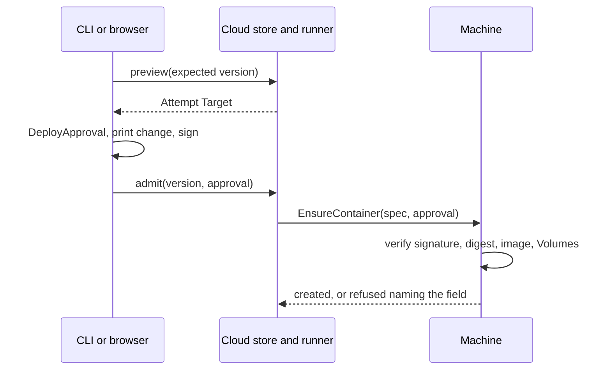

# Security 0.4 thread C plan, deploy and lifecycle effective payload

A compromised Cloud must not run code of its choosing on a Server, read its secrets or take data off it. Today a Machine under enforcement meets that for deploys by refusing every Operator deploy outright (`core/crates/ployzd/src/machine/local_machine/restart_approval.rs:89`). Thread C replaces that refusal with one check. A Machine creates a Container only when its spec matches a digest a trusted key approved.

The design is one statement, `DeployApproval`. A person's client signs it over the frozen Attempt Target of a Deploy. It names the Cluster, the Namespace, the Machines, an operation, a window, and one digest per Service. Each digest covers that Service's requested spec, minus its replica count and rollout order. The digest therefore covers the image by content address, the command, the environment with its Sealed values and their identity, the ports, every mount with its Config bytes, the privileges and the pre-deploy hook. A Machine recomputes the digest from the spec it is asked to create. Two Machine-local checks close what the digest cannot see. The image must be content-addressed, and a named Volume that already exists must match the approved declaration.

Four PRs. C1 is the smallest end-to-end slice, a CLI deploy of an image Service with enforcement on and no prompt. C2 lets the CLI pin public image tags. C3 hands thread B the statement for the dashboard's Deploy button and for agent proposals. C4 keeps a session's Sealed reads inside its own Environment. [c-inventory.md](c-inventory.md) lists every field and its mark. [c-decisions.md](c-decisions.md) holds the cache decision and the three design decisions this plan rests on.

## How to read this

One box is one unit of work. Every box names the evidence that checks it. A nested box is a sub-step of the box above it. Check a box only when its evidence exists, a file, a log line, a screenshot, a test run, or a SHA. The body is a how-to. The appendices explain and record.

The program runs `<plugin root>/skills/poteto-mode/playbooks/autopilot-stack.md`. Owners open PRs, and the operator lands the stack bottom-up. C1 and C2 change what the CLI prints during a deploy and stop at merge-ready for the operator's review. C3 and C4 merge on a clean verdict.

Tests alone are not sufficient verification. A PR is verified only when its unit, live, and perf boxes are all checked.

Terms follow `core/CONTEXT.md` (Deploy, Deploy Intent, Attempt Target, Requested Service Spec, Resolved Service Spec, Config Mount, Hook Container, Namespace, Device) and `dashboard/CONTEXT.md` (Approval, Approval card). "Payload digest" and "deploy approval" are new and defined in Appendix A. The CLI shows no prompt. No log, test or screenshot prints a secret value. Nothing written for this program names a Cloud host, an address or a path on Cloud's servers.

## Program checklist

### Arm the program

- [ ] State the protocol and this plan to the operator, then stop. Start execution only on the operator's explicit go.
- [ ] Read these at program start. Re-read them at every tick.
  - [ ] `cat <plugin root>/skills/poteto-mode/playbooks/autopilot-stack.md`
  - [ ] `cat <plugin root>/skills/swarm/SKILL.md`
  - [ ] `cat .agents/skills/verify-server/SKILL.md`
  - [ ] `cat .agents/skills/verify-dashboard/SKILL.md`
  - [ ] `cat <plugin root>/skills/poteto-mode/playbooks/opening-a-pr.md`
  - [ ] `cat <plugin root>/skills/principle-prove-it-works/SKILL.md`
  - [ ] `cat <plugin root>/skills/principle-sequence-verifiable-units/SKILL.md`
  - [ ] `cat docs/agents/landing.md`
  - [ ] `cat docs/agents/plans/security-0.4/c-inventory.md docs/agents/plans/security-0.4/c-decisions.md`
- [ ] On the operator's go, arm the audit tick as an hourly schedule_task bound to this thread with the tick prompt below. Never leave the cadence to memory.
- [ ] Use this tick prompt, verbatim. "Re-read the execution playbook from disk. Audit the operation against it and fix drift in this tick. Probe every active lane and judge progress by side effects only. Stand down a stuck lane and dispatch its replacement now. Then post a short status message to the operator in chat only when the audit found a tracked change that no earlier status message reported, such as a PR opened, a code-ready head, a round launched or closed, a verdict, a merge, a stuck agent and the action taken, a blocker added or cleared, or a decision only the operator can make. Name every such change and nothing else. Do not repeat a table, the merged list, or an unchanged blocker. If the audit found none, end the turn with no reply text. Either way, log this tick's row in your decision trail. The row names the items reported, or none."
- [ ] On the operator's hold or stand-down, send every owner a zero-writes order at once.

### Spawn owners

- [ ] Spawn one owner per PR with the full lifecycle the execution playbook names.
- [ ] Follow this dependency graph. Start dependent work only after its parent merges, or base it on the parent branch when the execution playbook stacks.
  - [ ] C1 is first. It branches from `main` once gaps 1 to 3 in Appendix B have the thread A owner's agreement.
  - [ ] C2 after C1.
  - [ ] C3 after C1. PR #3983 (agent proposals) is on `main`.
  - [ ] C4 after C3 and after gap 4 in Appendix B is agreed with threads A and B.
  - [ ] A gap in Appendix B that C cannot close inside `ployz_core::authority` with the A owner's review is a blocker for the PR named there. The root posts it to the operator and does not let the owner work around it with a Cloud-side check.
- [ ] Hold the file boundaries. C1 touches `core/crates/ployz-core/src/authority/deploy.rs`, `core/crates/ployz-core/src/authority/mod.rs`, `core/crates/ployz-core/src/rpc.rs` (one field), `core/crates/ployz-core/src/rpc_catalog.rs` (one capability row), `core/crates/ployzd/src/machine/local_machine/restart_approval.rs`, `core/crates/ployzd/src/machine/local_machine/deploy_approval.rs`, `core/crates/ployzd/src/docker/lifecycle.rs`, `core/crates/ployz/src/cluster.rs`, `core/crates/ployz/src/handlers/deploy.rs`, `core/crates/ployz/src/sdk/store_runner.rs`, `core/crates/ployz-store/src/deployment/**`, one new migration under `core/crates/ployz-store/src/storage/migrations/`, and `docs/user/deploy/**`. C2 touches `core/crates/ployz/src/handlers/deploy.rs`, `core/crates/ployz/src/image/**` and `core/crates/ployz/src/sdk/store_runner.rs`. C3 touches `core/crates/ployz-core/src/authority/{deploy,proposal,restart}.rs`, `core/crates/ployz-sdk/**` and `core/scripts/build-cloud-sdk.sh`. C4 touches `core/crates/ployz-core/src/authority/{deploy,session}.rs`, `core/crates/ployzd/src/machine/local_machine/deploy_approval.rs`, `dashboard/src/modules/approval-session/**` and `docs/user/services/variables.md`.
- [ ] Hold the review gate. C1 and C2 change what `ployz deploy` prints. They wait for the operator's review in chat with screenshots and terminal videos before merge.

### PR mechanics, for every PR

- [ ] Resolve the forge once. Default to `gh`; if `command -v origin` succeeds and Origin can resolve the repository, use `origin pr` for every PR operation. Record any fallback to `gh`. Never require `gt`.
- [ ] Open the PR ready, never draft, per **Opening a PR**. Use the run's built-in PR tool when it has one, else `origin pr create --status open --base <base-branch>` or `gh pr create --base <base-branch>` according to the resolved forge. A stack child targets its parent branch.
- [ ] Name the `core/DESIGN.md` bets the PR touches in its body and the choice each changed. Every C PR touches the stable promise (one optional request field and one capability row), bet 6 Machine-local authority (the Machine checks its own image store and Volumes), bet 7 Cloud drives and never owns (the runner carries the approval and cannot make one), bet 3 bounded imperative commands (the approval is evidence, not desired state) and bet 10 client first (the client computes the digest, and the daemon only verifies, which is a Machine-local safety boundary).
- [ ] Name in the PR body, once, the residuals the bar sets aside. Cloud can replay an approved Deploy inside its window, drop or reorder its steps, or show the person a false change. Do not open review rounds on them.
- [ ] Run the repo's lint and typecheck once before the PR-facing push (`cargo fmt --check` and the touched crates' `cargo clippy` in `core/`, `pnpm typecheck && pnpm lint` in `dashboard/` when C4 touches it). Push with hooks on.
- [ ] Run `/deslop` before each commit and `/no-comments` before review.
- [ ] Triage every Bugbot and security-reviewer comment per `../references/bugbot-triage.md`. Judge each finding by the Cloud security bar in `AGENTS.md`.
- [ ] Rebase onto current trunk before the code-ready report and babysit. Keep that merge base in fix rounds. Rebase again only at merge prep, on a `git merge-tree` conflict with trunk, on a CI failure that comes from a change on trunk, or when a known concurrent change to the same files lands.

### Verdict and merge, for every PR

- [ ] A full swarm runs once, at the code-ready head. Another full swarm runs only for new behavior, a redesign, or a large new diff. A rebase, a merge-conflict resolution, or a minor fix gets a single verifier at the new head, and a wording-only change gets none. Run each full swarm per `<plugin root>/skills/swarm/SKILL.md`. One gates lane. The ten live lanes from the PR's **Verify, live** block. The perf lane from its **Verify, perf** block. Two or more audit lanes, each with its own focus, that read the diff and the receipts and distrust the PR body. One audit lane always takes the attacker's view, holds every Cloud credential, and tries the attack paths the PR names.
- [ ] Judge every finding by the execution playbook's blocking rule and by the Cloud security bar. A finding that needs Cloud only to mislabel, reorder, delay or drop an approved action does not block. The verdict is clean when none blocks. A failure on trunk behavior in a lane marked `Regression lane against trunk.` is recorded against trunk and does not block the PR. A new head gets a fresh verdict, except for results that stay valid under the patch-id rule in `playbooks/shipping.md`.
- [ ] The root appends a verified PR to the stack and the operator lands the stack bottom-up, with the patch-id rule from `playbooks/shipping.md`.

### Boot recipe, for every live lane

Each live lane runs in its own worktree at the PR head. Drive through `verify-server`, and `verify-dashboard` for C4.

- [ ] `git fetch origin <head-branch> && git checkout <head SHA>`.
- [ ] From `core/`, run `scripts/verify-cluster up --daemon checkout --cloud --machines 2`. Turn enforcement on with `scripts/verify-cluster cli --device "$run" -- device enforce`.
- [ ] Deliver input only through `verify-cluster cli` (the Organization Token, which reaches Machines through Cloud as Operator), `verify-cluster cli --device` (the person's Device), and the attacker harness. The harness is a Node script the C1 owner writes under `.audit/c-attacker/` (not committed). It connects to a Machine through `@ployz/sdk` with the Boat Cloud's own connection, the way Cloud's worker does, and sends hand-built requests. Lanes copy it into their worktree.
- [ ] Read-only diagnostics are `verify-cluster exec <machine> -- journalctl -u ployzd`, `exec <machine> -- docker inspect`, `exec <machine> -- docker volume inspect`, and `docker exec <session> psql -U postgres -d ployz_cloud` for the Boat Cloud's database.
- [ ] Save every screenshot or terminal capture to `/tmp/swarm-<pr-id>/worker-<n>/<slug>.png` and return the paths with the report.

## Deploy an image Service from the CLI under enforcement (C1)

Outcome. With enforcement on, `ployz deploy` from a person's Device deploys an image Service whose image is pinned by digest. No prompt appears. The CLI prints the change it approved. Cloud's worker runs the Deploy, and each Machine logs the Device that approved it. Attack path. With every Cloud credential, Cloud cannot create a Container whose image, command, environment, Sealed values, mounts, Config bytes, ports, privileges or hook differ from the approved spec. Cloud cannot plant an image under the approved tag, or a host-bind Volume under an approved Volume name. Sealed values open only inside an approved spec.

**Depends on.** PRs #3926, #3939 and #3958 on `main`. Appendix B gaps 1, 2 and 3 agreed with the thread A owner.

**Files.**

- [ ] Create `core/crates/ployz-core/src/authority/deploy.rs` with `DeployApproval`, `ApprovedService`, `PayloadDigest`, `DeployFacts` and `deploy::verify`.
- [ ] Edit `core/crates/ployz-core/src/authority/mod.rs` to export them.
- [ ] Edit `core/crates/ployz-core/src/rpc.rs` so `EnsureContainerRequest` gains `deploy: Option<Signed<DeployApproval>>`, optional and skipped when absent.
- [ ] Edit `core/crates/ployz-core/src/rpc_catalog.rs` to add the capability `DEPLOY_APPROVAL_CAPABILITY: ("ployz.container.deploy-approval.v1", Always)`.
- [ ] Create `core/crates/ployzd/src/machine/local_machine/deploy_approval.rs` with `admit_operator_creation` and `admit_deploy_step`.
- [ ] Edit `core/crates/ployzd/src/machine/local_machine/restart_approval.rs` so `admit_operator_restart` calls `admit_operator_creation` for a new creation, and `admit_deploy_step` for a lifecycle step that carries a deploy approval.
- [ ] Edit `core/crates/ployzd/src/docker/lifecycle.rs` so `prepare_and_create` checks each named Volume the spec mounts under enforcement.
- [ ] Edit `core/crates/ployz-store/src/deployment/admit.rs` and add a migration under `core/crates/ployz-store/src/storage/migrations/` so a Deployment keeps an optional signed deploy approval.
- [ ] Edit `core/crates/ployz/src/handlers/deploy.rs` so `ployz deploy` builds the approval from the preview, prints its change, signs it with the Device key and passes it at admission.
- [ ] Edit `core/crates/ployz/src/sdk/store_runner.rs` and `core/crates/ployz/src/cluster.rs` so the runner sets the Deployment's approval on its client, and `ensure_unsettled` (`cluster.rs:1615`) sends it beside `restart_approval`.
- [ ] Edit `docs/user/deploy/deployments.md` and `docs/user/deploy/docker-image.md` to say that a Server that enforces needs a pinned image and runs only what a Device or passkey approved, and that an unattended `ployz deploy` approves whatever Cloud's Saved State says.

**Build.**

- [ ] `DeployApproval` in `deploy.rs` is a `Statement` under `Purpose::Workflow` with `cluster: SealingPublicKey`, `operation: OperationId` (the Deployment), `namespace: Namespace`, `machines` (sorted and distinct), `services: Vec<ApprovedService { name: ServiceName, digest: PayloadDigest }>` (sorted by name, distinct), `issued_at`, `expires_at` and `signer: SignerKey`. Its lifetime is at most `validity::MAX_LIFETIME_MILLIS`. It implements the grant scope with family `ActionFamily::Deploy`, so thread B's grants cover it unchanged.
- [ ] `PayloadDigest::of(&RequestedServiceSpec)` is the SHA-256 of the canonical JSON (`authority::canonical`) of the spec with `mode` and `update` removed. It is the one function the CLI, the native SDK and the Machine share.
- [ ] `deploy::verify` checks the signature through `verify_signers`, then the Cluster, this Machine in `machines`, the Namespace equal to `slot.namespace`, the window, and `PayloadDigest::of(&resolved.to_requested())` equal to the entry for `slot.service`. A hook slot also needs `pre_deploy` present. It then checks that `container.image` is content-addressed (`<name>@sha256:<64 hex>` or `sha256:<64 hex>`). Each failure is `AuthorityRefusal::Mismatch { field }` naming the field.
- [ ] `admit_operator_creation` runs only under enforcement. It refuses a new creation with no deploy approval (`Unsigned { purpose: Workflow }`), runs `deploy::verify`, and records a hook slot in the consumption log once per operation and Service, so the same approval never creates that Service's hook twice. Service Container creations are not consumed, because retries and replicas repeat them.
- [ ] `admit_deploy_step` admits Hold, Out, Stop, Start and Remove on a Container whose Namespace equals the approval's, on a Machine the approval names, inside its window, with no consumption. A restart approval keeps working as before.
- [ ] `prepare_and_create` under enforcement inspects each Ordinary and Provisioned Volume the spec mounts. If the Volume exists, it must pass `VolumeSource::matches_managed_volume`. An External mount refuses a Volume that carries Ployz's managed label. A refusal names the Volume and leaves Docker unchanged.
- [ ] `ployz deploy` on a Cloud store calls the existing preview for the expected version, builds `DeployApproval` from its Attempt Target, prints one line per Service with the image digest and every host-sensitive field that changed (privileged, capabilities, devices, Bind Mounts, host ports, PID mode, sysctls, the hook command), signs it with the Device key, and admits with `--expect-version` and the approval. It refuses a tag image with `Pin <service>'s image by digest to deploy to Servers that enforce.` and a typed `Hint::Next` naming the `ployz service set` command. With `--json`, the approved change goes into the result under `approved`.
- [ ] The runner reads the Deployment's approval and attaches it to every `EnsureContainer` it sends for that Deployment. A Deployment admitted without one runs as today, and a Machine that enforces refuses its creations, which the Deployment reports per Machine.
- [ ] `admit_operator_creation` logs `deploy <operation> approved by <approver> for <service> digest=<first 12 hex>` with codes only.

**You see.**

- [ ] `ployz deploy` prints `Approved web: nginx@sha256:<12 hex>…` and then the usual Deployment progress, with no prompt.
- [ ] `journalctl -u ployzd` on each Machine prints `deploy <id> approved by device <code> for web digest=<12 hex>`.
- [ ] `ployz deploy` of a tag image on an enforcing Cluster stops before admission with the pin message and `next: ployz service set web.image=…`.

**Verify, unit.** Tests alone are not sufficient verification. A PR is verified only when its unit, live, and perf boxes are all checked.

- [ ] `deploy.rs` tests take one approved spec and change one field per case, each refused with `Mismatch` naming that field. The cases are image digest, command, entrypoint, one plain variable, one Sealed ciphertext, the Sealed identity's Environment, a Bind Mount source, an Ordinary Volume driver option, a Config file's bytes, a Config Mount's mode, a Host port, an Ingress hostname, `privileged`, one `cap_add`, a device mapping, `pid_mode`, one sysctl, `network`, the hook command and the hook's `privileged`. Run `cargo nextest run -p ployz-core authority::deploy`.
- [ ] `deploy.rs` tests show the derived fields change nothing. A new `service_id`, `mode`, `update`, `gen`, `creation_key`, `deployment_id`, `registry_auth` and `image_prepared` all verify.
- [ ] `deploy.rs` tests refuse a tag image, an approval for another Cluster, another Namespace, a Machine outside `machines`, an expired window, a hook slot for a spec with no hook, and a 16 minute lifetime.
- [ ] `deploy.rs` tests refuse a passkey grant whose families lack `deploy`, with `Mismatch { field: "an action" }`.
- [ ] `PayloadDigest` has a golden test, a fixture spec and its digest hex, copied into the SDK test in C3.
- [ ] `ployzd` tests in `deploy_approval.rs` show a hook creation admitted once and refused on the second request with the same approval, and a Service Container creation admitted twice.
- [ ] `ployzd` tests in `lifecycle.rs` refuse a spec whose Ordinary Volume exists with other driver options, a Provisioned Volume that exists with the `local` driver, and an External mount of a Ployz-managed Volume. Run `cargo nextest run -p ployzd deploy_approval lifecycle`.
- [ ] `ployz` tests in `handlers/deploy.rs` show `--json` carries `approved` and that a tag image fails with `invalid_argument` before admission. Run `cargo nextest run -p ployz deploy`.

**Verify, live.** Tests alone are not sufficient verification. A PR is verified only when its unit, live, and perf boxes are all checked. Ten lanes on `claudeAgent/claude-opus-5-5 effort=medium` at the PR head, per the boot recipe.

- [ ] Lane 1. Regression lane against trunk. With enforcement off, add `web --image nginx:1.29-alpine` and deploy from `cli` at trunk and head. Save `c1-enforce-off.png`. Pass when both deploy and `ps` shows `web` running on both heads.
- [ ] Lane 2. Enforcement on. Add `web` with `nginx@sha256:<digest>` and deploy from `cli --device`. Save `c1-device-deploy.png`. Pass when no prompt shows, `web` runs, and each Machine that runs it logs `approved by device`.
- [ ] Lane 3. Enforcement on. Deploy the same `web` from `cli` with the Organization Token. Save `c1-token-refused.png`. Pass when the Deployment fails on every Machine with a refusal naming `ployz.container.deploy-approval.v1` and `docker ps` shows no new Container.
- [ ] Lane 4. Attacker harness. Capture the approved `EnsureContainer` from lane 2 and resend it with `image` swapped to an attacker image by digest, then with `privileged: true`, then with a Bind Mount of `/`, then with the hook command changed. Save `c1-swaps.png`. Pass when each is refused with the field named and Docker shows no new Container.
- [ ] Lane 5. Attacker harness. Push an attacker image to one Machine under the tag `nginx:1.29-alpine` through `EnsureImageIngest`, then replay lane 2's approved request. Save `c1-planted-tag.png`. Pass when the Container runs the approved digest (`docker inspect` image ID) and not the planted one.
- [ ] Lane 6. Attacker harness. Call `PrepareVolumes` for an Ordinary Volume with driver `local` and options `type=none,o=bind,device=/` under the physical name an approved spec mounts, then replay the approved creation. Save `c1-planted-volume.png`. Pass when creation is refused naming the Volume and no Container mounts it.
- [ ] Lane 7. Add a Sealed variable to `web`, deploy from `cli --device`, then use the harness to send `web`'s Sealed values in a spec with another image. Save `c1-sealed.png`. Pass when the approved Container sees the value (`cli --device -- exec -T web -- printenv KEY | wc -c` only, never the value) and the swapped spec is refused before any open.
- [ ] Lane 8. Add a pre-deploy hook that appends one line to a file on a Volume. Deploy, then replay the hook creation with the same approval. Save `c1-hook-once.png`. Pass when the file holds one line and the replay is refused by the consumption log.
- [ ] Lane 9. Deploy a new digest of `web` from `cli --device` and kill `ployzd` on one Machine mid-rollout with `exec <machine> -- systemctl kill -s KILL ployzd`. Save `c1-kill.png`. Pass when the Deployment reports that Machine's part as failed, the other Machine finished, and a fresh `ployz deploy` finishes both.
- [ ] Lane 10. Deploy from `cli --device` with a Service whose image is a tag. Save `c1-tag-refused.png`. Pass when the CLI stops before admission with the pin message and `next:` hint, and Cloud's database holds no new Deployment.

**Verify, perf.** Tests alone are not sufficient verification. A PR is verified only when its unit, live, and perf boxes are all checked.

- [ ] Metric. Wall time of `ployz deploy` for one pinned image Service on two Machines, from command start to the Deployment's success, at trunk with enforcement off and at head with enforcement on. Also the time `admit_operator_creation` spends per creation, from its log span.
- [ ] Probe. `time scripts/verify-cluster cli --device "$run" -- deploy web` after a one-line variable change, five runs each side, interleaved.
- [ ] Baseline. Record the trunk median first.
- [ ] Rule. The head median stays within 1.1 times trunk. Admission stays under 50 ms per creation at the median.

**Review gate.** The operator reviews before merge.

- [ ] Copy lane 2, 4 and 10 screenshots into `docs/agents/plans/security-0.4/media/c1-review-<slug>.png`.
- [ ] Record a 30 to 60 second terminal video of lanes 2 and 10 on a lane VM. Save it as `docs/agents/plans/security-0.4/media/c1-review.mp4`.
- [ ] Post the screenshots and the video in chat. Stop at merge-ready. Wait for the operator's click.

**Merge.**

- [ ] Root's clean verdict at the exact head SHA.
- [ ] Bugbot triage done.
- [ ] Rebased onto current trunk after the verdict, patch-id unchanged.
- [ ] The root appends C1 to the base-branch stack and the operator lands it bottom-up.

## Pin public image tags in the CLI (C2)

Outcome. A person who writes `nginx:1.29-alpine` can deploy to an enforcing Cluster. The CLI asks the image's registry for the manifest digest, approves `nginx:1.29-alpine@sha256:<digest>`, and the runner sends that pinned reference. A private image the CLI cannot read anonymously still needs a digest the person writes. Attack path. Cloud cannot repoint a tag after approval, since the Machine checks the pinned digest. Cloud never answers the digest lookup, since the CLI asks the registry over TLS itself.

**Depends on.** C1.

**Files.**

- [ ] Edit `core/crates/ployz-core/src/authority/deploy.rs` so `ApprovedService` gains `image: Option<String>`, the pinned reference, and `deploy::verify` requires `container.image` to equal it when present.
- [ ] Create `core/crates/ployz/src/image/pin.rs` with `pin_public(reference) -> Result<PinnedImage, PinError>`, an anonymous registry manifest read.
- [ ] Edit `core/crates/ployz/src/handlers/deploy.rs` to pin each tag image before it builds the approval.
- [ ] Edit `core/crates/ployz/src/sdk/store_runner.rs` so the runner writes the approved image into each spec before planning.
- [ ] Edit `docs/user/deploy/docker-image.md` to say which images the CLI pins and which need a digest.

**Build.**

- [ ] `pin_public` reads the manifest for the reference's platform-independent index digest with an anonymous token, with a 10 second timeout. It refuses a registry that asks for credentials with `PinError::NeedsCredentials`.
- [ ] `PayloadDigest` is taken over the spec with `container.image` set to the pinned reference, so the runner's rewrite is what the Machine checks.
- [ ] A pinned line prints as `Approved web: nginx:1.29-alpine → @sha256:<12 hex>…`.

**You see.**

- [ ] `ployz deploy` with `nginx:1.29-alpine` on an enforcing Cluster runs with no prompt, and `docker inspect` on the Machine shows the pinned digest.

**Verify, unit.** Tests alone are not sufficient verification. A PR is verified only when its unit, live, and perf boxes are all checked.

- [ ] `pin.rs` tests against a local registry fixture. A tag pins to its index digest, an authenticated repository refuses with `NeedsCredentials`, and a timeout refuses. Run `cargo nextest run -p ployz image::pin`.
- [ ] `deploy.rs` tests refuse a spec whose image is the tag without the pin, and a spec pinned to another digest.

**Verify, live.** Tests alone are not sufficient verification. A PR is verified only when its unit, live, and perf boxes are all checked. Ten lanes on `claudeAgent/claude-opus-5-5 effort=medium` at the PR head, per the boot recipe.

- [ ] Lane 1. Regression lane against trunk. With enforcement off, deploy `web --image nginx:1.29-alpine` at trunk and head. Save `c2-enforce-off.png`. Pass when both run the tag.
- [ ] Lane 2. Enforcement on. Deploy `web --image nginx:1.29-alpine` from `cli --device`. Save `c2-pinned.png`. Pass when it runs and the image ID matches the registry's digest for that tag.
- [ ] Lane 3. Attacker harness. Replay the approved request with the image set back to the bare tag. Save `c2-unpinned.png`. Pass when the Machine refuses naming the image.
- [ ] Lane 4. Attacker harness. Replay with the tag pinned to another digest of the same repository. Save `c2-other-digest.png`. Pass when refused.
- [ ] Lane 5. A private image with no digest. Save `c2-private.png`. Pass when the CLI stops with the pin message before admission.
- [ ] Lane 6. A private image written by digest. Save `c2-private-digest.png`. Pass when it deploys.
- [ ] Lane 7. Block outbound registry access on the host running the CLI and deploy a tag. Save `c2-offline.png`. Pass when the CLI fails within 15 seconds naming the registry.
- [ ] Lane 8. Two Services, one tag and one digest, in one deploy. Save `c2-mixed.png`. Pass when both run with the right digests.
- [ ] Lane 9. Deploy, then retag upstream (push a new image to a scratch repository under the same tag), then redeploy. Save `c2-retag.png`. Pass when the second deploy prints the new digest and runs it.
- [ ] Lane 10. `ployz deploy --json`. Save `c2-json.png`. Pass when `approved` lists the tag and its pinned digest per Service.

**Verify, perf.** Tests alone are not sufficient verification. A PR is verified only when its unit, live, and perf boxes are all checked.

- [ ] Metric. Wall time of `ployz deploy` of one tag image, at C1's head with the image written by digest and at C2's head with the tag.
- [ ] Probe. Five runs each side, interleaved.
- [ ] Baseline. Record the C1 median first.
- [ ] Rule. The C2 median stays within 2 seconds of C1.

**Review gate.** The operator reviews before merge.

- [ ] Copy lane 2 and 5 screenshots into `docs/agents/plans/security-0.4/media/c2-review-<slug>.png`.
- [ ] Record a 30 to 60 second terminal video of lanes 2 and 5 on a lane VM. Save it as `docs/agents/plans/security-0.4/media/c2-review.mp4`.
- [ ] Post the screenshots and the video in chat. Stop at merge-ready. Wait for the operator's click.

**Merge.**

- [ ] Root's clean verdict at the exact head SHA.
- [ ] Bugbot triage done.
- [ ] Rebased onto current trunk after the verdict, patch-id unchanged.
- [ ] The root appends C2 to the base-branch stack and the operator lands it bottom-up.

## Hand thread B the deploy statement for the browser and proposals (C3)

Outcome. Thread B's B5 can sign a deploy from the dashboard, and an agent can stage a Deploy as a proposal step. Cloud builds the approval body with the same Rust code the CLI uses, the browser key signs that body under its grant, and the store admits it like the CLI's. Attack path. Cloud cannot make a body a Machine accepts without a browser key under a live grant. A proposal step of kind Deploy runs only if its body hashes to the digest in the bundle the person approved.

**Depends on.** C1, and PR #3983 on `main`. Appendix B gap 1 (the Deploy kind on proposal steps).

**Files.**

- [ ] Edit `core/crates/ployz-core/src/authority/restart.rs` or a new shared kind, per gap 1, so a proposal step can be of kind `deploy`.
- [ ] Edit `core/crates/ployz-core/src/authority/proposal.rs` so `verify_step` takes any step statement that names its proposal, not only `RestartApproval`.
- [ ] Edit `core/crates/ployz-core/src/authority/deploy.rs` so `DeployApproval` gains `proposal: Option<ProposalRef>`, absent from a single approval.
- [ ] Edit `core/crates/ployz-sdk/src/lib.rs` to add `deployApprovalBody(preview, signer)`, which returns the canonical body string and the per-Service change lines for display.
- [ ] Edit `core/scripts/build-cloud-sdk.sh` so `@ployz/sdk/authority` exports `DeployApproval`, `ApprovedService` and `PayloadDigest`.

**Build.**

- [ ] `deployApprovalBody` runs `PayloadDigest::of` in Rust. The browser never hashes a spec. It signs the returned body string and renders the returned change lines. Since Cloud serves the page, a second hash in the browser would add nothing against the bar.
- [ ] A Deploy proposal step freezes its body when staged. The bundle's step digest is `StepDigest::of(body)`. The runner sends the step body with its bundle, and `verify_step` checks it as it checks a restart step.
- [ ] Settings changes produce no statement of their own (`c-decisions.md`). B5's `approveSettings` becomes a Deploy.

**You see.**

- [ ] A Node call to `deployApprovalBody` on the C1 fixture returns the golden digest.

**Verify, unit.** Tests alone are not sufficient verification. A PR is verified only when its unit, live, and perf boxes are all checked.

- [ ] `proposal.rs` tests admit a Deploy step whose body matches its digest, and refuse one whose body differs in one service digest, one whose index is outside the bundle, and one whose kind differs. Run `cargo nextest run -p ployz-core authority::`.
- [ ] `deploy.rs` tests verify a browser-signed approval under a grant with `deploy`, and refuse it under a grant for another Namespace.
- [ ] An SDK test calls `deployApprovalBody` on the C1 fixture and compares the golden digest.

**Verify, live.** Tests alone are not sufficient verification. A PR is verified only when its unit, live, and perf boxes are all checked. Ten lanes on `claudeAgent/claude-opus-5-5 effort=medium` at the PR head, per the boot recipe. B5's lanes cover the button. These cover the Machine side.

- [ ] Lane 1. Regression lane against trunk. Restart `web` from the dashboard with a passkey session at trunk and head. Save `c3-restart.png`. Pass when both restart with one prompt.
- [ ] Lane 2. With the harness, build a body through `deployApprovalBody`, sign it with a browser key under a grant from the virtual authenticator, and admit. Save `c3-browser-deploy.png`. Pass when the Machines log `approved by passkey`.
- [ ] Lane 3. Same, under a grant whose families lack `deploy`. Save `c3-no-family.png`. Pass when refused naming the action.
- [ ] Lane 4. Same, under a grant for another Environment. Save `c3-other-env.png`. Pass when refused naming the Environment.
- [ ] Lane 5. Stage a proposal with one Deploy step and one restart step, approve with one prompt. Save `c3-proposal.png`. Pass when both steps run and each Machine logs its step index.
- [ ] Lane 6. After approval, edit the staged Deploy body in `operation_proposals` with `psql`. Save `c3-edited-step.png`. Pass when the Machine refuses the step and runs nothing new.
- [ ] Lane 7. Replay an approved Deploy step after its window. Save `c3-expired.png`. Pass when refused as expired.
- [ ] Lane 8. A browser-signed approval with a 16 minute lifetime. Save `c3-lifetime.png`. Pass when refused.
- [ ] Lane 9. CLI deploy from `cli --device` on the same Boat. Save `c3-cli.png`. Pass when it still runs with no prompt.
- [ ] Lane 10. `pnpm sdk` in `dashboard/` and `import { DeployApproval } from "@ployz/sdk/authority"` in a scratch file typechecks. Save `c3-types.png`. Pass when `pnpm typecheck` passes on the scratch file.

**Verify, perf.** Tests alone are not sufficient verification. A PR is verified only when its unit, live, and perf boxes are all checked.

- [ ] Metric. Time for `deployApprovalBody` on an Environment of 20 Services.
- [ ] Probe. Ten calls from Node with `performance.now()`.
- [ ] Baseline. No trunk equivalent exists. Record that.
- [ ] Rule. Median under 20 ms.

**Review gate.** None. C3 is not review-gated.

**Merge.**

- [ ] Root's clean verdict at the exact head SHA.
- [ ] Bugbot triage done.
- [ ] Rebased onto current trunk after the verdict, patch-id unchanged.
- [ ] The root appends C3 to the base-branch stack and the operator lands it bottom-up.

## Keep a session's Sealed reads inside its Environment (C4)

Outcome. A deploy approved under a browser session opens only Sealed values sealed for that session's Environment. Device approvals keep full reach. Attack path. A malicious dashboard with a live `fix-api` session cannot deploy a Container that opens `production` secrets. Scope is the limit B's accepted residual relies on, and today a Machine cannot check it for Sealed values.

**Depends on.** C3 and Appendix B gap 4.

**Files.**

- [ ] Edit `core/crates/ployz-core/src/authority/session.rs` so `GrantBody` gains `environment_id: Uuid`, the Cloud Environment that `SealedIdentity.environment` names.
- [ ] Edit `core/crates/ployzd/src/machine/local_machine/deploy_approval.rs` so a creation approved under a grant requires `sealed_identity.environment == grant.environment_id` when the spec holds any Sealed value.
- [ ] Edit `dashboard/src/modules/approval-session/approval-session.ts` to put the Environment's id in the grant body.
- [ ] Edit `docs/user/services/variables.md` to say that a browser approval opens only its own Environment's Sealed values.

**Build.**

- [ ] The check runs only for browser signers. A Device signer is Full and unchanged.
- [ ] Thread D's preview inheritance changes this rule at checkpoint C3 of the program. C4 leaves a named function, `sealed_scope_allows`, for D to widen.

**You see.**

- [ ] A cross-Environment attempt logs `refused deploy <id>: Sealed values belong to another Environment` with no value.

**Verify, unit.** Tests alone are not sufficient verification. A PR is verified only when its unit, live, and perf boxes are all checked.

- [ ] `deploy_approval.rs` tests refuse a grant-approved spec holding Sealed values for another Environment, admit the same spec under a Device approval, and admit a grant-approved spec with no Sealed values.
- [ ] `session_tests.rs` gains a grant whose `environment_id` was changed after the assertion, refused on the challenge.
- [ ] `approval-session.test.ts` asserts the grant body carries the Environment id. Run `pnpm vitest run src/modules/approval-session`.

**Verify, live.** Tests alone are not sufficient verification. A PR is verified only when its unit, live, and perf boxes are all checked. Ten lanes on `claudeAgent/claude-opus-5-5 effort=medium` at the PR head, per the boot recipe, with `SERVERS=1` dashboard lanes per `verify-dashboard`.

- [ ] Lane 1. Regression lane against trunk. Deploy `web` with a Sealed variable from the dashboard inside a session at trunk and head. Save `c4-regression.png`. Pass when both run.
- [ ] Lane 2. In a `fix-api` session, use the harness to sign a deploy whose spec carries `production` ciphertext. Save `c4-cross-env.png`. Pass when refused and no Container is created.
- [ ] Lane 3. The same spec approved by `cli --device`. Save `c4-device.png`. Pass when it runs.
- [ ] Lane 4. Edit the grant's `environment_id` in page memory through `eval`, then deploy. Save `c4-tampered-grant.png`. Pass when the Machine refuses on the challenge.
- [ ] Lane 5. A spec with no Sealed values in a `fix-api` session. Save `c4-plain.png`. Pass when it runs.
- [ ] Lane 6. A Machine from before C4 with a grant that carries `environment_id`. Save `c4-older-daemon.png`. Pass when the older daemon refuses the grant and names the capability, so it fails closed.
- [ ] Lane 7. Sealed values in a pre-deploy hook only, cross-Environment. Save `c4-hook.png`. Pass when refused.
- [ ] Lane 8. Two Services in one approval, one cross-Environment. Save `c4-mixed.png`. Pass when the cross-Environment one is refused and the other runs.
- [ ] Lane 9. `journalctl` on the refusing Machine. Save `c4-log.png`. Pass when the line names the Service and prints no value.
- [ ] Lane 10. Read the changed `docs/user` page against lanes 2 and 3. Save `c4-docs.png`. Pass when every sentence matches what the lanes saw.

**Verify, perf.** Tests alone are not sufficient verification. A PR is verified only when its unit, live, and perf boxes are all checked.

- [ ] Metric. Admission time per creation at C3's head and C4's head.
- [ ] Probe. Log span timing over ten deploys each side, interleaved.
- [ ] Baseline. Record the C3 median first.
- [ ] Rule. C4 within 5 ms of C3.

**Review gate.** None. C4 is not review-gated.

**Merge.**

- [ ] Root's clean verdict at the exact head SHA.
- [ ] Bugbot triage done.
- [ ] Rebased onto current trunk after the verdict, patch-id unchanged.
- [ ] The root appends C4 to the base-branch stack and the operator lands it bottom-up.

## Close the program

- [ ] Every box above is checked with its evidence.
- [ ] Reply to the operator with the report the execution playbook names.

## Appendix A. Data shapes

**Payload digest.** `PayloadDigest` is the SHA-256 of `authority::canonical` JSON of one Service's `RequestedServiceSpec` with `mode` and `update` removed, written as 64 lowercase hex digits. It covers `name`, `container` (every field, including `image`, `environment` with Sealed ciphertexts, and `sealed_identity`), `placement`, `ports`, `mount_graph` (Volume declarations, mounts, Config definitions with their bytes, Config Mounts) and `pre_deploy`. The Machine computes it from the Resolved Service Spec it is asked to create through `ResolvedServiceSpec::to_requested`. Why the requested form, and not the resolved one, is in `c-decisions.md`.

**Deploy approval.** `DeployApproval` in `core/crates/ployz-core/src/authority/deploy.rs` is a `Statement` under `Purpose::Workflow`, carried in `Signed<DeployApproval>` with the same signature and grant rules as `RestartApproval`.

```text
DeployApproval
  cluster      SealingPublicKey
  operation    OperationId            the Deployment
  namespace    Namespace
  machines     [MachineId]            sorted, distinct
  services     [ApprovedService]      sorted by name, distinct
    name       ServiceName
    digest     PayloadDigest
    image      Option<String>         C2, the pinned reference
  issued_at    Timestamp
  expires_at   Timestamp              at most 15 minutes after issued_at
  signer       SignerKey              Device, or browser key under a grant
  proposal     Option<ProposalRef>    C3, a step of an approved proposal
```

**What a Machine checks.**

```text
EnsureContainer(New{slot, resolved_spec}, deploy) from an Operator, under enforcement
  verify_signers(deploy)                    Device, or browser key under a covering grant
  cluster == own Sealing public key
  own MachineId in machines
  namespace == slot.namespace
  issued_at <= now <= expires_at
  entry = services[slot.service]
  PayloadDigest::of(resolved_spec.to_requested()) == entry.digest
  slot.kind == hook  =>  pre_deploy present, consume (operation, service, hook) once
  image is content-addressed (and == entry.image when present)
  each named Volume mounted: absent, or matches its approved declaration
  browser signer and Sealed values  =>  sealed_identity.environment == grant.environment_id   (C4)
  then create, opening Sealed values as today

EnsureContainer(Stopped | Gone | Out | Held | Running Existing, deploy)
  same signature, Cluster, Machine and window checks
  Container's Namespace == namespace
```



**What B5 needs from C.** It needs the `DeployApproval` type with its grant scope under `ActionFamily::Deploy`, which is C1. It needs the TypeScript export and `deployApprovalBody` in the native SDK, so the browser signs a body string it did not hash, which is C3. It needs store admission that takes a browser-signed approval exactly like a Device-signed one, which C1 builds without regard to signer. It needs the proposal step kind `deploy` with a generic `verify_step`, which is C3. It does not need a settings statement. B5's `approveSettings` is a Deploy, and the `settings` family has nothing to approve on a Machine.

## Appendix B. C1 contract gaps

What C needs from thread A's contract that PRs #3926, #3939 and #3958 do not provide. "C inside authority" means a C owner adds code under `core/crates/ployz-core/src/authority/` with the A owner's review. "Waits" means A must change a shape first.

1. **No deploy workflow kind.** `WorkflowKind` is `Restart`, `Stop` and `Start` (`restart.rs:23`), and PR #3983's `ProposalStep.kind` reuses it (`proposal.rs:80`), with `verify_step` typed to `RestartApproval` (`proposal.rs:140`). C1 needs no kind, since `DeployApproval` is its own statement. C3 needs proposal steps of kind `deploy` and a `verify_step` that is not typed to `RestartApproval`. This waits for A and B to agree whether to add `Deploy` to `WorkflowKind` or to give proposal steps their own kind enum. The recommendation is a separate `StepKind`, so `WorkflowKind::permits` keeps meaning restart steps only.
2. **Out and Remove are approvable by no statement.** `WorkflowKind::permits` allows Hold, Stop and Start (`restart.rs:32`). A Deploy's rollout needs Out and Remove on old copies. C1 admits them under a deploy approval for its Namespace, with no consumption. This is C inside authority, but A must agree that a deploy approval may authorize lifecycle steps on Containers it did not create.
3. **The consumption log has no hook entry.** `ConsumptionLog` records restart steps per operation and Container, joins and starting sets (`restart_approval.rs:189`). The plan says C consumes the store and does not extend it. C1 needs one record kind, "this operation created this Service's hook here". This waits for A to add a generic once-per-operation entry, or to let C add it.
4. **A grant names a Namespace, and a Sealed identity names an Environment UUID.** `GrantBody.environment` is a `Namespace` (`session.rs:51`). `SealedIdentity.environment` is a `Uuid` (`ployz-core/src/sealed.rs:76`). A Machine cannot relate them, so it cannot keep a session's Sealed reads inside its scope. C4 adds `environment_id` to `GrantBody`. This waits for B's agreement, since it changes B's grant wire shape, and an older daemon refuses the new field. Grants are verification-selecting, so failing closed meets the stable promise's rule.
5. **One window for admission and completion.** `MAX_LIFETIME_MILLIS` is 15 minutes (`ployz-core/src/authority/validity.rs:6`). A Deploy whose rollout runs past its approval's window gets refusals for its remaining steps. Bet 4 reports that as a partial result, and the person deploys again. C1 accepts that limit. A longer completion allowance, as `decisions.md` describes for Volume Runs, is A's call and not needed for C1.

## Appendix C. Handoffs to other threads

- **Thread D.** `Build` and `MintBuildGrant` are not gated under enforcement (`c-inventory.md`). `Build` runs Cloud-chosen `RUN` steps with the Build's Sealed values opened. That is a bar crossing today, and it is D's to close. The cache decision depends on it. Built images reach a deploy approval only as a content-addressed digest that D's build proof vouches for. C adds nothing for builds.
- **Thread F.** `SetIngressDoors` is refused under enforcement by `admit_operator_deploy` (`ployzd/src/machine_api/local.rs:1069`). It runs only daemon-pinned images and crosses no part of the bar, so the refusal can become a standing allowance or a lifecycle approval in F's coverage table. Global catch-up (`core/crates/ployz/src/global_catch_up.rs:371`) creates Containers with no person present. Under enforcement it needs an approval inside its window, or it waits for the next Deploy. That belongs in F's automatic-effects inventory. `UpdateContainerLimits`, `RemoveVolume` and `PruneImages` cross no part of the bar. F decides their class.
- **Thread X.** `PublishCertificateMaterial` lets Cloud set the key the Ingress Proxy serves for a hostname. That is DNS and ACME authority, not payload.

## Appendix D. Residual risks

- Approved code can leak its own secrets, and an approved image that is itself malicious runs.
- Cloud can replay an approved Deploy inside its 15 minute window, run its steps in another order, run only some of them, or show the person a false change before they approve. The bar sets these aside. A replay recreates approved Containers and never reruns a hook.
- An unattended `ployz deploy` with a Device key approves whatever Cloud's Saved State says. Thread D's automatic deploy rule is the safe path for automation.
- A private image named by a tag needs a digest the person writes, since Cloud can hold write access to that registry.
- A malicious dashboard with a live session can deploy any payload inside that session's Environment. After C4 it cannot open another Environment's Sealed values.
- Placement is in the digest, but the Machine does not check its own labels against it. A copy that lands on another approved Machine runs approved code with approved mounts.

## Appendix E. Alternatives rejected

- **A denylist of host-sensitive fields** (privileged, host binds, driver options). Every denylist so far has had a bypass, and the driver-option path in the kickoff is one. A digest covers every field, including fields not yet written.
- **Digesting the Resolved Service Spec.** The approver would have to plan the Deploy. Placement fields change on retry and would force a new approval.
- **The Machine lowering Saved State itself.** The Machine would need the whole Environment, every variable and every Config, plus the lowering code, to check a digest the client can compute from the Attempt Target.
- **A separate settings statement.** Settings reach a Machine only through a Deploy.
- **Gating `PrepareVolumes` on the approval.** That needs the request to carry each Service's full spec. Checking the Volume when a Container mounts it is smaller, and it also catches Volumes made before enforcement was on.
- **Hashing the spec in the browser.** Cloud serves the page, so a browser hash adds nothing against the bar, and it would be a second implementation of `PayloadDigest` to keep in step.

## Appendix F. Prototype evidence

None run. This plan comes from reading `main` at `297c636aec`. These stay unproven until C1's owner shows them.

- `ResolvedServiceSpec::to_requested` round-trips every bound field for a spec that went through placement, so the Machine's recomputed digest equals the client's. C1's golden test and lane 2 prove it.
- Docker's containerd image store resolves `name@sha256:<digest>` by content when the same tag holds another image. C1 lane 5 proves it.
- `docker volume inspect` reports the driver and options `matches_managed_volume` reads, for a Volume created by `PrepareVolumes` with bind options. C1 lane 6 proves it.
- An anonymous manifest read gives the same index digest Docker pulls for a multi-platform tag. C2 lane 2 proves it.
