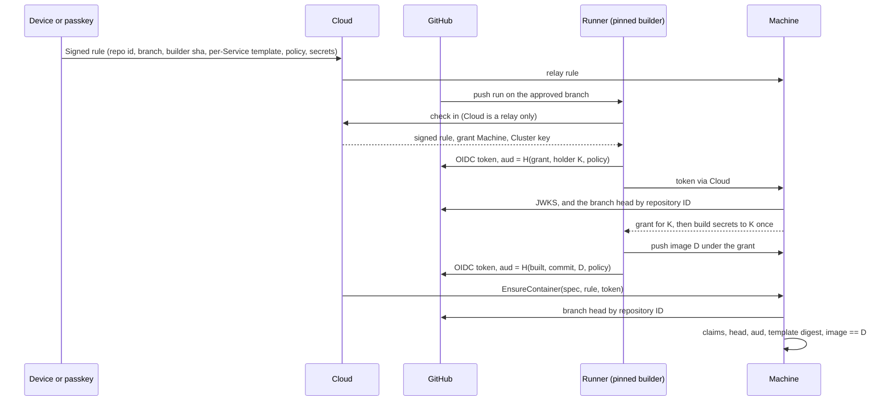

# Thread D design: build proof and preview inheritance

This file is checkpoint C2 (build proof) and checkpoint C3 (preview inheritance) of the 0.4 security program. [d-inventory.md](d-inventory.md) lists every input Cloud chooses today. [d-plan.md](d-plan.md) slices the work into PRs. Source is `main` at `7c5cc4571e`.

The bar is in `AGENTS.md`. Whoever takes over Ployz Cloud must not be able to read secrets, run code of their choosing on a Server, take data off a Server, or add a Server or Device. Mislabelling, reordering, delaying or dropping approved work is an accepted residual.

## The answer in one paragraph

A person approves an **automatic deploy rule** once, from a Device or with a passkey prompt of its own. The rule names the repository by ID, the branch, the Environment, the builder workflow pinned by commit, and per Service the digest of its spec with the image left out, the digest of its build policy and the digest of its sealed build secrets. GitHub runs the pinned builder on a push. The builder checks out the commit GitHub ran for, never one Cloud names. It asks GitHub for two OIDC tokens whose audience is a hash of what it is doing: first "give holder key K this Service's build secrets", then "this commit built image D under this policy". Cloud relays both tokens and cannot change them. Each Machine checks the token against GitHub's keys, checks every claim against the signed rule, and reads the branch head from `api.github.com` itself. It acts only when the token's commit is that head now. A creation runs only when its spec, image aside, matches the rule's digest, and its image is the digest the token names. A settings change, a policy change, another image, an old commit or a replayed token each fails one named check. Previews use the same proof under a preview rule that names trusted GitHub accounts and the Sealed values a preview may inherit. An inherited value carries its parent's Environment in its own associated data, so the Machine opens it in place and nothing is rewrapped.



## What a Machine trusts

- GitHub's OIDC issuer `https://token.actions.githubusercontent.com` and its JWKS, which the Machine fetches over TLS. Cloud's verdict on a token is never used.
- `api.github.com` over TLS, for the branch head. The Machine asks by repository ID, so the answer is about the approved repository whatever credential it uses.
- GitHub-hosted runner isolation between jobs.
- The builder workflow at the commit the rule pins. It is the code that asks GitHub for the tokens, so it attests what it built.
- The repository's own code on the approved branch. Anyone who can push there deploys. That is the rule's intent.
- Keys the Machine already trusts (Devices and passkeys, from thread A), for the rule's signature.

It does not trust Cloud's rows, Cloud's OIDC check, Cloud's Build Receipts, Uploaded Source, image tags, a webhook, or any commit, ref, version or input Cloud passes the runner.

## Precondition outside thread D

**Cloud must hold no GitHub credential that can write to a customer repository.** With Contents or Workflows write, Cloud can push its own commit to the approved branch, and that commit is a legitimate head. No Machine-side proof can tell it from a person's push. Thread Y found the public App requests Contents, Workflows and Administration write (`y-github-report.md` §1.1, on the unmerged audit branch). The program's decision record (also on that branch) already settled the fix: keep the App's permissions and take its key off Cloud. The App key moves to a minter outside Cloud, Cloud gets only read-narrowed installation tokens, and Cloud stops storing GitHub OAuth tokens in `account`. That service is not thread D's. D's proof is sound against a compromised Cloud only once it is live. Until then, automatic deploy under enforcement is safe against every path below except a pushed commit. The first operator decision in `d-plan.md` covers this.

A customer can also close the push path today on their own repository with a branch ruleset that blocks direct pushes, without a bypass for the Ployz App.

## The automatic deploy rule

A new statement in `ployz_core::authority`, `AutoDeployRule`, signed by a Device, or by a passkey's own assertion. A browser key under a session grant cannot sign it. A rule is standing authority over every future push, so it needs its own prompt.

```text
AutoDeployRule                       purpose: Rule (new)
  cluster        SealingPublicKey
  rule           RuleId               Cloud allocates, opaque
  generation     u64                  each re-approval adds one
  namespace      Namespace            the Environment
  machines       [MachineId]          sorted, distinct
  source
    repository_id  u64                 immutable
    owner_id       u64                 immutable
    repository     String              owner/name, for the workflow_ref check and for display
    branch         String
    workflow       String              the caller file, ".github/workflows/ployz-build.yml"
    events         [push | workflow_dispatch]
    builder        { ref, sha }        the reusable workflow, pinned by full commit
    runner         github-hosted
  services       [RuleService]        sorted by name, distinct
    name         ServiceName
    template     PayloadDigest         the requested spec with `container.image` emptied
    policy       PolicyDigest          the build policy below
    secrets      Option<SealedDigest>  the build's SealedRecord, ciphertexts only
  issued_at      Timestamp
  ended          bool                 true for the generation that switches the rule off
  signer         SignerKey
```

**Template digest.** `PayloadDigest::of` from thread C, taken over the Service's `RequestedServiceSpec` with `container.image` set to the empty string. It binds every field thread C binds, including plain values, Sealed ciphertexts and their identity, ports, mounts, Config bytes, privileges and the hook. Only the image is left open, and the token fills it. This digest is "the approved settings revision" the decision record asks for. It is a rule field the verifier reads, as `c-decisions.md` says.

**Build policy.** Every input the builder passes to `ployz build` other than the source tree. That is the Build Method and its path, the context, the target, plain build args, the names of build secrets, platforms and the cache setting. `PolicyDigest` is SHA-256 over its canonical JSON (`authority::canonical`). Repository files may change application code, including the Dockerfile. They cannot change the policy, because the builder reports the policy it used in the token and the Machine compares it.

**Generations.** A Machine keeps the highest generation it has seen per rule in its approval record. It refuses a lower one, and an `ended` one stops the rule. A re-approval after a settings change is the same rule at the next generation, so tokens minted for the old generation stop working.

## The builder and its tokens

The customer's `.github/workflows/ployz-build.yml` becomes:

```yaml
on:
  push: { branches: [main] }      # the rule's branch
  workflow_dispatch: {}
permissions: { contents: read, id-token: write }
jobs:
  build:
    uses: getployz/build/.github/workflows/build.yml@<40-hex sha>
    with: { cloud: https://<Cloud origin> }
```

Today's file takes `build`, `cloud` and `runner` from Cloud's dispatch (`.github/workflows/ployz-build.yml:4`). The new one takes nothing from a dispatcher. The runner label lives in the reusable workflow. The `cloud` input is a constant in the customer's file. A reusable workflow, unlike today's composite action `getployz/build@v1`, appears in the token as `job_workflow_ref` and `job_workflow_sha`, so the rule can pin it, and the caller cannot add steps to its job.

The builder:

1. Checks out `github.sha`. It ignores any commit from Cloud.
2. Checks in with Cloud to learn which Machine takes the push, the Cluster key, and the signed rule. Every one of these is relayed, and a lie fails a check below.
3. Makes a holder key K for the grant. It reads the Service's policy from the rule and computes its digest.
4. Asks GitHub for a token with `aud = "ployz-build:" + hex(SHA-256(canonical(Claim)))`, where:

   ```text
   Claim
     cluster     SealingPublicKey
     rule        RuleId
     generation  u64
     service     ServiceName
     policy      PolicyDigest
     stage       Grant { holder: K } | Built { commit, image: ImageDigest }
   ```

5. Sends the grant token to the Machine through Cloud and receives a grant for K.
6. Reads the build secrets from the grant (`GET /ployz/sealed`, as today), builds with exactly the policy, and pushes the image.
7. Asks for a second token with `stage = Built { commit: github.sha, image: D }`, and reports it to Cloud with the Build Steps.

The Machine recomputes the audience from facts it holds. Nothing in the audience needs to be secret or trusted. The runner's `ACTIONS_ID_TOKEN_REQUEST_TOKEN` stays in the builder's steps and is never passed into BuildKit.

## What a Machine checks

**The token, at grant and at creation.**

| Check | Against | Authority |
| --- | --- | --- |
| RS256 signature, `kid` in the issuer's JWKS | The JWKS the Machine fetched from the fixed issuer | GitHub |
| `iss` | `https://token.actions.githubusercontent.com` | Machine constant |
| `exp`, `nbf`, `iat` | The Machine's clock, with thread A's skew rule | Machine |
| `repository_id`, `repository_owner_id` | The rule | Signed rule |
| `ref_type == branch`, `ref == refs/heads/<branch>` | The rule | Signed rule |
| `event_name` in `events` | The rule | Signed rule |
| `workflow_ref == <repository>/<workflow>@refs/heads/<branch>` | The rule | Signed rule |
| `job_workflow_ref`, `job_workflow_sha` | The rule's builder | Signed rule |
| `runner_environment == github-hosted` | The rule | Signed rule |
| `sha == head` | `GET https://api.github.com/repositories/<repository_id>/git/ref/heads/<branch>`, read now by this Machine | GitHub |
| `aud` | `Claim` recomputed from the Machine's Cluster key, the rule, and the holder or the image in hand | Machine |

`sub` is not checked, because a repository admin can change its template.

**At grant** (`MintBuildGrant` with a rule and a token). The rule verifies, this Machine is in `machines`, the generation is current, the token passes, the stage is `Grant { holder }` for the holder the request names, and the `jti` is unused. The Machine consumes the `jti` in thread A's consumption log until `exp`. The Sealed record Cloud relays must hash to the rule's `secrets` digest. Then it mints the grant for that holder only, remembering the rule, generation and Service.

**At creation** (`EnsureContainer` with a rule and a token in place of a deploy approval). The rule verifies and the token passes with `stage = Built { commit, image }`, where `commit == sha == head`. The spec's image is content-addressed (thread C's `content_addressed`) and its digest is `image`. `PayloadDigest::of(spec with image emptied)` equals the rule's `template` for the slot's Service. The Machine then writes an accepted-build record, (rule, generation, Service, commit, image). A later creation of the same image under the same generation may use that record in place of an unexpired token. It still needs `head == commit` at that moment. A hook is consumed once per (rule, generation, commit, Service), so one push runs its hook once.

**Lifecycle steps** on old copies (Hold, Out, Stop, Start, Remove) follow thread C's `admit_deploy_step`. They are admitted for Containers in the rule's Namespace on Machines it names, while the proof passes, and nothing is consumed.

Every check is on facts this Machine reads itself. No Machine acts on another Machine's record, so bet 6 holds without argument. If Cloud vanishes, every Machine still decides the same way.

## Authority for every input

| Input | Who supplies it | Authority the Machine checks |
| --- | --- | --- |
| Repository, branch, Environment, builder, events | Cloud relays the rule | The rule's signature, by a trusted Device or passkey |
| Settings (the spec, image aside) | Cloud sends the spec | `template` in the rule |
| Build policy | Cloud relays the rule to the runner | The builder reports the policy digest inside a GitHub-signed `aud`, compared with the rule's |
| Build secrets | Cloud relays the Sealed record | The rule's `secrets` digest. They are opened only for the holder named in a GitHub-signed `aud`. |
| Commit | GitHub's `sha` claim. The builder checks out `github.sha`. | The head the Machine reads from GitHub now |
| Builder code | The customer's workflow file names it | `job_workflow_sha` in the token, against the rule |
| Image | Cloud names it in the spec | `image` in a GitHub-signed `aud`, written by the pinned builder |
| Which Machine builds, which Machines run it, when | Cloud | None needed. A wrong choice is an outage. |
| The `ployz` binary on the runner | Pinned inside the builder at its commit | `job_workflow_sha` |
| Head-read credential | Cloud relays a read-only installation token narrowed to the repository | None needed. The answer is authenticated by TLS to `api.github.com` and scoped by repository ID. A bad token reads nothing and the Machine refuses. |

## Rejected examples

| Attempt by a compromised Cloud | Refused by |
| --- | --- |
| **Substituted source.** It dispatches the workflow and tells the runner to build commit X, or dispatches it on branch `attacker`. | The builder ignores Cloud's commit and builds `github.sha`. A run on another ref fails `ref` and `workflow_ref`. A run on the approved branch builds its head, which is approved work. |
| **Substituted settings.** It sends `EnsureContainer` with the built image and `privileged: true`, a new Sealed variable, or a host bind. | The spec with its image emptied no longer hashes to `template`. `Mismatch { field: "a payload" }`. |
| **Substituted settings, at build time.** It gives the runner other build args or a registry cache. | The builder puts the digest of the policy it used in `aud`. The Machine computes `aud` from the rule's policy, so the grant is refused before any secret opens, and the image token never matches. |
| **Substituted artifact.** It pushes image D' through `EnsureImageIngest` and names `repo@D'` in the spec. | No GitHub-signed `aud` names D'. `Mismatch { field: "an image" }`. |
| **Stale proof.** It re-runs last week's run, which gets a fresh token with the old `sha` and a higher `run_attempt`. | `sha` is not the head this Machine reads now. `Mismatch { field: "a commit" }`. A force push to that same old commit makes it the head again and is accepted, as the decision record wants. |
| **Replayed proof.** It sends the same grant token twice. | The `jti` is consumed on the first grant. |
| **Replayed proof across a settings change.** It replays an image token from generation 3 after the person approved generation 4. | `aud` names generation 3, and the Machine refuses any generation below 4. |
| **Its own holder.** It asks for a grant for its own key with the runner's token. | `aud` names the runner's holder, not Cloud's. Without a valid rule token, `MintBuildGrant` is refused under enforcement (slice D1). |
| **A moved builder tag.** It moves `getployz/build@v1` or pushes a new builder commit. | `job_workflow_sha` does not match the rule. |
| **Another Cluster's token.** It replays a token from Cluster A on Cluster B. | `aud` binds Cluster A's key. |

## Caches

This is thread C's decision (`c-decisions.md`) applied to D.

- **BuildKit on a GitHub-hosted runner** starts empty in each job. Nothing to trust.
- **Registry caches** (`cache_from` and `cache_to` of type `registry` or `inline`). Not allowed in a rule's policy, because Cloud can write them through Registry Credentials.
- **The GitHub Actions cache** (`type=gha`). Allowed only with `scope` set to the policy digest. A run on another branch cannot write the approved branch's scope (GitHub's cache isolation, documented, not yet proven here). A run on the approved branch is either a person's push or a Cloud dispatch of the same builder on the same head. A run whose policy differs writes another scope. This stays unproven until slice D3's live lane. If that lane fails, rule policies turn the cache off.
- **BuildKit on Machines** (the Servers builder). It is outside this proof. Under enforcement, Cloud cannot start a `Build` (slice D1).

## Head evidence for private repositories

The kickoff asks how a Machine sees a private branch head without trusting Cloud. The Machine calls GitHub itself:

```text
GET https://api.github.com/repositories/<repository_id>/git/ref/heads/<branch>
Authorization: Bearer <read-only installation token, narrowed to this repository>
```

The credential decides only whether GitHub answers, not what it answers. TLS to `api.github.com` authenticates the answer, and the repository ID scopes it to the approved repository. A token Cloud picks can only fail, and failing is refusal. So Cloud can relay the credential. Before the minter, Cloud mints it narrowed to `contents: read` and that one repository. After the minter, it asks the minter. Public repositories need no credential, but unauthenticated reads are limited to 60 an hour per address, so the Machine uses the token when it has one.

Prototyped on 2026-11-09, read-only:

- `GET /repositories/1332172911/git/ref/heads/main` for a public repository with no credential returned `200` and the head commit.
- The same path for a private repository returned `200` and a commit object with a read credential, and `404` without one.

The credential in that test was a user token, not an installation token. An installation token narrowed to `contents: read` should behave the same, per GitHub's documentation. Slice D2 proves it.

Thread Y's alternatives were a deploy key per repository (H2), a customer-owned token (H3) or an independent verifier service (H5). Each costs setup or a new service and buys nothing over this, because the integrity comes from TLS either way.

## Freshness and its limits

- The promise is "head when this Machine admitted it". A push that lands mid-rollout makes the remaining creations refuse. That Machine reports a partial result (bet 4), and the next push's deploy replaces it.
- A creation long after the push, such as a copy rescheduled to another Machine, needs the head to still be that commit. If a later push failed to build, the old image cannot be placed anew until a person deploys. Restarting existing Containers is unaffected.
- GitHub's API may lag a push by seconds. A Machine may accept the previous head briefly. That is bounded freshness, not a new effect.
- Token lifetime is not documented. If it is short, a slow first rollout to some Machine misses the token. The accepted-build record covers later creations on Machines that saw it. A Machine that never saw a valid token reports refused. Slice D2 measures `exp - iat`.

## Preview inheritance (checkpoint C3)

### Today

A PR Environment runs a pull request's code. Cloud decides a PR is Trusted when its head is in the same repository and its author is a bot, or a GitHub account in Cloud's `member ⋈ account` rows. Both inputs are Cloud rows. An untrusted PR waits for a person's review in Cloud. Cloud builds the PR head commit it chose and deploys it. Preview Sealed values are not shared with the parent today. See `d-inventory.md`.

### The preview rule

A second statement, `PreviewRule`, with the same signer rule as `AutoDeployRule` (a Device, or a passkey's own prompt).

```text
PreviewRule                          purpose: Rule
  cluster, rule, generation, machines, ended, issued_at, signer    as AutoDeployRule
  parent         Namespace             the Destination Environment
  parent_id      Uuid                  its Cloud Environment ID, the one Sealed identities name
  source         as AutoDeployRule, except
    branch       none                  any branch of the repository, except the parent's
    events       [push]
  trusted        [u64]                 GitHub account IDs allowed to push a preview, by `actor_id`
  services       [PreviewService]
    name         ServiceName
    template     PayloadDigest          the preview's spec, normalised (below)
    policy       PolicyDigest
    secrets      Option<SealedDigest>
    inherit      [String]               parent Sealed keys this Service may open in a preview
```

**Who is trusted.** The signed list of GitHub account IDs. Cloud's membership rows cannot add to it. For a `push` run, `actor_id` is the account that pushed. For a re-run it stays the original actor, so a re-run cannot change who is trusted. A bot is trusted only if its ID is in the list. Ployz's own App bot is never added by default.

**Which branch.** A trusted preview is a push to a branch of the same repository other than the parent's. `repository_id` excludes forks. The head check reads that branch.

**Normalised template.** A PR Environment's spec differs from its parent's in fields Cloud derives from the PR: the Namespace, preview hostnames and its Own Copies' Volume names. `PreviewTemplate::of(spec)` empties the image and replaces those PR-derived fields with fixed placeholders, then takes `PayloadDigest`. The CLI computes it from the parent's Saved revision through the same preview lowering Cloud uses. The Machine computes it from the requested spec. A preview whose settings were edited inside the PR Environment no longer matches. It falls back to the review path below. Whether the PR-derived fields are exactly those three is the riskiest unproven claim in this design. Slice D7 starts with a prototype that checks it.

### Inheriting a Sealed value

A Sealed value's associated data binds the organization, the Environment, the scope and the key (`ployz-core/src/sealed.rs:163`). The Environment comes from the Container's one `SealedIdentity`. A preview Container holds its own values, sealed for the preview's Environment, and inherited ones, sealed for the parent. So one identity cannot cover both.

Change: `SealedValue` gains an optional `environment: Uuid`. When it is present, it replaces the identity's Environment in the associated data. An inherited value is the parent's ciphertext unchanged, with `environment = parent_id`. The Machine opens it in place with the Cluster's Sealing Key. Nothing is rewrapped, and no plaintext reaches Cloud.

A Machine opens a value whose `environment` differs from the Container's identity only when:

- the creation is admitted under a `PreviewRule` whose `parent_id` is that Environment, and
- the value's key is in that Service's `inherit` list.

The template digest already covers the ciphertext, so Cloud cannot swap in another parent value under an inherited name. Any other creation that carries such a value is refused (`Mismatch { field: "a Sealed value" }`). An older daemon refuses the new field, which fails closed.

### Untrusted pull requests

The existing review path stays, bound to the exact reviewed head. A person reviews PR N at commit X in the dashboard, which signs a `PreviewReview { rule, generation, pull_request: N, commit: X, namespace }`. A fork PR's commits can be fetched from the base repository at `refs/pull/N/head`. Cloud dispatches the builder on the parent's branch with the commit as an input, and the builder adds `commit` to `aud`. For a review, the Machine checks `aud.commit == X` from the signed review in place of the head check. The builder still runs at the pinned commit, so the commit in `aud` is the one it built.

`sealed_scope_allows` (thread C, `ployz-core/src/authority/deploy.rs:517`) widens here. A browser key whose grant names the preview's Environment may approve a review whose creation opens inherited values, but only those the `PreviewRule` lists. A compromised dashboard with a live session in that preview Environment can therefore approve any commit of the repository there. That code can read the inherited values the Device chose to share with previews, and nothing else. This is B's accepted live-session residual. The operator decision in `d-plan.md` asks whether a review needs a prompt of its own instead.

### Rejected examples for previews

| Attempt | Refused by |
| --- | --- |
| Cloud adds an attacker's GitHub account to `member ⋈ account` | The trusted list is in the signed rule. `actor_id` is not in it. |
| Cloud labels a fork PR as trusted | `repository_id` is the fork's, or the run is on the base repository's `refs/pull/N/merge`, not a branch. |
| Cloud deploys a preview that inherits a production value the rule does not list | The key is not in `inherit`. |
| Cloud deploys a preview with a value relabelled as another key | The associated data binds the key name, so it does not open. |
| Cloud runs a reviewed preview at a commit other than the one the person reviewed | `aud.commit` differs from the review's commit. |
| Cloud opens an inherited value outside a preview, for example in a Container approved under a production session | No `PreviewRule` admits that creation. |

## What remains

- Anyone who can push to the approved branch deploys. Anyone in `trusted` deploys a preview that reads the inherited values.
- Approved application code, including the Dockerfile, can leak the build secrets and the runtime secrets it receives.
- Until the minter is live, Cloud can push a commit. See the precondition above.
- Cloud can withhold a new generation from a Machine. Until it arrives, that Machine keeps accepting the previous one for new pushes, with settings the person approved earlier.
- Cloud can delay, drop, cancel or re-run builds, dispatch the approved branch's head, and show false build status.
- Flat mesh. A preview is not network-isolated from production.
- The rule names Machines. A Machine that joins later runs no rule deploys until the rule is approved again.

## Rejected alternatives

- **Cloud verifies the OIDC token and tells the Machine.** That is today's design (`dashboard/src/modules/config-store/store-github-builds.server.ts:239`), and Cloud's verdict is the thing under attack.
- **Head evidence by deploy key, customer token, or an independent verifier service.** The integrity comes from TLS to GitHub, so the credential's owner does not matter. See above.
- **GitHub artifact attestations (Sigstore).** They need more verifier machinery for the same trust, and their availability for private repositories on every plan is unknown.
- **The grant Machine signs a build receipt that other Machines trust.** That is one Machine acting on another's record, which is bet 6's red flag. A GitHub-signed audience lets every Machine check for itself.
- **Run number ordering or per-Machine high-water marks in place of a head check.** A Machine that never saw run N+1 accepts a re-run of N. The decision record already rejects it.
- **Rewrapping inherited values to the preview's Environment.** The Machine would re-seal plaintext on Cloud's request, which needs its own approval. Naming the source Environment in the associated data is smaller and binds the same thing.
- **A session grant signs rules.** A rule is standing authority over every future push. It gets its own prompt.
