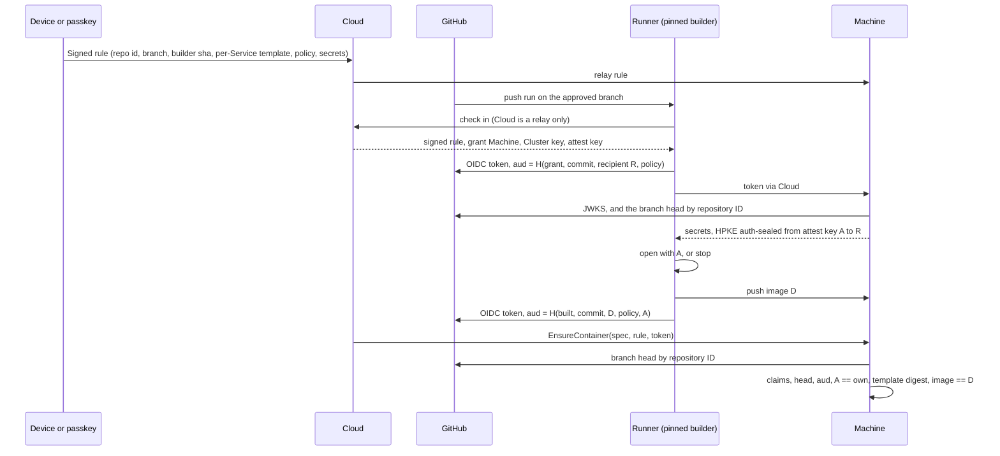

# Thread D design: build proof and preview inheritance

This file is checkpoint C2 (build proof) and checkpoint C3 (preview inheritance) of the 0.4 security program. [d-inventory.md](d-inventory.md) lists every input Cloud chooses today. [d-plan.md](d-plan.md) slices the work into PRs. Source is `main` at `7c5cc4571e`.

The bar is in `AGENTS.md`. Whoever takes over Ployz Cloud must not be able to read secrets, run code of their choosing on a Server, take data off a Server, or add a Server or Device. Mislabelling, reordering, delaying or dropping approved work is an accepted residual.

## The answer in one paragraph

A person approves an **automatic deploy rule** once, from a Device or with a passkey prompt of its own. The rule names the repository by ID, the branch, the Environment, and the builder workflow pinned by commit. Per Service it names three digests: the spec with the image left out, the build policy, and the sealed build secrets.

GitHub runs the pinned builder on a push. The builder checks out the commit GitHub ran for, never one Cloud names. It asks GitHub for two OIDC tokens whose audience is a hash of what it is doing. The first says "give recipient key R this Service's build secrets, to build commit C". The second says "commit C built image D under this policy, with secrets sealed by attest key A". Cloud relays both tokens and cannot change them.

Each Machine checks a token against GitHub's keys and every claim against the signed rule. It reads the branch head from `api.github.com` itself. It releases build secrets only after checking the authority for C: C must be the head now, or a person must have signed a statement naming C. The secrets go sealed end to end to R, in HPKE's authenticated mode, from a key only Cluster Machines can derive. So the builder rejects values from any endpoint Cloud substitutes. A creation runs only when its spec, image aside, matches the rule's digest. Its image must be the digest the token names, sealed from this Cluster's attest key. A settings change, a policy change, another image, an old commit, a replayed token or a substituted secrets endpoint each fails one named check.

Previews use the same proof under a preview rule. That rule names trusted GitHub accounts, a preview domain, and the Sealed values a preview may inherit. The Machine itself derives a preview's Namespace and hostnames from facts it verified, before it hashes anything. An inherited value carries its parent's Environment in its own associated data, so the Machine opens it in place and nothing is rewrapped.



## What a Machine trusts

- GitHub's OIDC issuer `https://token.actions.githubusercontent.com` and its JWKS, which the Machine fetches over TLS. Cloud's verdict on a token is never used.
- `api.github.com` over TLS, for branch heads and ancestry. The Machine asks by repository ID, so the answer is about the approved repository whatever credential it uses.
- GitHub-hosted runner isolation between jobs.
- The builder workflow at the commit the rule pins. It is the code that asks GitHub for the tokens, so it attests what it built and which key sealed its secrets.
- The repository's own code on the approved branch. Anyone who can push there deploys. That is the rule's intent.
- Keys the Machine already trusts (Devices and passkeys, from thread A), for the signatures on rules, build approvals and reviews.

It does not trust Cloud's rows, Cloud's OIDC check, Cloud's Build Receipts, Uploaded Source, image tags, a webhook, the grant endpoint Cloud names, or any commit, ref, version or input Cloud passes the runner.

The builder trusts only what it can check. Its own commit and inputs come from GitHub (`github.sha`, the workflow file at its pinned commit). Opened secrets come from a sender that proves it holds a Cluster-derived key, and the builder writes that key into the image token for Machines to compare.

## Precondition outside thread D

**Cloud must hold no GitHub credential that can write to a customer repository.** With Contents or Workflows write, Cloud can push its own commit to the approved branch, and that commit is a legitimate head. No Machine-side proof can tell it from a person's push. Thread Y found the public App requests Contents, Workflows and Administration write (`y-github-report.md` §1.1, on the unmerged audit branch). The program's decision record (also on that branch) already settled the fix: keep the App's permissions and take its key off Cloud. The App key moves to a minter outside Cloud, Cloud gets only read-narrowed installation tokens, and Cloud stops storing GitHub OAuth tokens in `account`. The operator made the minter its own slice after D4. D's proof is sound against a compromised Cloud only once it is live. Until then, automatic deploy under enforcement is safe against every path below except a pushed commit.

A customer can also close the push path today on their own repository with a branch ruleset that blocks direct pushes, without a bypass for the Ployz App.

## The automatic deploy rule

A new statement in `ployz_core::authority`, `AutoDeployRule`, signed by a Device, or by a passkey's own assertion. A browser key under a session grant cannot sign it. A rule is standing authority over every future push, so it needs its own prompt.

```text
AutoDeployRule                       purpose: Rule (new)
  cluster        SealingPublicKey
  rule           RuleId               128 random bits, made by the approver's client
  generation     u64                  each re-approval adds one
  namespace      Namespace            the Environment
  machines       [MachineId]          sorted, distinct
  source
    repository_id  u64                 immutable
    owner_id       u64                 immutable
    repository     String              owner/name, for the workflow_ref check and for display
    branch         String
    workflow       String              the caller file, ".github/workflows/ployz-build.yml"
    events         [push | workflow_dispatch]
    builder        { ref, sha }        the reusable workflow, pinned by full commit
    runner         github-hosted
  services       [RuleService]        sorted by name, distinct
    name         ServiceName
    template     PayloadDigest         the requested spec with `container.image` emptied
    policy       BuildPolicy           the build policy below, whose PolicyDigest the builder reports
    secrets      Option<SealedDigest>  the build's SealedRecord, ciphertexts only
  issued_at      Timestamp
  ended          bool                 true for the generation that switches the rule off
  signer         SignerKey
```

**Template digest.** `PayloadDigest::of` from thread C, taken over the Service's `RequestedServiceSpec` with `container.image` set to the empty string. It binds every field thread C binds, including plain values, Sealed ciphertexts and their identity, ports, mounts, Config bytes, privileges and the hook. Only the image is left open, and the token fills it. This digest is "the approved settings revision" the decision record asks for. It is a rule field the verifier reads, as `c-decisions.md` says.

**Build policy.** Every input the builder passes to `ployz build` other than the source tree. That is the Build Method and its path, the context, the target, plain build args, the names of build secrets, platforms and the cache setting. `PolicyDigest` is SHA-256 over its canonical JSON (`authority::canonical`). Repository files may change application code, including the Dockerfile. They cannot change the policy, because the builder reports the policy it used in the token and the Machine compares it.

**Generations.** A Machine keeps the highest generation it has seen per rule in its approval record. It refuses a lower one, and an `ended` one stops the rule. A Machine also records the rule's repository, branch and Namespace the first time it sees a rule ID. It refuses a later generation that changes any of them. A re-approval after a settings change is the same rule at the next generation, so tokens minted for the old generation stop working.

## The builder and its tokens

The customer's `.github/workflows/ployz-build.yml` becomes:

```yaml
on:
  push: { branches: [main] }      # the rule's branch
  workflow_dispatch:
    inputs:
      commit: { required: false, type: string }   # only for an approved or reviewed build
permissions: { contents: read, id-token: write }
jobs:
  build:
    uses: getployz/build/.github/workflows/build.yml@<40-hex sha>
    with: { cloud: https://<Cloud origin>, commit: "${{ inputs.commit }}" }
```

Today's file takes `build`, `cloud` and `runner` from Cloud's dispatch (`.github/workflows/ployz-build.yml:4`). The new one takes one optional input, `commit`, and the Machine checks it before any secret leaves (below). The runner label lives in the reusable workflow. The `cloud` input is a constant in the customer's file. A reusable workflow, unlike today's composite action `getployz/build@v1`, appears in the token as `job_workflow_ref` and `job_workflow_sha`, so the rule can pin it, and the caller cannot add steps to its job.

The builder checks out one commit C. On a push, or a dispatch with no `commit` input, C is `github.sha`. With a `commit` input, C is that commit, fetched from the repository the run belongs to. Either way C goes into both audiences, and the Machine decides whether C has authority.

```text
Claim                                 aud = "ployz-build:" + hex(SHA-256(canonical(Claim)))
  cluster     SealingPublicKey
  rule        RuleId
  generation  u64
  service     ServiceName
  policy      PolicyDigest
  commit      CommitSha                the commit the builder checked out
  authority   Head
            | Approved(StatementDigest)  a person's BuildApproval (D6)
            | Review(StatementDigest)    a person's PreviewReview (D7)
  stage       Grant { holder: K, recipient: R }
            | Built { image: ImageDigest, attest: A }
```

The builder:

1. Checks out C.
2. Checks in with Cloud to learn which Machine takes the push, the Cluster key, the Cluster's attest key A, the signed rule, and for an approved or reviewed build the signed statement. Every one of these is relayed, and a lie fails a check below.
3. Makes a holder key K, the iroh key that authenticates its push, and an X25519 recipient key R for the secrets. It reads the Service's policy from the rule and computes its digest.
4. Asks GitHub for a token with `stage = Grant { K, R }` and sends it to the Machine through Cloud.
5. Receives the build secrets HPKE-sealed to R. It opens them in authenticated mode with sender key A, and stops if that fails. It builds with exactly the policy and pushes the image.
6. Asks for a second token with `stage = Built { image: D, attest: A }`, and reports it to Cloud with the Build Steps.

The Machine recomputes the audience from facts it holds. Nothing in the audience needs to be secret or trusted. The runner's `ACTIONS_ID_TOKEN_REQUEST_TOKEN` stays in the builder's steps and is never passed into BuildKit.

## Build secrets reach only the approved build

Today the runner dials whatever Management Identity Cloud hands it (`core/crates/ployz/src/connect/build_grant.rs:92`). `GET /ployz/sealed` returns plaintext over that connection. The runner's only check, `OpenedSealed::covering` (`core/crates/ployz-core/src/sealed_record.rs:131`), is that the expected names are present. So Cloud can point the honest builder at its own endpoint. It can serve its own value for a Sealed URL or bootstrap script the approved Dockerfile fetches and runs, and the builder then gets a valid image token for an image carrying Cloud's code. Binding the grant Machine's Management Identity into the rule does not close this. The approver's client learns that identity from Cloud, and the builder cannot check the rule's signature.

The fix makes the opened values authenticate themselves.

- **Attest key.** Every Machine derives one X25519 key pair, A, from the Cluster's Sealing private key with HKDF-SHA-256 and the info `ployz build-secrets attest v1`. Every Machine that holds the Sealing Key derives the same A. Cloud cannot derive it, because it never holds the Sealing Key (thread A). A is separate from the Sealing key pair, so no key does two jobs.
- **Sealing to the build.** At grant, the Machine opens the approved Sealed record and seals the result with HPKE in authenticated mode (RFC 9180 §5.1.3). The sender key is A, the recipient is the R from the grant token's audience, and the info is `ployz build secrets v1` followed by the audience bytes. The response goes over the grant connection as today. It is now ciphertext only R can open, and only a holder of A can have made.
- **The builder checks.** It opens with the A that Cloud relayed. A Cloud endpoint without A cannot produce a ciphertext that opens. If Cloud relays its own key in place of A, the builder opens Cloud's values. It then writes Cloud's key into `Built.attest`, and every Machine refuses the image, because `attest` is not its own A.
- **Binding.** The info binds the response to one grant audience: rule, generation, Service, policy, commit, authority and recipient. An authentic response from another build or an older generation does not open.

The image a Machine admits therefore names an attest key the Machine recognises. That proves its build secrets came from a Cluster Machine that ran the grant checks below. Builds with no secrets carry A too, so a Cloud-run fake endpoint cannot even make a secretless build look like a grant build.

`hpke` 0.13, which core already uses for Sealed values, has the authenticated mode. The derivation and the mode are a contract change for thread A (d-plan Appendix A gap 6).

## What a Machine checks

**The token, at grant and at creation.**

| Check | Against | Authority |
| --- | --- | --- |
| RS256 signature, `kid` in the issuer's JWKS | The JWKS the Machine fetched from the fixed issuer | GitHub |
| `iss` | `https://token.actions.githubusercontent.com` | Machine constant |
| `exp`, `nbf`, `iat` | The Machine's clock, with thread A's skew rule | Machine |
| `repository_id`, `repository_owner_id` | The rule | Signed rule |
| `ref_type == branch`, `ref` | The rule's branch. A preview rule takes any other branch for a trusted push, and the parent's branch for a review. | Signed rule |
| `event_name` in `events` | The rule | Signed rule |
| `workflow_ref == <repository>/<workflow>@<ref>` | The rule | Signed rule |
| `job_workflow_ref`, `job_workflow_sha` | The rule's builder | Signed rule |
| `runner_environment == github-hosted` | The rule | Signed rule |
| `aud` | `Claim` recomputed from the Machine's Cluster key, its A, the rule, and the holder, recipient or image in hand | Machine |

`sub` is not checked, because a repository admin can change its template.

**Authority for the commit, checked before any secret opens.** The grant audience names C and an authority. The Machine accepts exactly one of these.

| Authority | Required |
| --- | --- |
| `Head` | `C == sha == head`, where head is `GET https://api.github.com/repositories/<repository_id>/git/ref/heads/<branch>` read now by this Machine, for the branch in `ref` |
| `Approved(d)` | A `BuildApproval` whose digest is d, signed by a trusted key, naming this rule, generation, Service and C (D6). C must be the branch head or one of its ancestors: `GET /repositories/<id>/compare/<C>...<branch>`, read now by this Machine, answers `identical` or `ahead`. `behind` (a descendant never merged) and `diverged` are refused. A run on the rule's branch with `event_name == workflow_dispatch`. |
| `Review(d)` | A `PreviewReview` whose digest is d, signed per the preview rule's signer rule, naming this preview rule, generation and C (D7). A run on the parent's branch with `event_name == workflow_dispatch`. |

A `commit` input with authority `Head` fails, because C differs from `sha`. Without a signed statement no other authority exists. So a dispatch on the parent's head with an attacker's commit as input gets no grant, and no secret opens.

**At grant** (`MintBuildGrant` with a rule, a token, and for `Approved` or `Review` the signed statement). The rule verifies, this Machine is in `machines`, the generation is current, the token passes, the stage is `Grant { K, R }` for the holder the request names, the commit's authority holds, and the `jti` is unused. The Machine consumes the `jti` in thread A's consumption log until `exp`. The Sealed record Cloud relays must hash to the `secrets` digest of the Service in the rule, or in the preview rule for a review. Then it mints the grant for K, remembering the rule, generation, Service, commit and authority, and serves the secrets sealed to R as above.

**At creation** (`EnsureContainer` with a rule and a token in place of a deploy approval). The rule verifies and the token passes with `stage = Built { image, attest }`. `attest` is this Machine's A. The commit's authority holds again at this moment: `Head` needs `commit == head` now, and `Review` needs the signed review. `Approved` builds never reach creation through a rule. Their deploy is a person's thread C approval (D6). The spec's image is content-addressed (thread C's `content_addressed`) and its digest is `image`. `PayloadDigest::of(spec with image emptied)` equals the rule's `template` for the slot's Service. The Machine then writes an accepted-build record, (rule, generation, Service, commit, image). A later creation of the same image under the same generation may use that record in place of an unexpired token. It still needs the authority check above. A hook is consumed once per (rule, generation, commit, Service), so one push runs its hook once.

**Lifecycle steps** on old copies (Hold, Out, Stop, Start, Remove) follow thread C's `admit_deploy_step`. They are admitted for Containers in the rule's Namespace on Machines it names, while the proof passes, and nothing is consumed.

Every check is on facts this Machine reads itself. No Machine acts on another Machine's record. The attest key is derived on each Machine from the Sealing Key it already holds, so bet 6 holds without argument. If Cloud vanishes, every Machine still decides the same way.

## Authority for every input

| Input | Who supplies it | Authority the Machine or builder checks |
| --- | --- | --- |
| Repository, branch, Environment, builder, events | Cloud relays the rule | The rule's signature, by a trusted Device or passkey |
| Settings (the spec, image aside) | Cloud sends the spec | `template` in the rule |
| Build policy | Cloud relays the rule to the runner | The builder reports the policy digest inside a GitHub-signed `aud`, compared with the rule's |
| Build secrets, sealed | Cloud relays the Sealed record | The rule's `secrets` digest |
| Build secrets, opened | The grant endpoint Cloud names | The builder opens them only with A, in HPKE authenticated mode. Machines admit only images whose `attest` is their own A. |
| The commit built | GitHub's `sha` claim, or the `commit` input | The authority in `aud`: the head this Machine reads now, or a person's signed statement naming it |
| Builder code | The customer's workflow file names it | `job_workflow_sha` in the token, against the rule |
| Image | Cloud names it in the spec | `image` in a GitHub-signed `aud`, written by the pinned builder |
| Which Machine builds, which Machines run it, when | Cloud | None needed. A wrong choice is an outage, because the endpoint cannot open the builder's secrets channel. |
| The `ployz` binary on the runner | Pinned inside the builder at its commit | `job_workflow_sha` |
| Head-read credential | Cloud relays a read-only installation token narrowed to the repository | None needed. TLS to `api.github.com` authenticates the answer, and the repository ID scopes it. A bad token reads nothing, and the Machine refuses. |
| Preview Namespace and hostnames | Cloud names them in the spec | Derived by the Machine from the preview rule and verified facts (below) |

## Rejected examples

| Attempt by a compromised Cloud | Refused by |
| --- | --- |
| **Substituted source.** It dispatches the workflow and tells the runner to build commit X, or dispatches it on branch `attacker`. | With `Head`, C must equal `sha` and the head. With X as input and no signed statement naming X, no authority holds, so no grant is minted and no secret opens. A run on another ref fails `ref` and `workflow_ref`. |
| **Reviewed-commit dispatch.** It dispatches on the parent's head with an attacker fork commit as `commit`, hoping the parent rule's grant releases the parent's secrets. | The grant audience names the fork commit. `Head` fails, and no `PreviewReview` or `BuildApproval` names it. Refused before `Mint::check` opens anything. |
| **Substituted secrets endpoint.** It names its own iroh endpoint as the grant Machine and serves its own value for a Sealed bootstrap URL. | Its response does not open with A, so the builder stops. If it also relays its own key as A, the image token names that key, and every Machine refuses `attest`. |
| **Substituted settings.** It sends `EnsureContainer` with the built image and `privileged: true`, a new Sealed variable, or a host bind. | The spec with its image emptied no longer hashes to `template`. `Mismatch { field: "a payload" }`. |
| **Substituted settings, at build time.** It gives the runner other build args or a registry cache. | The builder puts the digest of the policy it used in `aud`. The Machine computes `aud` from the rule's policy, so the grant is refused before any secret opens, and the image token never matches. |
| **Substituted artifact.** It pushes image D' through `EnsureImageIngest` and names `repo@D'` in the spec. | No GitHub-signed `aud` names D'. `Mismatch { field: "an image" }`. |
| **Stale proof.** It re-runs last week's run, which gets a fresh token with the old `sha` and a higher `run_attempt`. | `sha` is not the head this Machine reads now. `Mismatch { field: "a commit" }`. A force push to that same old commit makes it the head again and is accepted, as the decision record wants. |
| **Replayed proof.** It sends the same grant token twice. | The `jti` is consumed on the first grant. |
| **Replayed proof across a settings change.** It replays an image token from generation 3 after the person approved generation 4. | `aud` names generation 3, and the Machine refuses any generation below 4. |
| **Its own holder.** It asks for a grant for its own key with the runner's token. | `aud` names the runner's holder and recipient, not Cloud's. Without a valid rule token, `MintBuildGrant` is refused under enforcement (slice D1). |
| **A moved builder tag.** It moves `getployz/build@v1` or pushes a new builder commit. | `job_workflow_sha` does not match the rule. |
| **Another Cluster's token.** It replays a token from Cluster A on Cluster B. | `aud` binds Cluster A's key and A's attest key. |

## Caches

This is thread C's decision (`c-decisions.md`) applied to D.

- **BuildKit on a GitHub-hosted runner** starts empty in each job. Nothing to trust.
- **Registry caches** (`cache_from` and `cache_to` of type `registry` or `inline`). Not allowed in a rule's policy, because Cloud can write them through Registry Credentials.
- **The GitHub Actions cache** (`type=gha`). Allowed only with `scope` set to the policy digest. A run on another branch cannot write the approved branch's scope (GitHub's cache isolation, documented, not yet proven here). A run on the approved branch is either a person's push or a Cloud dispatch of the same builder on the same head. A run whose policy differs writes another scope. This stays unproven until slice D3's live lane. If that lane fails, rule policies turn the cache off (operator decision 7).
- **BuildKit on Machines** (the Servers builder). It is outside this proof. Under enforcement, Cloud cannot start a `Build` (slice D1).

## Head evidence for private repositories

The kickoff asks how a Machine sees a private branch head without trusting Cloud. The Machine calls GitHub itself:

```text
GET https://api.github.com/repositories/<repository_id>/git/ref/heads/<branch>
Authorization: Bearer <read-only installation token, narrowed to this repository>
```

The credential decides only whether GitHub answers, not what it answers. TLS to `api.github.com` authenticates the answer, and the repository ID scopes it to the approved repository. A token Cloud picks can only fail, and failing is refusal. So Cloud can relay the credential. Before the minter, Cloud mints it narrowed to `contents: read` and that one repository. After the minter, it asks the minter. Public repositories need no credential, but unauthenticated reads are limited to 60 an hour per address, so the Machine uses the token when it has one. The ancestry read for `Approved` uses the same credential and the `compare` endpoint by repository ID.

Prototyped on 2026-11-09, read-only:

- `GET /repositories/1332172911/git/ref/heads/main` for a public repository with no credential returned `200` and the head commit.
- The same path for a private repository returned `200` and a commit object with a read credential, and `404` without one.

The credential in that test was a user token, not an installation token. An installation token narrowed to `contents: read` should behave the same, per GitHub's documentation. Slice D2 proves it.

Thread Y's alternatives were a deploy key per repository (H2), a customer-owned token (H3) or an independent verifier service (H5). Each costs setup or a new service and buys nothing over this, because the integrity comes from TLS either way.

## Freshness and its limits

- The promise is "head when this Machine admitted it". A push that lands mid-rollout makes the remaining creations refuse. That Machine reports a partial result (bet 4), and the next push's deploy replaces it.
- A creation long after the push, such as a copy rescheduled to another Machine, needs the head to still be that commit. If a later push failed to build, the old image cannot be placed anew until a person deploys (D6). Restarting existing Containers is unaffected.
- GitHub's API may lag a push by seconds. A Machine may accept the previous head briefly. That is bounded freshness, not a new effect.
- A token lives 300 seconds (`exp - iat`, measured in D2 lane 1), so a slow first rollout to some Machine can miss the token. The accepted-build record covers later creations on Machines that saw it. A Machine that never saw a valid token reports refused.

## A person deploys a built image (D6)

A deploy of a commit that is not the head, such as a rollback, has no `Head` authority. A person supplies it in two signed steps, both by keys that may sign a thread C deploy approval.

1. **Build authority.** The person's client signs `BuildApproval { cluster, rule, generation, service, commit C, issued_at, expires_at, signer }`. It has thread C's 15-minute window. Cloud dispatches the rule's workflow on the rule's branch with `commit = C`. The grant Machine checks `Approved(d)`, including that C is the branch head or an ancestor of it, so a person's approval can only rebuild code that was pushed to the approved branch. The secrets then go to R as for any build. A `BuildApproval` is not needed when the client already holds a token for C, below.
2. **Deploy.** The client verifies the image token itself. That means the RS256 signature against GitHub's JWKS fetched by the client, and every claim and the audience against the rule, with `commit == C`, `authority == Approved(d)` or `Head`, and `attest` equal to the Cluster's A. A is read from a Machine over the Device's own connection, or taken from the image token the client last verified under a `Head` deploy. The client ignores `exp`, because the person, not freshness, is now the authority. It then signs thread C's `DeployApproval` with `image = <repository>@<D>` in its own fresh window. The Machine checks that approval exactly as thread C does. It sees a content-addressed image a person approved, and no token is involved.

Rolling back to an image built earlier skips step 1. The client verifies the token Cloud stored with that build. If GitHub has rotated that token's key out of its JWKS, the client cannot verify it, and it rebuilds C under step 1. The person's `DeployApproval` window starts after the build, so a long build never expires it.

## Preview inheritance (checkpoint C3)

### Today

A PR Environment runs a pull request's code. Cloud decides a PR is Trusted when its head is in the same repository and its author is a bot, or a GitHub account in Cloud's `member ⋈ account` rows. Both inputs are Cloud rows. An untrusted PR waits for a person's review in Cloud. Cloud builds the PR head commit it chose and deploys it. A PR Environment's Namespace is whatever Cloud allocates (`{project}-pr-N`, `ployz-store/src/deployment/mod.rs:1539`). Preview Sealed values are not shared with the parent today. See `d-inventory.md`.

### The preview rule

A second statement, `PreviewRule`, with the same signer rule as `AutoDeployRule` (a Device, or a passkey's own prompt).

```text
PreviewRule                          purpose: Rule
  cluster, rule, generation, machines, ended, issued_at, signer    as AutoDeployRule
  parent         Namespace             the Destination Environment
  parent_id      Uuid                  its Cloud Environment ID, the one Sealed identities name
  domain         Hostname              previews' hostnames live under it
  source         as AutoDeployRule, except
    branch       the parent's branch    reviewed builds run here
    events       [push, workflow_dispatch]
  trusted        [u64]                 GitHub account IDs allowed to push a preview, by `actor_id`
  services       [PreviewService]
    name         ServiceName
    template     PayloadDigest          the preview's spec with derived fields as placeholders (below)
    policy       BuildPolicy
    secrets      Option<SealedDigest>
    inherit      [String]               parent Sealed keys this Service may open in a preview
```

**Who is trusted.** The signed list of GitHub account IDs. Cloud's membership rows cannot add to it. For a `push` run, `actor_id` is the account that pushed. For a re-run it stays the original actor, so a re-run cannot change who is trusted. A bot is trusted only if its ID is in the list. Ployz's own App bot is never added by default.

**Which build.** A trusted preview is a push by an account in `trusted` to a branch of the same repository, other than `source.branch`. `repository_id` excludes forks. Its authority is `Head` on that branch. Any other preview is a reviewed build, below.

### Derived fields, checked before hashing

A preview's spec differs from its parent's in three fields Cloud used to choose: the Namespace, preview hostnames, and the Sealed identity's Environment. Under a preview rule, the Machine derives each one itself from the signed rule and facts it verified, checks the spec holds exactly that value, and only then hashes.

- **Preview key.** For a trusted push, `branch:<name>`, from the verified `ref` claim. For a review, the key the signed review names, `branch:<name>` or `fork:<pull request number>`.
- **Namespace.** `pv-<first 16 hex of rule>-<first 12 hex of SHA-256(preview key)>`. The rule ID is 128 random bits from the approver's client, so Cloud cannot choose it to collide with another rule's. That pattern is reserved. A Machine refuses any creation in a Namespace of that form unless it is admitted under the preview rule it derives from. It also refuses a preview-rule creation in any other Namespace. Thread C's deploy approval and the automatic deploy rule refuse reserved Namespaces, and Cloud's Namespace allocator never hands one to an ordinary Environment. So preview code can only land in a Namespace that holds nothing but that preview's own Containers and Volumes. A preview's Ordinary and Provisioned Volumes get their physical names from the Namespace (`ScopedVolumeSource::physical_name`, `ployz-core/src/domain/volume.rs:104`). So preview code cannot mount a production Volume of those kinds.
- **Hostnames.** Each Ingress hostname in a preview spec must be `<label>.<Namespace>.<domain>`. The template holds the label, the rule signs `domain`, and the Namespace is derived. Because the derived Namespace label is reserved, no preview hostname can equal a production hostname.
- **Sealed identity.** A trusted preview may carry only inherited Sealed values (below), so the Container's own `sealed_identity` opens nothing. The template holds it as a placeholder. For a review, the signed review names the preview's Environment ID, and the identity must equal it.

`PreviewTemplate::of(spec, derived)` replaces the image with the empty string, and replaces every occurrence of the derived Namespace, derived hostnames and checked identity with fixed placeholders. Then it takes `PayloadDigest`. The Machine substitutes only strings it derived itself. A Cloud-chosen production Namespace or hostname anywhere in the spec stays literal and fails the template. The CLI computes the template from the parent's Saved revision through the preview lowering with the same placeholders.

**Volume names are not placeholders.** A preview keeps its parent's logical Volume names. The Namespace separates their physical names. A Bind Mount or an External Volume in the parent stays literal in the template, so a preview using one shares it with production. The CLI prints such mounts as "shared with production" and refuses to sign a preview rule that has one unless `--share-mounts` is given.

Whether the preview lowering differs from the parent's only in these fields, and keeps logical Volume names, is the riskiest unproven claim in this design. D7 starts with a prototype that checks it. If Own Copies are renamed today, D7 changes the lowering to keep their logical names, rather than adding a placeholder.

### Inheriting a Sealed value

A Sealed value's associated data binds the organization, the Environment, the scope and the key (`ployz-core/src/sealed.rs:163`). The Environment comes from the Container's one `SealedIdentity`. A preview Container may hold its own values, sealed for the preview's Environment, and inherited ones, sealed for the parent. So one identity cannot cover both.

Change: `SealedValue` gains an optional `environment: Uuid`. When it is present, it replaces the identity's Environment in the associated data. An inherited value is the parent's ciphertext unchanged, with `environment = parent_id`. The Machine opens it in place with the Cluster's Sealing Key. Nothing is rewrapped, and no plaintext reaches Cloud.

A Machine checks the override on every Sealed part of a spec, template parts included, and on the build's Sealed record. It opens a value whose `environment` differs from the Container's identity only when:

- the creation or grant is admitted under a `PreviewRule` whose `parent_id` is that Environment, and
- the value's key is in that Service's `inherit` list.

The template digest already covers the ciphertext, so Cloud cannot swap in another parent value under an inherited name. Any other creation that carries such a value is refused (`Mismatch { field: "a Sealed value" }`). An older daemon refuses the new field, which fails closed.

### Untrusted pull requests

The existing review path stays, bound to the exact reviewed commit, and the review is checked before any secret opens.

A person reviews the pull request at commit X in the dashboard or CLI, and signs:

```text
PreviewReview                         purpose: Workflow
  cluster, rule, generation           the preview rule
  key           branch:<name> | fork:<number>
  commit        X
  environment   Uuid                  the preview's Cloud Environment ID
  services      [{ name, digest }]    PreviewTemplate digests of this preview's specs
  issued_at, expires_at, signer
```

Cloud dispatches the parent's workflow on `source.branch` with `commit = X`. A fork pull request's commits can be fetched from the base repository by commit. At grant, the Machine checks `Review(d)`. That means the review's signature, its rule and generation, `aud.commit == X`, and the run on `source.branch`. Only then does it release the preview rule's `secrets` for that Service, sealed to R. At creation it checks the review again. The spec must hash to the review's own `digest` for its Service, not the rule's `template`, so a person can approve a preview whose settings were edited inside the PR Environment. The derived Namespace comes from the review's `key`.

**Who may sign a review** (operator decision 6). A browser key under a session grant for the preview's Environment may sign a review whose Services inherit nothing and have no `secrets`. If any reviewed Service has a non-empty `inherit` list or a `secrets` digest, the review must come from a Device or from a passkey's own assertion. The Machine enforces this at grant and at creation. A session-signed review of such a Service is refused with `Mismatch { field: "the signer" }`, before anything opens.

`sealed_scope_allows` (thread C, `ployz-core/src/authority/deploy.rs:517`) widens here, and only for reviews. A browser key whose grant names the preview's Environment may approve a reviewed creation whose own Sealed values are sealed for that Environment, as today. Inherited values never pass through a session, by the rule above.

### Rejected examples for previews

| Attempt | Refused by |
| --- | --- |
| Cloud adds an attacker's GitHub account to `member ⋈ account` | The trusted list is in the signed rule. `actor_id` is not in it. |
| Cloud labels a fork PR as trusted | `repository_id` is the fork's, or the run is not a push to a branch of the base repository. |
| Cloud sends a valid trusted-preview proof with the production Namespace, so preview code mounts production Volumes | The Namespace is not the one derived from the rule and the verified branch. A preview-rule creation outside its derived Namespace is refused. |
| Cloud gives a production Environment a Namespace in the reserved preview form, then deploys a preview into it | Thread C's approval and the automatic deploy rule refuse reserved Namespaces, so no new production Container or Volume lands there. Before it admits a preview, the Machine also refuses one whose Namespace already holds a Container or Volume the preview rule did not create, which covers anything made before enforcement. |
| Cloud routes a production hostname to preview code | Every preview hostname must be `<label>.<derived Namespace>.<domain>`. Any other stays literal and fails the template. |
| Cloud deploys a preview that inherits a production value the rule does not list | The key is not in `inherit`. |
| Cloud deploys a preview with a value relabelled as another key | The associated data binds the key name, so it does not open. |
| Cloud dispatches a reviewed build at a commit other than the one the person reviewed | `aud.commit` differs from the review's commit. The grant is refused before any secret opens. |
| A compromised dashboard signs a review with a live session, for a preview that inherits values | The Machine refuses a session-signed review of a Service with `inherit` or `secrets`. |
| Cloud opens an inherited value outside a preview, for example in a Container approved under a production session | No `PreviewRule` admits that creation. |

## What remains

- Anyone who can push to the approved branch deploys. Anyone in `trusted` deploys a preview that reads the inherited values.
- Approved application code, including the Dockerfile, can leak the build secrets and the runtime secrets it receives.
- Until the minter is live, Cloud can push a commit. See the precondition above.
- Cloud can withhold a new generation from a Machine. Until it arrives, that Machine keeps accepting the previous one for new pushes, with settings the person approved earlier.
- Cloud can delay, drop, cancel or re-run builds, dispatch the approved branch's head, and show false build status.
- A compromised dashboard with a live session in a preview Environment can approve any commit there for a preview that inherits nothing. That is B's accepted residual.
- A preview rule signed with `--share-mounts` lets preview code use those Bind Mounts and External Volumes. The person approved that.
- Flat mesh. A preview is not network-isolated from production.
- The rule names Machines. A Machine that joins later runs no rule deploys until the rule is approved again.

## Rejected alternatives

- **Cloud verifies the OIDC token and tells the Machine.** That is today's design (`dashboard/src/modules/config-store/store-github-builds.server.ts:239`), and Cloud's verdict is the thing under attack.
- **Binding the grant Machine's Management Identity in the rule.** The approver's client learns that identity from Cloud, and the builder cannot verify the rule's signature. A Cluster-derived attest key that every Machine recomputes needs neither.
- **A digest of opened secret values in the rule.** The approver would need the plaintext, and a hash of a low-entropy secret lets Cloud guess it.
- **Head evidence by deploy key, customer token, or an independent verifier service.** The integrity comes from TLS to GitHub, so the credential's owner does not matter. See above.
- **GitHub artifact attestations (Sigstore).** They need more verifier machinery for the same trust, and their availability for private repositories on every plan is unknown.
- **The grant Machine signs a build receipt that other Machines trust.** That is one Machine acting on another's record, which is bet 6's red flag. A GitHub-signed audience lets every Machine check for itself.
- **Run number ordering or per-Machine high-water marks in place of a head check.** A Machine that never saw run N+1 accepts a re-run of N. The decision record already rejects it.
- **Placeholders for preview fields with no rule on their real values.** That lets a valid proof carry the production Namespace. Every placeholder now stands for a value the Machine derived.
- **Rewrapping inherited values to the preview's Environment.** The Machine would re-seal plaintext on Cloud's request, which needs its own approval. Naming the source Environment in the associated data is smaller and binds the same thing.
- **A session grant signs rules.** A rule is standing authority over every future push. It gets its own prompt.
