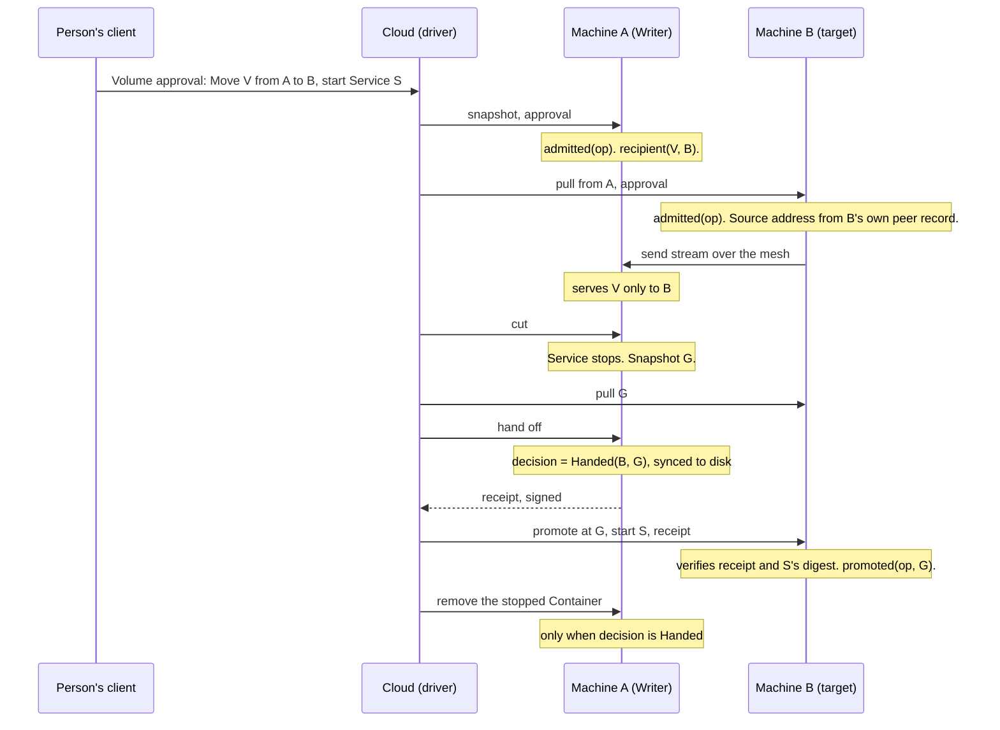

# Security 0.4 thread E plan, Volume Runs

A compromised Cloud must not run code of its choosing on a Server or take data off it. Today it can do both through a Volume Run. Under Device enforcement no Volume route is gated. `SetVolumeCopy` can cut a Writer, which stops its Service, and then promote a copy with `Start::Create`, which creates and starts a Container from a whole spec Cloud supplies, with the Volume mounted (#4041). `SeedVolume` copies one Volume's data under any Volume name Cloud picks. Slice E1 closes both first. The later slices replace the refusal with one approval of the reviewed workflow that every Machine checks for itself.

The design is in "Design" below. A person approves a Volume workflow once: a Move, a Mirror, a Restore, a Mirror removal, a resize or a seed. The approval names the Volume, the Machines, the Service a Move starts and what is lost. Each Machine admits each step against that approval and its own records. A Move's point of no return leaves Cloud's database: the source Machine records one decision, and the destination becomes the Writer only with the source's signed handoff receipt. [e-inventory.md](e-inventory.md) lists every input Cloud chooses today and the slice that closes it.

Eight PRs, in dependency order:

| Slice | Outcome | Closes |
| --- | --- | --- |
| E1 | Enforcing Machines refuse Cloud's `Start::Create` and `SeedVolume` | #4041, today's bar crossing |
| E2 | The Volume approval, its verifier and the Machine's admission record exist | Nothing yet. It is the verifier. |
| E3 | A Mirror lives only on a Machine a person approved, and the send stream serves only approved recipients | Mesh access reaching a bulk Volume stream. Cloud choosing where copies go. |
| E4 | A Move runs under one approval from a Device | Cloud choosing the target, the Service B starts, or a Volume to cut |
| E5 | The source Machine decides the Move. B promotes only with A's receipt. | Cloud holding the commit. A driver getting both outcomes from one Move. |
| E6 | Restore, Mirror removal and cleanup run under an approval that names the loss | Cloud promoting or destroying a copy on its own word |
| E7 | Resize and seed run under approval | Cloud choosing sizes and seed targets |
| E8 | The dashboard approves a Volume workflow with one passkey prompt and shows what is finishing | Approval and progress that only Cloud's rows vouch for |

## Operator decisions

Five. None blocks E1.

1. **Who may sign a Volume approval.** The decision record says a Volume workflow needs its own approval of the reviewed workflow, outside any session. *Recommendation.* A Device, or a passkey through its own prompt. A browser key under a session grant may not. The CLI on a trusted Device shows no prompt. The dashboard shows one passkey prompt for each Volume workflow.
2. **The key that signs a handoff receipt.** B must verify that A gave the Volume up, from something B already holds. A Machine has no signing key today. Its WireGuard key cannot sign, and its Management Identity is a transport key. *Recommendation.* Derive one receipt key for the Cluster from the Sealing Key, the way thread D derives its attest key. Every Machine holds the Sealing Key and Cloud does not. The cost is that any Machine of the Cluster could forge a receipt from any other. That stays under the bar, because a Machine holding the Sealing Key can already open every Sealed value. The receipt carries a key ID, so a key for each Machine can replace it if thread A ships one.
3. **A Mirror's approval is standing.** Mirrors sync every 15 minutes with no person present. *Recommendation.* Approving a Mirror approves every later sync of that Volume to that Machine, until the Mirror is removed. A Move's approval lists the Mirrors that keep following, so the new Writer serves them without a second prompt. The alternative is a prompt for each sync, which ends automatic sync on enforcing Clusters.
4. **What enforcing Clusters lose between E1 and E4.** After E1, Cloud cannot start a Service on the destination, so a Move cannot finish, and a seed cannot run. Mirror, sync, Restore, resize and every Deploy keep working. *Recommendation.* Land E1 now. Cloud refuses a Move or seed on an enforcing Cluster before anything stops, and says Moves return with E4. A person who must move a Volume first turns enforcement off from a Device.
5. **Recovery when the destination is lost after the handoff.** A handed the Volume to B, and B never comes back. A's copy is intact, but A refuses to resume under the Move's approval. *Recommendation.* A Restore of A's copy under a new approval is the way back. It is an existing verb with an existing loss confirmation, and it is the customer's own statement that B is gone. No "undo handoff" verb. If B returns later it holds a receipt and an older claim, and Cloud demotes the older epoch as it does today (bet 6's accepted window).

## How to read this

Same conventions as `c-plan.md` and `d-plan.md`. One box is one unit of work, and every box names the evidence that checks it. Check a box only when that evidence exists. Tests alone are not sufficient verification. A PR is verified only when its unit, live and perf boxes are all checked.

Terms follow `core/CONTEXT.md` (Provisioned Volume, Writer, Mirror, Device, Passkey, Sealing Key) and `dashboard/CONTEXT.md` (Volume, Volume Run, Approval card). In this plan A is the Machine holding the Writer and B is the Machine a copy goes to. "Volume approval", "admission record", "recipient record", "handoff", "decision" and "receipt" are new and defined in "Design". No log, test, fixture or screenshot prints a secret value. Nothing written for this program names a Cloud host, an address or a path on Cloud's servers.

The program plan and the E0 report are not on `main`. Read them with `git show 71806c2db4:docs/agents/plans/security-0.4/plan.md` (section E) and `git show bd21641e92:docs/agents/plans/security-0.4/e0-move-report.md`.

## Design

### The Volume approval

One statement type, `VolumeApproval`, in `ployz_core::authority`. A client builds it, shows the person a summary computed from the same bytes (`ApprovedVolumeChange`, as thread C's `ApprovedChange`), and signs it. Cloud stores the signed statement in the Volume Run's row and attaches it to every step. Cloud cannot change it.

It binds the Cluster, an operation ID, the Namespace, the Docker Volume name, an admission window (`issued_at`, `expires_at`, at most 15 minutes as every statement) and one workflow:

| Workflow | Names | Permits |
| --- | --- | --- |
| Move | A, B, the Service B starts (thread C's `ApprovedService`: name, payload digest, pin), the Mirrors that keep following | Snapshots on A. Pulls on B from A. One cut on A. A's handoff or resume. B's promotion at the cut's snapshot with A's receipt. B's start of that Service. Removal of A's stopped Container after the handoff. |
| Mirror | The Writer's Machine, the Mirror's Machine. Standing. | Snapshots on the Writer. Pulls on the Mirror from the Writer. |
| Mirror removal | The Machine, the slot's role, whether it is the last copy | Destroying that slot and the run snapshots it kept |
| Restore | The Machine, the snapshot, the time after which writes are lost | Promoting that copy with no receipt and no start. Demoting an older Writer that returns. |
| Resize | The Machines, the size, grow or shrink | `SetVolumeSize` to that size on those Machines |
| Seed | The Machine, the source Volume, the snapshot, the new Volume | One `SeedVolume` |

A workflow is a transition graph, not a list of routes. `VolumeWorkflow::permits` takes this Machine's ID and the transition `ployz_core::plan` chose (`CopyTransition`) and answers yes or no. A step outside the graph is refused however valid the signature is.

### What each Machine records

All records are local to one Machine. None is replicated, and none is read by another Machine.

- **Admission record**, `admitted(operation, digest)`. Written before a Machine's first effect under an approval, after the approval verifies inside its window. Later steps of the same operation pass on the record and skip the expiry check.
- **Recipient record**, `recipient(Volume, Machine)`. Written on a Writer's Machine when it admits a Mirror or a Move. The send stream reads it.
- **Decision**, `decision(operation)`, either `Handed { to, at }` or `Resumed`. Written by A after its cut, once, and synced to disk before the receipt leaves or the resume's Writer route runs.
- **Promotion**, `promoted(operation, snapshot, epoch)`. Written by B. B also stores the receipt it promoted on.

### The Move

The other branch is one step. Cloud asks A to resume, A records `Resumed` and starts its kept Container. After that no receipt exists, so B never promotes under this Move.

| Guard | What it stops |
| --- | --- |
| A writes one decision, synced before it acts | A handing off and resuming |
| B promotes under a Move only with a receipt naming this operation, B, and the snapshot B promotes at | B promoting on Cloud's word, or at another snapshot |
| A receipt names the operation and the approval's digest | A receipt from an earlier Move replayed |
| Only a Restore approval promotes without a receipt | A Move's approval used as a Restore |
| B's start must hash to the approved Service payload | Cloud starting its own Container |
| The stream serves a Volume only to its recipient records | Any other mesh peer pulling it |
| A removes its kept Container only when `Handed` | Cloud removing the way back before the handoff |

### Admission expires, completion does not

An approval's window bounds new work. It does not bound work already started. This is the split the UI shows.

- **Can't start new work.** A Machine with no admission record refuses the first step of an operation once the window has passed. The person approves again.
- **Finishing what started.** A Machine with an admission record admits the operation's remaining steps at any later time. B admits a pull and a promotion it never admitted in time when they carry A's receipt, because the receipt proves the Move started on A inside the window. Recovery is bounded by the graph, at most three Machine steps forward or one step back, never by a clock.

No Machine waits on a clock for safety. A Machine reads its own clock once, at admission.

### Why a receipt does not cross bet 6's red flag

Bet 6 flags a Machine acting on another Machine's records. The receipt is A's statement about A's own transition, that A gave up being the Writer. It reaches B the way the customer's approval does, carried by the driver and checked by B with a key B already holds. B then makes its own transition on its own copy. B never reads A's record, and no replicated row is involved. With the receipt stored, B decides the same with every other Machine unreachable, which is bet 6's test. Without the receipt B does nothing, which leaves a Volume with no Writer and never two. A's decision reads only A's record. There is no lease, no barrier and no clock.

### What remains

Named once in each PR body, then left alone.

- Cloud can stall a Move after the cut or after the handoff and leave a Volume with no Writer. It can end a run early, send permitted steps in any order, pick lane gens, epochs, drains and warm rounds, and show a state no Machine holds.
- Recipients the customer approved receive data. A Mirror's Machine receives every later snapshot until the Mirror is removed.
- A Machine of the Cluster could forge a receipt (operator decision 2).
- A person who approves a Restore while the old Writer still runs gets two Writers until Cloud demotes one. Bet 6 accepts that window.

## Program checklist

The program runs the way `c-plan.md` "Program checklist" says: arming, the audit tick, owners, PR mechanics, verdict and merge. These differences apply.

- [ ] Dependency graph. E1 branches from `main` now. E2 after E1, Appendix A gaps 1 and 3, and D4 merged. E3 after E2, gap 4 and decision 3. E4 after E3 and gap 5. E5 after E4, gap 2 and decision 2. E6 after E5 and decision 5. E7 after E2, in any order with E3 to E6. E8 after E4 to E7, B5 merged and gap 6.
- [ ] D4 and B5 are in flight and edit `core/crates/ployzd/src/machine/local_machine/{deploy_approval,restart_approval}.rs` and the dashboard approval session. Neither had a PR or a branch on origin when this plan was written. E1 stays out of both files by adding `local_machine/volume_approval.rs`. E2 adds record kinds to the consumption log in `restart_approval.rs`, so it rebases onto D4, which adds its own. E4 calls thread C's digest check in `deploy_approval.rs` and changes nothing in it. E8 builds on `dashboard/src/modules/approval-session/` after B5.
- [ ] File boundaries. E1 touches `core/crates/ployzd/src/machine/local_machine/volume_approval.rs` (new), `core/crates/ployzd/src/machine_api/local.rs`, `dashboard/src/modules/volume-run/volume-run.server.ts` and `docs/user/`. E2 adds `core/crates/ployz-core/src/authority/volume.rs` and touches `core/crates/ployz-core/src/{volume_copy,volume_size,volume_switch,rpc_catalog}.rs`, `restart_approval.rs` (record kinds) and `core/crates/ployz-sdk/`. E3 touches `core/crates/ployzd/src/{volume_send,daemon}.rs`, `core/crates/ployzd/src/machine_api/local_volume_copy.rs`, `core/crates/ployz/src/handlers/volume/run.rs`, `dashboard/src/modules/volume-run/**` and `dashboard/src/modules/volume-placement/mirror-sync.server.ts`. E4 touches `local_volume_copy.rs`, `volume_approval.rs`, `handlers/volume/run.rs` and `dashboard/src/modules/volume-run/**`. E5 touches `authority/volume.rs`, `volume_copy.rs`, `rpc_catalog.rs`, `local_volume_copy.rs`, `core/crates/ployzd/src/sealing_key.rs`, `volume_send.rs`, `core/crates/ployz-verify/src/volume_runs.rs`, `.claude/skills/verify-volume-runs/SKILL.md` and `dashboard/src/modules/volume-run/**`. E6 touches `local_volume_copy.rs`, `handlers/volume/{run,restore}.rs`, `core/crates/ployz/src/handlers/data_loss.rs` and `dashboard/src/modules/volume-run/**`. E7 touches `machine_api/local.rs`, `volume_size.rs` and `dashboard/src/modules/volume-run/{resize,volume-size.server}.ts`. E8 touches `dashboard/src/modules/{volume-run,volume-copies,volume-placement,approval-session,approvals}/**` and `dashboard/CONTEXT.md`.
- [ ] Bets every E PR names. Bet 6, Machine-local authority, with the argument above. Bet 7, Cloud drives and never owns, because the Move's commit leaves Postgres. Bet 3, bounded imperative commands, because a Volume Run stays a fixed list of steps and a stored receipt is acted on only when a driver asks. Bet 4, partial results, because a Move that stops after the handoff reports a Volume with no Writer and where it finishes. Bet 9, proven primitives, because the stream trusts WireGuard's key-bound source address and adds no TLS. Bet 10, client first, because the client plans and signs and the daemon only verifies. The stable promise, because of optional request fields, new capability rows and one new want behind a capability.
- [ ] Residuals each E PR names once. See "What remains".
- [ ] Live lanes run per `c-plan.md` "Boot recipe", with `--machines 3` and a managed pool on each Machine, driven through `verify-server`. The attacker harness is C1's `.audit/c-attacker/`, extended with `SetVolumeCopy`, `SeedVolume`, `SetVolumeSize` and a raw read of the send stream from a Machine's shell.
- [ ] The model. Every slice that adds or changes a run guard edits `core/crates/ployz-verify/src/volume_runs.rs` in the same PR, with a `Broken` flag and a `breaks` test for each guard, and runs `cd core && cargo test -p ployz-verify`. `verify-volume-marks` applies if a record is kept as a ZFS mark (gap 3). `verify-removal-marks` is untouched.

## Refuse Cloud's Container start and seed (E1)

Outcome. On a Machine with Device enforcement on, an Operator `SetVolumeCopy` whose want carries `Start::Create` is refused before the switch lock, and so is an Operator `SeedVolume`. The refusal names the capability. Every other want is unchanged, so Mirror, sync, Restore, resize, a Release back to A and every Deploy keep working. A Full caller (the local socket, or a Device's own connection) is unchanged, and so is a Machine that does not enforce. Attack path closed. Cloud can no longer start a Container of its choosing with a Volume mounted, or copy a Volume's data under a name it picks (#4041).

What users lose until E4. On an enforcing Cluster a Move through Cloud cannot finish, a Release cannot go forward to B, a Deploy cannot finish a committed Move, and a seed cannot run. Clusters that do not enforce are unchanged.

**Depends on.** `main`. Nothing else.

**Files.**

- [ ] Create `core/crates/ployzd/src/machine/local_machine/volume_approval.rs` with `admit_operator_volume_start` and `admit_operator_seed`. Each refuses under enforcement with `AuthorityRefusal::Unsigned { purpose: Workflow }`.
- [ ] Edit `core/crates/ployzd/src/machine_api/local.rs` so `set_volume_copy` (`:659`) calls the first when `from_operator` and the want is `Writer { start: Some(Start::Create { .. }) }`, and `seed_volume` (`:666`) calls the second when `from_operator`. Both refuse before any plugin call.
- [ ] Edit `dashboard/src/modules/volume-run/volume-run.server.ts` so `planOnCluster` (`:633`) refuses a Move or a seed when a Machine of the run enforces, before any step is sent. Where Cloud reads enforcement is not located yet. The Machine's refusal is the guard either way.
- [ ] Map the Machine's refusal, when a run meets it, to "This server starts only Services you approve. Moves return once Volume approvals are on." Run it through the `ui-copy` skill.
- [ ] Edit `docs/user/services/move-a-volume.md`, `docs/user/servers/manage-servers.md` (enforcement) and `docs/user/troubleshooting/volumes.md`.
- [ ] Confirm the model's Move already explores a refused start at `MoveStep::Start`. If it does not, add it to `volume_runs.rs` in this PR.

**Verify, unit.**

- [ ] `ployzd` tests show an Operator `SetVolumeCopy` with `Start::Create` refused under enforcement, with no Container created and the copy still a slot. `Start::Kept` and `start: None` are admitted. A Full caller is admitted. Both are admitted with enforcement off.
- [ ] `ployzd` tests show an Operator `SeedVolume` refused under enforcement with no dataset created. Run `cargo nextest run -p ployzd volume_copy seed`.
- [ ] `pnpm exec vitest run src/modules/volume-run` shows the up-front refusal.

**Verify, live.** Nine lanes per the boot recipe.

- [ ] Lane 1. Regression lane against trunk. Enforcement off. Move a Volume whose Service runs, at trunk and head. Save `e1-enforce-off.png`. Pass when both finish and the downtime is within the perf rule.
- [ ] Lane 2. Enforcement on. `ployz volume move` from `cli`. Save `e1-move-refused.png`. Pass when it is refused with the new message and the Service still runs on A.
- [ ] Lane 3. Attacker harness. Cut the Writer, then promote the copy with a `Start::Create` whose image prints the Volume's files. Save `e1-start-harness.png`. Pass when the promote is refused, `docker ps -a` shows no new Container, and the copy is unchanged. The cut itself still succeeds. Record that as open until E4.
- [ ] Lane 4. Attacker harness. `SeedVolume` into the Volume name of another Service. Save `e1-seed-harness.png`. Pass when it is refused and `docker volume inspect` shows that Volume untouched.
- [ ] Lane 5. Enforcement on. Mirror, sync, resize, a cloudless Restore and a Deploy of a Service with a Volume. Save `e1-unchanged.png`. Pass when all five work.
- [ ] Lane 6. Start a Move with enforcement off and turn enforcement on after the cut. Save `e1-midrun.png`. Pass when the start is refused, the run releases back, and the Service runs on A.
- [ ] Lane 7. Enforcement on, then off. Save `e1-toggle.png`. Pass when a Move refused while enforcing finishes after enforcement is off.
- [ ] Lane 8. Kill `ployzd` on B during the refused start. Save `e1-kill.png`. Pass when the restarted daemon still refuses.
- [ ] Lane 9. Read the changed `docs/user` pages against lanes 2 and 5. Save `e1-docs.png`. Pass when every sentence matches.

**Verify, perf.**

- [ ] Metric. Time to refusal for an Operator `Start::Create` under enforcement. Rule: under 100 ms at the median of ten calls. No trunk equivalent. Record that.
- [ ] Metric. Move downtime (Service stopped to started) with enforcement off, trunk and head, five each, interleaved. Rule: within 1.1 times.

**Review gate.** None.

## The Volume approval and the admission record (E2)

Outcome. `ployz_core::authority` has `VolumeApproval`, `VolumeWorkflow`, `ApprovedVolumeChange` and `volume::verify`. The three Volume requests carry an optional approval. A Machine can write and read an admission record. No route checks an approval yet. Attack path. None closed. This is the verifier E3 to E7 call.

**Depends on.** E1. D4 merged. Appendix A gaps 1 and 3.

**Files.**

- [ ] Create `core/crates/ployz-core/src/authority/volume.rs` with the types in "Design", `VolumeWorkflow::permits`, `VolumeFacts` and `volume::verify`. The verifier checks the signature and signer rule (decision 1), the Cluster, that this Machine is named, the Volume, the window with `CLOCK_SKEW_MILLIS`, and `permits`.
- [ ] Edit `core/crates/ployz-core/src/authority/mod.rs` to export them, and `core/crates/ployz-sdk/` to generate the TypeScript.
- [ ] Edit `core/crates/ployz-core/src/volume_copy.rs`, `volume_switch.rs` and `volume_size.rs` so `SetVolumeCopyRequest`, `SeedVolumeRequest` and `SetVolumeSizeRequest` gain `approval: Option<Signed<VolumeApproval>>`, optional and skipped when absent.
- [ ] Edit `core/crates/ployz-core/src/rpc_catalog.rs` to add `VOLUME_APPROVAL_CAPABILITY: ("ployz.volume.approval.v1", Container)`.
- [ ] Edit `volume_approval.rs` to add `admit_volume_step`: verify, then write `admitted(operation, digest)` before the effect. A recorded operation passes later steps without the expiry check and still passes through `permits`.
- [ ] Edit the consumption log in `restart_approval.rs` to hold the admission record. It survives a restart and a clock rollback, as the log's other entries do.

**Verify, unit.**

- [ ] Golden bytes. Rust and TypeScript encode one `VolumeApproval` of each workflow to the same canonical bytes.
- [ ] `volume::verify` refuses a changed Volume, a changed Machine, a Machine not named, a transition outside the graph, a session-signed statement, an unknown key and a bad signature, each with its `AuthorityRefusal`.
- [ ] Expiry. An expired approval with no admission record is `Expired`. The same approval with a record passes. A record written before a clock rollback still passes.
- [ ] An older daemon ignores the new field. A request without it decodes as before. Run `cargo nextest run -p ployz-core authority::volume` and `-p ployzd volume_approval`.

**Verify, live.** Two lanes.

- [ ] Lane 1. Regression lane against trunk. Enforcement on and off. Mirror, sync, Restore and resize at trunk and head. Save `e2-regression.png`. Pass when all behave as at E1.
- [ ] Lane 2. A trunk daemon and a head daemon in one Cluster. Save `e2-mixed.png`. Pass when a Mirror between them works and the trunk daemon does not advertise the new capability.

**Verify, perf.**

- [ ] Metric. `volume::verify` in a bench. Rule: under 2 ms at the median. The admission record's write. Rule: under 20 ms at the median of twenty.

**Review gate.** The thread A owner reads the statement, the signer rule and the record kinds, and records "consumable" or a gap.

## Mirror and sync to approved recipients (E3)

Outcome. With enforcement on, `ployz volume mirror` from a person's Device makes a Mirror with no prompt, and the CLI prints the change it approved. Automatic and requested syncs then run with no further approval. A Machine pulls a Volume only under an approval that names it, from the Machine that approval names. The send stream serves a Volume only to the Machines its Writer recorded as recipients. Attack path closed. Cloud cannot make any Machine pull a Volume. A mesh peer the customer did not approve for that Volume gets nothing from the stream.

**Depends on.** E2. Appendix A gap 4. Operator decision 3.

**Files.**

- [ ] Edit `core/crates/ployzd/src/volume_send.rs` so `serve` (`:38`) passes each connection's source address to `send` (`:52`) and `bound` (`:112`). Under enforcement the Machine maps the address to a peer in its own peer record and serves only when `recipient(Volume, that Machine)` exists. Anything else gets `403` and no bytes. A Machine that does not enforce serves as today.
- [ ] Edit `core/crates/ployzd/src/daemon.rs` (`:284`) to serve with connection info.
- [ ] Edit `core/crates/ployzd/src/machine_api/local_volume_copy.rs` so an Operator's pull (`NoneToMirror`, `MirrorToMirror`) under enforcement calls `admit_volume_step`. The request's `from` must equal the management address of the approval's source Machine in this Machine's own peer record. Otherwise it is `Mismatch { field: "the source Server" }`.
- [ ] Edit the same file so a `Snapshot` want that carries an approval writes the recipient record on the Writer. A `Snapshot` without one still runs and records nothing.
- [ ] Edit `core/crates/ployz/src/handlers/volume/run.rs` so `ployz volume mirror` signs a Mirror approval with the Device key and prints `ApprovedVolumeChange`.
- [ ] Edit `dashboard/src/modules/volume-run/{volume-run.server,volume-run.inngest,tables}.ts` and `dashboard/src/modules/volume-placement/mirror-sync.server.ts` to store the signed approval with the Mirror and send it with every snapshot and pull.
- [ ] Edit `docs/user/services/mirror-a-volume.md`.

**Verify, unit.**

- [ ] `volume_send` tests. The approved peer is served. Another mesh address is refused with no bytes. An address outside the peer record is refused. Enforcement off serves as before.
- [ ] `local_volume_copy` tests. A pull with no approval, with an approval naming another Machine, and with a `from` other than the approved source is refused. A resent pull under the same approval passes.
- [ ] CLI test. The printed change names the Volume, both Machines and that syncs continue.
- [ ] `pnpm exec vitest run src/modules/volume-run src/modules/volume-placement`.

**Verify, live.** Eleven lanes, three Machines.

- [ ] Lane 1. Regression lane against trunk. Enforcement off. Mirror and sync a 10 GiB Volume at trunk and head. Save `e3-enforce-off.png`. Pass when both finish within the perf rule.
- [ ] Lane 2. Enforcement on. `ployz volume mirror data --to web-2` from `cli --device`. Save `e3-mirror.png`. Pass when the Mirror lands and both Machines log the approving Device.
- [ ] Lane 3. Wait for the automatic sync. Save `e3-auto-sync.png`. Pass when web-2 pulls a new snapshot with no prompt.
- [ ] Lane 4. Attacker harness. Tell web-3 to pull the Volume from web-1. Save `e3-pull-refused.png`. Pass when web-3 refuses and holds no slot.
- [ ] Lane 5. Attacker harness. From web-3's shell, read web-1's send stream for that Volume over the mesh. Save `e3-stream-refused.png`. Pass when the answer is `403` and zero bytes, and web-1's journal names web-3.
- [ ] Lane 6. Attacker harness. Tell web-2 to pull with `from` set to web-3's address. Save `e3-source-refused.png`. Pass when it refuses on the source.
- [ ] Lane 7. From a Service Container on web-2 and from a Private Access client, connect to web-1's send port. Save `e3-not-mesh.png`. Pass when neither connects.
- [ ] Lane 8. Kill `ployzd` on web-1 during a stream, then on web-2 during a pull. Save `e3-kill.png`. Pass when a resend finishes the pull and the recipient record survived.
- [ ] Lane 9. Sync one hour after the approval. Save `e3-standing.png`. Pass when it pulls.
- [ ] Lane 10. Edit the Boat Cloud's row so the stored approval names web-3. Save `e3-row-edited.png`. Pass when both Machines refuse on the signature.
- [ ] Lane 11. Read the changed `docs/user` page against lanes 2 and 3. Save `e3-docs.png`. Pass when every sentence matches.

**Verify, perf.**

- [ ] Metric. Throughput of a full pull of a 10 GiB Volume, trunk and head, three each, interleaved. Rule: within 5 percent. Sync of an unchanged Volume. Rule: within 1.1 times.

**Review gate.** None.

## Move a Volume under one approval (E4)

Outcome. With enforcement on, `ployz volume move data --to web-2` from a person's Device moves the Volume and its Service with no prompt. One approval admits the warm rounds, the cut, the final pull, B's promotion and start, and every retry. The CLI prints what stops and what starts. Attack path closed. Cloud cannot send the Volume to another Machine, cannot start anything but the approved Service on B, and cannot cut a Writer no approval names. E1's refusal becomes a digest check.

Left open until E5. Cloud still holds the commit, so a driver can ask A to resume and B to promote.

**Depends on.** E3. Appendix A gap 5.

**Files.**

- [ ] Edit `local_volume_copy.rs` so an Operator's cut (`WriterToMirror`) and promote (`MirrorToWriter`, `WriterToWriter`) under enforcement call `admit_volume_step`.
- [ ] Edit `volume_approval.rs` so `admit_operator_volume_start` admits a `Start::Create` whose spec hashes to the approval's `ApprovedService` digest in the approved Namespace, through thread C's check (`deploy_approval.rs:28`, `deploy::verify` with a `Creation`). A `Start::Kept` is admitted for the Container the cut stopped.
- [ ] Edit `core/crates/ployz/src/handlers/volume/run.rs` so `ployz volume move` computes the Service payload the way `ployz deploy` does, signs a Move approval and prints `ApprovedVolumeChange`: the Volume, both Machines, the Service that stops and starts, and the Mirrors that follow.
- [ ] Edit `dashboard/src/modules/volume-run/volume-run.server.ts` so `startWriter` (`:1387`) builds the start from the approved payload. It no longer reads the spec from A's stopped Container.
- [ ] Edit `dashboard/src/modules/volume-run/{volume-run.inngest,tables}.ts` to store the approval and send it with every Move step.
- [ ] Edit `volume_runs.rs`: each Machine gains an admission record, and a first step after the window refuses. Add `Broken::AdmitsExpired` and its `breaks` test.
- [ ] Edit `docs/user/services/move-a-volume.md` and remove E1's notes.

**Verify, unit.**

- [ ] `ployzd` tests. A start whose spec differs in image, command, environment or mounts is refused with `Mismatch`. A promote on a Machine the approval does not name is refused. A cut of another Volume is refused. A resent step passes.
- [ ] Expiry. A first step after the window is `Expired`. A later step on a Machine with a record passes.
- [ ] `cd core && cargo test -p ployz-verify` passes, and the new `breaks` test fails the property.
- [ ] CLI and vitest tests for the printed change and the stored approval.

**Verify, live.** Eleven lanes, three Machines.

- [ ] Lane 1. Regression lane against trunk. Enforcement off. Move at trunk and head. Save `e4-enforce-off.png`. Pass within the perf rule.
- [ ] Lane 2. Enforcement on. Move from `cli --device`. Save `e4-move.png`. Pass when the Service runs on web-2 with its data and both Machines log the approving Device.
- [ ] Lane 3. Attacker harness. With that approval, promote and start on web-3. Save `e4-target-refused.png`. Pass when web-3 refuses.
- [ ] Lane 4. Attacker harness. With that approval, start on web-2 a spec with one changed environment value. Save `e4-spec-refused.png`. Pass when it is refused and the correct start then succeeds.
- [ ] Lane 5. Attacker harness. With that approval, cut another Volume on web-1. Save `e4-cut-refused.png`. Pass when it is refused and that Service keeps running.
- [ ] Lane 6. Kill `ployzd` on web-1 during the cut, on web-2 during the final pull, and on web-2 during the start, one run each. Save `e4-kill-<n>.png`. Pass when Cloud's resend finishes each Move under the same approval.
- [ ] Lane 7. Admission expires during the run. Pause the Boat Cloud's worker after the cut for 20 minutes, then resume. Save `e4-expired-midrun.png`. Pass when the Move completes.
- [ ] Lane 8. Admission expires before the run. Hold the request 20 minutes before its first step. Save `e4-expired-start.png`. Pass when both Machines refuse `Expired` and the Service still runs on web-1.
- [ ] Lane 9. Replay. Send the finished Move's cut again. Save `e4-replay.png`. Pass when web-1 refuses.
- [ ] Lane 10. Deploy the Service after the Move. Save `e4-deploy.png`. Pass when it deploys on web-2.
- [ ] Lane 11. Read the changed `docs/user` page against lanes 2, 7 and 8. Save `e4-docs.png`. Pass when every sentence matches.

**Verify, perf.**

- [ ] Metric. Move downtime at E3's head with enforcement off and at E4's head with enforcement on, five each, interleaved. Rule: within 1.1 times. Admission of one step. Rule: under 20 ms at the median.

**Review gate.** The operator reads the CLI's printed change before merge.

## The source decides (E5)

Outcome. One approved Move ends on one side, whatever the driver sends. After its cut A records one decision. B becomes the Writer under a Move only with A's receipt, at the cut's snapshot. A Release asks A for its decision and no longer reads Cloud's row. B stores the receipt, so the Move finishes after admission expired or with A gone. Attack path closed. Cloud no longer holds the Move's commit, and a hostile driver with one approved Move cannot get both a resumed A and a promoted B.

**Depends on.** E4. Operator decision 2. Appendix A gaps 2 and 3.

**Files.**

- [ ] Edit `authority/volume.rs` to add `HandoffReceipt`: kind `volume-handoff` and a protocol version, the Cluster, the operation and the approval's digest, the Volume, the source Machine and its key ID, the target Machine, the snapshot (GUID and name), A's Writer epoch at the cut and the epoch B takes. No timestamp and no expiry.
- [ ] Edit `volume_copy.rs` to add `WantedCopy::Handoff`, whose reply carries the receipt, and an optional `receipt` on `WantedCopy::Writer`. Add `VOLUME_HANDOFF_CAPABILITY: ("ployz.volume.copy.handoff.v1", Container)` to `rpc_catalog.rs`, as `VOLUME_FLOOR_CAPABILITY` did for the `floor` want.
- [ ] Edit `core/crates/ployzd/src/sealing_key.rs` to derive the receipt key (info `ployz volume handoff v1`), beside `attest` (`:120`).
- [ ] Edit `local_volume_copy.rs`. On A, a handoff writes `Handed` and syncs it before the reply, and a resend returns the same receipt. A resume writes `Resumed` and syncs it before the Writer route. Each refuses when the other is recorded. On B, a promotion under a Move approval verifies the receipt against the operation, itself, the snapshot and the epoch, stores it and writes `promoted`.
- [ ] Edit `volume_approval.rs` so a receipt for an operation B never admitted admits B's pull and promotion after the window.
- [ ] Edit `volume_send.rs` so A serves the cut's snapshot to B for as long as `Handed { to: B }` stands.
- [ ] Edit the Container removal path so A removes its kept Container for a Move only when `Handed`.
- [ ] Edit `dashboard/src/modules/volume-run/volume-run.server.ts` so `commitMove` (`:1335`) records the receipt A returned and decides nothing. Edit `releaseVolume`, `finishRelease` and `failAndRelease` in `volume-run.inngest.ts` and `fenceTaken` and `fenceFollowed` in `volume-run.deploy.server.ts` to ask A for its decision first. When A does not answer they wait as a forward Release does today, then fail with the line that tries again.
- [ ] Edit `volume_runs.rs`. Add the decision, the promotion record and the receipt. Add a hostile driver that sends any step of the approved Move to A and B in any order, any number of times, and replays any receipt it has seen. Add `Broken::NoDecision`, `Broken::PromoteUnreceipted`, `Broken::ReceiptBeforeSync` and `Broken::ReceiptAnySnapshot`, each with a `breaks` test. Keep the existing scenarios, so lane gens, Busy retries, holders and late resizes run under the hostile driver too.
- [ ] Edit `.claude/skills/verify-volume-runs/SKILL.md` to list the new records, guards and tests.

**Verify, unit.**

- [ ] `cd core && cargo test -p ployz-verify` passes with the hostile driver. Each new `breaks` test reaches two Writers or a second decision.
- [ ] `ployzd` tests. A crash between the decision's write and its reply re-issues the same decision. A receipt for another operation, Machine, snapshot or epoch is refused. A receipt under another key is refused. A promotion under a Move approval with no receipt is refused.
- [ ] Vitest for Release choosing from A's answer, and for the row carrying the receipt.

**Verify, live.** Twelve lanes, three Machines.

- [ ] Lane 1. Regression lane against trunk. Enforcement off. Move, then a Move that fails at its start and releases. Save `e5-enforce-off.png`. Pass when both behave as at trunk.
- [ ] Lane 2. Enforcement on. Move from `cli --device`. Save `e5-move.png`. Pass when web-1's journal shows the decision before the receipt left.
- [ ] Lane 3. Attacker harness. After the cut, ask web-1 to resume and web-2 to promote with no receipt. Save `e5-both-refused.png`. Pass when web-2 refuses and one Writer exists.
- [ ] Lane 4. Attacker harness. After the handoff, ask web-1 to resume. Save `e5-resume-refused.png`. Pass when web-1 refuses and web-2 then promotes.
- [ ] Lane 5. Attacker harness. Move the Volume to web-2 and back, then replay the first Move's receipt at web-2. Save `e5-replay.png`. Pass when web-2 refuses on the operation.
- [ ] Lane 6. Kill `ployzd` on web-1 between the decision and its reply. Save `e5-kill-a.png`. Pass when the restarted daemon returns the same receipt.
- [ ] Lane 7. Kill `ployzd` on web-2 during the promotion. Save `e5-kill-b.png`. Pass when a resend finishes it.
- [ ] Lane 8. Power web-1 off after the handoff and hold the run past the admission window. Save `e5-a-gone.png`. Pass when web-2 finishes from the receipt.
- [ ] Lane 9. Power web-2 off after the handoff. Save `e5-b-gone.png`. Pass when the run reports a Volume with no Writer that finishes on web-2, web-1 refuses a resume, and the output prints the Restore line. E6 lane 6 finishes it.
- [ ] Lane 10. Edit the Boat Cloud's row to say committed when web-1 never handed off. Run a Release. Save `e5-row-edited.png`. Pass when the Release goes back to web-1.
- [ ] Lane 11. Deploy while a Move is cut, and Deploy after a handoff whose start never ran. Save `e5-deploy-lanes.png`. Pass when the first resumes on web-1 and the second starts on web-2.
- [ ] Lane 12. Save the model check's output as `e5-model.txt`, with states explored and the time.

**Verify, perf.**

- [ ] Metric. Move downtime at E4's head and E5's head, enforcement on, five each, interleaved. Rule: within 1.05 times. The decision's synced write. Rule: under 50 ms at the median. `cargo test -p ployz-verify` wall time. Rule: within twice trunk's. Record both.

**Review gate.** The thread A owner reviews the receipt and the bet 6 argument. The operator reads the argument in the PR body.

## Restore, Mirror removal and cleanup under approval (E6)

Outcome. A Restore, a Mirror removal, a requested sync's reset and the cleanup of abandoned slots run only under an approval that names the Machine and what is lost. The existing loss confirmations stay, and what the person confirmed is now inside what they signed. Attack path closed. Only a Restore approval promotes a copy without a receipt, so Cloud cannot make a second Writer on its own word. Cloud cannot destroy a copy. A confirmation is no longer a flag Cloud says it saw.

**Depends on.** E5. Operator decision 5.

**Files.**

- [ ] Edit `local_volume_copy.rs` so an Operator's promote with no receipt, and every `Forget` and destroy, call `admit_volume_step` under enforcement. A Restore approval that names A admits A's promotion over a `Handed` decision and records it.
- [ ] Edit `core/crates/ployz/src/handlers/volume/run.rs` and `core/crates/ployz/src/handlers/data_loss.rs` so a Restore or removal through Cloud signs the approval after the existing confirmation, with the loss in it. The cloudless Restore in `handlers/volume/restore.rs` is a Full caller and is unchanged.
- [ ] Edit `dashboard/src/modules/volume-run/volume-run.inngest.ts` (`restoreVolume`, `deleteMirror`, `demoteVolume`, the reset in `mirrorVolume`, `sweepOrphans`) to send the approval that covers each step. The sweep destroys a slot only under the removal or Move approval that orphaned it.
- [ ] Edit `volume_runs.rs` for the Restore that overrides a handoff, with `Broken::RestoreUnapproved` and its `breaks` test.
- [ ] Edit `docs/user/services/restore-a-volume.md`, `mirror-a-volume.md` and `docs/user/troubleshooting/volumes.md`.

**Verify, unit.**

- [ ] `ployzd` tests. A promote with no receipt is refused under a Move or Mirror approval and admitted under a Restore approval for that Machine and snapshot. A `Forget` is refused without a removal approval and when the slot's role differs from the approved one.
- [ ] CLI tests. The loss the person confirmed equals the loss in the signed statement.
- [ ] `cargo test -p ployz-verify` and vitest for the changed steps.

**Verify, live.** Eight lanes, three Machines.

- [ ] Lane 1. Regression lane against trunk. Enforcement off. Restore from a Mirror, and remove a Mirror. Save `e6-enforce-off.png`. Pass when both behave as at trunk.
- [ ] Lane 2. Enforcement on. Power the Writer off and `ployz volume restore data --from web-2` from `cli --device`. Save `e6-restore.png`. Pass when web-2 writes and the output names the lost time.
- [ ] Lane 3. Attacker harness. Promote web-2's Mirror with a Mirror approval, then with no approval. Save `e6-promote-refused.png`. Pass when both are refused and web-1 is the only Writer.
- [ ] Lane 4. Attacker harness. `Forget` web-2's slot with no approval. Save `e6-forget-refused.png`. Pass when the slot remains.
- [ ] Lane 5. Remove the last Mirror with the typed confirmation. Save `e6-last-copy.png`. Pass when the approval carries the last-copy term and the slot is gone.
- [ ] Lane 6. Continue E5 lane 9. Restore web-1's copy from `cli --device`. Save `e6-after-handoff.png`. Pass when web-1 writes again. Then power web-2 on. Pass when the next sync demotes the older copy.
- [ ] Lane 7. Abandon a slot with a failed Mirror and wait for the sweep. Save `e6-sweep.png`. Pass when the sweep removes it under the Mirror's approval and touches no other slot.
- [ ] Lane 8. Read the changed `docs/user` pages against lanes 2, 5 and 6. Save `e6-docs.png`. Pass when every sentence matches.

**Verify, perf.**

- [ ] Metric. Time from the Restore command to a writable Volume, trunk and head, five each. Rule: within 1.1 times.

**Review gate.** None.

## Resize and seed under approval (E7)

Outcome. A resize and a seed run under an approval that names the size or the two Volumes. E1's seed refusal becomes a check. Attack path closed. Cloud cannot change a Volume's quota or copy a Volume's data into a Volume the person did not name.

**Depends on.** E2. It can land in any order with E3 to E6.

**Files.**

- [ ] Edit `core/crates/ployzd/src/machine_api/local.rs` so an Operator's `SetVolumeSize` (`:684`) and `SeedVolume` (`:666`) call `admit_volume_step` under enforcement. The size, the direction, `into` and `guid` must equal the approval's.
- [ ] Edit `core/crates/ployz/src/handlers/volume/run.rs` to sign a Resize approval, and the seed's caller to sign a Seed approval.
- [ ] Edit `dashboard/src/modules/volume-run/{resize.ts,volume-size.server.ts,volume-run.inngest.ts}` to store and send it.
- [ ] Edit `volume_runs.rs` only if a resize guard changes. The existing resize scenarios must still pass.
- [ ] Edit the `docs/user` pages that describe resizing a Volume and starting a branch from a copy.

**Verify, unit.**

- [ ] `ployzd` tests. A resize to another size, a shrink under a grow approval and a seed into another name are each refused. A resent step passes.
- [ ] `cargo test -p ployz-verify` and vitest for `resize` and `volume-size`.

**Verify, live.** Six lanes.

- [ ] Lane 1. Regression lane against trunk. Enforcement off. Grow, shrink and seed. Save `e7-enforce-off.png`. Pass when all behave as at trunk.
- [ ] Lane 2. Enforcement on. Grow and shrink from `cli --device`. Save `e7-resize.png`. Pass when every copy holds the new size.
- [ ] Lane 3. Enforcement on. Seed a branch's Volume. Save `e7-seed.png`. Pass when the new Volume holds the snapshot's files.
- [ ] Lane 4. Attacker harness. `SetVolumeSize` with `allow_shrink` and no approval. Save `e7-size-refused.png`. Pass when the quota is unchanged.
- [ ] Lane 5. Attacker harness. With a Seed approval, seed into another Service's Volume name. Save `e7-seed-refused.png`. Pass when it is refused.
- [ ] Lane 6. Kill `ployzd` during a seed. Save `e7-kill.png`. Pass when a resend finishes it.

**Verify, perf.**

- [ ] Metric. Resize of a Volume with one Mirror, trunk and head, five each. Rule: within 1.1 times.

**Review gate.** None.

## Approve and follow a Volume workflow in the dashboard (E8)

Outcome. A dashboard Move, Mirror, Restore, Mirror removal or resize shows the browser's passkey prompt once, then runs. The confirmation shows the change computed from the bytes the passkey signs. The run's progress says which of two states it is in: "Approval expired. Nothing new can start." or "Finishing what started." It shows which Servers accepted each step. An agent's Volume request shows as an Approval card and takes one prompt. Nothing says "sign". Attack path closed. A Cloud row marked approved starts nothing, because the Machines check the passkey's statement.

**Depends on.** E4 to E7. B5 merged. Appendix A gap 6.

**Files.**

- [ ] Edit `dashboard/src/modules/volume-run/**`, `volume-copies/**` and `volume-placement/**` so each Volume action builds a `VolumeApproval` from the generated types, asks the passkey directly and sends the signed statement with the request.
- [ ] Edit `dashboard/src/modules/approval-session/` to reuse the passkey-direct helper (thread B, gap 6). `SESSION_FAMILIES` gains nothing.
- [ ] Edit `dashboard/src/modules/approvals/**` so an agent's Volume request draws an Approval card from the statement.
- [ ] Edit the run's progress view to derive its state from each Machine's answers: admitted or not, handed off or not, promoted or not.
- [ ] Edit `dashboard/CONTEXT.md` (Volume Run) and the `docs/user` Volume pages. Run every string through the `ui-copy` skill and check the UI against `dashboard/DESIGN.md`.

**Verify, unit.**

- [ ] Vitest. The browser's statement bytes equal the Rust golden for each workflow. A changed target, Volume or Service fails verification.
- [ ] Vitest. The progress state for each combination of Machine answers, including one Machine silent.
- [ ] `pnpm typecheck`, `pnpm lint`.

**Verify, live.** Nine lanes, `verify-dashboard` with `SERVERS=1`.

- [ ] Lane 1. Regression lane against trunk. Enforcement off. Move from the dashboard. Save `e8-enforce-off.png`. Pass when no prompt appears and the Move runs.
- [ ] Lane 2. Enforcement on. Move from the dashboard. Save `e8-prompt.png` and `e8-progress.png`. Pass when one prompt appears and the progress names both Servers.
- [ ] Lane 3. Pause the worker past the window after the cut. Save `e8-finishing.png`. Pass when the UI says it is finishing what started and the Move completes.
- [ ] Lane 4. Pause the worker past the window before the first step. Save `e8-expired.png`. Pass when the UI says nothing new can start and offers to approve again.
- [ ] Lane 5. Restore and remove the last Mirror. Save `e8-loss.png`. Pass when the existing confirmation shows first and the prompt second.
- [ ] Lane 6. An agent asks for a Move. Save `e8-agent.png`. Pass when an Approval card shows the change and one prompt runs it.
- [ ] Lane 7. Attacker harness. Edit the Boat Cloud's database so a Move's row reads approved with no statement. Save `e8-row-edited.png`. Pass when the Machines refuse and the UI shows the refusal.
- [ ] Lane 8. A second browser with no passkey. Save `e8-no-passkey.png`. Pass when it explains how to add one and starts nothing.
- [ ] Lane 9. Read the changed `docs/user` pages against lanes 2 to 5. Save `e8-docs.png`. Pass when every sentence matches.

**Verify, perf.**

- [ ] Metric. Click to first Machine step, excluding the time the prompt is open, trunk and head, five each. Rule: within 1.2 times.

**Review gate.** The operator reviews the prompt, the confirmation and both progress states before merge.

## Appendix A. Contract gaps

1. **`VolumeApproval` and its signer rule (thread A).** A Volume approval must not be signable under a session grant. `Purpose::Workflow` allows that. Either E reuses the signer rule of `Purpose::Rule` (`ployz-core/src/authority/keys.rs:29`) under a new purpose, or `Workflow` gains a check that no `GrantBody.families` covers it. A decides.
2. **Machine-issued receipts (thread A).** E5 has every Machine derive a receipt key from the Sealing Key and sign a statement no person signed. That is a new use of the Sealing Key, as thread D's gap 6 was, and a new envelope beside `Signed<T>`. A owns the derivation, the envelope and the key ID field.
3. **Record kinds (thread A).** Admission, recipient, decision and promotion records. Unlike the log's other entries they are not consumed once, and the decision must be synced before its effect. A also decides where they live: in the approvals log, or as a ZFS mark on the copy so the record travels with the dataset. If marks, `verify-volume-marks` applies.
4. **The peer record under enforcement (thread A).** E3 maps a mesh source address to a Machine ID through this Machine's own peers. A join approval binds a Machine ID to its WireGuard key (`ployz-core/src/authority/join.rs:15`), but only the admitting Machines verify it. A confirms that every enforcing Machine holds that binding from a join it checked, not from the replicated Machines row alone. If it does not, the Volume approval carries each named Machine's WireGuard key, which a Device reads over its own connection.
5. **The start payload (thread C).** E4 reuses `deploy::verify`'s `Creation` check for `Start::Create`. C confirms it accepts a Move's start, and says which fields may differ from the approved payload. Today Cloud sets `pull_policy: "never"` and rewrites `maximum_bytes` from its own row.
6. **Passkey-direct signing and the Approval card (thread B).** E8 needs a passkey assertion over a statement outside a session, the same helper as thread D's gap 2, and an Approval card for a Volume workflow an agent proposes. Proposals cover restarts, stops and starts today.
7. **Automatic effects (thread F).** Automatic sync runs under the Mirror's standing approval (E3), and the orphan sweep under the approval that orphaned the slot (E6). F's maintenance list names "Volume recovery". In this plan that is a Release under the Move's own approval. F's coverage table gains the six Volume rows, the two existing capabilities and the two new ones.
8. **`RemoveVolume` (threads C and F).** A Deploy that removes a Volume deletes data through `RemoveVolume` after `--accept-volume-loss`. E does not gate it. Thread C's inventory leaves it to F. One of them takes it, or it joins E6.

## Appendix B. Handoffs

- **Thread A.** Gaps 1 to 4.
- **Thread B.** Gap 6. No session covers a Volume workflow, so `ActionFamily` gains no member.
- **Thread C.** Gap 5. E4 uses `ApprovedService` and `PayloadDigest` unchanged.
- **Thread D.** E5 derives its key beside D3's attest key in `sealing_key.rs`. E2 rebases onto D4's consumption-log records.
- **Thread F.** Gaps 7 and 8. Removing the unsigned Volume paths belongs to F's cutover.
- **Thread R.** The harness lanes in E3 to E6 are the starting set: an unapproved recipient, a changed source, a changed Service, both outcomes, a replayed receipt, an edited row.

## Appendix C. What was checked, and what was not

Read on `main` at `00859a3dd4`, not run.

- **Read.** `start_volume_holder` (`ployzd/src/machine/local_machine/container.rs:284`) passes a `Start::Create` spec to `create_container_admitted`. `admit_operator_creation` is called only from `admit_operator_restart` (`restart_approval.rs:139`). The six Volume handlers in `machine_api/local.rs` (`:614` to `:694`) call no `admit_operator_*`.
- **Read.** `volume_send.rs` reads nothing about its caller. `management_policy` (`network/firewall.rs:488`) accepts the send port from the mesh prefix on the WireGuard interface. A Machine's management address is derived from its WireGuard public key (`ployz-core/src/domain/machine.rs:151`).
- **Read.** A Deploy that places a Volume sends `Floor` to every copy, so a blanket refusal of `SetVolumeCopy` would stop those Deploys. E1 is narrower for that reason.
- **Read.** The E0 scratch model covers the Move alone. Lane gens, Busy retries, holders, resizes, Mirror sets and two operations at once are untested against the handoff until E5 extends the real model.

Unproven until the slice that proves it:

- An Operator can run the E1 attack end to end on a Boat Cluster. E1 lane 3 at trunk.
- A mesh peer cannot send from another peer's management address, and nothing that is not a Machine reaches the send port. E3 lanes 5 and 7.
- `deploy::verify` accepts the spec of a Move's start. Gap 5 and E4's unit tests.
- The model stays checkable with a hostile driver. E5 lane 12.
- `verify-cluster` boots three Machines with managed pools, and the Boat Cloud's worker can be paused past an admission window. E3 lane 1 and E4 lane 7.
