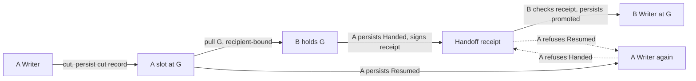

# E0. Hostile-driver Move sketch

Status is a throwaway prototype result for thread A before C1. It is not an implementation. The scratch model is [`e0-scratch/hostile_move.rs`](e0-scratch/hostile_move.rs). It is not compiled into the workspace.

## The question

Cloud drives a Move of a Volume from Machine A to Machine B under one customer approval. Cloud is malicious. Which local records and participant receipts must A and B require so the driver cannot get two incompatible outcomes? The outcomes in scope are two Writers, both sides committed, B writing from a snapshot older than A's last write, and the Volume reaching a Machine the approval does not name. The answer must keep bet 6, use no clock-based safety wait, and recover in bounded steps after a crash.

## Answer

Use **source decides**. A, the Machine that stopped writing, holds the Move's one commit point.

1. After its cut, A persists exactly one decision for the operation. The decision is `Handed { to: B, at: G }` or `Resumed`. A writes it to disk before the handoff receipt leaves A, and before the resume's Writer route runs.
2. A resumes as Writer from its own record, and only if it has not handed off. A needs nothing from B.
3. B becomes Writer only with A's signed handoff receipt for this operation and snapshot G, at exactly G.
4. A's send stream serves this Volume only to the recipient the approval names.
5. After admission expires, B accepts a pull and promotion that carry A's handoff receipt as completion of an operation A already committed. It does not treat them as new work.

The model checks this with a driver that can send any step in any order, repeat any step, withhold any step, keep every receipt, and replay a receipt from an earlier Move. No reachable state has two Writers, both outcomes, a lost write, or an unapproved recipient. From every reachable state, a clean driver with no receipts reaches exactly one Writer once admission has expired.

## Designs tried

Each design runs against the same hostile driver. "Holds" means the property holds in every reachable state. The paths come from the run output.

| Design | Two Writers | Both outcomes | Lost write | Unapproved recipient | Clean recovery |
| --- | --- | --- | --- | --- | --- |
| Envelope alone | fails | fails | fails | holds | fails |
| Target decides | holds | holds | holds | holds | holds |
| Source decides | holds | holds | holds | holds | holds |

**Envelope alone.** This is the A2 authorization with a per-Machine transition graph and consumption, but with no receipt from the other participant. Each step is individually approved, so the driver composes incompatible ones. The path is `CutA, PullB(Final), ResumeA, PromoteB(Final)`. A resumes from its record and B promotes from its approval, so two Writers result. `CutA, ResumeA, PromoteB(Warm)` also makes B write from a stale snapshot. Per-Machine consumption is necessary but not enough.

**Target decides.** B holds the commit point and persists `Committed` or `Aborted` once. B promotes only with A's signed cut receipt naming G. A resumes only with B's signed abort receipt. It is safe, but A depends on B for the back path. In the model, none of the 16 reachable states with no Writer recover while B is gone. B's abort must also be exempt from admission. With `abort_needs_admission`, the path `CutA, Expire` strands the Volume, because a B that never admitted the op can no longer abort it.

**Source decides.** Same safety, with one receipt in one direction. In the model, 8 of the 16 states with no Writer recover with B gone, because A has not handed off and resumes alone. The other 8 have A handed off, and those need B. Neither design recovers with A gone in the model, because the clean driver holds no receipt. See "B stores the receipt" under the options below.

## Each guard earns its keep

Each `Broken` flag removes one guard from a safe design. The model finds the named failure for both designs unless a row says otherwise.

| Guard removed | Fails | Path in source decides |
| --- | --- | --- |
| Decision persisted before its receipt leaves | two Writers | `CutA, PullB(Final), HandA, Crash(A), ResumeA, PromoteB(Final, Hand)` |
| One decision record per operation | two Writers | `CutA, PullB(Final), HandA, ResumeA, PromoteB(Final, Hand)` |
| Receipt bound to the operation | two Writers, lost write | `CutA, ResumeA, PromoteB(Warm, Old)` with a handoff from an earlier Move |
| Receipt bound to snapshot G | lost write | `CutA, HandA, PromoteB(Warm, Hand)` |
| Recipient-bound send stream | unapproved recipient | `CutA, PullB(Final), PullC`, which is today's `volume_send.rs` |
| Handoff receipt admits B's completion after expiry | clean recovery (source decides only) | `CutA, HandA, Expire` leaves no Writer forever |
| Abort exempt from admission | clean recovery (target decides only) | `CutA, Expire` |

The first run of source decides failed clean recovery on `CutA, HandA, Expire`. The fifth rule in the answer is the fix. Thread A's expiry rules must let a participant finish an operation that another participant's receipt shows was already committed.

## The handoff receipt

A signs it with its Machine key. It binds:

| Field | Why |
| --- | --- |
| Receipt kind `volume-handoff` and protocol version | It cannot be read as another receipt kind |
| Cluster ID | No cross-Cluster replay |
| Operation ID and the authorization envelope digest | No replay from an earlier Move. The digest ties it to the approved workflow kind, Volume, participants and Environment |
| Volume ID | The receipt names the copy it hands off |
| Source Machine ID, signing key ID and trust generation | B verifies the signature against A's key in B's own trust records (A1) |
| Target Machine ID | Redundant while a Move approval names one target. Required once a workflow names several recipients, such as a mirror set |
| Snapshot G, its GUID and its name `f-<epoch>` | B promotes at exactly the cut and not at a warm snapshot |
| A's Writer epoch at the cut and the epoch B takes | B's epoch is above A's, as the floors expect today |

It carries no timestamp or expiry. The receipt is a permanent statement by A about A. Replay is refused by the operation binding and by B's consumption record, not by time.

For comparison, target decides needs two receipts. A's cut receipt binds kind, Cluster, operation and digest, Volume, A's identity and key, G, and A's epoch. B's abort receipt binds kind, Cluster, operation and digest, Volume, B's identity and key, and the Machine allowed to resume.

## Records each Machine persists

All of these sit in A2's local consumption store and survive daemon restart. None is replicated.

**A, the source.**
- `admitted(op, digest)` on its first step of the operation.
- `cut(op, G, epoch)`, written with the cut. A re-issues receipts and answers "where is G" from it.
- `decision(op) = Handed { to, G } | Resumed`. It is written once and synced to disk before the receipt leaves or the resume runs. A repeated `HandA` re-issues the same receipt. A repeated resume is idempotent. The other one is refused.

**B, the target.**
- `admitted(op, digest)`, or completion admission on a valid handoff receipt after expiry.
- `promoted(op, G, epoch)`, written before the Writer route. It makes a resend idempotent and refuses the same receipt after a later operation has moved the Volume again.

**Nowhere.** The decision lives in no Cloud row, no Corrosion row, no lease and no clock. Lane gens and floors stay as today's fence against an honest run's late steps. Safety against a hostile driver does not need them, because the driver can mint any gen.

## Bounded recovery

A clean driver after np1 is restored asks A for its decision. If A has handed off, it re-issues the receipt, B pulls G if it lacks it, and B promotes. That takes at most three Machine steps. Otherwise A resumes in one step. The model runs this from every reachable state with admission expired and no receipts kept, and it always ends with exactly one Writer. A daemon that crashed after persisting a decision but before its effect redoes the effect from the record.

When B is gone after A handed off, the Volume has no Writer until B returns. Bet 6 already accepts that outcome ("at worst no Writer, never two"). Reversing it needs a customer-authority override on A. Thread A owns that recovery action, and it is outside this sketch.

## Where the design leans on another Machine's receipt

Thread E must argue the bet 6 red flag ("a Machine acting on another Machine's records") at each of these points.

1. **B's promotion** to Writer and its Service start require A's handoff receipt.
2. **B's completion admission** after expiry accepts the same receipt as evidence that the operation is in its completion window.
3. **B verifies A's signature** against A's key, which B trusts only through its own verified trust chain from A1. A replicated key row alone is not enough.

These points do not lean on another Machine:
- A's resume decision rests on A's own record.
- A's recipient check on the send stream uses the approval and A's own WireGuard peer table. That identity is only as good as A1's join authorization.
- A's removal of its kept Container uses A's own `Handed` record. This holds only if thread C puts the Service payload in the approval, so B can start without A's stopped Container. Today `startWriter` copies the spec from A's stopped Container (`volume-run.server.ts`). If E keeps that, A's removal must wait for B, which would add a lean in the other direction. Prefer the payload.
- Do not add a step that forgets A's slot inside the Move. That step would need B's signed promoted receipt, which is a second lean.

The case for crossing the red flag:
- The customer's approval authorizes B's effect. The receipt only narrows when B may use it. Bet 6 lets an observation narrow and forbids one that authorizes.
- The receipt is A's signed, operation-bound promise about A's own future. It says A will never write this Volume again under this operation. It claims nothing about B, and B decides about itself.
- Bet 6's test still passes. With the receipt in hand, B decides with every other Machine unreachable.
- There is no barrier, lease, quorum or clock, and no Machine the operation does not touch is involved.
- Today B promotes on Cloud's Postgres row (`commitMove`, `volume-run.server.ts:1333`). Moving the commit point onto A, the participant that holds the stopped data, puts the Move's authority back on a Machine.

## What changes in the Move flow (for E)

- `commitMove` stops being the point of no return. A new `SetVolumeCopy` step on A, the handoff, replaces it. A runs it after B confirms it holds G, and B's start carries A's receipt.
- A Release no longer chooses back or forward from the row's phase (`volume-run.inngest.ts:680` and `releaseVolume` / `finishRelease`). It asks A to re-issue its decision. If A has handed off, the Release goes forward. If A has not, the Release resumes A, and A's `Resumed` record refuses any later handoff.
- `volume_send.rs:52` serves a stream only to the approval's target, for a Volume with an admitted operation on A.

## Options not taken

- **A hands off only on B's signed "holds G" receipt.** It ensures B is admitted before A commits and avoids completion admission. It adds a lean from A on B, although only for liveness. The model shows completion admission is enough without it.
- **B stores the receipt.** A could deliver the handoff receipt directly to B, for example as the last frame of the final stream, and B could persist it. Forward recovery would then work with A gone when B already holds G. This is worth E's consideration. It does not change safety.

## Blind spots

The model is abstract. It sits above `ployz_core::plan` and treats a copy as who writes and from which snapshot. It covers one approved Move, A and B plus one unapproved peer C, one crash, and one stale receipt from an earlier Move. It does not model lane gens, Busy retries, Service holders, resizes, mirror sets, copy, restore, or two approved operations on one Volume at once. Thread E must extend the real `volume_runs.rs` model with this hostile driver, using the `verify-volume-runs` skill, and prove it on real Machines with `verify-server`.

## How to rerun the sketch

Copy `e0-scratch/hostile_move.rs` into `core/crates/ployz-verify/src/` and add `#[cfg(test)] mod hostile_move;` to its `lib.rs`. From `core/`, run `cargo test -p ployz-verify hostile_move -- --nocapture --test-threads=1`. All five tests pass. Source decides has 32 reachable states, target decides has 38, and the broken variants have up to 130.
