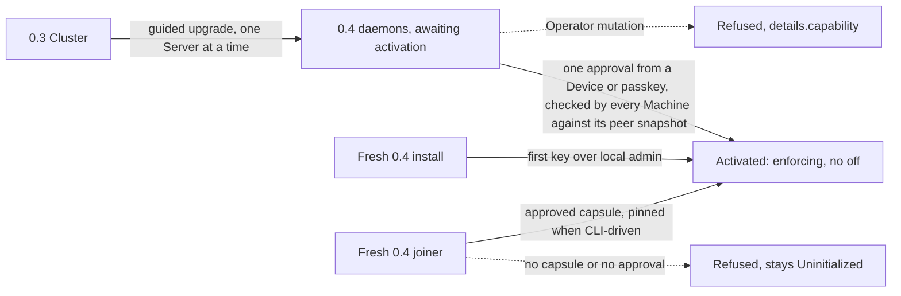

# Security 0.4 thread F plan, coverage, upgrades, maintenance and cutover

A compromised Cloud must not read secrets, run code of its choosing on a Server, take data off a Server, or add a Server or Device. Threads A to E close the routes that cross that bar, one at a time, behind a per-Cluster enforcement switch. Thread F makes the result whole. Every mutating route gets an authorization class that a test checks. Upgrades and automatic maintenance keep running. The 0.4 upgrade turns enforcement on once per Cluster with the customer's authority. In the last slice the switch is gone. Enforcement is then the only mode, and a fresh daemon refuses a join no one approved.

Two things are open on `main` today. An enforcing Machine still obeys Cloud's `Leave` and `Forget`. Either one removes every Container on a Server and resets it, with no person involved (#4049). F1 closes that. And a fresh daemon that Cloud cuts off from its join capsule enrolls with enforcement off, trusting Devices Cloud chose. Thread A accepted that residual until F removes the switch (#4025). F7 closes that.

[f-inventory.md](f-inventory.md) lists every catalog route with its class, every automatic effect, every Cloud path still sent unsigned, and every place the switch lives.

Seven PRs, in dependency order:

| Slice | Outcome | Closes |
| --- | --- | --- |
| F1 | Every catalog route has an authorization class, checked by a test. Enforcing Machines refuse Cloud's `Leave` and `Forget`. | A new route landing with no class. Cloud resetting an enforcing Server with no approval (#4049). |
| F2 | A Machine upgrades through Cloud only along the Release Channel the customer signed | Cloud choosing a release off the customer's channel |
| F3 | Ingress doors start, and Private Access turns on, under enforcement | Maintenance that today only works with enforcement off. A Cloud-chosen tailnet reaching the mesh. |
| F4 | Redeploy, rollback, Retry, a Sync's deploy and a new branch's deploy are signed in the browser | The unsigned dashboard deploys B5 left. Each is refused under enforcement today. |
| F5 | Deleting an Environment, closing a preview and removing a Server run under a signed teardown | Cloud tearing down a Namespace or a Server on its own word |
| F6 | The 0.4 upgrade ends in one activation per Cluster, which can't be turned off. Each Machine checks the starting set against its own record of its peers. | The trust-on-first-use starting set (#3945), including a key Cloud substitutes behind a Server's connection. A Server too old to enforce in an enforcing Cluster (#3980, and A1's older-admitter window). |
| F7 | The switch is gone. A fresh daemon refuses an unapproved join, and a new Cluster enforces from its first Server. | The capsule-less join (A1's residual). Every unsigned path in daemon and Cloud that crosses the bar. |

## Operator decisions

Three. The operator accepted all three recommendations on 2026-11-10, so none blocks a slice.

1. **Per-upgrade approval or a standing channel.** Automatic upgrades run with no person present (`docs/user/servers/manage-servers.md`, "Turn on automatic upgrades"). An approval per upgrade would end them on enforcing Clusters. *Decided, as recommended.* A standing channel. A person signs "this Cluster follows Stable" (or Beta) once, from a Device or with one passkey prompt, and signs again only to switch. Each Machine admits an upgrade from Cloud only to the release that channel resolves to, which the Machine reads itself. Cloud still picks when to upgrade and in what order, which is a delay or reorder under the bar.
2. **How 0.4 squares with the stable promise.** The promise says a changed route semantic gets a new `.vN` route, and the old row serves until a major. Refusing an unsigned `EnsureContainer` changes the semantic of a row that 0.3 serves. *Decided, as recommended.* A narrow, dated 0.4 exception, written into `core/DESIGN.md` by F7, with the text in "The stable-promise argument" below. Every 0.4 daemon refuses mutating Operator routes that carry no customer authority, naming `details.capability` as rule 7 already requires. A Machine still upgrades in place without re-enrolling, and every row and record stays readable. The alternative is additive activation by capability name. It needs no exception, but it keeps the unsigned paths in daemon and Cloud until 1.0 for every Cluster that never activates. That is the permanent mixed-version dispatcher the decision record rules out, and it leaves those Clusters fully exposed.
3. **What "refuses an unapproved join" can promise.** Deleting the capsule-less path stops a joiner from enrolling with no approval. A fresh daemon still has nothing to check an approval against, so Cloud could forge one under its own Sealing Key and Device. *Decided, as recommended.* Pin CLI-driven joins, and name install-line joins as a residual. Joins driven by a person's CLI (`ployz server add` from an approved Device) pass the joiner a pin of the Cluster's authority over SSH, and the joiner refuses any approval that does not chain to it. A join from Cloud's install line runs Cloud's script as root before anything else, so a pin there proves nothing. F7 names that residual once instead of building a check that can't hold.

## How to read this

Same conventions as `c-plan.md`, `d-plan.md` and `e-plan.md`. One box is one unit of work, and every box names the evidence that checks it. Check a box only when that evidence exists. Tests alone are not sufficient verification. A PR is verified only when its unit, live and perf boxes are all checked.

Terms follow `core/CONTEXT.md` (Machine, Device, Passkey, Release Channel, Sealing Key, Management Scope, Operator) and `dashboard/CONTEXT.md` (Server, Approval card, Environment). "Authorization class", "upgrade channel statement", "teardown", "activation" and "awaiting activation" are new and defined in "Design". "The switch" means `device_enforcement` in the local Machine record and everything that reads it. No log, test, fixture or screenshot prints a secret value. Nothing written for this program names a Cloud host, an address or a path on Cloud's servers.

The program plan is not on `main`. Read it with `git show 71806c2db4:docs/agents/plans/security-0.4/plan.md` (section F, checkpoints C4 and C5) and the decision record beside it.

## Design

### Authorization classes

Each catalog route gets exactly one class, in a table in `ployz_core::authority::coverage`, keyed by the generated capability constants.

| Class | Meaning | An Operator's call on an enforcing Machine |
| --- | --- | --- |
| `Read` | Changes nothing on the Machine | Served |
| `Full` | Catalog scope `Full` | Refused at dispatch (`machine_api/mod.rs:212`) |
| `Signed(statements)` | Needs a statement a trusted key signed. The list names which statements admit it, and it may be empty. | Refused without one, naming the route's capability |
| `Bound(reason)` | Served unsigned. The reason says why the worst Cloud can do is mislabel, reorder, delay or drop, or an effect that crosses no part of the bar. | Served |
| `Pending(slice)` | Not gated yet. The slice that gates it is named. | Served, as today |

`Pending` is a migration state. F7 deletes the variant, so the build fails while any route still has it. That is how "every mutating route has a class" stays true after F. A new route cannot reach `main` without a class, because the completeness test fails, and `Pending` needs an edit to a frozen list.

Two tests hold the table to the code. A static test in `ployz-core` checks that every catalog route appears exactly once, that `Full` matches the catalog's scope column both ways, and that the `Pending` list equals a frozen list. A behaviour test in `ployzd` drives each `Signed` route through the real `MachineApi` as an Operator on an enforcing Machine, with a valid request that carries no statement. It checks the refusal names `details.capability` and that nothing changed. A `Signed` route without a sample request fails the test.

**The live matrix comes from the table.** "Unsigned" is not the same as "refused". A `Bound` route succeeds unsigned by design, and one route can carry several mutations with different answers. So F1 also writes `CASES` beside the table, one case per branch: the capability, the branch (for example `EnsureContainer` create, or `EnsureContainer` restart), the request the harness sends, and what an enforcing Machine must do with it from Cloud.

| Expected | Meaning | Used for |
| --- | --- | --- |
| `Refused` | Refused, naming the capability. Nothing changed. | Every branch of a `Signed` row, and a `Full` row sent from the mesh |
| `Bounded(check)` | Served, and the named check holds. For example, a door with another image is refused while the pinned image is served. | A `Bound` row whose reason has a check |
| `Served` | Served | A `Bound` row whose reason is a residual, and a `Pending` row until its slice |

The static test checks that every `Signed` and `Bound` row has at least one case, and that each multi-branch route in f-inventory.md "Live matrix" has a case for every branch listed there. The behaviour test runs every case, not only the `Signed` rows. `cargo run -p ployz-core --example coverage_cases` prints the cases as JSON. The attacker harness reads that output at the head under test and keeps no list of its own, so a live lane follows the table as later slices move rows.

### The upgrade channel

One statement, `UpgradeChannel`, in `ployz_core::authority::upgrade`, signed under `Purpose::Rule`, so a session grant cannot sign it. It binds the Cluster's Sealing public key, the channel (`stable` or `beta`), and a generation. It names no Machines and no release, and it does not expire.

Cloud stores the signed statement with the Organization's upgrade settings and attaches it to every `RequestMachineUpgrade` as an optional field. On an enforcing Machine, an Operator request is admitted when:

- the statement verifies against this Machine's trusted keys and names this Cluster;
- its generation is at least the highest this Machine has accepted, which it then records;
- the request names that channel, or an exact version equal to what that channel resolves to now.

The Machine resolves the channel itself, as it does today (`installer/release.rs:126`), so the pointer read and the minisign check stay where they are. The downgrade refusal (`installer/upgrade.rs:130`) is unchanged. A Full caller keeps `AnyRelease`.

This only promises something if Ployz Cloud's operator cannot produce a signed release. F2 merges only after the release-signing protections in the operator's checklist are applied.

### Teardowns

A teardown is a `Workflow` statement that names what goes and what is lost. It comes in three kinds.

| Kind | Names | Permits |
| --- | --- | --- |
| Namespace | The Cluster, the Namespace, the Machines, the Volumes lost | `Out` and `Remove` of every Container in that Namespace on those Machines, and `RemoveVolume` of the named Volumes there |
| Preview | Covered by D7's preview rule, not signed again | The same, for the rule's derived Namespace when its pull request closes |
| Server | The departing Machine, the Machines told to forget it, whether its copies are kept | `Leave` on the departing Machine, `Forget` on the others |

The existing data-loss confirmation stays first, and what the person confirmed is inside what they sign, as E6 does for Volumes. A dashboard teardown uses the passkey's own prompt, not a session. A Device's CLI signs with no prompt.

### Activation

Activation is today's `ployz device enforce` with three changes. Every key in the starting set must match a source Cloud doesn't write, closing #3945. The set refuses any Machine that does not advertise `ployz.machine.enforced.v1`. And there is no `--off`.

**Where the starting set's keys come from.** Today `enforce` reads each member through the connections in Cloud's Server Access response (`ployz/src/handlers/server.rs:142`). Cloud picks both the key a connection dials and the Machine that answers. It can put its own key behind a Server's name, answer `Inspect` with a matching member, and advertise `ployz.machine.enforced.v1`. Nothing Cloud returns can pin a key, so F6 takes keys from two sources Cloud doesn't write. The dashboard path can use only the first.

1. **Each Machine's own peer snapshot, on every path.** The first time a daemon that advertises `ployz.machine.enforced.v1` starts, it writes the ID and WireGuard public key of every Member its record holds to a local snapshot. After that, the snapshot grows only by a join whose signed `JoinApproval` this Machine verified, so Cloud can't add to it. `SetDeviceEnforcement` refuses a starting set that names a Member outside the snapshot, or a known ID under another key, and names that Member. Each Machine checks only its own snapshot (bet 6). If Cloud pads or swaps a Member in the set, every real Machine refuses it. If Cloud trims the set, that's a drop.
2. **The signer's own pins, on the CLI path.** The CLI signs nothing until it has pinned every Server's key from one of three places. The first is the Machines this Device approved a join for. `approve_waiting_join` already shows the joiner's key (`ployz/src/handlers/device.rs:282`), and F6 records the ID and key in a known-Machines file beside the Device key. The second is a key read over the person's own SSH from that Server's local socket. The third is a fingerprint the person confirms against `ployz status` run on that Server's console. The Server Access response then supplies only addresses. The CLI reads each member over a connection that dials the pinned key, and refuses to sign while any Server is unpinned, naming it. `--yes` doesn't confirm a fingerprint, so a non-interactive run needs a Device pin or an SSH pin.
3. **The dashboard-only path.** Cloud serves the page, so nothing the browser shows or builds is independent of Cloud. The passkey signs whatever set the page gives it, so this path rests on source 1 alone. The page lists each Server with its key fingerprint and tells the person to compare it with `ployz status` on the box. That comparison catches a swap, but nothing enforces it.

Source 1 can't see a Machine that Cloud added to the mesh before any Server started F6's daemon, because that Machine is in every snapshot. The CLI path refuses it unless the person pins it. The dashboard path trusts it. That exposure dates from the 0.3 Cluster rather than from activation, and every Server on that path was added through Cloud's install line, which decision 3 already names. A Server that joined without approval after the snapshot is named at activation. The person removes it, or approves its join again first.

`ployz.machine.enforced.v1` is a new capability row. A daemon advertises it only when it gates every route the coverage table classes `Signed` at that daemon's version, and when it publishes an approved joiner only after the joiner's confirmation (#4025). Its meaning is fixed at F6's set and never widens. A Server too old for it is named and left out, which closes #3980. It also closes A1's older-admitter window, since an admitting Machine from before #4025 cannot be in an activated Cluster.

For a dashboard-only customer, activation is the last step of the guided 0.4 upgrade. Cloud does not roll a Cluster from 0.3 to 0.4 automatically.

**Awaiting activation** is the state a 0.3 record comes up in on its first 0.4 start once F7 lands. Workloads keep running. The Machine keeps peering with the Machines its record already held, but it trusts none of them to admit a join or receive the Sealing Key. Reads and `RequestMachineUpgrade` are served. Every other mutating Operator route is refused, with `next` naming the command or dashboard step that activates. Activation moves the record to activated in one write, and nothing moves it back.

### The stable-promise argument

The promise covers what a daemon carries or speaks. 0.4 keeps every part of it except one route semantic.

| Promise | Under 0.4 |
| --- | --- |
| A daemon upgrades across 0.x without re-enrolling | Kept. A 0.3 Machine upgrades in place and comes up awaiting activation. |
| Replicated rows, local records, enrollment and the release source stay readable | Kept. Every new field is optional, and `device_enforcement` is read once to decide awaiting or activated, then ignored. |
| Rule 4: changed semantics get a new `.vN` route, and the old row serves until a major | **Broken, narrowly.** A mutating Operator route without customer authority is refused on every 0.4 daemon. |
| Rule 7: every refusal names `details.capability` | Kept, and checked by F1's behaviour test for every `Signed` route |
| A breaking line protects older Clusters from its own side | Kept. 0.4 Cloud drives a 0.3 Machine only to upgrade it. |

The text F7 adds to `core/DESIGN.md`, under "Stable promise":

> **The 0.4 authority exception.** From 0.4, a Machine refuses a route that changes it when the request carries no customer authority, and names the route's capability. This is the only semantic 0.x has withdrawn. It is not a precedent. The next withdrawal waits for a major.

Additive activation by capability name was weighed and rejected (Appendix B).

### What remains

Named once in each PR body, then left alone.

- Cloud chooses when each Machine upgrades, in what order, and whether at all. It can keep using an older channel statement on a Machine that never saw the newer one, until that Machine sees it. The person approved that channel earlier.
- `Bound` routes stay open by design. Cloud can rename a Server, change its labels and endpoints, set resource limits low enough to starve a Service, prune unused images, choose network paths, and set where crash events go. Each is a mislabel, a delay or a drop, or data Cloud already reads.
- `PublishCertificateMaterial` and the tunnel token in `SetIngressDoors` are DNS and Cloudflare authority Cloud already holds. Thread X owns them.
- A Server added from Cloud's install line ran Cloud's script as root before it joined (decision 3). A Cluster founded from that line trusts the first key that line installs (Appendix A gap 6).
- A teardown a person approved runs in the order and at the time Cloud picks.
- A dashboard-only activation trusts a Machine that Cloud added to the mesh before any Server started F6's daemon. That Machine is in every peer snapshot, and only the CLI path's pins catch it ("Activation").
- Cloud can leave a real Server out of the starting set. That's a drop. The Server stays awaiting activation and is named.

## Program checklist

The program runs the way `c-plan.md` "Program checklist" says, from arming and the audit tick to owners, PR mechanics, verdict and merge. These differences apply.

- [ ] Dependency graph. F1 branches from `main` now. F2 after F1 and Appendix A gaps 1 and 2. F2 merges only after the release-signing protections in the operator's checklist are applied. F3 after F1 and gap 2. F4 after F1 and D6 merged (a built-image rollback is D6's statement). F5 after F1, gaps 3 to 5, and E6 merged (gap 5). F6 after F2 to F5, D4, E8 and gap 7. It is the C4 integration slice. F7 after F6, thread R's findings at C4 resolved or accepted, and gap 6.
- [ ] Hotspots. `rpc_catalog.rs` gains one row in F2, F3, F5 and F6 each. `machine_api/local.rs`, `restart_approval.rs` and `dashboard/src/server/schema.ts` are shared with C, D and E. Each F PR adds one row or one `admit_*` call and rebases promptly.
- [ ] File boundaries. F1 touches `core/crates/ployz-core/src/authority/{coverage,mod}.rs` (new module), `core/crates/ployz-core/tests/capabilities.rs`, `core/crates/ployzd/src/machine_api/{local,authorization_tests}.rs`, `core/crates/ployzd/src/machine/local_machine/restart_approval.rs` (`admit_operator_departure`), `core/crates/ployz/src/handlers/server/` (refusal copy) and `docs/user/servers/manage-servers.md`. F2 adds `core/crates/ployz-core/src/authority/upgrade.rs` and touches `core/crates/ployz-core/src/rpc/upgrade.rs` (one field), `rpc_catalog.rs`, `core/crates/ployzd/src/machine/local_machine/upgrade.rs`, `core/crates/ployzd/src/installer/upgrade.rs` (`ReleaseChoice`), `restart_approval.rs` (one record kind), the `ployz server upgrade-policy` handler, `dashboard/src/modules/server-upgrade/**` and the docs. F3 touches `machine_api/local.rs` (`set_ingress_doors`, `set_private_access`), `core/crates/ployz-core/src/authority/` (`PrivateAccessApproval`), `dashboard/src/modules/{ingress,private-access}/**` and the docs. F4 touches only `dashboard/src/modules/{config-store,approval-session,service-act}/**` and `docs/user/deploy/**`. F5 adds `core/crates/ployz-core/src/authority/teardown.rs` and touches `deploy_approval.rs`, `machine_api/local.rs` (`leave`, `forget`, `remove_volume` hand-off to E6's check), `core/crates/ployz/src/deploy/pipeline.rs` (`destroy_namespace`), `dashboard/src/modules/machines/{namespace-cleanup,machine-removal}*`, and the docs. F6 touches `core/crates/ployz/src/handlers/device.rs` (pins and the known-Machines file), `core/crates/ployzd/src/machine/` (the peer snapshot), `restart_approval.rs` (`set_device_enforcement`), `rpc_catalog.rs`, `dashboard/src/modules/server-upgrade/**`, `dashboard/src/modules/machines/server-policy*` and the docs. F7 touches every file in f-inventory.md "Where the switch lives", `core/DESIGN.md`, `core/crates/ployzd/src/machine/store.rs` (`member`, `founder`) and `docs/user/servers/{add-a-server,manage-servers}.md`.
- [ ] Bets every F PR names. The stable promise, with the argument above, and from F7 the exception. Bet 8, evidence over claims, because the dashboard calls a Cluster protected only from each Machine's own answer, and refusals name the capability. Bet 6, Machine-local authority, because each Machine checks the channel, the teardown and its own activation, and reads no other Machine's record. Bet 7, Cloud drives and never owns, because Cloud stores statements it cannot make. Bet 3, bounded imperative commands, because a channel statement and a teardown are evidence for one command, not desired state.
- [ ] Residuals each F PR names once. See "What remains".
- [ ] Live lanes run per `c-plan.md` "Boot recipe", with `--machines 3` where a lane says so. The attacker harness is C1's `.audit/c-attacker/`. From F1 it takes its route cases from `coverage_cases` at the head under test. It is also extended with `Leave`, `Forget`, `RequestMachineUpgrade`, `SetIngressDoors`, `SetPrivateAccess`, a stripped enroll response and a forged one.
- [ ] Model checks. `verify-upgrade-attempt` runs in F2, since `ReleaseChoice::admit` sits inside `request_locked`. `verify-volume-runs` runs in F5 if `RemoveVolume`'s hand-off touches a run guard.

## Classify every route, and refuse Cloud's Leave and Forget (F1)

Outcome. `ployz_core::authority::coverage` holds one authorization class per catalog route, and two tests keep it honest. On a Machine with enforcement on, an Operator `Leave` or `Forget` is refused before any Container stops, naming the capability. A person's Device over a direct connection, and the local socket, still remove and forget Servers. Attack path closed. A new route can no longer reach `main` without a class. Cloud can no longer remove every Container on an enforcing Server, demote its Volumes and reset it to a fresh, unenforced daemon, either directly with `Leave` or through another Machine with `Forget`, which makes the forgotten Machine fence itself (`forgotten_fence.rs:238`).

What users lose until F5. On an enforcing Cluster, the dashboard's **Remove server** and `ployz server rm` through Cloud are refused. The refusal says to run `ployz server rm` from an approved Device. Clusters that do not enforce are unchanged.

**Depends on.** `main`. Nothing else.

**Files.**

- [ ] Create `core/crates/ployz-core/src/authority/coverage.rs` with `Authorization` (the five classes), `Statement` (`Join`, `Deploy`, `Restart`, `Proposal`, `Rule`, `Volume`, `Upgrade`, `Teardown`, `PrivateAccess`), `AUTHORIZATION`, `authorization(capability)`, `Expected` (`Refused`, `Bounded`, `Served`) and `CASES`. Fill the table from f-inventory.md, "Every route", and the cases from "Live matrix". Export it from `authority/mod.rs`. Add `core/crates/ployz-core/examples/coverage_cases.rs`, which prints `CASES` as JSON.
- [ ] Edit `core/crates/ployz-core/tests/capabilities.rs` to add `every_route_has_one_authorization_class` (completeness and uniqueness), `full_class_matches_catalog_scope` (both ways), `pending_routes_are_the_frozen_list` and `every_signed_and_bound_route_has_its_cases`.
- [ ] Edit `core/crates/ployzd/src/machine/local_machine/restart_approval.rs` to add `admit_operator_departure(capability)`, beside `admit_operator_build` (`:108`). Under enforcement it refuses with `Error::DepartureRefused { capability }`, which names the capability.
- [ ] Edit `core/crates/ployzd/src/machine_api/local.rs` so `leave` (`:917`) and `forget` (`:924`) call it when `from_operator`, before `depart` or `forget_machine` runs.
- [ ] Create `core/crates/ployzd/src/machine_api/authorization_tests.rs`. For each entry in `CASES`, it builds the case's request with no statement, sends it as an Operator through `MachineApi` on an enforcing Machine, and checks the expected answer: refused with nothing changed, served with the check holding, or served. `sample_request` is a `match` on the case, so a case with no sample fails the test.
- [ ] Extend C1's attacker harness in `.audit/c-attacker/` to read the `coverage_cases` output instead of a hand list.
- [ ] Map the refusal in `core/crates/ployz/src/handlers/server/` and the dashboard's removal error to "This server leaves only when you approve it. Run `ployz server rm` from an approved device." Run it through the `ui-copy` skill.
- [ ] Edit `docs/user/servers/manage-servers.md` ("Remove a server", "Forget a server that is gone", the enforcement section).

**Verify, unit.**

- [ ] `cargo nextest run -p ployz-core --test capabilities` passes. A scratch commit that adds a catalog row with no class fails `every_route_has_one_authorization_class`, naming the capability. Record the failing output in the PR body.
- [ ] `ployzd` tests. An Operator `Leave` under enforcement is refused, and the Machine is still Participating with its Containers and Volume roots unchanged. An Operator `Forget` naming another Machine is refused, and that Machine's row is still in the store. A Full caller is admitted for both, and so is an Operator with enforcement off.
- [ ] `cargo nextest run -p ployzd authorization_tests departure` passes. Every refusal names the route's capability or the statement capability its class lists. Every `Bounded` case's check holds, and every `Served` case is served.

**Verify, live.** Eight lanes, three Machines, per the boot recipe.

- [ ] Lane 1. Regression lane against trunk. Enforcement off. `ployz server rm web-3` through Cloud at trunk and head. Save `f1-enforce-off.png`. Pass when both remove it.
- [ ] Lane 2. Attacker harness. Enforcement on. `Leave` to web-3 as Cloud. Save `f1-leave-refused.png`. Pass when it is refused naming `ployz.machine.leave.v1`, `docker ps` on web-3 is unchanged, and `ployz status` there says Participating.
- [ ] Lane 3. Attacker harness. `Forget` web-3 sent to web-1 as Cloud. Save `f1-forget-refused.png`. Pass when it is refused, web-3's row is in every Machine's store, and web-3's journal shows no fence.
- [ ] Lane 4. On trunk, run lane 2's request. Save `f1-trunk-leave.png`. Pass when trunk resets web-3. This records the hole the slice closes.
- [ ] Lane 5. Enforcement on. `ployz server rm web-3` from `cli --device` with a direct connection. Save `f1-device-rm.png`. Pass when web-3 leaves.
- [ ] Lane 6. Enforcement on. The dashboard's **Remove server**. Save `f1-dashboard-rm.png`. Pass when it shows the new refusal and nothing stops.
- [ ] Lane 7. Kill `ployzd` on web-3 while a refused `Leave` is in flight. Save `f1-kill.png`. Pass when the restarted daemon still refuses.
- [ ] Lane 8. Read the changed `docs/user` page against lanes 5 and 6. Save `f1-docs.png`. Pass when every sentence matches.

**Verify, perf.**

- [ ] Metric. Time to refusal for an Operator `Leave` under enforcement. Rule: under 100 ms at the median of ten calls. No trunk equivalent. Record that.
- [ ] Metric. `cargo nextest run -p ployz-core --test capabilities` wall time, trunk and head. Rule: within 2 seconds of trunk.

**Review gate.** None.

## Upgrade only along the channel the customer signed (F2)

Outcome. A person sets their Cluster's Release Channel once with `ployz server upgrade-policy set --releases stable` from a Device, or with one passkey prompt under **Upgrade settings**. Upgrades through Cloud, automatic or by hand, then run as today with no prompt. A Machine with enforcement on admits an Operator upgrade only to the release the signed channel resolves to, read by the Machine itself. Attack path closed. Cloud can no longer move a Stable Cluster onto a beta, or name an exact version off the customer's channel.

What users lose. On an enforcing Cluster with no signed channel, upgrades through Cloud are refused until someone signs one. Cloud offers the prompt before the first upgrade.

**Depends on.** F1. Appendix A gaps 1 and 2.

**Gate.** F2 merges only after the release-signing protections in the operator's checklist are applied.

**Files.**

- [ ] Create `core/crates/ployz-core/src/authority/upgrade.rs` with `UpgradeChannel` (`cluster`, `channel`, `generation`), `verify` and a golden test. Generate its TypeScript in `core/crates/ployz-sdk/`.
- [ ] Edit `core/crates/ployz-core/src/rpc/upgrade.rs` so `RequestMachineUpgradeRequest` gains `channel: Option<Signed<UpgradeChannel>>`, optional and skipped when absent. Edit `rpc_catalog.rs` to add `UPGRADE_CHANNEL_CAPABILITY: ("ployz.machine.upgrade.channel.v1", Always)`, and add its `ABOVE_FLOOR` row. A Cloud that finds a Machine without it sends no statement, and the Machine upgrades along the channel as today.
- [ ] Edit `core/crates/ployzd/src/installer/upgrade.rs` so `ReleaseChoice` gains `Signed(MachineRelease)`. `admit` (`:160`) refuses a request whose release is another channel, or an exact version that channel does not resolve to, with `Error::OffChannel`.
- [ ] Edit `core/crates/ployzd/src/machine/local_machine/upgrade.rs` so `request_upgrade` verifies the statement for an Operator under enforcement, checks and records the generation high-water mark, and passes `Signed`. With enforcement on and no statement it refuses naming `ployz.machine.upgrade.channel.v1`.
- [ ] Edit `restart_approval.rs` to hold the generation high-water mark per Cluster, synced before the upgrade's receipt is written.
- [ ] Edit the `ployz server upgrade-policy set` handler to sign a new generation with the Device key and print the channel it approved.
- [ ] Edit `dashboard/src/modules/server-upgrade/**` to store the signed statement with the Organization's settings per Cluster, send it with every request, and ask the passkey directly when **Releases** changes. Run the strings through `ui-copy`.
- [ ] Run the `verify-upgrade-attempt` model check.
- [ ] Edit `docs/user/servers/manage-servers.md` ("Choose Stable or Beta releases", "Upgrade from the CLI").

**Verify, unit.**

- [ ] `authority::upgrade` tests. A statement for another Cluster, a session-signed statement, an unknown key and a lower generation are each refused with their `AuthorityRefusal`.
- [ ] `installer/upgrade.rs` tests with a fake release source. Under `Signed(Stable)`, `beta` is refused, an exact version equal to Stable's pointer is admitted, and the next beta's exact version is refused. Existing signature and downgrade tests still pass.
- [ ] `local_machine/upgrade.rs` tests. Enforcement on and no statement is refused. A statement of generation 2 then one of generation 1 refuses the second, also after a reload. Enforcement off ignores the field. Run `cargo nextest run -p ployz-core authority::upgrade` and `-p ployzd upgrade`.
- [ ] Vitest for `server-upgrade` storing and sending the statement, and for the prompt firing only on a change.

**Verify, live.** Eight lanes, three Machines. Lanes 3 and 4 point `PLOYZ_CHANNEL_URL` at a test channel, as `manage-servers.md` describes.

- [ ] Lane 1. Regression lane against trunk. Enforcement off. Upgrade one Server through Cloud at trunk and head. Save `f2-enforce-off.png`. Pass when both upgrade.
- [ ] Lane 2. Enforcement on. Sign Stable from `cli --device`, then **Upgrade** in the dashboard. Save `f2-upgrade.png`. Pass when every Server upgrades with no prompt and each journal names the channel generation.
- [ ] Lane 3. Attacker harness. Request `beta` on a Stable-signed Machine. Save `f2-beta-refused.png`. Pass when it is refused naming the channel and the version is unchanged.
- [ ] Lane 4. Attacker harness. Request the exact version the test channel's beta points at. Save `f2-exact-refused.png`. Pass when it is refused.
- [ ] Lane 5. Switch to Beta in the dashboard with one passkey prompt, then switch back to Stable. Replay the Beta statement. Save `f2-replay.png`. Pass when the replay is refused naming the generation.
- [ ] Lane 6. Turn on automatic upgrades with a signed channel, and let the 3-day hold pass on the test channel. Save `f2-automatic.png`. Pass when the rollout upgrades every Server with no prompt.
- [ ] Lane 7. Kill `ployzd` between the generation write and the receipt. Save `f2-kill.png`. Pass when a resend finishes the same attempt.
- [ ] Lane 8. Read the changed `docs/user` sections against lanes 2 and 5. Save `f2-docs.png`. Pass when every sentence matches.

**Verify, perf.**

- [ ] Metric. Request to Accepted for an Operator upgrade, enforcement off at trunk and on at head, ten each, interleaved. Rule: within 50 ms of trunk at the median. Statement verification alone under 2 ms.

**Review gate.** The operator reviews the **Upgrade settings** prompt and the CLI's printed channel, with lane 2 and 5 screenshots and a 30 to 60 second video.

## Keep ingress and Private Access running under enforcement (F3)

Outcome. Under enforcement, Cloud starts and repairs the Ingress Proxy and its doors as it does with enforcement off, and the daemon renews certificates with Cloud unreachable. Turning Private Access on takes one passkey prompt, and turning it off takes none. Attack path closed. Cloud cannot turn on a Private Access router that joins a tailnet the customer did not approve, which would reach every Service on the mesh. Ingress doors run only images the daemon pins, so serving them unsigned crosses no part of the bar.

**Depends on.** F1. Appendix A gap 2.

**Files.**

- [ ] Edit `core/crates/ployzd/src/machine_api/local.rs` so `set_ingress_doors` (`:1161`) no longer calls `admit_operator_deploy` under enforcement. It checks that each door's image is the daemon's pinned image and refuses any other, naming `ployz.ingress.doors.v1`. Class `Bound`.
- [ ] Create `PrivateAccessApproval` in `core/crates/ployz-core/src/authority/` (`Workflow`, passkey-direct or Device, binding the Cluster and the digest of `sealed_auth_key`). Edit `SetPrivateAccessRequest` to carry it as an optional field. Add `PRIVATE_ACCESS_APPROVAL_CAPABILITY: ("ployz.private-access.approval.v1", Cluster)`.
- [ ] Edit `set_private_access` (`:1173`) so an Operator under enforcement needs the approval to turn on. Turning off needs none.
- [ ] Edit `dashboard/src/modules/ingress/doors.server.ts` to stop treating enforcement as a refusal. Edit the Private Access settings flow to seal the key in the browser and ask the passkey once.
- [ ] Edit `docs/user/services/private-networking.md` and the enforcement section of `manage-servers.md`.

**Verify, unit.**

- [ ] `ployzd` tests. `SetIngressDoors` with the pinned image is admitted for an Operator under enforcement, and one with another image is refused. `SetPrivateAccess` on with no approval, and with an approval over another ciphertext, are refused. Off is admitted. Run `cargo nextest run -p ployzd ingress_doors private_access`.
- [ ] F1's `authorization_tests` covers `SetPrivateAccess` as `Signed`.

**Verify, live.** Seven lanes.

- [ ] Lane 1. Regression lane against trunk. Enforcement off. Add a Server that accepts ingress at trunk and head. Save `f3-enforce-off.png`. Pass when its Ingress Proxy serves.
- [ ] Lane 2. Enforcement on. Add the same Server. Save `f3-ingress.png`. Pass when its doors come up with no prompt.
- [ ] Lane 3. Attacker harness. `SetIngressDoors` with a door image Cloud picked. Save `f3-door-image.png`. Pass when it is refused and `docker ps` shows the pinned image only.
- [ ] Lane 4. Stop the Boat Cloud and move the clock past a certificate's renewal window on one Server. Save `f3-renewal.png`. Pass when Caddy renews and the route still serves.
- [ ] Lane 5. Enforcement on. Turn Private Access on from the dashboard. Save `f3-private-access.png`. Pass when one prompt appears and the router serves.
- [ ] Lane 6. Attacker harness. `SetPrivateAccess` on with a key sealed by the harness. Save `f3-tailnet-refused.png`. Pass when it is refused and no router Container exists.
- [ ] Lane 7. Read the changed `docs/user` pages against lanes 2 and 5. Save `f3-docs.png`. Pass when every sentence matches.

**Verify, perf.**

- [ ] Metric. `SetIngressDoors` admission, trunk enforcement off and head enforcement on, ten each. Rule: within 20 ms at the median.

**Review gate.** The operator reviews the Private Access prompt with lane 5's screenshot.

## Sign the dashboard deploys B5 left (F4)

Outcome. **Redeploy**, rollback, **Retry**, a Sync's deploy and a new branch's first deploy build their deploy approval in the browser, the way B5's **Deploy** does, under the same session. A Git-sourced rollback uses D6's `BuildApproval`. Attack path closed. None on the Machine, which already refuses these unsigned. What closes is the reason to keep enforcement off. Every dashboard deploy now works on an enforcing Cluster.

**Depends on.** F1. D6 merged.

**Files.**

- [ ] Edit `dashboard/src/modules/config-store/**` so each of the five actions calls B5's approval helper with the plan it shows. Add the approval field to the Store's Retry.
- [ ] Edit `dashboard/src/modules/service-act/**` where a rollback starts.
- [ ] Edit `docs/user/deploy/deployments.md` and `docs/user/deploy/history-and-rollback.md` to remove "still unsigned".

**Verify, unit.**

- [ ] Vitest. Each action's body equals the Rust golden digest for the same plan. A plan for another Environment is refused before signing. Run `pnpm exec vitest run src/modules/config-store src/modules/approval-session`, then `pnpm typecheck` and `pnpm lint`.

**Verify, live.** Seven lanes, `verify-dashboard` with `SERVERS=1`, enforcement on.

- [ ] Lane 1. Regression lane against trunk. Enforcement off. Each of the five actions at trunk and head. Save `f4-enforce-off.png`. Pass when all deploy.
- [ ] Lanes 2 to 6. One lane per action, enforcement on. Save `f4-<action>.png`. Pass when it deploys inside the session with no extra prompt, and the Server logs the passkey.
- [ ] Lane 7. Attacker harness. Rewrite the plan a Redeploy reads, as B5's lane 6 did. Save `f4-tampered.png`. Pass when the Server refuses and the page shows why.

**Verify, perf.**

- [ ] Metric. Press to Deployment page for Redeploy, enforcement off at trunk and on at head, ten each, interleaved. Rule: within 200 ms, B5's rule.

**Review gate.** The operator reviews the five actions with screenshots and a video.

## Tear down a Namespace or a Server under approval (F5)

Outcome. Deleting an Environment, closing a preview and removing a Server keep their data-loss confirmations, then ask for one passkey prompt in the dashboard, or none from a Device's CLI. Each Machine removes only what the signed teardown names. A closed preview's Namespace is torn down under its own preview rule. Attack path closed. Cloud cannot remove a Namespace's Containers or a Server on its own word. F1's blanket refusal of `Leave` and `Forget` becomes a check.

**Depends on.** F1. Appendix A gaps 3, 4 and 5. E6 merged.

**Files.**

- [ ] Create `core/crates/ployz-core/src/authority/teardown.rs` with `Teardown` (`Namespace` and `Server` kinds, from "Design"), `verify` and golden bytes. Add `TEARDOWN_CAPABILITY: ("ployz.teardown.v1", Always)`.
- [ ] Edit `deploy_approval.rs` so an `Out` or `Remove` step for a Container in a Namespace is admitted under a Namespace teardown that names this Machine.
- [ ] Edit `machine_api/local.rs` so `leave` and `forget` admit an Operator under a Server teardown that names this Machine and the forgotten one. `RemoveVolume` goes through E6's Volume check (gap 5).
- [ ] Edit `core/crates/ployz/src/deploy/pipeline.rs` (`destroy_namespace`, `:139`) and `core/crates/ployz/src/handlers/server/` to sign after the confirmation and carry the statement.
- [ ] Edit `dashboard/src/modules/machines/{namespace-cleanup,machine-removal}*` to send it. The preview close path sends the preview rule (gap 4).
- [ ] Edit `docs/user/servers/manage-servers.md` and the Environment deletion page.

**Verify, unit.**

- [ ] `authority::teardown` refuses another Namespace, another Machine, a session signer and an expired statement.
- [ ] `ployzd` tests. A `Remove` in another Namespace under a teardown is refused. A `Leave` under a teardown naming another Machine is refused. Run `cargo nextest run -p ployz-core authority::teardown` and `-p ployzd teardown`.
- [ ] CLI tests. The loss the person confirmed equals the loss in the signed statement.

**Verify, live.** Eight lanes, three Machines, enforcement on.

- [ ] Lane 1. Regression lane against trunk. Enforcement off. Delete an Environment and remove a Server. Save `f5-enforce-off.png`. Pass when both behave as at trunk.
- [ ] Lane 2. Delete an Environment from the dashboard. Save `f5-env-delete.png`. Pass when the confirmation shows first, one prompt second, and every Machine logs the teardown.
- [ ] Lane 3. Remove web-3 from `cli --device`. Save `f5-server-rm.png`. Pass when it leaves.
- [ ] Lane 4. Attacker harness. A Namespace teardown replayed against another Namespace. Save `f5-other-ns.png`. Pass when every `Remove` is refused.
- [ ] Lane 5. Attacker harness. `Leave` to web-2 under web-3's Server teardown. Save `f5-other-server.png`. Pass when web-2 refuses.
- [ ] Lane 6. Close a trusted preview's pull request (needs D7). Save `f5-preview-close.png`. Pass when its derived Namespace is torn down with no prompt.
- [ ] Lane 7. Kill `ployzd` mid-teardown. Save `f5-kill.png`. Pass when the resend finishes it under the same statement.
- [ ] Lane 8. Read the changed `docs/user` pages against lanes 2 and 3. Save `f5-docs.png`. Pass when every sentence matches.

**Verify, perf.**

- [ ] Metric. Environment deletion, trunk enforcement off and head enforcement on, five each, excluding prompt time. Rule: within 1.2 times.

**Review gate.** The operator reviews the teardown confirmation and prompt with screenshots and a video.

## Turn enforcement on with the 0.4 upgrade, once per Cluster (F6, checkpoint C4)

Outcome. A 0.3 customer upgrades their Servers to 0.4 from the dashboard or CLI, then approves one activation for the Cluster, from a Device or with one passkey prompt. Each Machine accepts the starting set only when every Member in it is in that Machine's own peer snapshot. The CLI also signs only keys it pinned itself. Activation refuses any Server that cannot enforce, and has no off. The dashboard calls a Cluster protected only when every Server reports activated. Attack path closed. Cloud cannot put its own key into the starting set (#3945). That covers a key swapped behind a Server's name, where Cloud supplies both the connection's identity and an `Inspect` answer to match, and a Member added to the set the passkey signs in the dashboard. A Server too old to enforce cannot sit in an enforcing Cluster (#3980). An admitting Machine from before #4025 cannot publish a joiner under Cloud's Devices (A1's older-admitter window). This slice is the C4 integration run.

**Depends on.** F2 to F5. D4 and E8 merged. Appendix A gap 7 (the snapshot and the approval that travels with a Member row).

**Files.**

- [ ] Edit `rpc_catalog.rs` to add `ENFORCED_CAPABILITY: ("ployz.machine.enforced.v1", Always)`, advertised only by a daemon that gates every `Signed` route and publishes joiners only after confirmation.
- [ ] Create the peer snapshot in `core/crates/ployzd/src/machine/` (gap 7). Write it on the first start that advertises `ployz.machine.enforced.v1`, and extend it only on a verified `JoinApproval`. Edit `restart_approval.rs` so `set_device_enforcement` refuses a starting set that names a Member outside it, naming the Member.
- [ ] Edit `core/crates/ployz/src/handlers/status_servers.rs` so `ployz status` over the local socket prints this Machine's key fingerprint. It prints none today, and the third pin source and the dashboard page both compare against it.
- [ ] Add a known-Machines file beside the Device key, next to the `key` module in `core/crates/ployz/src/handlers/device.rs`. `approve_waiting_join` (`device.rs:282`) records the approved joiner's ID and key there.
- [ ] Edit `core/crates/ployz/src/handlers/device.rs` so `enforce` pins every Server's key first, from the known-Machines file, from an SSH read of the local socket, or from a fingerprint the person confirms. Then it reads each member over a connection that dials the pinned key and uses the Server Access response only for addresses. It refuses an unpinned Server, a member whose key is not the pin, and a Server without `ployz.machine.enforced.v1`, naming each, before it signs. Delete `--off` (`:91`).
- [ ] Edit `restart_approval.rs` so `set_device_enforcement` (`:39`) refuses `enforced: false` once activated, naming the capability.
- [ ] Edit `dashboard/src/modules/server-upgrade/**` so automatic upgrades never cross from 0.3 to 0.4, and the 0.4 upgrade is a guided flow that ends in activation. Edit `dashboard/src/modules/machines/server-policy*` to show protection only from each Machine's reported state. The activation page lists every Server with its key fingerprint and how to compare it on the box.
- [ ] Edit `docs/user/servers/manage-servers.md` and write the 0.4 upgrade guide under `docs/user/servers/`.

**Verify, unit.**

- [ ] `device_tests.rs` `enforce_refuses_a_substituted_identity_and_answer`. A fake Server Access response swaps web-2's management identity for a harness key. A harness daemon behind it answers `Inspect` with a member under that key and advertises `ployz.machine.enforced.v1`. Pass when `enforce` exits before signing, naming web-2, with no signature made and no `SetDeviceEnforcement` sent. The same run with web-2's real key in the known-Machines file reaches signing, and its set holds the real key.
- [ ] `device_tests.rs`. An unpinned Server under `--yes` is refused, naming it. A Server without the capability is named and left out. `--off` is gone from help.
- [ ] `ployzd` test `a_starting_set_outside_the_snapshot_is_refused`. A validly signed set that adds a Member absent from the snapshot is refused, naming it. So is one that names a snapshot ID under another key. The record is unchanged. A join with a verified approval after the snapshot extends it, and a join without one does not.
- [ ] `ployzd` tests. `enforced: false` after activation is refused, also after a reload. The snapshot survives a restart and is never rewritten from the store.

**Verify, live.** Eleven lanes, three Machines, starting from a Cluster on the latest 0.3 release.

- [ ] Lane 1. Regression lane against trunk. Enforcement off on 0.4 trunk. Deploy, restart and upgrade. Save `f6-trunk.png`. Pass when all work.
- [ ] Lane 2. Upgrade the 0.3 Cluster to the head build from the dashboard, then activate with one passkey prompt. Save `f6-activate.png`. Pass when every Server reports activated and the dashboard shows it.
- [ ] Lane 3. The C4 run. On the activated Cluster, run every customer workflow on the program plan's C4 list. That is dashboard deploy, CLI deploy, start, stop, restart, settings change, GitHub push deploy, force push deploy, preview with inherited secret, Volume copy, Move, restore, join, Device add, upgrade. Save `f6-c4-<workflow>.png`. Pass when each works.
- [ ] Lane 4. Attacker harness. Run every case `coverage_cases` prints at this head. Save `f6-matrix.png` and the harness's per-case log. Pass when each `Refused` case is refused naming its capability with nothing changed, each `Bounded` case is served and its check holds, and each `Served` case is served. A `Pending` row left at this point fails the lane.
- [ ] Lane 5. Attacker harness, CLI path. Rewrite the Server Access response so web-2's connection dials a harness Machine, and have it answer `Inspect` with a matching member that advertises `ployz.machine.enforced.v1`. Save `f6-tofu-cli.png`. Pass when `ployz device enforce` refuses before signing, naming web-2, and no Server's record changes.
- [ ] Lane 5b. Attacker harness, dashboard path. As Cloud, give the activation page a starting set with a harness Member added, then one with web-2's ID under the harness key, and tap the passkey for each. Save `f6-tofu-dashboard.png`. Pass when every real Server refuses both, naming the Member, and none reports activated.
- [ ] Lane 6. Leave one Server on 0.3 and activate. Save `f6-old-server.png`. Pass when it is named and left out, and the rest activate.
- [ ] Lane 7. Attacker harness. `SetDeviceEnforcement { enforced: false }` from a Device after activation. Save `f6-no-off.png`. Pass when it is refused.
- [ ] Lane 8. Automatic upgrades on, a 0.4 release on the test channel. Save `f6-no-auto-cross.png`. Pass when no 0.3 Server moves to 0.4 on its own.
- [ ] Lane 9. Let maintenance run for a certificate renewal cycle with Cloud stopped. Save `f6-maintenance.png`. Pass when routes serve and Mirrors resume syncing once Cloud returns.
- [ ] Lane 10. Read the upgrade guide against lanes 2 and 6. Save `f6-docs.png`. Pass when every sentence matches.

**Verify, perf.**

- [ ] Metric. Activation of three Servers, from command to every Server reporting activated. Rule: under 10 s. Deploy press to running on the activated Cluster against the same Cluster before activation, five each. Rule: within 1.2 times.

**Review gate.** The operator reviews the guided upgrade and activation with screenshots and a video before merge.

## Remove the switch (F7, checkpoint C5)

Outcome. Enforcement is the only mode. A fresh daemon refuses a join that carries no approval and stays Uninitialized. A join driven from a person's CLI is pinned to the Cluster's authority, so a forged capsule is refused too. A new Cluster enforces from its first Server, which waits for its first key over local administration. A 0.3 record comes up awaiting activation. Cloud drives a 0.3 Machine only to upgrade it. `core/DESIGN.md` carries the 0.4 exception. Attack path closed. Cloud cannot bring a fresh Server up under Devices it chose by withholding the capsule (A1's accepted residual, #4025). No unsigned path that crosses the bar is left in daemon or Cloud. The `Bound` routes stay unsigned by design.

**Depends on.** F6. Thread R's C4 findings fixed or accepted. Appendix A gap 6.

**Files.**

- [ ] Edit `core/crates/ployzd/src/machine/store.rs`. In `member` (`:472`), delete the `else` branch that returns `(devices, false)` (`:551` to `:559`). A registration without an approved capsule refuses with `JoinRefused(Unsigned { purpose: Join })` whatever the record says. `Registered.devices` stays an optional field the daemon ignores. In `founder` (`:434`), a new Cluster's record is activated with no trusted keys and waits for its first key (gap 6).
- [ ] Edit `store.rs` so `member` verifies the approval against the pin the enroll request carries, when it carries one. Add the optional pin field to `EnrollAs::Member` (gap 6).
- [ ] Delete every `!device_enforcement()` branch listed in f-inventory.md, "Where the switch lives". Keep `device_enforcement` in `record_wire.rs` as a read-only field that decides awaiting or activated on first start.
- [ ] Delete `Authorization::Pending` from `authority/coverage.rs`. Every route that still had it must have a class.
- [ ] Edit `core/crates/ployz/src/handlers/server/add.rs` and `helpers.rs` so a CLI-driven join passes the pin over SSH.
- [ ] Delete Cloud's unsigned dispatch paths in `dashboard/src/modules/{service-act,volume-run,config-store,approval-session}/**`. A Machine without `ployz.machine.enforced.v1` gets only `RequestMachineUpgrade` and reads, and the dashboard says "This server runs Ployz 0.3. Upgrade it to deploy."
- [ ] Edit `core/DESIGN.md` "Stable promise" with the text in "Design".
- [ ] Edit `docs/user/servers/add-a-server.md` to remove the paragraphs on withheld capsules and bootstrap defaults, and `manage-servers.md` to remove "turn enforcement off".

**Verify, unit.**

- [ ] `ployzd` `store.rs` test `a_fresh_daemon_refuses_a_join_without_an_approval`. A fresh store, a member registration with Cloud's Devices and no capsule. `plan_enrollment` returns `JoinRefused(Unsigned { purpose: Join })`, the record is still Uninitialized, and no management slot exists for those Devices.
- [ ] Same file, `a_fresh_daemon_refuses_a_capsule_with_no_approval`. A capsule that opens but carries no signed approval is refused the same way.
- [ ] Same file, `a_pinned_join_refuses_a_forged_approval`. An approval signed by a key outside the pin, sealed under another Sealing Key, is refused.
- [ ] `register_tests`. Every test that relied on enforcement off is either deleted or rewritten to an activated record. `rg 'device_enforcement\(\)' core/crates` returns only the first-start read.
- [ ] `ployz/tests/cloud_init`. A Cloud that strips the capsule from `/api/enroll` makes the join command exit non-zero with the refusal, and the daemon stays Uninitialized.
- [ ] `capabilities.rs` builds with no `Pending` variant.
- [ ] Vitest. Cloud sends nothing but upgrades and reads to a Machine without `ployz.machine.enforced.v1`.

**Verify, live.** Ten lanes. This is the C5 rehearsal.

- [ ] Lane 1. Regression lane against trunk. A trunk join with an approval. Save `f7-trunk-join.png`. Pass when it joins.
- [ ] Lane 2. Attacker harness. A Cloud token join on the head build with the capsule stripped. Save `f7-stripped.png`. Pass when the joiner refuses naming the join capability, stays Uninitialized, and holds no management slot. On trunk the same join enrolls with enforcement off. Record both.
- [ ] Lane 3. Attacker harness. A Cloud token join with a capsule Cloud forged under its own Sealing Key and Device. Save `f7-forged-install-line.png`. Record the result as decision 3's residual.
- [ ] Lane 4. Attacker harness. `ployz server add root@host` from `cli --device`, with the Register response rewritten to a forged capsule. Save `f7-forged-pinned.png`. Pass when the joiner refuses on the pin.
- [ ] Lane 5. A fresh install from the dashboard's line. Save `f7-founder.png`. Pass when the first Server waits for its first key, and a deploy works once it is installed.
- [ ] Lane 6. The C5 rehearsal. Build a Cluster on the latest 0.3 release, upgrade it to the 0.4 candidate, and activate. Save `f7-c5-activate.png`. Pass when every Server is activated.
- [ ] Lane 7. On that Cluster, run lane 3 of F6. Save `f7-c5-<workflow>.png`. Pass when each workflow works.
- [ ] Lane 8. Attacker harness. Run every case `coverage_cases` prints at this head, as F6 lane 4 does. Save `f7-c5-matrix.png` and the per-case log. Pass when every case gets its expected answer. With `Pending` deleted, every case is `Refused`, `Bounded` or `Served`.
- [ ] Lane 9. Leave one Server on 0.3 under 0.4 Cloud. Save `f7-old-machine.png`. Pass when the dashboard offers only an upgrade, and the upgrade works.
- [ ] Lane 10. Read every changed `docs/user` page against lanes 2, 5 and 6. Save `f7-docs.png`. Pass when every sentence matches.

**Verify, perf.**

- [ ] Metric. A Cloud token join, end to end, at F6's head and at F7's head, five each, interleaved. Rule: within 1.1 times. Time to refusal for a stripped capsule. Rule: under 1 s.

**Review gate.** The operator reviews the `DESIGN.md` text, the founder's first-key flow and the docs before merge.

## Appendix A. Contract gaps

1. **`UpgradeChannel` and its record (thread A).** F2 adds a `Rule` statement and a per-Cluster generation high-water mark in the consumption log. Like D4's generation record, A agrees to the record kind.
2. **Passkey-direct signing in the dashboard (thread B).** F2's channel, F3's Private Access approval, F5's teardown and F6's activation each need a passkey assertion outside a session. It is the same helper as thread D's gap 2 and thread E's gap 6. Confirm it with the B owner.
3. **Teardown steps under a statement with no Services (thread C).** F5 admits `Out` and `Remove` for every Container of a Namespace under a teardown, not a deploy approval. C's `deploy::verify` owns step admission for a Namespace (C's gap 2), so C's owner reviews where the teardown check sits.
4. **Preview close under the preview rule (thread D).** F5 tears down a closed preview's derived Namespace under D7's preview rule with no new prompt. D's owner confirms the rule may permit that, or D7 adds it.
5. **`RemoveVolume` goes to E6 (thread E, E's gap 8).** F decides that E6 owns it. A Volume's removal names a loss, as E6's other approvals do, and E6 already owns `data_loss.rs` and `VolumeApproval`. E6 adds a `Remove` workflow. A Deploy with `--accept-volume-loss` signs it beside the deploy approval, and F5's Namespace teardown names the Volumes it loses through the same check. F's table holds `RemoveVolume` as `Pending("E6")` until then. The E owner agrees, or F5 builds it instead.
6. **First authority and the join pin (thread A).** F7 needs two things from A1's open follow-up. A founder enrolled with enforcement as the default must take its first key over local administration, for dashboard-only customers too, which is A1's open "first Device for dashboard-only customers" decision. And `JoinApproval` must verify against a pin the enroll request carries. A owns both shapes. F7 blocks on them.
7. **Where the starting set's keys come from (thread A, #3945).** F6 needs three things from A, since the starting set and `JoinApproval` are A's statements. The first is a local peer snapshot record, written once and extended only by a verified `JoinApproval`, which `SetDeviceEnforcement` checks the set against. The second is a signed `JoinApproval` that travels with a new Member's replicated row, so every Machine, not only the admitter, can verify it before extending its snapshot. The third is the Device's known-Machines file, recorded at `ApproveJoin`. *Recommendation.* Accept the dashboard-only limit in "Activation", for the reason given there. Requiring a direct-administration step for dashboard-only activation is the alternative, and A decides it together with gap 6's first key.

E's gap 7 needs nothing from F. F's maintenance list maps onto E's slices. Automatic sync runs under the Mirror's standing approval (E3), the orphan sweep under the approval that orphaned the slot (E6), and "Volume recovery" is a Release under the Move's own approval (E5). F's coverage table records those classes, and F6's lane 9 checks they still run.

## Appendix B. Alternatives rejected

- **An authorization column in `rpc_catalog!`.** Every macro consumer (the tonic build, the request enum, the extractors) would have to match a column none of them reads. A table keyed by the generated constants, with a completeness test, gives the same guarantee and touches one module.
- **Additive activation by capability name, with no exception.** Clusters that never activate stay exposed for the rest of 0.x. Daemon and Cloud keep both dispatch paths until 1.0. "Enforcement is the default" would hold only for new Clusters.
- **Per-upgrade approval.** It ends automatic upgrades on enforcing Clusters, and buys nothing a standing channel does not. Cloud still cannot leave the channel, and Ployz's own signature still decides what a release contains.
- **The Machine checking a release's age.** Cloud's 3-day hold is scheduling. Moving it into the Machine would need a clock and a date source Cloud does not control, to close a delay.
- **Making `Leave` and `Forget` `Full` in the catalog.** That would break Cloud's removal on Clusters that do not enforce. F1 refuses them only under enforcement, as D1 and E1 did.
- **A pin in Cloud's install line.** Cloud writes the line and its script runs as root first. Decision 3.

## Appendix C. What was checked, and what was not

Read on `main` at `02aaa926b5`, not run.

- **Read.** No `admit_operator_*` call in `leave` or `forget` (`ployzd/src/machine_api/local.rs:917`, `:924`). `depart` removes every managed Container, demotes or seals storage, and commits a reset (`local_machine.rs:1159` to `:1260`). `complete_reset` deletes the data directory, the enforcement flag with it (`machine/store.rs:940`). `Forget` deletes the other Machine's row (`local_machine.rs:1107`), and that Machine fences itself (`forgotten_fence.rs:238`).
- **Read.** `member` takes Cloud's `devices` with enforcement off when no approved capsule opens (`machine/store.rs:551` to `:559`). With a capsule, it checks the approval against the Devices the approval itself lists unless the record already enforces (`:504`).
- **Read.** An Operator upgrade may name `stable`, `beta`, or an exact version equal to either channel's pointer (`installer/upgrade.rs:159` to `:181`). The Organization's channel lives only in Cloud's database (`dashboard/src/modules/server-upgrade/server-upgrade.server.ts:112`).
- **Read.** `SetIngressDoors` and `SetPrivateAccess` are refused under enforcement by `admit_operator_deploy` (`machine_api/local.rs:1167`, `:1179`). `PruneImages` and `PublishCertificateMaterial` are not gated.
- **Read.** `ployzd/src/machine_api/mod.rs:185` gives a mesh caller Full scope when enforcement is off. F7 removes that branch with the switch.
- **Read.** `ployz device enforce` gathers members through `server::connect_full`, which falls back to the connections in Cloud's Server Access response (`ployz/src/handlers/server.rs:142`). `sign_starting_set` signs whatever members answer (`ployz/src/handlers/device.rs:526`). No Machine checks the set against its own peers.

Unproven until the slice that proves it:

- The attacker harness can send `Leave` and `Forget` as Cloud on a Boat Cluster. F1 lane 4 at trunk.
- Every `Signed` route's refusal already names `details.capability`. F1's behaviour test. A route whose refusal does not is fixed in F1.
- `verify-cluster` builds a Cluster on the latest 0.3 release. F6 lane 2.
- A daemon's first start after F7 can tell a 0.3 record from a fresh one with only the fields 0.3 wrote. F7's unit tests.

## Appendix D. Handoffs

- **Thread A.** Gaps 1, 6 and 7.
- **Thread B.** Gap 2.
- **Thread C.** Gap 3. F4 reuses C's `DeployApproval` unchanged.
- **Thread D.** Gap 4. F4 uses D6's `BuildApproval` for a Git rollback. F7 removes the old dispatched-workflow build path, per d-plan's handoff.
- **Thread E.** Gap 5. F7 removes the unsigned Volume paths, per e-plan's handoff.
- **Thread X.** `PublishCertificateMaterial` and the tunnel token in `SetIngressDoors` are classed `Bound` with X's report as the reason.
- **Thread R.** F6 lanes 4 and 5 and F7 lanes 2 to 4 are the starting set. They cover every case in the live matrix, a starting set with a substituted Server, one padded through the dashboard, a stripped capsule, a forged capsule on an install-line join, and a forged capsule on a pinned join.
- **Operator, outside code.** F2 merges only after the release-signing protections in the operator's checklist are applied.
