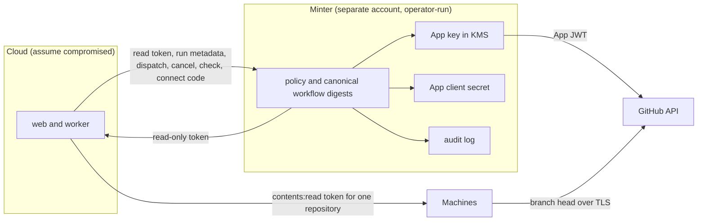

# Security 0.4 thread M plan, the GitHub minter

A compromised Cloud must not get a GitHub token that can write to a customer repository. Today it can. Cloud holds the `getployz` App's private key and client secret, mints installation tokens with every permission the installation accepted (`dashboard/src/modules/github/github-token.server.ts:56`, `:184`), and the App requests Contents, Workflows and Administration write. With Contents or Workflows write, Cloud can push its own commit to an approved branch, and thread D's automatic deploy treats that commit as a person's push (`d-build-proof.md`, "Cloud must hold no GitHub credential that can write to a customer repository"). With Administration write, Cloud can also delete the branch ruleset that `docs/user/deploy/github.md:157` tells customers to add as the interim defence.

The fix keeps the App and moves its key off Cloud. A small minter, outside Cloud's trust domain, holds the App private key and the App client secret. Cloud asks the minter for installation tokens and gets only `contents`, `metadata`, `pull_requests` and `checks` at `read`. Everything else Cloud does in GitHub today becomes a narrow minter operation. Cloud can read the metadata of `ployz-build.yml` runs, cancel them, and post the Ployz check. It can dispatch `ployz-build.yml` only when the file at that branch is exactly a canonical template, which pins the builder by commit and gives the run's `GITHUB_TOKEN` only `contents: read`. No route returns a write token, and no route reads Actions logs or artifacts. The App also drops the permissions nothing uses.

Six slices, in dependency order:

| Slice | Outcome | Owner |
| --- | --- | --- |
| M1 | The App stops requesting Administration, Deployments and Statuses (and, per decision 2, Contents, Workflows and Pull requests write) | Operator, App settings |
| M2 | The minter exists as code, with its policy, the canonical workflow digests, its audit log and a local signer for tests and lab lanes | Agent |
| M3 | Cloud reaches GitHub's App authority and Actions data only through one service, with a local mode for Self-hosted Cloud and a minter mode for hosted Cloud | Agent |
| M4 | The dashboard generates a `ployz-build.yml` that pins the builder by commit and declares least permissions, and flags repositories whose file differs | Agent, then customers |
| M5 | Hosted Cloud runs on the minter, the old client secret and key are deleted on GitHub, then user tokens are revoked, and Cloud's env holds neither | Operator, infra |
| M6 | `docs/user` says what Cloud can and cannot do in a customer's GitHub, and drops the "except a pushed commit" caveat | Agent, after M5 |

## Check the design against the Cloud security bar

The bar in `AGENTS.md` says a compromised Cloud must not read secrets, run code of its choosing on a Server, take data off a Server, or add a Server or Device. Each thing a compromised Cloud can still ask the minter for stays under it.

| What Cloud can get | Why it stays under the bar |
| --- | --- |
| A token with `contents`, `metadata`, `pull_requests` and `checks` at `read`, for any repository of any installation | Reads of code and metadata are the accepted residual in the program's decision record. The token has no `actions` permission, so it cannot download Actions logs or artifacts. A token Machines use for head reads can only make GitHub answer or refuse (`d-build-proof.md:247`). |
| The state of `ployz-build.yml` in a repository, and the metadata of its runs (ID, URL, head SHA, event, status, conclusion) | Metadata only. No route returns jobs, steps, logs or artifacts, and no route answers for another workflow. |
| A dispatch of `ployz-build.yml` on a branch whose file is exactly a canonical template | GitHub runs the file at that branch. The minter reads that file with its own token and refuses unless its bytes match a canonical template. So the run executes the pinned builder commit, and its `GITHUB_TOKEN` has `contents: read` and `id-token: write`, whatever the repository holds on other branches. What the builder then builds is the next row. |
| A cancel of a `ployz-build.yml` run | Drop. Named as a residual. |
| A Ployz check run on a commit | Mislabel. Named as a residual. |
| The facts from a connect (login, installations, who administers them) | Cloud can already link any installation to any Organization through its own database. Linking grants reads only. |

Nothing Cloud can ask for pushes a commit, edits a workflow file, changes a setting or ruleset, adds a deploy key or collaborator, re-runs a run, approves a fork run, enables a workflow, or reads a log or artifact. Those have no route.

**What a Cloud-chosen commit gives Cloud.** The canonical template keeps today's builder shape, a composite action that checks out the commit Cloud returns at check-in (`getployz/build` `action.yml:28` to `:31`). Pinning the builder does not change which commit it builds. Here is what that choice gives a compromised Cloud, beyond an image that Machines then verify.

- On a Cluster that does not enforce, Cloud picks the commit and gets a Build Grant with that Service's build secrets. That is today's trust in Cloud on such Clusters. The minter does not change it. Enforcement does, through D1 and D3.
- Under enforcement, the grant Machine opens no secret unless the commit is the head it read itself (D3), or a commit a person approved (D6, D7). The image token names the commit, and Machines refuse a deploy of any other. So the commit choice gives Cloud a build with no secrets and an image no Machine will run. Rule builds under D3's template check out `github.sha` and ignore Cloud's commit.
- The checked-out code runs inside BuildKit. The runner passes Buildx only the Actions cache variables (`core/crates/ployz/src/build/local.rs:12`), never the job's OIDC request token, so a commit's Dockerfile steps cannot mint a token for the job.
- `actions/checkout` fetches by SHA, so any commit GitHub serves from the repository can be built, fork pull request heads included [G, unproven until D7 lane 7]. Under enforcement that build gets no secret, per the second item.
- The build can write Actions cache entries in the dispatched branch's scope, which a later build of that branch reads. BuildKit keys each entry by the instruction and its inputs, so a planted entry is used only by an identical step. `d-plan.md` decision 7 owns the cache. This plan names it as a residual and adds nothing.

## Operator decisions

Nothing here blocks M2, M3 or M4. M1 and M5 are the operator's to run.

1. **Drop the permissions nothing uses.** Appendix A shows no code calls an Administration, Deployments or Statuses endpoint, and no code writes Contents, Workflows or Pull requests. Administration write is the worst of them. It reaches branch protection, rulesets, deploy keys and webhooks, so a holder can remove the ruleset customers add, or add a deploy key that outlives any App key rotation. *Recommendation.* Drop Administration, Deployments and Statuses now, on the lab App first and then on `getployz`.
2. **The coding agent's write permissions.** The decision record kept Contents, Workflows and Pull requests write so a future coding agent never forces a re-request. After M5 those permissions live only behind the minter, which has no route that uses them. They are still the minter's blast radius if its account is taken. *Recommendation.* Drop them too in M1. When the agent ships, give it its own opt-in App, held by the agent's service, so installing Ployz for deploys never grants code write. The cost is one re-request for customers who want the agent.
3. **Single App behind a minter, or split Apps.** Appendix B weighs both. A split needs every GitHub-build customer to install a second App, and still needs a minter for the write App. *Recommendation.* One App behind a minter for 0.4. Split only when the agent arrives (decision 2).
4. **Where the key lives.** *Recommendation.* An AWS KMS asymmetric key (`RSA_2048`, `SIGN_VERIFY`) with the new App key imported as its material, in a dedicated AWS account used for nothing else. The Lambda role may call `kms:Sign` on that key and nothing else. If KMS refuses the import in the M5 rehearsal, the fallback is AWS Secrets Manager readable only by the Lambda role. That key is exportable by the account's admins, but still outside Cloud.
5. **Who operates the minter.** *Recommendation.* The operator, with credentials that are not on any Cloud host and not in any CI job that a Ployz App installation can reach. Deploys go from the operator's machine through a script in `getployz/ops`, from a reviewed commit of `minter/`. No CI deploys it.
6. **How Cloud authenticates to the minter.** *Recommendation.* A Lambda Function URL with `AWS_IAM` auth. Cloud signs requests with SigV4 using an access key for an IAM user whose only permission is `lambda:InvokeFunctionUrl` on that function. A stolen key gets what Cloud already gets. The alternative, a bearer secret, is simpler but carries no rotation story.
7. **Sign-in.** If hosted Cloud uses "One app for both" (`docs/user/self-hosting.md:87`), the sign-in client secret is the App's client secret, and every sign-in returns a user-to-server token with the App's permissions. *Recommendation.* Hosted Cloud signs in through a separate OAuth App with the default `read:user` and `user:email` scopes. The operator compares `GITHUB_CLIENT_ID` with `GITHUB_APP_CLIENT_ID` (both non-secret) before M5.
8. **The `getployz-dev` and `getployz-staging` Apps.** *Recommendation.* Apply M1's permission set to both. Confirm that no customer has installed either. If none has, their keys stay where they are, because they reach only the `getployz` org, which Y's O1 handles.
9. **Release order.** *Recommendation.* M1 now. M2, M3 and M4 merge before the 0.4 release, with local mode as the default, so nothing changes until the operator sets the minter env. M5 runs before the 0.4 tag. If M5 slips, 0.4 ships with today's "except a pushed commit" caveat and the branch-ruleset advice, and M6 waits.
10. **Repositories that still carry today's workflow file.** Every repository set up before M4 has a `ployz-build.yml` that uses `getployz/build@v1`. After M5, the minter refuses to dispatch it. Builds that GitHub starts on a push are not dispatched, so they keep running, and so do Servers builds. Dispatched GitHub builds stop for that repository until someone commits the new file. The alternative is a grace window in which the minter also accepts today's exact file. Today's file already declares `contents: read` and `id-token: write`, so the grace risk is only the mutable `@v1` tag, which Y's O1 protects. *Recommendation.* No grace window. Ship M4 early, let the dashboard flag the old file for some weeks, count the repositories that still carry it just before M5, and decide then.

## How to read this

Same conventions as `c-plan.md`. One box is one unit of work, and every box names the evidence that checks it. Check a box only when its evidence exists. The program runs `<plugin root>/skills/poteto-mode/playbooks/autopilot-stack.md`. Owners open M2, M3, M4 and M6, and the operator lands them. M1 and M5 are operator steps that no agent runs. Tests alone are not sufficient verification. A PR is verified only when its unit, live, and perf boxes are all checked.

Terms follow `core/CONTEXT.md` (Build, Build Grant, Machine) and `dashboard/CONTEXT.md` (Organization, Self-hosted Cloud). "Minter", "read set", "canonical template" and "narrow operation" are new and defined in Appendix C. No log, test, fixture or screenshot prints a token, a private key, a client secret or an OAuth code. Nothing written for this program names a Cloud host, an address or a path on Cloud's servers.

## Program checklist

The program runs the way `c-plan.md` "Program checklist" says. These differences apply.

- [ ] Dependency graph. M2 and M4 branch from `main` now. M3 after M2, because it calls M2's request and response types. M2 takes its canonical digests from M4, so whichever merges second updates `minter/src/canonical-workflows.json`. M1 is independent and the operator may run it any time. M5 after M3 and M4 are deployed to hosted Cloud, after decisions 4 to 7 and 10, and after Y's O1 removes the `getployz`, `getployz-dev` and `getployz-staging` installs from the `getployz` org, because `minter/` lives in a repository those installs can write. M6 after M5.
- [ ] File boundaries. M2 adds `minter/**` and one line in `AGENTS.md` (the workspace list). M3 touches `dashboard/src/modules/github/{github-token.server,github-observation.api,github-build.server,github-connect.server,github-token.static.test}.ts`, a new `dashboard/src/modules/github/github-authority.server.ts`, `dashboard/src/modules/config-store/{store-github-builds,store-deployment,store-pull-request,store-pr-grants,config-store}.server.ts`, `dashboard/src/server/config.server.ts`, `dashboard/src/test/fake-github.ts` and `docs/user/self-hosting.md`. M4 touches `dashboard/src/modules/github/{github-build-workflow,github.queries}.ts`, `dashboard/src/routes/_protected/cloud/$organizationSlug/_org/-components/builds-settings.tsx`, `minter/src/canonical-workflows.json`, `docs/user/deploy/github.md` (the workflow file) and, outside this repository, `getployz/build`. M6 touches `docs/user/deploy/github.md`, `docs/user/self-hosting.md` and `docs/agents/plans/security-0.4/d-build-proof.md` (the "until the minter is live" lines).
- [ ] M3 shares `store-github-builds.server.ts` and `store-deployment.server.ts` with D5 to D7, and M4 shares `github-build-workflow.ts` with D3. Each owner rebases on whatever D has merged, and changes only the lines this plan names there.
- [ ] Bets every M PR names. Bet 7, Cloud drives and never owns, because Cloud keeps driving GitHub reads and builds but no longer owns the App's authority. Bet 9, lean on proven primitives, because the key sits in KMS, the caller authenticates with IAM, GitHub's own token narrowing (`permissions`, `repository_ids`) enforces the read set, and the workflow's own `permissions` block limits the run's token. The stable promise, because Self-hosted Cloud's env keeps working unchanged (local mode).
- [ ] Residuals each M PR names once, without review rounds. Cloud reads the code, metadata, pull requests and checks of every repository the App can read. Cloud can dispatch a canonical `ployz-build.yml` on any branch, build a commit of its choosing with it, cancel its runs, and post a false Ployz check. Cloud can link an installation to the wrong Organization. Installation tokens minted before the key deletion live up to one hour. Until M5 deletes the old key and client secret, a Cloud that copied them can still mint installation tokens and exchange connect codes, as it can today. M5 keeps that window to the length of its checks. User tokens a compromised Cloud captured before the deletions live until M5's revoke step. If GitHub offers no way to revoke them all, they live until they expire, and a token issued while the App's tokens did not expire never does.
- [ ] Live lanes run per `c-plan.md` "Boot recipe", with a Boat Cloud against the lab App and lab repository from `d-plan.md` Appendix B. The minter runs on the lane host as a process (`node minter/dist/local.js`) with the local signer. The lab App's key and client secret reach it as files at mode 600 through `request_secret`, and the lane deletes them when it ends. The attacker harness holds Cloud's minter credential and sends hand-built minter requests.

## Drop the App permissions nothing uses (M1)

Outcome. The App's requested permissions are Contents read, Metadata read, Pull requests read, Checks write, Actions write, Members read, and Email addresses read only if decision 7 keeps one-app sign-in. Administration, Deployments and Statuses are gone, and Contents, Workflows and Pull requests write are gone if the operator takes decision 2. The App keeps Actions write and Checks write because the minter's dispatch, cancel and check operations need them. Attack path closed. A token minted from today's key, by anyone, cannot delete a ruleset, add a deploy key, or (with decision 2) push.

This slice is the operator's. An agent prepares the evidence and the checklist, and changes no App setting.

**Depends on.** Nothing.

**Operator steps.**

- [ ] On the lab App, set the permissions above. Record the before and after from `GET /app/installations/{id}` on the lab installation, permission names only.
- [ ] Check whether the reduction reaches the lab installation without the owner accepting anything. Record the answer. It decides whether customers see a prompt.
- [ ] Repeat on `getployz`, then `getployz-dev` and `getployz-staging` (decision 8).

**Verify.**

- [ ] An agent runs `rg` over `dashboard/src` and `core/crates` for every GitHub path under Administration, Deployments, Statuses, Workflows and Contents write, and attaches the empty result. Appendix A is the starting list.
- [ ] Lab lane. A Boat Cloud on the lab App after the drop runs a legacy dispatched build, a push build under a rule, a PR check, a repository sync and a connect. Pass when each works as before the drop.
- [ ] Lab lane. With a token minted from the lab key after the drop, `PUT /repos/{r}/rulesets` and `PUT /repos/{r}/contents/x` return 403. Pass when both are refused.

**Review gate.** The operator runs it.

## Build the minter (M2)

Outcome. `minter/` is a small TypeScript service with one handler that runs as an AWS Lambda behind a Function URL, and as a local process for lanes. It holds no Cloud code and imports nothing from `dashboard/`. Its policy is a table, one row per route. No route returns a write token, no route takes a GitHub path from the caller, and no route returns Actions logs, jobs or artifacts. Attack path closed. None yet. This is the service M5 deploys.

**Depends on.** `main`. M4's template for the final digests.

**Files.**

- [ ] Create `minter/package.json`, `minter/tsconfig.json` and `minter/README.md`. Runtime dependencies are `@aws-sdk/client-kms` and nothing else. Node's `fetch` and `crypto` do the rest.
- [ ] Create `minter/src/policy.ts` with `READ_SET = { contents: "read", metadata: "read", pull_requests: "read", checks: "read" }`, the build workflow path `.github/workflows/ployz-build.yml`, its allowed input names (`build`, `runner`, `commit`), and the Ployz check names (the value of `PR_CHECK_NAME` in `dashboard/src/modules/config-store/store-pull-requests.ts`, copied, not imported).
- [ ] Create `minter/src/canonical-workflows.json`, the SHA-256 of each canonical `ployz-build.yml` that M4 generates, after CRLF becomes LF. M4's test fails when the dashboard's templates and this file disagree.
- [ ] Create `minter/src/routes.ts` with the nine routes in Appendix C. Each parses its body with a strict schema and refuses unknown fields.
- [ ] Create `minter/src/signer.ts` with `Signer` and two implementations. `KmsSigner` calls `kms:Sign` with `RSASSA_PKCS1_V1_5_SHA_256`. `PemSigner` signs with a PEM file and exists for tests and lab lanes. The Lambda entry refuses to start with `PemSigner`.
- [ ] Create `minter/src/github.ts` for the App JWT (`iat` 60 s back, `exp` 9 minutes on) and the GitHub calls in Appendix C.
- [ ] Create `minter/src/audit.ts`. Each request writes one JSON line with time, caller identity, route, installation ID, repository IDs, permissions asked and granted, ref, the workflow file's digest, run ID, check name, outcome, refusal reason, GitHub status and token expiry. Never the token, the code, or a request header.
- [ ] Create `minter/src/lambda.ts` and `minter/src/local.ts`. The local entry listens on loopback, takes a bearer secret from a file for lane auth, and logs audit lines to stdout.
- [ ] Edit `AGENTS.md` to add `minter/` to the workspace list. It says the minter sits outside Cloud's trust domain and never imports Cloud code.

**Build.**

- [ ] A token request that names any permission outside `READ_SET`, `actions` included, or any level other than `read`, is refused with 400 and an audit line. It is never trimmed and granted. A refusal is the signal that something asked for what Cloud's code never asks for.
- [ ] Every GitHub token request the minter sends carries an explicit `permissions` body. A request with no `repository_ids` gets the whole installation, read only.
- [ ] Dispatch first resolves the branch's head SHA, then reads `.github/workflows/ployz-build.yml` at that SHA with a token the minter mints for itself (`contents: read`, that repository, never returned). It dispatches only when the file's digest is in `canonical-workflows.json`. A push between the read and the dispatch can change the file. Only someone with push rights can make that push, and after M1 and M5 Cloud has none.
- [ ] The run routes first read the run, and refuse unless its `path` is `.github/workflows/ployz-build.yml`.
- [ ] Rate limits are the Lambda's reserved concurrency (decided in M5, default 10) and GitHub's own App limits. The minter adds no per-installation counter, because a limit does not change what Cloud can read. Audit alarms do the detection.

**Verify, unit.** Tests alone are not sufficient verification. A PR is verified only when its unit, live, and perf boxes are all checked.

- [ ] `minter/src/routes.test.ts` refuses, one case each, `actions: read`, `contents: write`, `actions: write`, `checks: write`, `administration: read`, `workflows: read`, an unknown permission key, a non-numeric installation ID, and an extra body field. A request with no permissions gets `READ_SET` in the body sent to GitHub (asserted on a stub GitHub).
- [ ] Dispatch refuses a file that differs from every canonical template by one byte, a file that asks for `contents: write`, a file that uses `getployz/build@v1`, a missing file, another workflow file name, a tag ref, a 40-hex ref, an input name outside the allowed set, and a `commit` that is not 40 hex. It fills `cloud` from config, never from the request. A canonical file with CRLF line ends is accepted.
- [ ] Cancel, run and runs refuse a run or a workflow whose `path` is not the build workflow, after reading it from the stub. The run and runs responses carry only the fields Appendix C lists, asserted against a stub response that also holds `logs_url`, `jobs_url` and `artifacts_url`.
- [ ] Check refuses a name outside the Ployz set.
- [ ] Connect returns login and installations, and the test asserts the stub's user token appears in no audit line and no response.
- [ ] `signer.test.ts` shows a JWT from `PemSigner` verifies with the public key, and the Lambda entry refuses `PemSigner`.
- [ ] `audit.test.ts` scans every audit line from the suite for `ghs_`, `ghu_`, `-----BEGIN` and the test code value. Pass when none appears. Run `pnpm --dir minter test`.

**Verify, live.** Eight lanes, all against the lab App, with the minter running locally per the boot recipe. Evidence is terminal output saved as `media/m2-*.txt`.

- [ ] Lane 1. Mint a read token for the lab repository and read its head with it. Pass when `git/ref/heads/main` matches `git ls-remote`.
- [ ] Lane 2. With that token, `PUT /repos/{r}/contents/probe.txt` and `GET /repos/{r}/actions/runs/{id}/logs` for a finished build run. Pass when GitHub refuses both and the repository is unchanged.
- [ ] Lane 3. Attacker harness. Ask for `contents: write`, then `actions: read`, then `administration: write`. Pass when all three are refused and three refusal lines appear in the audit log.
- [ ] Lane 4. Commit M4's canonical file to the lab repository's `main` and dispatch it. Pass when the run starts with `cloud` set to the configured origin, and the run's `GITHUB_TOKEN` gets 403 on a push (a step in the lab builder fork prints only the status code).
- [ ] Lane 5. On a lab branch, commit a `ployz-build.yml` that declares `contents: write`, and dispatch on that branch. Pass when the minter refuses before GitHub starts a run, and the audit line names the file's digest.
- [ ] Lane 6. Attacker harness. Dispatch another workflow file in the lab repository, then cancel and read a run of it. Pass when all are refused and the run is unaffected.
- [ ] Lane 7. List the push runs of the build workflow for a commit, and read one run. Pass when the responses hold only Appendix C's fields.
- [ ] Lane 8. Post the Ployz check on a lab PR twice. Pass when one check run exists, updated in place.

**Verify, perf.** Tests alone are not sufficient verification. A PR is verified only when its unit, live, and perf boxes are all checked.

- [ ] Metric. Local minter latency for a token request, cache cold, against a direct mint from the same host, and for a dispatch, which adds two reads.
- [ ] Probe. Ten of each, interleaved.
- [ ] Baseline. Record the direct mint and a direct dispatch first.
- [ ] Rule. The minter adds under 50 ms to a token and under 500 ms to a dispatch at the median on the local process. M5 records the Lambda numbers.

**Review gate.** The operator reads `minter/src/policy.ts` and `routes.ts` before merge, since they are the whole security argument.

## Route Cloud's GitHub authority through the minter (M3)

Outcome. Every place Cloud uses the App key or client secret, or reads Actions data, goes through one service, `GithubAuthority`. Its local layer keeps today's behaviour for Self-hosted Cloud, with read tokens now narrowed per call. Its minter layer sends every request to the minter. When `GITHUB_MINTER_URL` is set, Cloud boots without `GITHUB_APP_PRIVATE_KEY` and `GITHUB_APP_CLIENT_SECRET`. Attack path closed once M5 sets the env. Cloud holds no credential that can mint a write token, read an Actions log, or exchange a user code.

**Depends on.** M2.

**Files.**

- [ ] Create `dashboard/src/modules/github/github-authority.server.ts` with `GithubAuthority` and its operations `readToken(installationId, repositoryIds?, permissions?)`, `installation(installationId)`, `buildWorkflow(...)`, `buildRuns(...)`, `buildRun(...)`, `dispatchBuild(...)`, `cancelBuild(...)`, `postCheck(...)` and `connect(code)`. Add `GithubAuthorityLocal` (moves `createGithubAppJwt` and `mintInstallationToken` here, and keeps the canonical-file check so local and minter modes agree) and `GithubAuthorityMinter` (SigV4 through `aws4fetch`, decoding M2's responses with Effect Schema).
- [ ] Edit `github-token.server.ts` so `GithubTokens` mints through `GithubAuthority.readToken` and keeps its 50 minute cache and link checks (`:152` to `:180`).
- [ ] Edit `github-observation.api.ts` so `app` (`:612`), `exchangeUserCode` (`:660`) and `postInstallationCheckRun` (`:501`) call the authority, and `json` refuses `method` for installation access. After this, `GithubApi.json` only reads, and never under `/actions/`.
- [ ] Edit `github-build.server.ts` so `checkGithubBuildWorkflow` (`:28`), `dispatchGithubBuildWorkflow` (`:63`), `findGithubPushRun` (`:91`), `cancelGithubRun` (`:110`) and `githubRunCompleted` (`:124`) call the authority.
- [ ] Edit `store-deployment.server.ts:92` and `store-github-builds.server.ts:407` to call `readToken` with the one repository and `{ contents: "read" }`, as they mint today. The token Machines hold stays as narrow as it is now.
- [ ] Edit `github-connect.server.ts:117` so `authorizedGithubUser` takes `{ login, installations, administers }` from `GithubAuthority.connect` and makes no user-token call itself.
- [ ] Edit `config.server.ts:73` to `:78` and `:249` to `:254`. `GITHUB_APP_PRIVATE_KEY` and `GITHUB_APP_CLIENT_SECRET` become required only when `GITHUB_MINTER_URL` is unset. Add `GITHUB_MINTER_URL`, `GITHUB_MINTER_ACCESS_KEY_ID` and `GITHUB_MINTER_SECRET_ACCESS_KEY` (redacted).
- [ ] Edit `github-token.static.test.ts` so it fails when any module other than `github-authority.server.ts` reads `appPrivateKey` or `appClientSecret`, calls `access_tokens`, sends a non-GET GitHub request, or names a path under `/actions/`.
- [ ] Edit `dashboard/src/test/fake-github.ts` to provide a fake `GithubAuthority`.
- [ ] Edit `docs/user/self-hosting.md` to say a Self-hosted Cloud keeps its own App key, that its read tokens are now narrowed, and that one-app sign-in carries the App's permissions into every sign-in token.

**Build.**

- [ ] In minter mode, Cloud's resolved config has no App private key and no App client secret. A config test asserts both fields are absent.
- [ ] A minter that is down fails dispatch, cancel, run reads and check with `GithubObservationError` and a retriable flag, so the existing skip paths (`store-github-builds.server.ts:179`) take over. Cached read tokens keep working until they expire.
- [ ] Run the `verify-build-handoff` model check, since dispatch, cancel and run reads change their failure modes.

**Verify, unit.** Tests alone are not sufficient verification. A PR is verified only when its unit, live, and perf boxes are all checked.

- [ ] `github-authority.server.test.ts` runs the same contract against both layers. The local layer sends `permissions` and `repository_ids` to a stub GitHub, and refuses a dispatch of a non-canonical file. The minter layer sends a SigV4-signed request to a stub minter, and maps its 400 refusal and its 5xx to the right errors.
- [ ] `github-connect.postgres.test.ts` links an installation from the fake connect result and stores no token.
- [ ] `github-token.static.test.ts` passes, and fails on a planted `fetch(".../access_tokens")` and a planted `/actions/runs` path in another module (shown once in the PR, then removed).
- [ ] Config tests boot with the minter env and no key, and refuse to boot with neither. Run `pnpm exec vitest run src/modules/github src/server/config.server.test.ts src/modules/config-store/store-github-builds`.

**Verify, live.** Ten lanes at the PR head, per the boot recipe, against the lab App. The Boat Cloud runs in minter mode with no App key in its env, except lane 1's trunk side.

- [ ] Lane 1. Regression lane against trunk. A dispatched build of the lab repository, at trunk with the local key and today's file, and at head through the minter with M4's file. Save `m3-legacy.png`. Pass when both build and the image lands.
- [ ] Lane 2. A push under an automatic deploy rule (D4's lane 2). Save `m3-rule-push.png`. Pass when both Machines run the new digest, Cloud found the push run through the minter's runs route, and the minter's audit shows a `contents: read` token for that one repository.
- [ ] Lane 3. Connect the lab installation to a fresh Organization. Save `m3-connect.png`. Pass when it links, and `ghu_` appears zero times in the Boat Cloud's logs and database dump (`grep -c`).
- [ ] Lane 4. A lab PR with a PR Environment. Save `m3-check.png`. Pass when the Ployz check appears on the PR and updates when the preview deploys.
- [ ] Lane 5. Cancel a Deployment while its GitHub build runs. Save `m3-cancel.png`. Pass when the run ends cancelled.
- [ ] Lane 6. Attacker harness with the Boat Cloud's minter credential. Ask for a `contents: write` token, an `actions: read` token, and a dispatch of `release.yml`. Save `m3-attacker.png`. Pass when all are refused and audited.
- [ ] Lane 7. Attacker harness. Every kind of token the harness can get from `/v1/token` tries `PUT /repos/{r}/contents/x`, `POST /repos/{r}/actions/workflows/ployz-build.yml/dispatches` and `GET /repos/{r}/actions/runs/{id}/logs`. Save `m3-token-reach.png`. Pass when GitHub refuses all three.
- [ ] Lane 8. Stop the minter for ten minutes during repository sync, a dispatch and a PR check. Save `m3-minter-down.png`. Pass when reads keep working from cache, the dispatch is skipped with "GitHub couldn't take the build", and everything resumes when the minter returns.
- [ ] Lane 9. The Settings page's GitHub section and the Builds settings' workflow readiness in minter mode. Save `m3-settings.png`. Pass when both show the same state as at trunk for a repository with M4's file. Check light and dark themes per `dashboard/DESIGN.md`.
- [ ] Lane 10. A Self-hosted Cloud in local mode, from the release image built at head, with the lab App key. Save `m3-self-host.png`. Pass when connect, a build and a PR check work, and a token the local layer minted gets 403 on `PUT /repos/{r}/contents/x`.

**Verify, perf.** Tests alone are not sufficient verification. A PR is verified only when its unit, live, and perf boxes are all checked.

- [ ] Metric. Time from a push webhook to the build run starting, and the token cache hit rate over the run.
- [ ] Probe. Five pushes at trunk (local key) and five at head (local minter), interleaved.
- [ ] Baseline. Record trunk first.
- [ ] Rule. Head within 1.1 times trunk at the median, and the cache hit rate unchanged.

**Review gate.** None. M3 changes no screen.

## Pin the build workflow by commit (M4)

Outcome. The dashboard's "Add workflow" offers a `ployz-build.yml` that calls the builder at a full commit SHA and declares `permissions: { contents: read, id-token: write }`. The Builds settings show a repository whose file differs from every canonical template as "Update workflow", with the new file to copy and a link to GitHub's editor for that file. Attack path closed once M5 makes the minter enforce it. A dispatched run executes only the pinned builder with a read-only `GITHUB_TOKEN`, whatever Cloud or anyone else put on other branches.

**Depends on.** `main`. A `getployz/build` commit whose `action.yml` pins its own actions (`actions/checkout`, `crazy-max/ghaction-github-runtime`) by SHA.

**Files.**

- [ ] Outside this repository. Open a PR on `getployz/build` that pins every `uses:` in `action.yml` by full SHA. The operator merges it and records the commit.
- [ ] Edit `dashboard/src/modules/github/github-build-workflow.ts`. `GITHUB_BUILD_WORKFLOW` (`:8`) uses `getployz/build@<BUILDER_COMMIT>`, a new constant holding that commit. Keep the `permissions` block (`:15` to `:17`). D3's rule template landed in this file with M4 as `GITHUB_RULE_WORKFLOW`, with fixed content: Cloud's address comes from the minter's `cloud` input on a dispatch and the repository variable `PLOYZ_CLOUD` on a push. Its digest joined the canonical set the same way, and Organization → Builds offers it to each repository a rule builds from. It calls the builder at the same commit as the build template, and ployz-core's `BUILDER_SHA` moved there: the old pin was a fork's commit that GitHub refused to run.
- [ ] Edit the same file to add `githubBuildWorkflowDigests()`, the SHA-256 of each canonical template, and `githubBuildWorkflowEditUrl` for a repository that already has the file.
- [ ] Edit `github-build-workflow.ts` and `github.queries.ts` so `GithubBuildReadiness` gains `outdated`, which `checkGithubBuildWorkflow` returns when the file exists and its digest is not canonical. M3 moves that check behind the authority.
- [ ] Edit `builds-settings.tsx` to show `outdated` as "Update workflow", with the file and the edit link. Run the `ui-copy` skill.
- [ ] Edit `minter/src/canonical-workflows.json` to the digests `githubBuildWorkflowDigests()` returns.
- [ ] Edit `docs/user/deploy/github.md` to show the new file and say Ployz dispatches builds only for that exact file.

**Build.**

- [ ] A test in `github-build-workflow.test.ts` reads `minter/src/canonical-workflows.json` from disk and fails when it differs from `githubBuildWorkflowDigests()`. The dashboard never imports from `minter/`.

**Verify, unit.** Tests alone are not sufficient verification. A PR is verified only when its unit, live, and perf boxes are all checked.

- [ ] `github-build-workflow.test.ts` asserts the template's `uses:` ends in 40 hex, its `permissions` are exactly `contents: read` and `id-token: write`, and the digest test above passes.
- [ ] `github-build.test.ts` returns `outdated` for today's `@v1` file, `ready` for the new file, and `setup_needed` for none. Run `pnpm exec vitest run src/modules/github/github-build`.

**Verify, live.** Four lanes per `verify-dashboard` with `SERVERS=1`, and one against the lab repository.

- [ ] Lane 1. Regression lane against trunk. A repository with today's file shows "ready" at trunk and "Update workflow" at head. Save `m4-outdated.png`.
- [ ] Lane 2. Follow "Add workflow" on a repository with no file. Save `m4-add.png`. Pass when GitHub's editor opens with the new file.
- [ ] Lane 3. Follow "Update workflow". Save `m4-update.png`. Pass when the editor opens on the existing file and the dashboard shows the new content to paste. Whether GitHub's edit page accepts prefilled content is unproven, so the lane records what it does.
- [ ] Lane 4. Light and dark themes, and phone width, per `dashboard/DESIGN.md`. Save `m4-themes.png`.
- [ ] Lane 5. **GitHub.** Commit the new file in the lab repository and run a dispatched build. Save `m4-lab-build.png`. Pass when it builds with the pinned builder commit, which the run's log names.

**Verify, perf.** None. Record that the readiness check makes the same number of GitHub calls as before.

**Review gate.** The operator reviews the new file and the "Update workflow" screen before merge, since customers copy the file.

## Cut over, revoke and rotate (M5)

Outcome. Hosted Cloud runs in minter mode. The App's private key and client secret that Cloud held are deleted on GitHub, and then every user token the App issued is revoked. Cloud's env holds neither credential. Attack path closed. A compromised Cloud cannot get a token with any write permission or `actions` access, cannot dispatch a workflow file other than a canonical one, cannot exchange a user code, and cannot sign an App JWT, including with the old key and secret it may have copied.

This slice is the operator's. An agent writes the runbook in `getployz/ops` and the checks below, and runs no step. The steps run in this order, and the switch, the checks, both deletions and the revoke run in one sitting.

**Why this order.** Until GitHub deletes them, the old client secret and the old private key are both live credentials that a compromised Cloud may hold.

- With the old client secret, Cloud receives every connect callback, because the authorize URL sends the person back to Cloud (`github-connect.server.ts:79` to `:81`). It can exchange the code itself (`github-observation.api.ts:669`). It then holds a fresh user token, valid for eight hours if tokens expire, carrying the App's permissions where the person has access, `actions: write` included. That token can dispatch any workflow and skips the minter's canonical-file check. So the old secret goes before the revoke. A revoke run while Cloud can still exchange codes leaves a window that the revoke does not close.
- With the old private key, Cloud can sign an App JWT and mint an installation token with every permission the installation accepted. That means `actions: write` and `checks: write` at least, and Contents and Workflows write too unless M1 dropped them. Each such token lives one hour. So the old key gets the same treatment. It is deleted right after the functional checks, together with the old secret, behind one pause.
- Until the deletions, this exposure is the same as today's. The plan only keeps it to the length of the checks.

Deleting the old secret before the revoke breaks no step in between. The minter already uses the new secret for connect. The App settings' revoke-all control needs no client secret. GitHub's per-grant API, if used for a token the operator holds, works with the new secret. The one thing that breaks is one-app sign-in, which signs in with the App's client secret. So that case moves first (below).

**Depends on.** M3 and M4 deployed to hosted Cloud in local mode. Decisions 4 to 7 and 10. Y's O1.

**Prepare.**

- [ ] Rehearse every step below on the lab App with a lab AWS account first. Record each output, and whether GitHub offers a revoke-all control for a GitHub App's user tokens.
- [ ] Read the App's "Expire user authorization tokens" setting and record it. If it is off, every user token issued at connect, and at sign-in if decision 7 finds one-app sign-in, never expires [G]. Today's code cannot tell, because `exchangeUserCode` reads only `access_token` (`github-observation.api.ts:677`).
- [ ] If decision 7 found one-app sign-in, move sign-in to a separate OAuth App now, and redeploy Cloud with its client ID and secret in `GITHUB_CLIENT_ID` and `GITHUB_CLIENT_SECRET`. Otherwise Cloud's sign-in config keeps a copy of the App's client secret, and deleting the old secret later breaks sign-in. Better Auth matches accounts by GitHub user ID, so existing users keep signing in. The rehearsal confirms that.
- [ ] Count the linked repositories whose `ployz-build.yml` is not canonical, through the minter's workflow route from the rehearsal. Take decision 10 with that count.
- [ ] Create the dedicated AWS account, the KMS key, the Lambda from a reviewed `minter/` commit, its Function URL with `AWS_IAM`, the log group with 400-day retention, and alarms on any refusal and on dispatch volume.
- [ ] Generate a new private key and a new client secret on the `getployz` App. Import the key into KMS and store the client secret in the minter's secret store, so the minter signs and exchanges with the new pair only. Destroy the local copies. The old key and secret still work on GitHub, so nothing changes yet.
- [ ] If the App's "Expire user authorization tokens" setting is off, turn it on.

**Switch Cloud to the minter.**

- [ ] Copy the old private key and the old client secret to files at mode 600 on the operator's machine. They exist only for the checks after deletion.
- [ ] Set `GITHUB_MINTER_URL` and the two access-key values in Cloud's per-service env files, remove `GITHUB_APP_PRIVATE_KEY` and `GITHUB_APP_CLIENT_SECRET` from them, and redeploy Cloud web and worker.

**Check with the new pair, then delete the old one.**

- [ ] The production checks from M3's lanes 2 to 5 pass on a Ployz-owned test Organization, through the minter. Lane 3's connect proves the minter exchanges codes with the new secret.
- [ ] The minter's audit log shows those requests, signed with the new key, and no refusals.
- [ ] Warm Lambda latency for a token request, median of ten, is under 300 ms. Cold starts are recorded, not gated.
- [ ] If any check fails, roll back. Restore the two old values in the env files and unset `GITHUB_MINTER_URL`. This is the last point where rollback is possible. After the next box, rollback means generating a fresh key and secret for Cloud, which reopens the hole, so fix forward instead.
- [ ] Pause and confirm with the operator. The next two boxes cannot be undone.
- [ ] Delete the old client secret on the App.
- [ ] Delete the old private key on the App, straight after.

**Revoke user tokens, after Cloud can no longer mint them.**

- [ ] Revoke every user token the App has issued, with the App settings' revoke-all control. No credential Cloud held can now exchange a code or refresh a token, so no new user token reaches Cloud after this. A person connecting or signing in afterwards authorizes the App again, through the minter, and nothing else changes, because Cloud keeps no user token.
- [ ] If the rehearsal found no revoke-all control, record that. GitHub's per-grant API (`DELETE /applications/{client_id}/grant`) needs each token in hand, and Ployz holds no user token since `cd334b8362`, so it cannot reach tokens a compromised Cloud captured. Those tokens stay valid until they expire, which for a non-expiring token is never. Decide with that record whether to ask customers to revoke the App's authorization in their GitHub settings.

**Confirm nothing Cloud held still works.**

- [ ] Sign an App JWT with the copied old key and call `GET /app`. Pass when GitHub returns 401.
- [ ] Call `POST /applications/{client_id}/token` with Basic auth from the client ID and the copied old secret, and any token value. Pass when GitHub refuses the credentials. Then destroy both copies.
- [ ] Wait one hour, the lifetime of an installation token minted before the key's deletion.
- [ ] Read the minter's audit log for the first 24 hours. Pass when it shows Cloud's requests and every refusal is explained. Then declare the rotation done.

**Review gate.** The operator runs it.

## Say what Cloud can do in a customer's GitHub (M6)

Outcome. `docs/user/deploy/github.md` stops telling customers that Cloud's App can push a commit, and says what Cloud can do (read code, pull requests and checks, read the build workflow's run metadata, dispatch the exact build workflow file, cancel its runs, post the Ployz check) and what it cannot. `d-build-proof.md` marks the minter precondition met.

**Depends on.** M5.

**Files.**

- [ ] Edit `docs/user/deploy/github.md:157` to `:159`. Keep "someone who can push to the branch can deploy". Drop the App push and the ruleset advice as a Ployz defence. A ruleset stays good practice.
- [ ] Edit `docs/user/self-hosting.md` permissions table if M1 changed it.
- [ ] Edit `d-build-proof.md` lines 56 and 375 and `d-plan.md` line 58.

**Verify.** Run the `ui-copy` skill over the changed pages. Read them against M3's lanes 2 to 7 and M5's checks. Pass when every sentence matches.

**Review gate.** None.

## Close the program

- [ ] Every box above is checked with its evidence, M1 and M5 by the operator.
- [ ] The minter's audit log shows no unexplained refusal in the week after M5.
- [ ] Reply to the operator with the report `autopilot-stack.md` names.

## Appendix A. Where Cloud uses GitHub authority today

Read on `main` at `c9933fb472`. Labels are from Y's report. [S] source, [D] seen through GitHub's API, [G] GitHub's docs, [U] unknown.

**Credentials Cloud holds.**

| Credential | Read at | Used for | After M5 |
| --- | --- | --- | --- |
| App private key | `dashboard/src/server/config.server.ts:75`, `:251` | App JWT (`github-token.server.ts:17`, `:44`), installation tokens (`:56`), installation lookup (`github-observation.api.ts:612`) | Minter only |
| App client secret | `config.server.ts:78`, `:254` | Connect code exchange (`github-observation.api.ts:660` to `:678`) | Minter only |
| Sign-in client secret | `config.server.ts:73`, `:249`, `dashboard/src/server/auth.server.ts:419` | Sign-in. Tokens are no longer stored (`auth.server.ts:222`, `:435`, commit `cd334b8362`). | Cloud, a separate OAuth App per decision 7 |
| Webhook secret | `github.api.ts:145` | Checks deliveries to Cloud only | Cloud, unchanged |

**Every token Cloud mints.**

| Where | Narrowing today | Used by |
| --- | --- | --- |
| `github-token.server.ts:184`, through `GithubTokens` (`:152`) and `GithubApiLive.bearer` (`github-observation.api.ts:538`) | None. Every permission the installation accepted, every selected repository. | Every installation read and write below |
| `store-deployment.server.ts:92` | `contents: read`, one repository | The head reader Machines use for rule deploys |
| `store-github-builds.server.ts:407` | `contents: read`, one repository | The head reader the grant Machine uses for rule builds |

**Every GitHub call, by permission.** All through the unnarrowed token unless noted.

| Permission | Calls | Callers | After M5 |
| --- | --- | --- | --- |
| Metadata read | `resolve_repository` (`github-observation.api.ts:256`), installation repositories (`:619`) | Repository sync, source pin, `ployz github` (`github-cli.server.ts:82`) | Read token |
| Contents read | branch head (`:292`), compare (`:343`), branches, files, contents (`github.api.ts:58` to `:125`), tarball (`github-observation.api.ts:633`) | Push and merge observation, Servers builder source, dashboard and CLI browsing | Read token |
| Pull requests read | `fetch_pull_request` (`:442`) | PR Environments | Read token |
| Checks read | `fetch_check_suite` (`:405`), `list_check_runs` (`:516`) | Waiting for CI, the Ployz check | Read token, and the check route |
| Checks write | `create_check_run` and `update_check_run` (`:528`, `:529`) | The Ployz PR check (`store-pull-request.server.ts:162`) | Check route |
| Actions read | `fetch_workflow` (`github-build.server.ts:41`), `list_push_runs` (`:97`), `fetch_run` (`:126`) | Workflow readiness, following a rule's push run (`store-github-builds.server.ts:157`), run end | Workflow, runs and run routes |
| Actions write | `dispatch_workflow` (`github-build.server.ts:68`), `cancel_run` (`:112`) | Dispatched builds (`store-github-builds.server.ts:166`), cancel (`:172`, `config-store.server.ts:52`) | Dispatch and cancel routes |
| App JWT | `fetch_installation` (`github-observation.api.ts:483`) | Missing-grant warning (`store-pr-grants.server.ts:11`) | Installation route |
| User token (App OAuth) | `/user`, `/user/installations`, `/user/memberships/orgs/{o}` (`github-connect.server.ts:117` to `:137`) | Connect | Connect route |
| Administration, Deployments, Statuses, Workflows, Contents write, Pull requests write | None | None | Dropped in M1 |

**Actions logs, jobs and artifacts.** Cloud reads none of them. No code calls a `/jobs`, `/logs` or `/artifacts` path. A build's steps reach Cloud as the runner's own Build Steps reports (`dashboard/src/routes/api/builds/$build/steps.ts`), not from GitHub. So the minter has no route for them, and no filtered one either.

**Onboarding.** No code creates a repository, writes a file, or sets a repository secret. "Add workflow" opens GitHub's new-file page in the person's browser with the workflow filled in, and the person commits it (`github-build-workflow.ts:50` to `:58`). Build secrets reach runners through the Build Grant, never as GitHub secrets. So onboarding loses nothing when Cloud only reads. M4 changes the file it offers.

**What changes when Cloud only reads.** Workflow readiness, run reads, dispatch, cancel, the PR check, the installation lookup and connect move to minter routes and keep working. Nothing breaks unless the minter is down, or a repository's workflow file is not canonical (decision 10). With the minter down, dispatched builds skip, cancels are logged and dropped, the PR check goes stale, and connect fails with "GitHub did not complete a connect". Reads continue from the token cache for up to 50 minutes.

## Appendix B. Designs weighed

| Design | What a compromised Cloud gets | Customer cost | Verdict |
| --- | --- | --- | --- |
| Today | Every accepted permission, including push and settings | None | Fails the bar under automatic deploy |
| Narrow the App only, key stays on Cloud (Y's §7) | Reads plus Actions write and Checks write as raw tokens. Actions write also re-runs, approves fork runs, enables workflows, deletes logs, and dispatches any workflow file [G]. Actions read reaches logs and artifacts. | None | Fails "no write token", and leaves the agent nowhere to live. Taken as M1, not as the end state. |
| One App, key in a minter (recommended) | Reads without `actions`, plus the narrow operations in Appendix C | Repositories update `ployz-build.yml` once (M4). The rotation itself is invisible. | Meets the bar and the "no write token" goal. One small service to run. |
| Split, a read App on Cloud and a write App in the minter | Reads, enforced by GitHub, not by minter code. The write App's operations as above. | Every GitHub-build customer installs a second App. A customer who skips it loses dispatched builds, cancel and the PR check. | Stronger ceiling, worse onboarding, still needs the minter. Right for the agent later (decision 2), not for 0.4. |
| Fine-grained tokens from each customer | What each customer grants | A token per repository or owner, with expiry, and org approval | Breaks webhooks and installation-wide reads. Rejected. |
| A per-customer App through the manifest flow, key on the customer's Device | Nothing write | One App per customer, created from the CLI | Strongest, heaviest. Rejected for hosted Cloud. Self-hosters already do the equivalent. |
| Deploy keys for head reads (Y's H2) | Does not replace the App | One key per repository | Solves a different problem. Head reads already work with a relayed read token. |

A dispatch route that checks only the file name was weighed and rejected. GitHub runs whatever `ployz-build.yml` the branch holds, and that file sets the run's `GITHUB_TOKEN` permissions and the builder it calls. A file name check would let a branch's own file ask for `contents: write` or call any builder.

A minter that verifies customer-signed requests before minting a write token is not in 0.4. No current flow needs a write token, so the route does not exist. When the coding agent needs one, the design starts from the decision record's rule. The minter pins each installation's trusted keys at first link, and only an existing trusted key changes them.

## Appendix C. The minter API

Every route is `POST`, JSON in and out, behind the Function URL's IAM auth. The minter authenticates Cloud but does not trust it. Authentication keeps the internet from reading customers' private repositories, and gives the audit log a caller. Every response is one a compromised Cloud may hold.

The read set is `contents`, `metadata`, `pull_requests` and `checks`, each at `read`. A canonical template is a `ployz-build.yml` whose SHA-256, after CRLF becomes LF, is in `minter/src/canonical-workflows.json`. A narrow operation is a route that does one GitHub action on the build workflow or the Ployz check and returns only the fields listed here.

| Route | Body | GitHub calls | Returns | Refuses |
| --- | --- | --- | --- | --- |
| `/v1/token` | `installation_id`, optional `repository_ids` (at most 100), optional `permissions` | `POST /app/installations/{id}/access_tokens` with an explicit `permissions` body | Token and expiry | Any key outside the read set, `actions` included, and any level other than `read` |
| `/v1/installation` | `installation_id` | `GET /app/installations/{id}` | URL and permission names | Nothing else |
| `/v1/workflow` | `installation_id`, `repository_id` | `GET /repositories/{id}`, `GET .../actions/workflows/ployz-build.yml`, `GET .../contents/.github/workflows/ployz-build.yml` on the default branch | Full name, default branch, state, and whether the file is canonical | Nothing else |
| `/v1/runs` | `installation_id`, `repository_id`, `head_sha`, `event` | `GET .../actions/workflows/ployz-build.yml/runs` | ID, URL, head SHA, event and status of each run | Another workflow |
| `/v1/run` | `installation_id`, `repository_id`, `run_id` | `GET .../actions/runs/{id}` | ID, URL, head SHA, event, status, conclusion | A run whose `path` is not the build workflow |
| `/v1/dispatch` | `installation_id`, `repository_id`, `branch`, `inputs` | `GET /repositories/{id}`, the branch head, `GET .../contents/.github/workflows/ployz-build.yml?ref=<head>`, then `POST .../actions/workflows/ployz-build.yml/dispatches` with `return_run_details` | Run ID and URL | A file that is not canonical or is missing, another file, a tag or SHA ref, unknown inputs, a caller-set `cloud` |
| `/v1/cancel` | `installation_id`, `repository_id`, `run_id` | `GET .../actions/runs/{id}`, then `POST .../cancel` | Nothing | A run whose `path` is not the build workflow |
| `/v1/check` | `installation_id`, `repository_id`, `head_sha`, `name`, `status`, `conclusion`, `details_url`, `output` | `GET .../commits/{sha}/check-runs`, then `POST` or `PATCH` | Check run ID | A name outside the Ployz set |
| `/v1/connect` | `code` | `POST /login/oauth/access_token`, `GET /user`, `GET /user/installations`, `GET /user/memberships/orgs/{o}` | Login, and each installation with its account and whether the person administers it | The user token never leaves the handler |

The minter's own reads (the workflow file, a run before cancelling it) use tokens it mints for itself and never returns. No route returns jobs, steps, logs or artifacts.

Who may ask for which token. Cloud, authenticated, may ask for a read-set token on any installation of the App, for any of its repositories. Machines never call the minter. They get a `contents: read` token for one repository relayed by Cloud. No person and no other service can ask for anything in 0.4. Nobody can get a write token or an `actions` token.

Audit. One JSON line per request in a log group in the minter's account, which Cloud cannot reach. Fields as in M2. Alarms fire on any refusal and on dispatch volume above the operator's threshold.

## Appendix D. Prototype evidence and unknowns

Nothing was run for this plan. Proven elsewhere in the program:

- **Proven in D2.** An installation token narrowed to `contents: read` and one repository reads the head by repository ID (`d-plan.md` Appendix C).
- **Read in source.** The App requests Administration, Contents, Deployments, Pull requests, Statuses and Workflows write, and Cloud's code uses none of those writes (Y's report §1.1 and §3 [D], and Appendix A above [S]).
- **Read in source.** The builder at `getployz/build` `v1` (`7b57cb8`, the same commit as `main`) checks out the commit Cloud returns at check-in (`action.yml:28` to `:31`), and uses `actions/checkout@v4` and `crazy-max/ghaction-github-runtime@v3` by tag.

Unproven until the slice that proves it:

- A permission reduction reaches existing installations without the owner's action. M1, lab first.
- A workflow's `permissions` block limits a dispatched run's `GITHUB_TOKEN` to `contents: read`, whatever the repository's default [G]. M2 lane 4.
- GitHub's edit page for an existing file accepts prefilled content. M4 lane 3.
- KMS accepts the GitHub App's RSA key as imported material. M5 rehearsal.
- An App holds the new and old private keys at once, so the cutover has an overlap [G]. M5 rehearsal.
- GitHub offers a revoke-all control for a GitHub App's user tokens [U]. M5 rehearsal.
- Whether the App's user tokens expire today [U]. M5's first step reads the setting.
- `actions/checkout` fetches a fork pull request's commit by SHA from the base repository [G]. D7 lane 7.
- Whether hosted Cloud uses one-app sign-in. Decision 7.
- Whether any customer installed `getployz-dev` or `getployz-staging`. Decision 8.

## Appendix E. Handoffs

- **Thread D.** M3 changes the token and Actions lines in `store-github-builds.server.ts` and `store-deployment.server.ts`. M4 changes `github-build-workflow.ts`, and D3's rule template joins its canonical set. D5 to D7 rebase over them. D's residual "until the minter is live, Cloud can push a commit" ends at M5. `d-plan.md` decision 7 keeps the Actions cache residual.
- **Thread F.** The legacy dispatch path goes at F's cutover. `/v1/dispatch` stays for D6 and D7, which dispatch with a `commit` input.
- **Thread Y.** O1 is a prerequisite for M5. O2 is M1.
- **Operator, outside code.** M1, M5, decisions 4 to 8 and 10, the `getployz/build` pin in M4, and the lab AWS account for the rehearsal.
