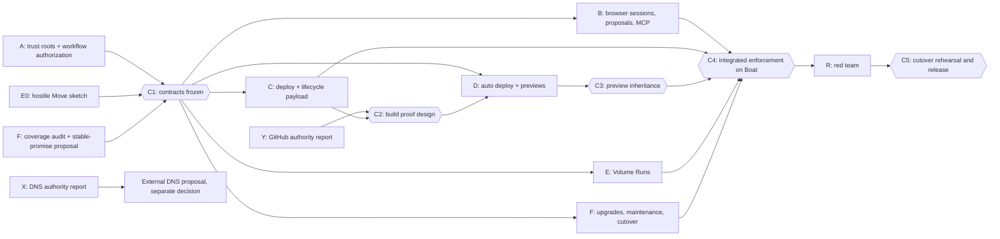

# Ployz 0.4 security execution plan

Status is planned, not implemented. Read [the decision record](decisions.md) first. It holds the security promise, the settled product choices, the shared contracts, the evidence for each attack path and the open decisions. This file covers the order of work, who owns what, and the evidence that proves each piece. [The kickoff prompts](kickoffs.md) start each thread. [The external authority brief](external-authority.md) scopes the DNS and GitHub investigations.

The goal is that root on np1 can cause an outage and read what Cloud already sees, but cannot run new code or settings on a customer Machine, start or stop a workload, open Sealed values, take a Volume, add a Machine or Device, or choose an upgrade. Customer Machines enforce this with customer-held keys. Customers keep ordinary buttons, native authentication prompts and automatic GitHub deploys.

## Threads at a glance

| Thread | Owns | Kind | Starts | Blocks |
| --- | --- | --- | --- | --- |
| A | Trust roots (A1) and workflow authorization (A2) in core | Contract and implementation | Now | C1 for B, C, E, F |
| X | DNS authority investigation | Read-only report | Now | External DNS proposal |
| Y | GitHub authority investigation | Read-only report | Now | D's proof design at C2 |
| E0 | Hostile-driver Move prototype | Throwaway sketch | Now, feeds A2 | C1 Volume schema |
| B | Browser approval sessions, proposals, MCP, CLI-hosted MCP | Implementation | UX sketch now, build after C1 | C4 |
| C | Deploy and lifecycle effective payload, ingress, Config Mounts, Sealed open, caches | Implementation | Inventory now, build after C1 | C2, C4 |
| D | Automatic GitHub deploy rules, build provenance, previews | Design then implementation | Design after Y and C1 | C2, C3, C4 |
| E | Volume Runs under authorization | Implementation | After C1 | C4 |
| F | Coverage audit, upgrades, automatic maintenance, stable-promise argument, cutover | Audit, implementation, release prep | Audit now, build after C1 | C4, C5 |
| R | Red team against the integrated build | Read-only attack | At C4 | Release |

Eight build or research threads plus one red-team thread. A1 and A2 stay in one thread because they share the same core types and the same files in `ployz-core` and `ployzd/src/machine_api`. Splitting them would serialise on those files anyway.

## Dependency graph

## Checkpoints

**C1. Contracts frozen.** A publishes the trusted key record, first-key install, join authorization, workflow authorization envelope, canonical encoding, refusal shapes, local consumption store, expiry and clock rules, and revocation rules. Each comes with Rust types in `ployz-core`, generated TypeScript in `ployz-sdk` for Cloud and the browser, and golden examples. E0's sketch result is folded into the Volume transition rules. F's coverage table lists every mutating Machine RPC row with its workflow kind. F's stable-promise proposal is written. C1 closes when B, C, D, E and F owners have each read the contract and recorded either "consumable" or a concrete gap. A fixes gaps before C1 closes. Nobody edits the contract types after C1 except through A.

**C2. Build proof design.** D publishes how a Machine verifies that an automatic deploy runs the approved branch head, built by the approved workflow and policy, producing the image digest it is about to run. It uses Y's evidence about private-repository head access, workflow identity, reruns and force pushes. C publishes the cache decision. C2 closes only if the design names the authority source for every input and shows a rejected example for each of these: substituted source, substituted settings, substituted artifact, stale proof and replayed proof. If no design meets this without trusting np1, D stops and reports. Automatic deploy then stays on the pre-0.4 path, which is an explicit release decision, not an improvised fallback.

**C3. Preview inheritance.** D publishes how a preview rule names trusted repositories and GitHub identities, which Sealed references a preview may inherit, and how the Machine rewraps or resolves them without plaintext reaching Cloud. The Sealed associated-data scope changes here.

**C4. Integrated enforcement.** All threads land on main behind the enforcement switch. A Boat Cluster with enforcement on runs every customer workflow end to end: dashboard deploy, CLI deploy, start, stop, restart, settings change, GitHub push deploy, force push deploy, preview with inherited secret, Volume copy, Move, restore, join, Device add, upgrade. The same Cluster refuses each demonstrated attack path from the decision record with Cloud fully attacker-controlled. Thread R starts here.

**C5. Cutover rehearsal and release.** F upgrades a Boat Cluster built on the latest 0.3 release to the 0.4 candidate. It enables enforcement with customer authority and proves that Cloud on 0.4 drives the enforced Cluster. It also proves that an enforced Machine refuses every old unsigned mutating route by capability name. R's surviving findings are fixed or recorded as accepted residual risk. Nick runs the release, per `docs/agents/landing.md`.

## Parallelism

Start now and in parallel: A, X, Y, E0, the F coverage audit and stable-promise proposal, the B UX sketch, and the C payload inventory. None of these writes contract types. B's sketch and C's inventory write only planning notes or throwaway prototypes until C1.

After C1, B, C, E and F build in parallel. They touch disjoint areas:

| Thread | Core paths | Cloud paths |
| --- | --- | --- |
| B | Verification of browser session chains in the module A names | `src/server/auth*.ts` passkey code, `modules/approvals`, `modules/devices`, `modules/agent`, approval UI routes |
| C | `ployzd/src/docker`, `ployzd/src/ingress.rs`, `ployzd/src/sealed_env.rs`, `ployz-core/src/domain/{volume,ingress}.rs`, deploy handlers in `ployz` | `modules/service-act`, `modules/runtime`, `modules/config-store` (non-GitHub parts), `modules/variables` |
| D | `ployzd/src/management/build_grant.rs`, `ployz-build`, OIDC verification next to A's verifier | `modules/github`, `modules/config-store/store-github*`, preview code |
| E | `ployzd/src/volume_send.rs`, `machine_api/local_volume_copy.rs`, `ployz-core` volume copy planning | `modules/volume-run`, `modules/volume-copies`, `modules/volume-placement` |
| F | `ployzd/src/installer`, `ployz-core/src/release.rs`, `rpc_catalog.rs` coverage test | `modules/server-upgrade`, `modules/machines` upgrade paths |

`rpc_catalog.rs`, `machine_api/mod.rs`, `machine_api/local.rs` and `dashboard/src/server/schema.ts` are shared hotspots. A owns the dispatch-level authorization hook in `machine_api`. Other threads add per-route payload checks in their own handler files. Where the catalog needs a new row, add one row per PR and rebase promptly.

D starts building after C2. E and C both depend on A's local consumption store, so they consume it and do not extend it.

## Workstreams

Each workstream lists the outcome customers see, how often they approve, what it closes, what remains, prerequisites, code boundaries, bets and acceptance evidence. "Boat" means a disposable real Cluster from the `verify-server` skill. Every PR follows `docs/agents/landing.md`. Local runs are focused checks only, and GitHub CI is the gate.

### A. Trust roots and workflow authorization

**Customer outcome.** A Cluster has a list of trusted keys held on its Machines. The first key comes from the customer's CLI over local administration or verified SSH, once per Cluster. Adding a Machine or a Device takes one approval from an existing trusted Device. Recovery uses an existing Device, the recovery code, or root on a customer Machine. Email reset, support access and Cloud database edits can't change trust. Day-to-day work sees no new prompts from A itself.

**Approval frequency.** First key once per Cluster. One approval per join and per new Device. Recovery is rare and explicit.

**Closes.**
- Register wraps the Sealing Key to an attacker-chosen Machine key (`ployzd/src/machine/local_machine.rs:751`, `:780`).
- Cloud-provided Devices seed a joining Machine (`ployz/src/handlers/cloud.rs:434`, `ployzd/src/machine/store.rs:480`).
- A registered mesh peer reaches the API with no application authority and can become Full (`ployzd/src/network.rs:187`, `machine_api/mod.rs:176`, `machine/local_machine/management_client.rs:78`).
- Through A2, every other path stops at the Machine API until a valid workflow authorization arrives. A2 supplies the mechanism and the other threads bind the payload.

**Remains.** Root on a customer Machine. A stolen trusted Device key or recovery code. Mesh reachability itself, since a registered peer still gets network access to services on the flat mesh. Denial of joins by withholding requests.

**Prerequisites.** None.

**Code boundaries.** `ployz-core` new authority module, `rpc_catalog.rs` authorization classes, `ployzd/src/machine_api/mod.rs` dispatch hook, `ployzd/src/machine/local_machine.rs` register, enroll and sealing key share, `ployzd/src/machine/store.rs` local consumption and trust storage, `ployz` CLI first-key, join and recovery commands, `ployz-sdk` generated types. Cloud only relays envelopes in `modules/machines` and `modules/devices`.

**Bets.** Machine-local authority, since each Machine verifies the chain itself and replicated key rows count only after their signatures check locally. Two-tier identity, since key and Machine identity are opaque IDs and never names. Stable promise, through new capability rows and the F proposal. Lean on proven primitives, using Ed25519 or the existing Device key scheme, WebAuthn verification libraries and a fixed canonical encoding. Evidence over claims, since refusals name the missing authority. AP over C, since revocation is per-Machine acknowledgement and there is no Cluster-wide instant.

**Deliverables before C1.** The decisions A1 and A2 own in the decision record: first authority and join UX, local recovery, crash records, expiry and clock failure, revocation during partitions. Each is written into `decisions.md` with its chosen answer.

**Acceptance.**
- Focused: `cargo nextest run -p ployz-core` for the authority module, `-p ployzd` for the touched tests, `cargo clippy -p ployz-core -p ployzd`, `cargo fmt --check`. Property tests on canonical encoding round trips and signature binding, so that changing any bound field breaks verification.
- `verify-server`, with 2 to 3 agents on separate angles. (1) Fresh Cluster. Install the first key from the CLI, join a second Machine with approval, add a Device. (2) With Cloud credentials only, call Register with an attacker Machine key, inject a Device row, and connect a mesh peer that claims Full. Each is refused with a named capability and no Sealing Key is wrapped. (3) Restart the daemon mid-workflow, then replay a consumed authorization. It is refused. Expire an admission while a step is in flight. Bounded completion still finishes.
- Recovery on Boat: lose all Devices, recover with the recovery code, rotate the old key. Confirm an email-only Cloud session cannot do the same.
- GitHub CI.

### B. Browser approval sessions, proposals and MCP

**Customer outcome.** A dashboard user presses a normal button. If no session is active for that Environment, the browser shows its native passkey prompt once. Buttons then work without prompts until the session expires or the user asks for something outside its scope. Destructive storage actions keep their existing confirmation that explains what is lost. An MCP agent's change shows up as the existing Approval card. Approving it takes one passkey prompt and covers the whole proposed workflow. CLI users with a trusted Device see no prompts. Nothing says "sign" or "signature".

**Approval frequency.** One native prompt per session per Environment scope. Session length is open (see below). One prompt per MCP proposal. Zero for trusted CLI.

**Closes.**
- Cloud-held approvals and sessions can be rewritten (`dashboard/CONTEXT.md:228`, `dashboard/src/server/auth.server.ts:268`). An Approval row, Better Auth session or bearer token no longer authorises anything on a Machine.
- MCP and Organization Tokens can no longer approve their own proposals.
- CLI-hosted MCP can no longer turn access to the CLI process into free use of the Device key for any tool call.

**Remains.** Accepted risk: malicious dashboard code can use a live session within its scope and expiry. Effects accepted during the session can outlast it. Cloud can still show false status and withhold proposals.

**Prerequisites.** C1 for the envelope and chain formats. The UX sketch can start now.

**Code boundaries.** Dashboard passkey and session code in `src/server/auth*.ts` and the client. `modules/approvals`, `modules/agent`, `modules/devices`. Action buttons call one shared helper that ensures a session and then signs. Core work is limited to verifying the session chain (WebAuthn assertion to ephemeral key to workflow envelope) in the module A names. The `ployz mcp` path is in the `ployz` crate.

**Bets.** Cloud drives, never owns, since Cloud stores public material and signed envelopes only. Client-first, daemon when forced, since the browser plans and signs and the daemon only verifies. Lean on proven primitives, via WebAuthn. Evidence over claims, since the UI shows which Machines accepted.

**Open decision B must close before UX acceptance.** Session length and the action families a session covers. The recommended start is a short session per Environment covering deploy, settings and lifecycle. Volume and other destructive workflows each need their own approval of the reviewed workflow.

**Acceptance.**
- Focused: `pnpm typecheck`, `pnpm lint`, and vitest for `modules/approvals`, `modules/agent` and the session helper. Tests assert that a tampered scope, an extended expiry or a widened Environment fails verification.
- `verify-dashboard`, with `SERVERS=1` for the runtime UI. Record one prompt opening a session, then several deploy, restart and stop clicks with no further prompt. Record expiry causing one new prompt. Record that an out-of-scope action prompts. Record an MCP proposal approved with one prompt and executed. Save screenshots of each state.
- `verify-server`: with the database edited so an Approval row reads "approved" and no real assertion exists, the Machine refuses. With a real session, an action in a second Environment is refused.
- `verify-mcp-login` if `ployz mcp login` or `mcp.json` handling changes.
- GitHub CI.

### C. Deploy and lifecycle effective payload

**Customer outcome.** Deploys, settings changes, start, stop and restart behave as today, from the dashboard (inside a session), CLI and approved MCP proposals. A Machine runs only the payload the customer approved. Plain variables stay plain.

**Approval frequency.** No extra prompts beyond B's session. Zero for CLI.

**Closes.**
- Operator chooses the container image and host-sensitive Docker fields (`ployz-core/src/rpc_catalog.rs:73`, `ployzd/src/machine_api/local.rs:469`, `ployzd/src/docker/create.rs:157`, `:401`).
- Volume driver options bypass the bind-mount denylist (`ployz-core/src/domain/volume.rs:364`, `ployzd/src/docker/volume.rs:155`).
- Ingress accepts a caller-selected image with certificate mounts (`ployz-core/src/domain/ingress.rs:75`, `ployzd/src/ingress.rs:1144`).
- Replacement code opens valid Sealed values (`ployzd/src/sealed_env.rs:56`). Opening is bound to the approved payload digest, which covers the image digest, command and mounts.
- Cloud-substituted Config Mount bytes, and caches Cloud can write.

**Remains.** Approved application code can leak its own secrets. Cloud can redeploy an already approved revision, which is idempotent and reruns no hooks as fresh work, or it can withhold deploys. Plain values are visible to Cloud.

**Prerequisites.** C1. The inventory can start now. It lists every field that reaches Docker, the ingress, hooks, mounts and Sealed open, and states whether it is approved, derived or Machine-local.

**Code boundaries.** `ployzd/src/docker`, `ployzd/src/ingress.rs`, `ployzd/src/sealed_env.rs`, `ployz-core/src/domain`, `ployz` deploy handlers, and the Cloud deploy path in `modules/service-act`, `modules/runtime`, `modules/config-store` and `modules/variables`. The effect-boundary check sits in the handler that calls Docker, not in Cloud.

**Bets.** Bounded imperative commands, since the approved payload record is authorization evidence and not a new reconciler. Partial results are outcomes, since each Machine reports accepted or refused. Machine-local authority. Stable promise, for new routes and payload fields.

**Decision C owns before C2.** Cache trust. The recommendation is to disable any cache Cloud can write unless its content is verified against an approved digest, rather than build a trust service.

**Acceptance.**
- Focused: crate tests that assert a payload differing in any one field (image digest, command, mount, privilege, route, hook, driver option, Config Mount hash) is refused. `pnpm typecheck` and vitest for touched modules.
- `verify-server`, 2 to 3 agents. (1) Normal deploy, settings change, start, stop and restart from the CLI and the dashboard. (2) Attacker with Cloud credentials sends EnsureContainer with a new image, a privileged flag, a host bind through driver options, an ingress image swap and changed Config Mount bytes. Each is refused and nothing changes in Docker. (3) Redeploy an approved revision twice and kill the daemon mid-deploy. Hooks do not rerun as fresh work.
- `verify-dashboard` for any changed deploy or settings UI.
- GitHub CI.

### D. Automatic GitHub deploy, builds and previews

**Customer outcome.** A customer approves a repository, branch, Environment, workflow and build policy, and settings revision once. Every push to that branch deploys with no prompt, including intentional force pushes. Changing settings or build policy needs a new approval. Trusted previews deploy automatically and can inherit selected Sealed values the rule names. Untrusted PRs keep the existing review path, bound to the exact reviewed head.

**Approval frequency.** Once per rule. Again only when the settings revision or build policy changes. Zero per push. Once per preview inheritance rule.

**Closes.**
- Forged Build Grant opens Sealed values (`ployzd/src/management/build_grant.rs:111`, `:480`).
- Cloud picks build ref and inputs (`dashboard/src/modules/github/github-build.server.ts:74`).
- Cloud validates OIDC with a Cloud audience and its result is trusted (`dashboard/src/modules/config-store/store-github-builds.server.ts:229`).
- Cloud substitutes source, settings, artifact or stale proof on an automatic deploy.
- Settings riding along with an auto-deploy.

**Remains.** Anyone who can push to the approved branch deploys, which is the intended rule. The GitHub App's existing reach, per Y's report. A rerun of an old workflow on an old commit is accepted only while that commit is still the branch head. Flat mesh, so a preview is not network-isolated from production.

**Prerequisites.** C1, Y's report, and C's cache decision for C2. C2 must close before D builds. C3 must close before preview inheritance is built.

**Code boundaries.** `ployzd/src/management/build_grant.rs`, `ployz-build`, an OIDC verifier next to A's authority module (fixed issuer, Cluster-specific audience), `.github/workflows/ployz-build.yml` and the external `getployz/build` action where accessible. Cloud side: `modules/github`, `modules/config-store/store-github*` and preview code.

**Bets.** Machine-local authority, since each Machine checks the proof. Cloud drives, never owns. Lean on proven primitives, via GitHub OIDC and signed provenance where it exists. Evidence over claims. Observer-relative truth, since freshness means head at observation, not latest everywhere.

**Open decisions.** Private-repository head evidence without trusting np1 (blocks C2). Preview identity and inheritance representation (blocks C3).

**Acceptance.**
- Focused: OIDC verifier unit tests with real GitHub token fixtures. Wrong audience, wrong issuer, expired token, wrong workflow ref, wrong repository ID and a replay are each refused. Tests for build policy and digest binding.
- A real isolated GitHub repository and installation, because `verify-dashboard` fakes SHAs and OIDC. Prove a push deploys. Prove a force push deploys. Prove that an old proof for a superseded head is refused. Prove that a Cloud-substituted image digest, ref or settings revision is refused. Prove that a preview inherits only the named secret.
- `verify-build-handoff` if the build walk changes. `verify-server` for Machine admission. `verify-dashboard` for the one-time rule approval UI.
- GitHub CI.

### E. Volume Runs

**Customer outcome.** Moving, copying, mirroring or restoring a Volume takes one approval of the reviewed workflow, plus the existing confirmation where data is lost. The approval covers planned stops, transfer, switch, restart, permitted retries and recovery after a crash. The UI separates "can't start new work" (admission expired) from "finishing what started".

**Approval frequency.** One per Volume workflow.

**Closes.**
- Cloud controls Volume operations and the Move commit decision (`dashboard/src/modules/volume-run/volume-run.server.ts:1333`, `volume-run.inngest.ts:680`).
- Mesh access reaches a bulk Volume stream (`ployzd/src/volume_send.rs:52`). The stream becomes recipient-bound to the approved target Machine.
- A malicious driver gets both incompatible outcomes from one approved Move.

**Remains.** Cloud can stall a Move, leaving a Volume with no Writer. Bet 6 already accepts that, and the fix is to finish it under the bounded recovery allowance. Recipients the customer approved receive data.

**Prerequisites.** C1. E0's sketch result is in A2's contract.

**Code boundaries.** `ployzd/src/volume_send.rs`, `machine_api/local_volume_copy.rs`, `ployz-core` volume copy planning, `ployz-verify` Stateright model. Cloud: `modules/volume-run`, `modules/volume-copies`, `modules/volume-placement`.

**Bets.** Machine-local authority. This is the hardest seam. A participant receipt may authorise a Machine's own transition, and E must argue in its PR why that does not make one Machine act on another's records. Partial results are outcomes. No clock-based safety waits.

**Acceptance.**
- Focused: `verify-volume-runs` model check extended with a hostile driver that holds one approved Move. No reachable state has two Writers or an unapproved recipient.
- `verify-server`, 2 to 3 agents. (1) Normal Move, copy and restore with one approval each, killing the daemon mid-transfer to check bounded recovery. (2) Cloud credentials stream a Volume to an unapproved Machine, change the recipient mid-run, or commit both sides. Each is refused. (3) Admission expires mid-run and the run still completes. A new run needs a new approval.
- `verify-dashboard` for the approval and progress UI.
- GitHub CI.

### F. Coverage, upgrades, maintenance and cutover

**Customer outcome.** Upgrades keep working from the dashboard and CLI. Cloud can't choose a release the customer didn't pick. Automatic maintenance (ingress startup, certificate renewal, image pruning, preview cleanup, Volume recovery) keeps running. The 0.4 upgrade turns enforcement on once per Cluster with the customer's authority.

**Approval frequency.** One approval to enable enforcement per Cluster. For upgrades, one per upgrade, or a standing channel choice. Which one is open (see below). Maintenance needs none.

**Closes.**
- Cloud selects a forward signed release outside the UI channel choice (`ployzd/src/installer/release.rs:132`, `dashboard/src/modules/server-upgrade/server-upgrade.server.ts:253`).
- Coverage gaps: any mutating catalog row without an authorization class fails a test.
- Maintenance used as a back door: every automatic effect gets a bounded standing authorization or is a consequence of an approved workflow.

**Remains.** A customer who never upgrades keeps today's exposure. Release signing stays where it is today. Its reachability from np1 is not established and depends on `getployz/ops`.

**Prerequisites.** The coverage audit and stable-promise proposal start now and feed C1. Upgrade and cutover work follows C1.

**Code boundaries.** `ployz-core/src/rpc_catalog.rs` with a coverage test, `ployzd/src/installer`, `ployz-core/src/release.rs`, Cloud `modules/server-upgrade` and `modules/machines`, `core/DESIGN.md` stable promise text, `docs/user/` upgrade and security pages.

**Bets.** Stable promise. F writes the argument for a narrow 0.4 exception, or an additive activation where an enforced Machine refuses unsigned routes by capability name. Evidence over claims, since the UI shows enforcement only for Machines that acknowledged it.

**Open decisions.** Per-upgrade approval or standing channel. The stable-promise resolution.

**Acceptance.**
- Focused: a catalog coverage test that fails on any mutating row without an authorization class. Installer tests that a Cloud-chosen version outside the approved channel is refused. Existing signature and downgrade tests still pass.
- `verify-upgrade-attempt` model check if the upgrade attempt flow changes.
- `verify-server`: upgrade a latest-0.3 Boat Cluster to the 0.4 candidate, enable enforcement, run a normal deploy, then send an old unsigned mutating route and see it refused with `details.capability`. Let maintenance run for a renewal cycle with Cloud offline.
- GitHub CI.

### R. Red team at C4

Read-only. Assume root on np1 against the integrated Boat Cluster. Try to run your own code or settings, read Sealed values, take a Volume, hijack traffic, ship a binary, or add a Machine or Device. Hit the seams listed in the decision record: first key and joins, OIDC claims and audience, replay, rollback, previews, settings riding along, builds and caches, registry images, Config Mounts, the browser session window, recovery, staff access and the release pipeline. Report only attacks that work, with commands and end state. The owning thread fixes each one.

### X and Y. DNS and GitHub authority

Scope, evidence and stopping point are in [external-authority.md](external-authority.md). Both are read-only and start now. Neither changes customer approval frequency. X gates any external DNS change. Y gates D's proof design at C2 and any GitHub separation proposal. Neither starts implementation. Each ends at a cited recommendation that the operator selects or rejects.

## Integration rules

- C1 is the only point where contract types change freely. After C1, a change to a contract goes through A with a short note to consumers.
- Every mutating route lands with enforcement code and a refusal test in the same PR. A route that is only partly covered stays behind the switch.
- The enforcement switch is per Cluster, turned on by customer authority, and it is not a permanent mixed-version dispatcher. F deletes the unenforced Cloud paths before release, per the coordinated-cutover decision.
- Docs: each thread updates `docs/user/` for behaviour customers see in the same PR.
- PR bodies name each DESIGN bet touched and the choice it changed, per `AGENTS.md`.

## Open decisions

These are copied from the decision record and owned as listed. None is settled by this plan.

| Decision | Owner | Must close by |
| --- | --- | --- |
| First authority and join UX | A | C1 |
| Local recovery details | A | C1 |
| Crash records and incompatible Move transitions | A with E0 | C1 |
| Expiry and clock failures | A | C1 |
| Revocation during partitions | A | C1 |
| Stable-promise conflict | F | Proposal at C1, resolved before release |
| Session length and action families | B | B's UX acceptance |
| Cache trust | C | C2 |
| Private-repository head and build proof | D with Y | C2 |
| Preview identity and inheritance | D | C3 |
| Per-upgrade approval or standing channel | F | C4 |
| DNS separation | X, then the operator | Separate decision |
| GitHub separation | Y, then the operator | Separate decision |
