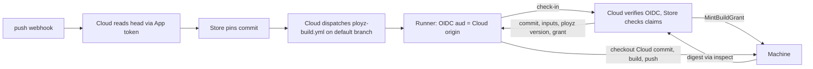

# Y. GitHub authority report

Thread Y, read-only. Source is this branch (plan commit `2ff598cf1d` on `38666a9841`). The GitHub API reads were made on 2026-11-06 as `nick-potts`, read-only. Nothing was dispatched, pushed, re-run or changed. No secret value was printed. Only key names and locations appear here.

Labels on each claim:

- **[S]** source-confirmed in this checkout, or in `getployz/build` at tag `v1` (`7b57cb8`).
- **[D]** deployed. Observed through the read-only GitHub API or the private `getployz/ops` repo.
- **[F]** fixture-only. The `verify-dashboard` fakes show this, not GitHub.
- **[G]** stated in GitHub's published docs. Not exercised here.
- **[U]** unknown.

## 1. Findings that change the plan

1. **The App requests much more than the docs say. [D]** The public `getployz` App (id 3128858, external URL `https://ployz.dev`) asks for Actions, **Administration**, Checks, **Contents**, **Deployments**, **Pull requests**, **Statuses** and **Workflows**, all *write*. It also asks for Members, Metadata and Emails, read-only. `docs/user/self-hosting.md:79` and `decisions.md` describe Contents read, Actions write, Checks write, Pull requests read, Metadata read and Members read. Cloud's code uses only that documented set (§3). A new customer installation accepts everything the App requests. Then root on np1 can mint a token that **pushes commits, edits workflows and changes branch protection** in every repository the customer selected. With automatic deploy, a push to the approved branch *is* authorization. So no Machine-side proof thread D could build would stop np1 from deploying its own code while the App keeps Contents or Workflows write. Narrowing the App is a precondition for C2.
2. **np1 can reach Ployz's own release pipeline. [D for the grants and policies, U for the end-to-end path, which was not exercised]** `getployz`, `getployz-dev` and `getployz-staging` are installed on the `getployz` org with `repository_selection: all`. Each install holds the same write set, including Contents, Workflows and Administration. With any one of those keys:
   - **Signing key.** `getployz/ployz` has no tag ruleset. Its `release` environment admits any `v*` tag through a branch policy, and it holds `MINISIGN_SECRET_KEY`. A pushed branch carrying a modified `release.yml` plus a pushed `v*` tag would run in that environment. `decisions.md` lists release signing key access from np1 as "not established". This path suggests it is reachable.
   - **ployz.sh.** `CLOUDFLARE_API_TOKEN` is a repository-level secret, so any workflow on any branch can read it. That token deploys `https://ployz.sh`. Every GitHub build fetches `install.sh` from ployz.sh before it builds (`getployz/build` `prepare.sh`).
   - **The build action.** `getployz/build` has no rulesets and an unprotected `main`. Customer workflows use the mutable tag `getployz/build@v1`. Moving that tag runs np1's code inside every customer build job. Those jobs hold `id-token: write` and the runner-held Build Grant, which opens Sealed values.

   Under `AGENTS.md` this scores S=10 (a security hole), so it meets the fix bar. This thread is read-only, and the fix is GitHub org settings, not code. I filed no public issue because the repository is public. It goes to the operator as action O1 (§7).
3. **np1 chooses the source that GitHub builds. [S]** The workflow is dispatched on the default branch (`github-build.server.ts:63`). The action then checks out `.commit` from Cloud's check-in response (`getployz/build` `action.yml`, `prepare.sh`, and `core/crates/ployz/src/sdk/github_build.rs:267`). The OIDC `sha` claim is the default branch head when the run was created. It is not the commit that was built. The build inputs, the `ployz` version and the runner label also come from Cloud. The Machine sees no GitHub evidence at all: Cloud asks for a Build Grant and the Machine mints it (`github_build.rs:296`).

## 2. Credential inventory

| Credential | Where it lives | What it can do | Exported? |
| --- | --- | --- | --- |
| App private key `GITHUB_APP_PRIVATE_KEY` | np1 `/root/ployz/.env.web.production` and `.env.worker.production`. The env map lists it as a placeholder line during the Railway move. Whether it is filled now: [U], though prod GitHub features working implies yes. Read at `config.server.ts:75`. | Signs App JWTs (`github-token.server.ts:17`, `:44`). Lists, reads and **deletes** installations, edits the App's webhook config [G], and mints a token for **any** installation. | Not sent to Machines or runners [S]. |
| Installation tokens | Minted at `github-token.server.ts:52`, with no `repositories` or `permissions` narrowing in the body (`:56`). Cached in process for 50 minutes (`:149`). | Every permission the installation granted, on every repository it selected. The only gate is the Cloud-side org link and suspension check (`:128`, `:163`), which root on np1 bypasses. | Not exported. Used only by `GithubApiLive` (`github-observation.api.ts:537`) [S]. The runner uses Actions' own `GITHUB_TOKEN` (`contents: read`, `persist-credentials: false`) [S]. |
| App client ID and secret `GITHUB_APP_CLIENT_SECRET` | Same env files. | Exchanges OAuth codes for user-to-server tokens (`github-observation.api.ts:659`). Such a token carries the App's permissions intersected with the user's access. | The connect flow keeps the user token in a closure only (`github-connect.server.ts:117`) [S]. Root on np1 can capture it live. |
| Sign-in OAuth `GITHUB_CLIENT_ID` and `GITHUB_CLIENT_SECRET` | Same env files. Better Auth `socialProviders.github` (`auth.server.ts:386`). | With a separate OAuth App: the default scopes `read:user` and `user:email` [S, from Better Auth 1.7.7 `social-providers/github.mjs:15`; the installed `^1.7.16` is U]. In "One app for both" mode (`self-hosting.md:96`) it is a GitHub App user-to-server token, which carries the App's write permissions where the user has access. | **Stored in plaintext** in `account.access_token`, `refresh_token` and `id_token` (`identity/tables.ts:80`). `encryptOAuthTokens` is not set. Cloud code never reads them [S]. Which mode prod uses is [U]: compare the two non-secret client IDs on np1. |
| Webhook secret `GITHUB_APP_WEBHOOK_SECRET` | Same env files. Checked at `github.api.ts:139`. | Forges deliveries **to Cloud** only. Cloud reads the branch head from GitHub again and ignores the head in the webhook (`store-github.server.ts:133`) [S]. It is irrelevant to Machines. | n/a |
| `DATABASE_URL` | Same env files. | Exposes the OAuth tokens above, PR trust rows and pinned commits. | n/a |

The installs on the getployz org were read through `GET /orgs/getployz/installations` [D]. Customer installations, their selected repositories and their accepted permission sets are **[U]**. An installation made before a permission increase may not have accepted it yet.

## 3. Documented, requested and used permissions

| Permission | `self-hosting.md:79` | App `getployz` requests [D] | getployz org installs: `getployz`, `-dev`, `-staging` [D] | What Cloud code uses [S] |
| --- | --- | --- | --- | --- |
| Actions | read and write | write | write | `fetch_workflow`, `dispatch_workflow` and `cancel_run`, `fetch_run` (`github-build.server.ts:28`, `:63`, `:86`, `:100`) |
| Administration | none | **write** | **write** | none |
| Checks | read and write | write | write | `create_check_run` and `update_check_run` (`github-observation.api.ts:500`). Check-suite reads (`:397`). |
| Contents | read | **write** | **write** | reads only: refs, compare, trees, contents, tarball (`:284`, `:334`, `:633`, `github.api.ts:225-314`) |
| Deployments | none | **write** | **write** | none |
| Metadata | read | read | read | `resolve_repository` (`:252`), installation repos (`:618`) |
| Pull requests | read | **write** | **write** | `fetch_pull_request` (`:438`) |
| Statuses | none | **write** | **write** | none |
| Workflows | none | **write** | **write** | none. Add workflow opens GitHub's editor for the user (`github-build-workflow.ts:51`). |
| Members (org) | read | read | read | connect membership check through the user token (`github-connect.server.ts:137`) |
| Emails (account) | only in one-app mode | read | n/a | sign-in |

Events: Push, Check suite, Workflow run and Pull request. Docs and App match [D].

`store-pr-grants.server.ts:11` warns only when Checks write or Pull requests read is missing [S]. Nothing checks for excess grants.

## 4. Every current caller

| Operation | Endpoint | Callers |
| --- | --- | --- |
| Mint a token | `POST /app/installations/{id}/access_tokens` | `GithubTokens` (`github-token.server.ts:144`). All installation calls below go through it. |
| `fetch_installation` (App JWT) | `GET /app/installations/{id}` | `store-pr-grants.server.ts:11` |
| `list_repositories` | `GET /installation/repositories` | repo sync (`github.api.ts:26`) |
| `resolve_repository` / `resolve_branch_head` | `GET /repositories/{id}`, `GET /repos/{r}/git/ref/heads/{b}` | push observation (`store-github.server.ts:132-133`), merge observation (`:53-54`), source pin (`github-source.server.ts`, `resolveGithubSourceSha`) |
| `compare_commits` | `GET /repos/{r}/compare/{a}...{b}` | `store-github.server.ts:56`, `:99` |
| `fetch_check_suite` | `GET /repos/{r}/check-suites/{id}` | `store-github.server.ts:155` |
| `fetch_pull_request` | `GET /repositories/{id}/pulls/{n}` | `store-github.server.ts:73`, `store-pull-request.server.ts` |
| `list_check_runs`, `create_check_run`, `update_check_run` | `GET`/`POST`/`PATCH .../check-runs` | the PR check (`store-pull-request.server.ts:162`) |
| `download_source` | `GET /repos/{r}/tarball/{sha}`, with no credential on the codeload hop | Servers builder and uploaded source (`github-source.server.ts:225`) |
| `list_branches`, `resolve_file_ref`, `list_files`, `fetch_contents` | branches, commits, trees, contents | `ployz github` CLI and dashboard (`github-cli.server.ts`, `github.api.ts:47-136`) |
| `fetch_workflow`, `dispatch_workflow`, `cancel_run`, `fetch_run` | Actions | `store-github-builds.server.ts:130`, `:145`, `:151`, `:171`, `cancelDispatchedGithubRun` |
| `exchange_user_code`, `/user`, `/user/installations`, `/user/memberships/orgs/{o}` | OAuth plus user token | the connect callback (`github-connect.server.ts:117-137`) |
| Runner OIDC check | GitHub JWKS. The audience is the **Cloud origin**. | `github-oidc.server.ts:51`, `store-github-builds.server.ts:229-235`. The Store compares `repository_id`, `job_workflow_ref`, `run_id` and `event_name` in `core/crates/ployz-store/src/build.rs:894-904`. |
| Webhook | HMAC | `-webhook.handler.ts:53` |

The two Cloud-origin modes, `organizationAccess` and `installationAccess`, both resolve to the same unscoped installation token (`github-observation.api.ts:537-541`) [S].

## 5. How deploys and previews are proven today

- **Push deploy.** Every fact the Machine acts on comes from Cloud: the head, the pinned commit, the build inputs and the decision to mint a grant [S]. The Machine checks no GitHub claim.
- **Build workflow.** `.github/workflows/ployz-build.yml` matches `getployz/build`'s copy byte for byte [S]. It has three Cloud-chosen inputs: `build`, `cloud` and `runner` (`runs-on: ${{ inputs.runner }}`, so np1 can choose a self-hosted label). The action refs `getployz/build@v1`, `actions/checkout@v4` and `crazy-max/ghaction-github-runtime@v3` are all mutable tags. The last one exposes `ACTIONS_RUNTIME_TOKEN` for the Actions cache, which feeds C's cache decision.
- **What the action does** [S, `v1`]:
  - `prepare.sh` sends an OIDC token with `aud=<cloud input>` to `<cloud>/api/builds/<id>/check-in`. It takes back `commit`, `fingerprint`, `deployment` (the lowered input, Sealed values included for a holder grant), `ployzVersion` and the grant's Machine.
  - It installs that `ployz` version from `https://ployz.sh`. `install.sh` checks a minisign signature, so only signed releases install, but Cloud picks which one [S, `core/install.sh:47-71`].
  - `action.yml` checks out `steps.prepare.outputs.commit`. The `digest` output is informational, because Cloud reads the digest from the Machine through grant inspection.
- **Because `cloud` is a dispatch input,** whoever dispatches the run chooses where the runner sends its OIDC token. Today that is np1 itself.
- **Previews.** A PR is Trusted when its head is in the same repository and the author is a bot, or the author's GitHub ID is in Cloud's `member ⋈ account` rows (`pull_request/mod.rs:218-231`, `config-store.server.ts:236`) [S]. Both inputs are Cloud-mutable. If an Organization includes bot PRs, a PR the App opens itself as `getployz[bot]` counts as Trusted.
- **Fixtures.** `dashboard/scripts/verify/fake-github.ts` fakes SHAs and issues its own OIDC tokens [F]. Nothing above about GitHub's real behaviour was proven with it.

## 6. Answers for thread D

### 6.1 What GitHub's OIDC claims bind

The claim meanings below come from GitHub's OIDC reference and its events and re-run pages [G].

| Claim | Binds | Notes for a Machine verifier |
| --- | --- | --- |
| `iss` | `https://token.actions.githubusercontent.com` | Fix it. Check the signature against GitHub's JWKS, fetched by the Machine. |
| `aud` | Whatever the job asked for | Any code in the job can ask for **any** audience. A Cluster-specific audience stops cross-use, but only when the code that requests the token is pinned (`job_workflow_sha`). |
| `repository_id`, `repository_owner_id` | Immutable IDs | Use these, not names. |
| `ref`, `ref_type` | The ref that triggered the run | `workflow_dispatch` takes any branch or tag the dispatcher names. Bind `ref_type=branch` and the exact branch. |
| `sha` | `push`: "Tip commit pushed to the ref". `workflow_dispatch`: "Last commit on the GITHUB_REF branch" **when the run was created** | This is the trigger commit, not the checked-out commit. Today they differ. |
| `workflow_ref`, `workflow_sha` | The caller workflow file and its commit | It lives in the customer repository, so after narrowing np1 cannot write it. |
| `job_workflow_ref`, `job_workflow_sha` | For reusable workflows, the **called** workflow and its exact commit | This is the only claim that pins which code ran the job. Today the build is a composite action, so `job_workflow_ref == workflow_ref` and the builder code is **not** pinned by any claim. |
| `run_id`, `run_number` | The run. `run_number` increases per workflow. | Both are unchanged by re-runs. |
| `run_attempt` | Re-runs of the run | Increments on each re-run. |
| `event_name` | `push`, `workflow_dispatch`, and so on | After narrowing, np1 cannot create `push` runs. It can create `workflow_dispatch` runs with Actions write. |
| `actor`, `actor_id` | The account that started the run | On a re-run it is still the original actor's privileges. |
| `runner_environment` | `github-hosted` or `self-hosted` | Pin to `github-hosted` unless the rule names self-hosted. |
| `sub` | A template | A repository admin can change it through `PUT /repos/{o}/{r}/actions/oidc/customization/sub`. **Don't verify `sub`**, verify discrete claims. |
| `iat`, `exp`, `jti` | Freshness and uniqueness | Exact lifetime is not documented on the reference page [U]. Consume `jti` per Machine. |

**Re-runs.** A re-run uses "the same `GITHUB_SHA` … and `GITHUB_REF` of the original event". It works up to 30 days after the run and at most 50 times. The new token keeps the same `sha`, `run_id` and `run_number`, with `run_attempt+1`, fresh `iat` and `jti`, and the original `actor` [G]. Anyone with Actions write can re-run. That includes np1 even after narrowing. So **np1 can get a freshly valid token for any commit that was a branch head in the last 30 days**. Freshness and `jti` checks cannot catch this. Only a head check, or monotonic per-Machine state, can.

**Force pushes.** No claim records `before`, `forced` or ancestry. A force push, including one back to an older commit, starts a new `push` run with a higher `run_number` and `sha` = the new tip. To a verifier, an intentional force push looks the same as a forward push. It differs from a re-run because the re-run keeps its old `run_number` and the force push gets a new, higher one. This matches the decision that a force-pushed old commit can be a new authorized head.

**Fork PRs.** Actions write also allows approving fork PR runs that are waiting for approval [G]. Whether such runs can mint OIDC tokens is [U]. Binding `event_name`, `ref` and `workflow_ref` excludes them anyway.

### 6.2 Head evidence for a private repository without trusting np1

| Option | What the Machine trusts | Setup | Verdict |
| --- | --- | --- | --- |
| **H1.** OIDC `sha` from a `push` run, plus `run_attempt`/`run_number` ordering and per-Machine high-water marks | GitHub's OIDC issuer, and the fact that np1 cannot create `push` runs (true only after narrowing) | None | **Not enough alone**, as `decisions.md` already says. A Machine that never saw run N+1 accepts a re-run of N. Ordering of quick pushes by `run_number` is not documented. Useful as the supplement. |
| **H2.** Machine runs `git ls-remote` over SSH with a **customer-added, read-only deploy key** generated on the Cluster and held Sealed | GitHub's SSH host keys (pinned from `api.github.com/meta`), deploy-key custody on Machines | Once per repository: the customer pastes a public key at a link Ployz gives. No App involved. | **Recommended.** Exact head at admission, and the same key lets Servers builds fetch source directly, removing np1's tarball hop (`github-source.server.ts:225`). Gaps: one key per repository (GitHub rule), and the deploy-key limit per repository is [U]. |
| **H3.** Machine calls the REST API with a customer-owned credential: a fine-grained PAT, or a per-customer App made by the manifest flow through the CLI (the code exchange happens locally, never at a Cloud callback) | GitHub API TLS, credential custody | More steps. PATs expire. | Fine where SSH egress is blocked. Second choice. |
| **H4.** Public repository: unauthenticated `GET .../git/ref` | GitHub API TLS | None | Use it for public repositories. It has rate limits. |
| **H5.** An independent verifier service with its own read-only App, signing "head of repo R, branch B is S, for challenge N" | That service's host, operator, deploy pipeline and key. It must share nothing with np1 or the getployz org installs. | None for the customer | Lying about a head lets it deploy **any commit in the repository**, including unreviewed PR heads. It is high-value and needs its own infrastructure. Only worth it if H2 setup is rejected. |
| **H6.** Reads proxied by np1, commit signatures, the API's `verification.verified` | np1 | n/a | **Rejected.** GitHub API responses are not signed, and all three are np1-relayed claims. |

### 6.3 Binding source to the produced image digest

Recommended shape. Each line names the authority behind each input:

1. **Trigger.** The customer's `ployz-build.yml` runs `on: push` to the approved branch, which removes Cloud's dispatch from the authority path. It calls a **reusable workflow** pinned by full SHA, for example `getployz/build/.github/workflows/build.yml@<sha>`. Then `job_workflow_ref` and `job_workflow_sha` identify the builder code, and the caller cannot inject steps into that job. Optional `workflow_dispatch` runs stay acceptable only through the head check.
2. **Checkout.** The builder checks out `github.sha`, never a Cloud-supplied commit. The `ployz` binary is installed by digest from the approved build policy, inside the pinned workflow. It is not fetched as `install.sh` from ployz.sh at a Cloud-chosen version.
3. **Grant.** The runner presents its OIDC token, with `aud` = a Cluster-specific audience, **to a Machine**. Relaying it through Cloud is fine, because the token authenticates itself. The Machine checks:
   - `iss`, signature and `exp` or `iat` freshness
   - `jti` not already used
   - `repository_id` and `repository_owner_id`
   - `ref_type=branch` and `ref` match the device-signed rule
   - `event_name` is in the rule
   - `workflow_ref` names the rule's file on the rule's branch
   - `job_workflow_ref` and `job_workflow_sha` match the builder the rule pins
   - `runner_environment`
   - `sha` == the head from H2, H3 or H4, **observed by the Machine now**
4. **Inputs.** The Machine, not Cloud, returns the build inputs from the approved settings revision. It mints the Build Grant bound to `(rule generation, sha, settings digest, job identity)`. Sealed values are released only to that holder key.
5. **Digest.** The push under that grant records `digest ↔ (sha, rule, settings digest)` as a Machine-local receipt. The deploy admits only that digest. Cloud's Build Receipt remains a display.

This trusts GitHub's OIDC and runner isolation, the pinned builder commit, and the repository's own build steps, which the rule authorizes. It does not trust np1.

Rejected examples for C2:

| Attempt | Refused because |
| --- | --- |
| Substituted source: np1 hands a commit or ref other than `github.sha` | The builder ignores Cloud's commit, and `sha` must equal the head the Machine observed |
| Substituted settings | The Machine supplies the inputs, and the grant is bound to the settings digest |
| Substituted artifact: an image pushed outside the grant, or a digest Cloud claims | Only the digest received under the bound grant is admitted |
| Stale proof: a re-run of last week's run | Its `sha` is not the current head |
| Replayed proof: the same token sent twice | `jti` is already used, and the grant is single-push |
| Wrong builder: a moved `@v1` tag | `job_workflow_sha` does not match |

The alternative is GitHub artifact attestations, which are Sigstore-signed and carry workflow, commit and event. Private repositories use GitHub's own Sigstore instance, without a transparency log [G]. Plan availability for private repositories is [U]. It needs the same trust plus more verifier machinery, so it is not preferred.

## 7. Recommendation: narrow and separate, no broker

**Current reach of root on np1:**

- **Reads**, which stay allowed. Every repository in every customer installation: code, refs, PRs, check suites, Actions runs and logs [S for what Cloud does; reach is D/U per installation].
- **Writes on customer repositories.** Everything in the installation's accepted grant. If they accepted the App's current request, that is pushing code, editing workflows, changing protection and rulesets, deployments, statuses, PR edits, Actions dispatch, cancel and re-run, and check runs.
- **Ployz's own org.** The paths in §1.2.
- **Users.** Plaintext OAuth tokens, plus live capture of user-to-server tokens.
- **The App itself.** Deleting every installation and redirecting the webhook [G].

**Operator actions. Not code, and none of them done here:**

- **O1.** On the `getployz` org:
  - Remove the `getployz`, `getployz-dev` and `getployz-staging` installs, or limit them to non-sensitive repositories without write access.
  - Add `v*` tag rulesets to `getployz/ployz` and `getployz/build`.
  - Protect `getployz/build` `main`.
  - Add required reviewers to the `release` environment.
  - Move `CLOUDFLARE_API_TOKEN` into an environment restricted to `main` with reviewers.
  - Then decide whether `MINISIGN_SECRET_KEY` and the Cloudflare token need rotating.
- **O2.** Cut the three Apps' requested permissions to what Cloud uses: Contents read, Metadata read, Pull requests read, Checks write, Actions write, and Members read for orgs. Whether reductions reach existing installations without owner action is [U]. Check one installation afterwards (`GET /app/installations/{id}`).
- **O3.** Check whether prod uses "One app for both" by comparing `GITHUB_CLIENT_ID` with `GITHUB_APP_CLIENT_ID` (both IDs are non-secret).

**Code follow-ups for other owners. I did not make them:**

- **D**, `modules/github`: mint installation tokens scoped with `repositories` and `permissions` per call. This is defence in depth only, because np1 holds the key.
- **D:** retire the `cloud` and `runner` dispatch inputs and the Cloud-chosen `commit` and `ployzVersion` in the builder, per §6.3.
- **B or identity:** stop persisting the GitHub `access_token`, `refresh_token` and `id_token` in `account`. Cloud never reads them, and encrypting them wouldn't help against np1 root.
- **D, for C3:** derive preview trust from GitHub facts the Machine verifies, not from `member ⋈ account`. Exclude the Ployz App's own bot from "bot" trust.

**Why no broker.** Once the App is narrowed, a broker holding the App key would protect only Actions write and Checks write. What np1 can do with those after §6.3:

| Capability | Effect with §6.3 in place |
| --- | --- |
| Dispatch | Builds the current head |
| Re-run | Refused by the head check |
| Cancel or disable a workflow | Outage, which the promise already concedes |
| Approve a fork run | Refused by event and ref binding |
| Forge Ployz check runs | Cosmetic. Matters only if a customer's required checks are not pinned to an app source. |

A broker is a new service and deploy pipeline that must sit outside np1 and the getployz org. It buys little. If the operator wants one anyway, it would hold the App key and expose only:

- `dispatch(signed rule)`, for `ployz-build.yml` on the rule's branch only
- `cancel(run)`, only for runs of that workflow
- `check(repo, sha, name ∈ Ployz check names)`
- minting of read-only tokens (`contents:read, metadata:read, pull_requests:read, checks:read, actions:read`), which keeps reads as they are

These requests must be refused:

- a token with `contents:write` or `actions:write`
- dispatching `release.yml` or any other file
- dispatching to `refs/heads/attacker` or to a tag
- `POST /actions/runs/{id}/rerun`
- cancelling a non-Ployz workflow run
- `POST /actions/runs/{id}/approve`
- any `PUT /repos/.../contents/...`, which has no route at all

**Residual after O1, O2 and D:**

- np1 still reads everything the App can read.
- It can deny builds by cancelling them or disabling the workflow.
- It can forge Ployz checks.
- It can capture user-to-server tokens during live connect flows.
- It can uninstall the App everywhere.
- Anyone who can push to an approved branch deploys, which is the intended rule.

## 8. Unknowns

- How many customer installations exist, their repository selection, and which permissions each accepted.
- Whether `GITHUB_APP_PRIVATE_KEY` is filled on np1 now, and which slug prod sets in `GITHUB_APP_SLUG`. `getployz` is inferred from its `https://ployz.dev` URL.
- Where the `getployz-dev` key lives. It may be on developer machines, and it holds the same getployz org write access.
- Whether a pushed `v*` tag with a modified `release.yml` actually gets `MINISIGN_SECRET_KEY`. The policy says yes. Not exercised.
- OIDC token lifetime, whether fork-PR runs can mint OIDC tokens, and how quickly pushed `run_number`s are ordered.
- The deploy-key count limit per repository.
- Artifact-attestation plan availability for private repositories.
- Whether reducing an App's permissions changes existing installations without owner action.
- Proof for any of §6 needs an isolated real installation and repository, as `external-authority.md` says. The fixtures can't show it.
