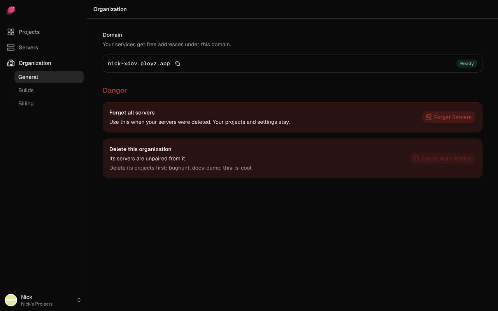

An organization holds your projects, your servers and your billing. The first time you sign in,
Ployz creates one for you, named after you (like Ada's Projects). An agent can also make one
before anyone signs in, named Agent sandbox. Open its claim link within 24 hours to keep it. See
[Try Ployz without an account](try-without-an-account.md).

## Your organization

You can invite people to work in your organization with you. See
[Invite people](#invite-people). To let a CI job act for you, make an
[organization token](../cli/overview.md#make-an-organization-token) under **Organization →
Tokens**. Pick **Deploy** and an Environment for a token that can only deploy there, **Read only**
for one that can't change anything, or **Full as you** for one that can do whatever you can.
**Deploy** needs an Environment, so in an organization without one the dialog starts at **Read
only**.

To make another organization, open the account menu and click **Switch organization → New
organization**. Name it, change its URL if you like, and click **Create**. You land in the new
organization, and you own it. Switch between your organizations under **Switch organization**.

From the CLI, run `ployz org new` with a name:

```sh
ployz org new "Acme Corp"
ployz org new "Acme Corp" --slug acme
```

The slug comes from `--slug`, or from the name when you leave it out. If another organization
already has that slug, Ployz adds a short suffix, and the command prints the slug it picked. The
CLI then acts in the new organization. Your browser and your other signed-in CLIs stay where they
were. An organization token can't make an organization, so sign in with `ployz login` first.

In the sidebar, click **Organization** for its settings:

- **General**: your organization's **Display name**. Owners and admins can change it: type a new
  one and press Enter or click the check. Its URL stays the same. Below it, **Allow support
  access**, and **Forget all servers** for when your servers were deleted.
- **Network**: your **Cluster name**, which your services' long private addresses carry. See
  [Name your cluster](../services/private-networking.md#name-your-cluster). Below it, your
  organization's **Domain**, which your services' free addresses live under. Until you generate
  your first domain, it reads **No domain yet**.
- **Members**: who's in the organization, their roles, and, for owners and admins, pending
  invites. See
  [Invite people](#invite-people).
- **Tokens**: organization tokens. See
  [Make an organization token](../cli/overview.md#make-an-organization-token).
- **GitHub**: the connected GitHub App. See [Deploy from GitHub](../deploy/github.md).
- **Builds**: where builds run. See [Where builds run](../builds/where-builds-run.md).
- **Billing** (when billing is on): your plan.



## Invite people

Everyone in an organization has one role: **Owner**, **Admin** or **Member**. Each role can do
everything the role below it can, and more:

| Role   | Can do |
| ------ | ------ |
| Member | See the organization, its members, projects, servers, volumes, variables, logs and metrics. Create projects and environments, edit projects, stage changes, deploy, destroy and merge them, restart and stop services, and make their own organization tokens. |
| Admin  | Also change the organization's settings and support access, invite people, change roles and remove members, manage everyone's tokens and agents, connect GitHub, delete projects and environments, protect and unprotect environments, delete volume copies, and add, operate, open a shell on and remove servers. |
| Owner  | Also manage billing, delete the organization, and make or remove an owner. |

When you try something your role can't do, Ployz says who can: "Only an owner or admin of this
Organization can do this." or "Only an owner of this Organization can do this." A change to a
project's configuration that your role can't make is refused with the permission it needs, such as
`Needs environment:delete`; `ployz <command> --help` names that permission before you run it.

To invite someone, go to **Organization → Members** and click **Invite**. Pick **Member** or
**Admin**, add their email if you like, and click **Make link**. When Ployz Cloud has email on, it emails the
link to that address, and the dialog tells you where it went. A self-hosted Cloud without email,
or an invite with no email, sends nothing, so copy the link from the dialog and send it to them
yourself. Whoever opens the link, signs in and clicks **Join** and the organization's name joins with that role, so share it
only with the person you mean. A link works once and expires after 7 days. Someone already in
the organization who opens it sees **You're in** and **Open** instead, and keeps their role.
Owners and admins see pending invites, who sent them and when they expire. Click **Revoke** to
cancel one. The list updates as soon as someone joins.

Owners and admins change a role with the select beside each person, and click **Remove** to take
someone out. To leave an organization yourself, click **Leave** on your own row. An organization
always keeps an owner, so its last owner can't leave or step down until they make someone else
an owner. `ployz org member rm` refuses to remove the last owner, and `ployz org member role`
refuses to give them another role. Each refuses at once, before it asks for a yes.

When someone leaves or is removed, they lose the organization at once: its dashboard, their
organization tokens, and their signed-in CLIs' access to its servers. If they joined by invite and
open it again, it says their membership ended.

## Let Ployz support in

Turn on **Allow support access** under **Organization → General** to let Ployz support open your
organization and do what you can. It's off until an owner or admin turns it on, and turning it
off applies on support's next request. While support has your organization open, a banner at the
top says so. A [self-hosted Ployz Cloud](../self-hosting.md) has no Ployz support, so the setting
doesn't appear.

Support sees your projects, services and settings. Three switches under the setting decide what
more it sees:

- **Variables**: values of variables that aren't sealed. Off, they read as sealed.
- **Config files**: what's in each config file. Off, support sees each file's name and mount but
  not its contents.
- **Container logs**: what your containers print, including a failed health check's output.
  What a build prints is always visible.

All three start off, and turning support access off turns them off. Each applies on support's
next request. Support sees these switches but can't change them. It can still change anything
else you can, including a value it can't read, but it can't delete the organization.

## Destructive actions ask first

Some changes remove things: a save or deploy that removes a running service, deletes a volume and
its data, detaches a volume or removes a domain. So do draining or removing a server, renaming the
cluster, cleaning up what a deleted environment left on your servers, removing a project, an
environment or the organization, forgetting every server, and turning an environment's protection
off. Before one runs, Ployz shows what it removes and a person says yes. Every organization works
this way, and no setting turns it off. The one exception is an
[Agent sandbox](try-without-an-account.md) nobody has claimed yet: no person could answer there,
so nothing asks until someone keeps it.

How you say yes depends on where the change starts:

- **In a terminal**, the command lists what it removes and asks `Go ahead with …? [y/N]`. Say yes
  and it runs. Anything else, or Ctrl-C, changes nothing. A redeploy's list names the deploy it
  ships again, such as `This redeploy of #4:`, and the later deploys it rolls back.
- **Without a terminal**, such as in a script, it prints the same list, changes nothing, and names
  the command to run again with `--approval DIGEST`.
- **With `--json`**, it never asks. It exits with `approval_required`, and `details.retry` is the
  same command with `--approval DIGEST`. Run that to go ahead. The one exception is
  `ployz env sync --value ROW`, which refuses `--approval`, since a yes can't carry secrets given
  again on stdin. Run that sync without `--json` and answer the question.
- **In the dashboard**, confirming a dialog is your yes.
- **From an agent**, a deploy comes back as a link where you review it and approve it with your
  passkey. A stop or restart comes back as a link you approve or deny. Anything else that removes
  something, and any volume restore, is refused with where to do it: `needs a person. Do it in
  Ployz Cloud`, plus the `ployz` command when there is one. An agent can't send a yes. This holds for the [Ployz agent](agent-sidebar.md),
  `ployz mcp` and an agent you [connected to Ployz Cloud](connect-an-agent.md).

The digest names exactly what you saw. If the change moved on before it runs, such as another
deploy landing in between, the yes no longer fits. Nothing runs, and the command says
`It changed after your yes`. Run it again to see what it does now.

Which commands ask:

- `ployz deploy` and `ployz deploy --skip-deploy` ask only when the change removes something
  that's running. Rolling out a new image or changing variables never asks. Redeploying never
  asks, except when it takes something off: redeploying a `ployz env shutdown`, or rolling back to
  a deploy from before a service was added, asks as a deploy that removes the same would.
- `ployz project rm`, `ployz env rm` and `ployz env shutdown` ask when they would take something
  off the servers. `ployz org rm`, `ployz server forget` with no server named and
  `ployz env protect --off` always ask.
- Removing or forgetting a server Ployz Cloud manages with `ployz server rm` or
  `ployz server forget SERVER` always asks. `ployz server drain` asks when a global service would
  run on no other server, and `ployz server clean` asks when it would stop a service or delete
  volume data. `ployz server upgrade` never asks.
- `ployz service stop`, `ployz service restart` and starting a service don't ask.
- In a [Protected environment](../environments/environments.md#protect-an-environment), a
  member's deploy, and their stop or restart from the dashboard or an agent, wait for an owner or
  admin, and anything else only they can do is refused. See
  [Permissions](permissions.md#protect-production).

A yes runs its command once. The CLI sends the same request again with the same request key, so
a resend that crosses a lost reply runs nothing new.

An older `ployz` that sends an approval ID is refused with the update to run. Update `ployz` and
run the command again.

An agent's own sandbox doesn't ask. While only the agent owns it, nobody could answer, so its
deploys and removals go ahead. Once a person keeps it, the agent asks like anywhere else.

This keeps a well-behaved agent from deleting something by mistake. It doesn't stop a program
that's trying to get around it: anything that holds your own `ployz` login or one of your own
tokens can say yes to its own `ployz` request, as if you'd answered in a terminal. The agent token
`ployz mcp login` saves can't. Keep tokens you give an agent short-lived: a token can't make or
revoke tokens, so revoking it cuts the agent off. Keep
[backups](../services/databases.md#back-up-a-database) of data you can't lose.

## Billing

Ployz is free on your own servers: unlimited servers and projects, preview environments,
generated https addresses and custom domains. Your hosting provider bills you for the servers.

Pay when your cluster is in production. **Production** is $10 a month with two servers included,
then $5 for each extra server. Production pays for what Ployz Cloud runs for you:

- [Uptime checks](../observe/uptime.md) from outside your servers, and an email when a service goes
  down or comes back.
- [Web analytics](../observe/analytics.md) for your domains.
- Longer log and metrics history, coming.

Without Production, Ployz keeps checking your services and counting your visits. You can't see the
results: the Monitoring tab, **Analytics**, `ployz uptime` and the Ployz agent ask you to add
Production instead, and the uptime emails stop. Add Production and the results show again, as far
back as Ployz keeps them. Everything else is free: metrics, logs, deploys and the crash emails.

Click **Upgrade to production** on **Organization → Billing** to start. The page shows your server
count and what you pay a month. A server you add is charged as soon as it joins. When you remove
one, the lower price starts at the next renewal. **Manage billing** on the same page cancels
Production or gets invoices. A cancelled Production stays until the end of the period you paid for.

In an agent's sandbox, billing waits until someone keeps it.

A [self-hosted Ployz Cloud](../self-hosting.md) has no billing. Custom domains, uptime and
analytics are always available there.

## Delete an organization

Deleting an organization removes it with its settings and tokens, and disconnects your servers
from it. It can't be undone. Only an owner can delete it. For anyone else **Delete organization**
is disabled.

1. [Delete every project](../environments/environments.md#delete-a-project) in it. **Delete
   organization** stays disabled until you do.
2. **Cancel Production first** if you pay for it. Deleting the organization doesn't cancel it: go to
   **Organization → Billing → Manage billing**.
3. Go to **Organization → General** and click **Delete organization**.
4. Type the organization's slug, as the dialog shows it, and click **Delete**.

<!-- screenshot: the Delete organization dialog with the slug typed -->

If a server is offline, the organization stays, disabled, until that server is back. Then click
**Try again**. A server that now belongs to another cluster keeps the organization waiting the same way,
since Ployz Cloud won't change it. Stop Ployz on that server, over SSH, with
`sudo systemctl stop ployz.socket ployz`. Then [forget your servers](../servers/manage-servers.md#forget-servers-you-deleted)
and click **Try again**. That server still belongs to the other cluster, so skip the uninstall step the Forget dialog
mentions: start Ployz on it again with `sudo systemctl start ployz.socket ployz` once the forget finishes.

The dashboard then opens another of your organizations. With none left, it offers **Create an
organization**.

Once it's gone, its slug is free, and a new organization can take it. Old links and emails that
name the slug open the new organization only for its members, and for Ployz support if it allows
support access. Once its **Domain** has served your services, no organization gets it again.

From the CLI, `ployz org rm ORGANIZATION` does the same. If this device was signed in to that
organization, it moves to another of yours and says which. With none left, run `ployz logout`,
then `ployz login`.

An agent's sandbox ends 24 hours after the agent made it, unless someone keeps it. Ployz then
removes it. See
[When nobody claims it](try-without-an-account.md#when-nobody-claims-it).
