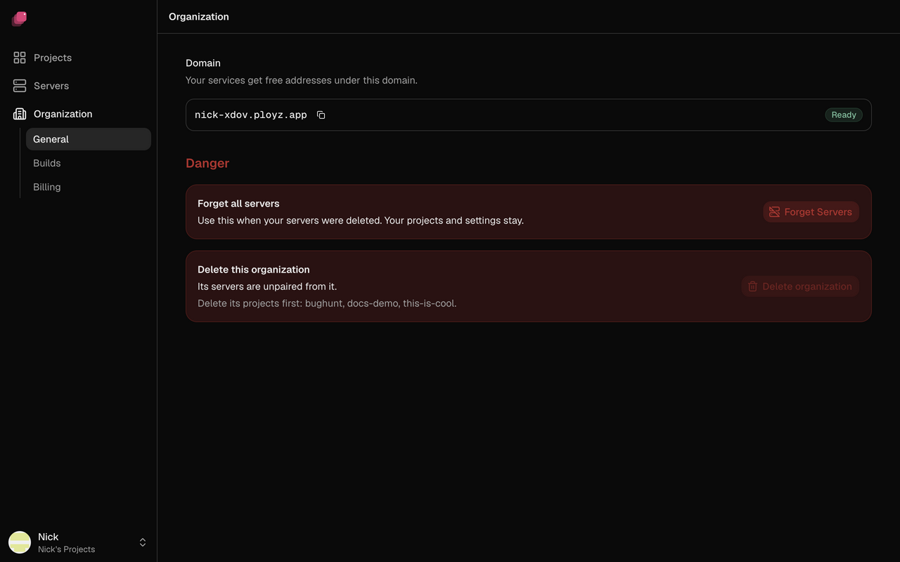

An organization holds your projects, your servers and your billing. The first time you sign in,
Ployz creates one for you, named after you (like Ada's Projects).

## Your organization

You can invite people to work in your organization with you. See
[Invite people](#invite-people). To let a CI job act for you, make an
[organization token](../cli/overview.md#make-an-organization-token).

To make another organization, open the account menu and click **Switch organization → New
organization**. Name it, change its URL if you like, and click **Create**. You land in the new
organization, and you own it. Switch between your organizations under **Switch organization**.

In the sidebar, click **Organization** for its settings:

- **General**: your organization's **Domain**, which your services' free addresses live under.
  It appears with your first deploy. Below it, **Allow support access**, and **Forget all
  servers** for when your servers were deleted.
- **Members**: who's in the organization, their roles, and pending invites. See
  [Invite people](#invite-people).
- **Builds**: where builds run. See [Where builds run](../builds/where-builds-run.md).
- **Billing**: your plan.

## Invite people

Everyone in an organization has one role:

- **Owner**: everything, including deleting the organization and making other owners.
- **Admin**: everything an owner can do, except deleting the organization or making or
  removing an owner.
- **Member**: deploys and changes projects and servers, but can't invite, change roles, remove
  anyone, turn support access on or off, or forget servers.

To invite someone, go to **Organization → Members** and click **Invite**. Pick **Member** or
**Admin**, add their email if you want to remember who it's for, and click **Make link**. Copy
the link and send it to them yourself. Ployz doesn't email it. Whoever opens it, signs in and
clicks **Join** joins with that role, so send it only to the person you mean. A link works once
and expires after 7 days. Pending invites list who sent them and when they expire. Click
**Revoke** to cancel one.

Owners and admins change a role with the select beside each person, and click **Remove** to take
someone out. To leave an organization yourself, click **Leave** on your own row. An organization
always keeps an owner, so its last owner can't leave or step down until they make someone else
an owner.

When someone leaves or is removed, they lose the organization at once. Their organization tokens
stop working, and their signed-in CLIs lose access to its servers.

## Let Ployz support in

Turn on **Allow support access** under **Organization → General** to let Ployz support open your
organization and do what you can. It's off until an owner or admin turns it on, and turning it
off applies on support's next request. While support has your organization open, a banner at the
top says so. A [self-hosted Ployz Cloud](../self-hosting.md) has no Ployz support, so the setting
doesn't appear.

Support sees your projects, services and settings. Three switches under the setting decide what
more it sees:

- **Variables**: values of variables that aren't sealed. Off, they read as sealed.
- **Config files**: what's in each config file. Off, support sees each file's name and mount but
  not its contents.
- **Container logs**: what your containers print, including a failed health check's output.
  Build logs are always visible.

All three start off, and turning support access off turns them off. Each applies on support's
next request. Support sees these switches but can't change them. It can still change anything
else you can, including a value it can't read, but it can't delete the organization.

## Destructive actions ask first

A coding agent working through the CLI can publish or deploy a change that removes a running
service, deletes a volume and its data, detaches a volume from a service, or removes a domain. It
can also drain or remove a server, or clean up what a deleted environment left on your servers.
Ployz refuses that command with `approval_required`, naming what it would remove and the approval
it opened for you. Every organization works this way, and no setting turns it off.

How you answer depends on where the command runs:

- In a terminal, it lists what it would remove and asks you to type the environment's name. A
  server command asks for the server's name, or for `server clean` the name you passed it. Type
  it and the command carries on. Anything else, or Ctrl-C, leaves the approval pending and
  changes nothing.
- Without a terminal, such as in a script, it prints the same list and waits until someone
  approves or denies it in Ployz Cloud. It then carries on, or fails naming what was denied and
  the reason given. Ctrl-C stops waiting and leaves the approval pending.
- With `--json`, it never asks or waits. It exits with `approval_required`, and `details.retry`
  is the same command with `--approval ID`. Run that once the approval is approved.
- In an agent that uses `ployz mcp`, the agent's app asks you. See
  [Give the agent Ployz tools](../cli/overview.md#give-the-agent-ployz-tools).
- In the [Ployz agent](agent-sidebar.md) in the dashboard, you approve or deny right in its
  panel, and the agent waits for you.

- `ployz publish` and `ployz deploy` ask only when the change removes something that's running.
  Rolling out a new image or changing variables never asks.
- Removing a server Ployz Cloud manages with `ployz server rm` always asks. `ployz server drain`
  asks when a global service would run on no other server, and `ployz server clean` asks when it
  would stop a service or delete volume data. `ployz server upgrade` never asks.
- Dashboard buttons and dialogs never ask: confirming a dialog is your approval. When the
  [Ployz agent](agent-sidebar.md) does the same thing for you, it asks.
- If the change moves on after Ployz asked, your approval no longer fits it, and the command asks
  again about the new one.
- An approval covers one publish. A later publish that still carries a removal that hasn't
  deployed yet asks again.

A retry of a command you denied is still denied, even once it would destroy nothing. A retry of
one still waiting for your answer still waits, unless it no longer destroys anything.

You can answer from a terminal too. `ployz org approval ls` lists the approvals waiting,
`ployz org approval show ID` shows what one would remove, and `ployz org approval approve ID` or
`ployz org approval deny ID --reason "keep the volume"` answers it. Approving asks you to type the
organization's name, so it needs a terminal.

This keeps a well-behaved agent from deleting something by mistake. It doesn't stop one that's
trying to get around it: anything that holds your login or token can approve its own request.
Keep tokens you give an agent short-lived, and keep
[backups](../services/databases.md#back-up-a-database) of data you can't lose.

## Billing

Ployz is free on your own servers: unlimited servers and projects, preview environments,
generated https addresses and custom domains. Your hosting provider bills you for the servers.

**Organization → Billing** shows the plans. **Hobby**, $5 a month, and **Pro**, $49 a month per
organization, are coming soon.

If you subscribed to the old $9 Pro plan for custom domains, you no longer need it. Click
**Manage billing** on the same page to cancel it or get invoices.

A [self-hosted Ployz Cloud](../self-hosting.md) has no billing, and custom domains are always
allowed.

## Delete an organization

Deleting an organization removes it with its settings and tokens, and disconnects your servers
from it. It can't be undone. Only an owner can delete it.

1. Delete every project in it. **Delete organization** stays disabled until you do.
2. **Cancel Pro first.** Deleting the organization doesn't cancel it: go to
   **Organization → Billing → Manage billing**.
3. Go to **Organization → General** and click **Delete organization**.
4. Type the organization's slug, as the dialog shows it, and click **Delete**.

<!-- screenshot: the Delete organization dialog with the slug typed -->

If a server is offline, the organization stays, disabled, until that server is back. Then click
**Try again**.

With no organization left, the dashboard offers **Create an organization**.

From the CLI, `ployz org rm SLUG` does the same. If this device was signed in to that
organization, it moves to another of yours and says which. With none left, run `ployz logout`,
then `ployz login`.
