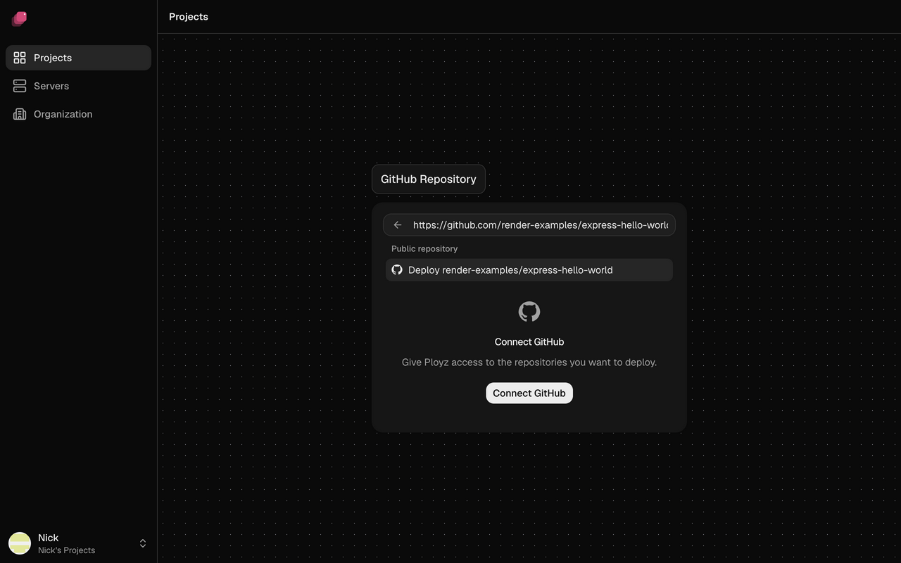
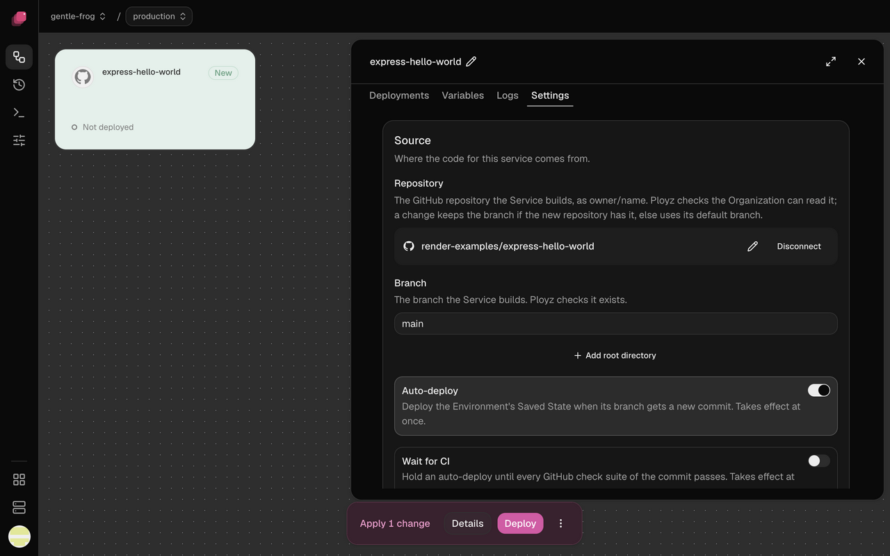

Connect a GitHub repository to a service and Ployz builds and deploys it each time you push to
its Git branch. [How builds work](../builds/overview.md) covers what happens in between.

## Add a service from a repository

1. Go to **Projects**, click **New project** and choose **GitHub repository**. (To add it to a
   project you already have, click **Create** on that project's canvas instead.) The first time,
   click **Connect GitHub**, pick the account or organization, choose the repositories Ployz may
   use, and install the Ployz GitHub App. GitHub sends you back to **Organization → GitHub**, which
   lists the account. It says "Repositories appear in a moment" until Ployz has listed them.
   If the app is already installed on that account, for another Ployz organization, click
   **Use existing** instead.
2. Search for the repository, or paste its URL, and pick it.
3. Before you deploy, set what your app needs to start:
   - To make it public, open **Settings → Networking** and click
     [**Generate Domain**](../services/domains.md#generate-a-domain). Enter its port in **Port**
     if your app doesn't listen on `PORT`.
   - If it needs [variables](../services/variables.md) or a
     [database](../services/databases.md) to start, add them now.
   - For one app of a monorepo, set its [root directory](#deploy-a-monorepo) under **Source**.
4. Click **Deploy** in the bottom bar.



The service is named after the repository and follows its default Git branch. The GitHub App
reads your code, pull requests and checks, and can't push code. The repository list groups
repositories by GitHub account. To give Ployz more repositories later, choose **Install on another
GitHub account** at the end of the repository list. GitHub opens in a new window, and the new
repositories appear in the list when you come back. If a repository you just granted is missing,
choose **Refresh repositories**.

## Deploy a public repository without the app

In the repository list, type `owner/repo` or paste the repository's URL, choose **Deploy
owner/repo**, then deploy.

Without the app, Ployz never hears about pushes: no deploy on push, no **Wait for CI**, and no
[builds on GitHub Actions](../builds/where-builds-run.md#build-on-github-actions). Install the
app on the repository to get them. Until then, shipping a new commit is CLI-only for now, because
the dashboard's **Deploy** needs a staged change:

```sh
# Builds and deploys the newest commit on the service's Git branch
ployz deploy
```

**Auto-deploy** and **Wait for CI** keep their values on such a service, so they work as soon as
the app is installed. Until then, the dashboard shows a line under **Auto-deploy**, and `ployz get`
and `ployz set` print the same note:

```text
$ ployz set web.waitForCi=true
Applied web.waitForCi in shop/production.
Pushes reach Ployz only once the GitHub App is installed on owner/repo.
```

## Choose the Git branch

1. Open the service and go to **Settings → Source**.
2. Next to **Branch**, click the pencil and pick a Git branch. For a public repository, type its
   name.
3. Deploy the change.



Each environment has its own settings, so production can follow `main` while staging follows
`develop`. See [Environments and branches](../environments/environments.md).

### Protected environments

In a [Protected environment](../environments/environments.md#protect-an-environment), only an
owner or admin can connect a repository or change the branch. Merging into that branch still
deploys: Ployz doesn't decide who can merge. Use
[GitHub branch protection](https://docs.github.com/en/repositories/configuring-branches-and-merges-in-your-repository/managing-protected-branches/about-protected-branches)
on the branch to require reviews before a merge.

## Deploy on push

**Auto-deploy** is on for every new service. Each push to the service's Git branch deploys it, in
every environment that follows that Git branch. Turn **Auto-deploy** off under **Settings →
Source** to deploy only when you choose. It applies at once, with no deploy.

A push deploys like **Deploy**: it ships every change you
[saved](deployments.md#deploy-your-changes) in the environment, and staged changes you haven't
saved stay behind. The services that follow its repository and Git branch, have **Auto-deploy**
on and match their [watch paths](#deploy-only-when-certain-files-change) build the new commit.
Every other service keeps the commit it last built, and one with nothing new to ship keeps
running as it is.

A volume deletion you confirmed when you saved goes out with the push without asking again. If
the data changed since, the push keeps it and your next deploy asks; see
[Confirm a deploy that deletes data](deployments.md#confirm-a-deploy-that-deletes-data).

### Approve a rule for deploys on push

Your servers deploy a push only under an automatic deploy rule you approve from an
[approved device](../servers/manage-servers.md#what-needs-an-approved-device), or with a
[passkey](../servers/manage-servers.md#add-a-passkey) your servers trust. The rule stands for
every future push, so each approval is its own prompt.

In the dashboard, connect a service to its repository and click **Save**. Save shows the
repository and branch, the builder, the servers and each service's settings, and **Save with
passkey** signs the rule with what you save, in one prompt. A later Save asks again only when it
changes something the rule covers. The rule covers every service that builds from GitHub with
**Auto-deploy** on. If they build from different branches, it keeps the branch the rule already
covers, and the other services save without it.

**Deploy** does the same: when no rule approves what it saves, even before you have one, its
passkey prompt signs the rule with the deploy. From the CLI, `ployz deploy` shows the rule after
the services it signs, and your yes signs both with this device. A renewed rule keeps the platform
it was approved for.

A deploy builds each service the rule covers on GitHub Actions only, as a push does, whatever your
Build Order says. If GitHub skips the build, your servers don't take it, and the deployment says why.
If your Build Order is **Servers only**, the build fails with
`Its automatic deploy rule builds it on GitHub, which your Build Order leaves out`.
A new service from a repository deploys in one prompt, and one the rule already approves asks
nothing. A deploy reuses an image only when your servers verified it under the rule as it stands
now. After you approve the rule again, the next deploy builds afresh. When the servers a service may
run on need platforms other than the ones the rule was approved for, GitHub skips the build and the
deployment says why.

When your servers need an approved device, a service builds from GitHub only when the rule you
keep, or the one the deploy signs, covers it. When neither does, `ployz deploy` stops before it
signs:
`No automatic deploy rule covers web as it stands, so your servers won't build it. Turn on Deploy every push, then deploy again.`
**Deploy** in the dashboard starts, and the deployment fails at that service's build. Your servers
refuse it with `This server runs only builds an approved device starts.` When you turned automatic
deploys off, **Deploy** stops before it starts instead.

A deploy that waits at a link, from a computer with no device key or for an owner or admin in a
Protected Environment, signs the rule on its [approval page](deployments.md#deploy-with-no-key):
the tap that approves the deploy signs it too. When the page can't sign it, the deploy goes without
it, says why, and your servers refuse the builds only the rule covers. If the rule changed after
the tap, the deploy is refused:
`Automatic deploys changed since you looked. Check them, then try again.`

To turn automatic deploys on yourself, open the environment's **Settings**, find **Automatic
deploys** and turn on **Deploy every push**. That's a Save that signs the rule: the same sheet
shows the rule, and **Save with passkey** signs it in one prompt. Save or discard any staged
changes first. When the services build from several branches, pick one under **Branch**: only
pushes to it deploy, and a Save leaves the rule on its branch. Picking another branch while the
rule is on signs a new rule for that branch the same way. When every service with **Auto-deploy**
on moves to one other branch, a Save signs a rule for that branch instead. Either way the sheet
says the approval moves off `main`. Services that follow `main` keep their **Auto-deploy**
setting, so turn it off there if pushes to `main` should start nothing.

While the rule is on, **Approve again** signs its next generation in one prompt, for the services,
settings and servers as they are now. Use it when pushes to the branch are on hold, after you add a
server, or when a push is refused. Turning the rule on or approving it again pins Ployz's own
builder.

After you turn it off, Save and Deploy never turn it back on: only the switch does. If the rule
changed after the page loaded, for example in another tab, nothing is turned off:
`The rule changed since this page loaded. Reload.`
A deploy signed while the rule was on, and sent after you turned it off, deploys nothing:
`Automatic deploys are off for web. Turn on Deploy every push to deploy it.`

When Save or Deploy can't ask your passkey for the rule, for example because a server is offline,
your servers don't trust your passkey, or a server runs an older `ployz`, it goes on without the
rule and tells you why. Pushes then hold until a Deploy signs the rule. If you can stage changes but
not deploy them, Save never asks: it tells you when pushes hold until someone who can deploy
approves the rule. The switch, **Branch** and **Approve again** save nothing when they can't sign
the rule, and say why. When none of your servers checks approvals, pushes deploy without a rule:
`None of your servers checks approvals, so pushes deploy without a rule.`

There's no separate command to approve a rule. From the CLI, `ployz deploy` signs it with your
device key whenever what it deploys isn't what the rule approves. It prints the rule after the
services it signs:

```text
Approving automatic deploys for production:
  namespace   shop-production
  repository  acme/web on main
  workflow    .github/workflows/ployz-build.yml, on push and on rebuilds you approve
  builder     getployz/build/.github/workflows/build.yml@6f3b5a76ad939acfb605ba4070916e827a13cf2a
  servers     2 in the cluster
  web
    builds    Dockerfile Dockerfile, context ., platforms linux/amd64, with the Actions cache, build args LOG_LEVEL=info, build secrets DATABASE_URL
    variables DATABASE_URL (sealed), LOG_LEVEL=info
    command ["node server.js"]
```

`ployz github rule approve` is gone, from an older CLI too:
`ployz github rule approve is gone. Turn on Deploy every push in Ployz Cloud.`

A volume a service mounts shows as its own line, the way [`ployz deploy`](deployments.md#deploy-from-an-approved-device) shows it, such as `mounts managed volume uploads at /app/uploads, read-write: a new, empty volume`. A volume only services outside the rule mount stays as it was.

A rule has no approved version to compare a volume with, so each volume that already holds data
needs your yes, every time you approve. That includes data from before this version of Ployz,
an external Docker volume such as `mounts external Docker volume customer-db at /archive, read-write: data from outside Ployz`,
and a host path. A tmpfs mount asks nothing. The sheet lists those lines, and your passkey says
yes to them. `ployz deploy` lists them and asks before it signs; answer no and nothing is signed.

The rule lists every setting it pins that isn't Ployz's default, including the start command and how GitHub builds each service, so read them before you rely on it. A value with anything but letters, digits and `-_./:@+` shows in double quotes, with line breaks and other control characters escaped, so `X="a, Y=b"` is one build arg and `X=a, Y=b` is two.

From then on every push to that branch deploys with no prompt, force pushes included. GitHub
Actions builds it with Ployz's pinned builder, and each server checks that the image is the one
built for the branch's current head, under these settings. The repository needs Ployz's rule
workflow as `.github/workflows/ployz-build.yml` on the rule's branch. **Organization → Builds**
offers it for each repository a rule builds from: **Add workflow** and **Update workflow** show
the file and open GitHub to commit it. It builds on every push to a branch.
Commit it exactly as Ployz gives it:

```yaml
name: Ployz build
on:
  push:
    branches: ['**']
  workflow_dispatch:
    inputs:
      cloud: { required: false, type: string }
      commit: { required: false, type: string }
permissions:
  contents: read
  id-token: write
jobs:
  build:
    if: github.event_name != 'push' || vars.PLOYZ_BRANCH == '' || github.ref_name == vars.PLOYZ_BRANCH
    uses: getployz/build/.github/workflows/build.yml@6f3b5a76ad939acfb605ba4070916e827a13cf2a
    with:
      cloud: ${{ inputs.cloud || vars.PLOYZ_CLOUD || 'https://ployz.dev' }}
      commit: ${{ inputs.commit }}
```

Nothing in it names your branch or your Ployz Cloud, so commit it unchanged: hosted Ployz Cloud
dispatches a rebuild only with this exact file, and **Builds** reads any other as **Uses an older
workflow**. Each server checks that a push was to the rule's branch. To skip pushes to other
branches, set the repository variable `PLOYZ_BRANCH` to the rule's branch, such as `main`, as the
dialog names it, in the repository's **Settings → Secrets and variables → Actions → Variables**.
A self-hosted Ployz Cloud sets `PLOYZ_CLOUD` there to its own address, such as
`https://ployz.example.com`. A repository with this file builds on GitHub only under its rules: a
deploy of another environment from it builds on your servers.

- **A saved change waits for you.** A Save or Deploy in the dashboard, or `ployz deploy`, signs
  the change with the rule. A change saved without it, such as a CLI save with no deploy, to a service the rule covers, its settings or
  how it builds, or a new service that builds from the rule's branch, holds pushes until you
  approve the rule again. Settings shows **Pushes to main are on hold** with what changed: click
  **Approve again**. Your next Deploy, or `ployz deploy`, also signs the rule with it and names
  what changed, as `changed     web since the last approval`. A push that changes only
  the code deploys as before, and so does a new replica count.
- **A new server waits for a service that keeps data there.** The rule names the servers it was
  approved for. A service with a volume, a folder from its server or other host access runs only
  on those, so after you [add a server](../servers/add-a-server.md), click **Approve again**
  under **Automatic deploys**, or deploy: either signs the rule again for every server. A service that keeps nothing on its server runs on any server.
- **Stop it** by turning off **Deploy every push**, or with `ployz github rule end`. Pushes no
  longer deploy on those servers.
- **A server checks the approval's time.** It refuses a rule approved more than 10 minutes ahead
  of its own clock. Fix the clock on the device or the server, and pushes deploy again.
- **An older approval stops starting containers.** Once a server has seen a newer approval of
  the rule, or the rule turned off, it won't start a stopped container an older approval made,
  from the dashboard or the CLI. One that's running keeps running, and the next push deploys a
  new one.
- **A build stays deployable after GitHub's token expires.** The first server that deploys a
  push checks it with GitHub, and Ployz Cloud keeps what that server answers. Any server of the
  cluster checks that answer with its own key, so a rollback to the build or a drain of a server
  running it works after the branch moved on. It stops working once you approve the rule again,
  turn it off, or remove the device or passkey that approved it; see
  [Roll back a service a rule built](history-and-rollback.md#roll-back-a-service-a-rule-built).
- **Someone who can push to the branch can deploy.** Ployz Cloud can't swap the commit, the
  image or the settings, but its GitHub App can push a commit to the branch itself. Add a branch
  ruleset on GitHub that blocks direct pushes to the branch.

## Wait for CI

Turn on **Wait for CI** under **Settings → Source** to hold a push's deploy until its GitHub
checks pass, from GitHub Actions or any other app that reports checks. It applies at once.

A held push shows in **Runs** and in `ployz deployment ls` as a deployment that reads **Waiting
for CI**, named by its commit rather than a number. It deploys as that same deployment once
every check passes, and takes the next deployment number then, so deployments stay numbered in
the order they ran, whichever branch passed CI first. Cancel it there to drop the push. Nothing
was frozen for it, so it can't be redeployed: push again instead.

- If a check fails, the deployment reads **CI failed** and the commit doesn't deploy. Re-run the
  check on GitHub and the commit deploys once it passes, or push a fix.
- A newer push replaces a commit that's still waiting, and so does a deploy you start yourself.
  A replaced commit leaves the list; one you cancelled stays, so you can see you dropped it.
- If no checks run for a commit, it waits until your next push. CI that reports commit statuses
  instead of checks counts as no checks.

## Deploy only when certain files change

**Watch paths** limit auto-deploys to pushes that change files you list. Under **Settings →
Source → Watch paths**, type a pattern and click **Add**. Patterns work like `.gitignore` and
start at the root of the repository, whatever the service's root directory is. They apply at
once.

| Pattern | Matches |
| --- | --- |
| `apps/web/**` | everything under `apps/web` |
| `*.md` | Markdown files in any folder |
| `/README.md` | only the README at the root |
| `!**/*.md` | leaves out Markdown files an earlier pattern matched |

Without watch paths, any change deploys. A force push, the first push Ployz sees on a Git
branch, or a push that changes 300 files or more deploys every service on the Git branch,
whatever their watch paths.

## Deploy a monorepo

Add one service per app from the same repository, and give each its own root directory and
watch paths before you deploy it. For a repository with `apps/web` and `apps/worker`:

| Service | Root directory | Watch paths |
| --- | --- | --- |
| `web` | `/apps/web` | `apps/web/**` |
| `worker` | `/apps/worker` | `apps/worker/**` |

To set the root directory, open **Settings → Source**, click **Root directory** and enter the
folder, starting with `/`. The build sees nothing outside that folder, and a Dockerfile path is
relative to it.

If an app imports code from elsewhere in the repository, like a shared package in a pnpm or npm
workspace, leave the root directory at `/`. Set a
[build command](../builds/railpack-and-dockerfiles.md#change-the-build-and-start-commands) and
[**Start command**](../services/settings.md#start-command) for that app instead, such as
`pnpm --filter web build`, and add the shared folder to its watch paths.

## Who owns the connection

A GitHub installation belongs to the organization it is connected to, not to the person who
installed it. Everyone in the organization can pick its repositories, and it stays connected
when that person leaves. **Organization → GitHub** lists each connected account with its
repositories, who connected it, and when. Only an owner or admin can connect or disconnect one;
members see the list.

One installation can be connected to more than one organization. To connect one you already
installed, click **Use existing** in the repository picker or in **Organization → GitHub** of the
other organization. Ployz connects only GitHub accounts you own: your own user account, or a GitHub
organization where you are an owner. Collaborating on one of its repositories is not enough. When
you own several new ones, Ployz asks which to connect.

To stop an organization from using an account, click **Disconnect** on its row, or run
`ployz github ls` and then `ployz github disconnect <login>`. Builds that organization has in
flight on GitHub through that account stop, and their deploys fail with "GitHub account
`<login>` was disconnected". Other organizations connected to the same installation keep it,
and the app stays installed on GitHub. To uninstall it, use **Uninstall on GitHub** after you
disconnect.

Suspending the app on GitHub hides its repositories from every organization until you unsuspend
it; the connections stay. Uninstalling the app on GitHub removes it from every organization at
once. Either way, builds in flight through it stop within seconds, and their deploys fail with
"GitHub account `<login>` was suspended" or "was disconnected".

## Read a repository from the CLI

To see what's in a repository before you deploy it, list its files and read one. Both work on
any repository the Ployz GitHub App can read, and on public repositories.

```sh
# Every file on the default branch
ployz github tree acme/web

# Only files under apps/web, on the dev branch
ployz github tree acme/web apps/web --ref dev

# Only files whose path matches a glob
ployz github tree acme/web --match '**/Dockerfile'

# The text of one file
ployz github cat acme/web apps/web/package.json
```

`--match` matches the whole path from the top of the repository, so `*.toml` finds only files at
the top, and `**/*.toml` finds them in every folder. Quote the glob so your shell doesn't expand
it. A listing stops at 500 files. When it's cut short, name a folder or a narrower `--match` to
see the rest. A folder or file the repository doesn't have fails with `No path` and exit code 1.
`github cat` says `No file` for a missing file, also with exit code 1.

`github cat` prints text files up to 64 KiB. For a larger file or a binary one, it says so
instead of printing it. Pass `--ref` to read a branch, tag or commit other than the default.

## Good to know

- **Every deploy ships the newest commit.** Clicking **Deploy** to apply a setting also picks up
  whatever is on the service's Git branch now.
- **Your servers build from GitHub only under a rule.** A push or a dashboard **Deploy** of a
  service no rule covers fails at its build, and nothing changes. `ployz deploy` stops before it
  signs and creates no deployment. See
  [Approve a rule for deploys on push](#approve-a-rule-for-deploys-on-push).
- **Changing a variable rebuilds your app.** See [How builds work](../builds/overview.md#good-to-know).
- **Only the service's Git branch deploys.** Pull requests can get their own
  [preview environments](../environments/preview-environments.md) instead.
- **Merging a pull request brings its code, not its preview's settings.** Its code deploys like
  any push. Settings you changed in its [preview](../environments/preview-environments.md) stay
  there: to bring one to production, open **Sync** in production and sync it from the preview
  while the pull request is open.

Next: [give your app its variables](../services/variables.md).
