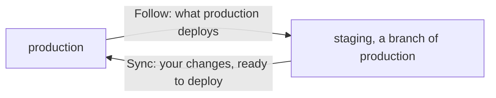
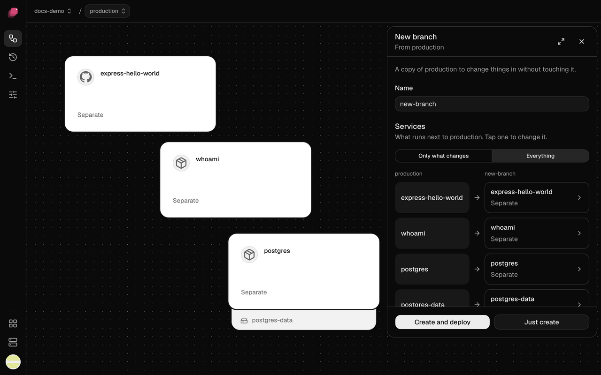
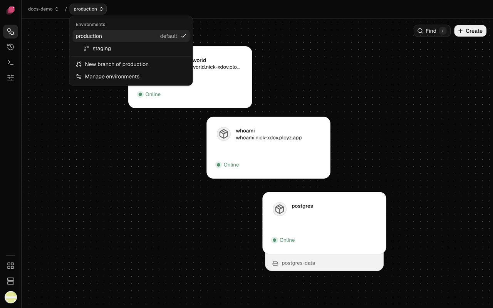
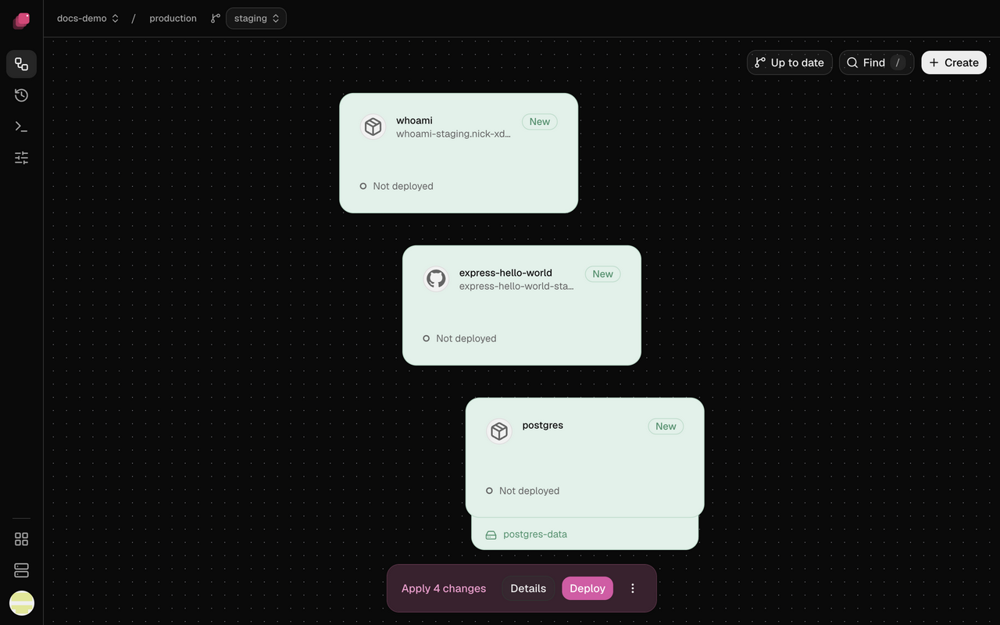
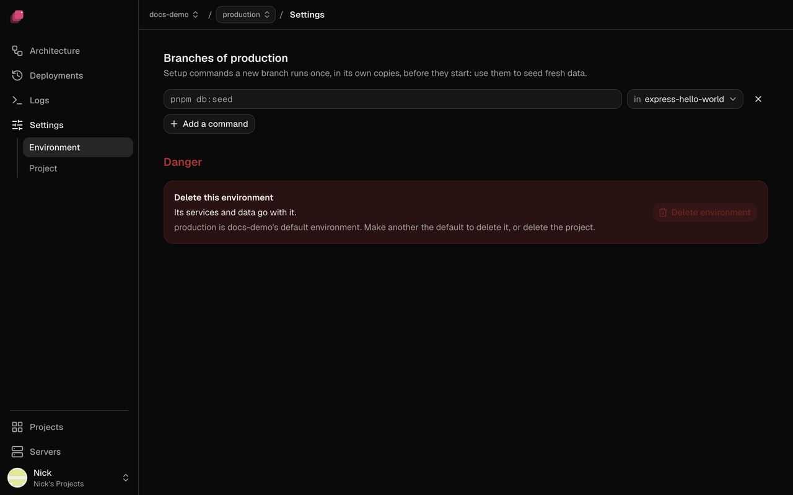

An environment is a full set of your app's services, variables and volumes, running apart
from the others. Every project starts with one, `production`.

To get another, branch one you have. A branch is a copy of another environment, called its
parent, that you can change without touching the parent. When a change works there, you sync it
back to the parent. What the parent deploys follows into the branch on its own.

The steps below make `staging` for a project `my-app` with a `web` service and a `postgres`
database, so staging gets its own copy of both and its own data. Use your own services' names.

## Create staging

1. Click **production** in the top bar, then **New branch of production**. Enter the **Name**
   `staging`.
2. Under **Services**, click **Everything**. `web` and `postgres` show **Separate**, and
   `postgres-data`, the database's volume, shows **New, empty**.
3. Optional: if your app has a command that fills a database with test data, click **Add a
   command** under **Setup command**, enter it, like `pnpm db:seed`, and pick `web` to run it in.
4. Turn on **Keep it after syncing into production**, so staging stays after you sync from it.
   Click **Create and deploy**, or **Just create** to set its secrets before it first deploys.

Ployz never copies data, so staging's database starts empty. A setup command runs before `web`
first starts, to fill the database, and again on each deploy until `web` first deploys
successfully. To give every new branch of production the same commands, add them under **Branch
setup** in production's **Settings → Environment**.

Nor does Ployz copy secrets: by design, a branch never gets its parent's secret values. Each
sealed variable in staging starts **Not set**, and deploys leave it out until you set it. Each
service's card says how many, like `1 not set`: open its **Variables** and choose **Set value**
on each. If staging already deployed, deploy it again.

From the CLI, add the command when you branch, with `ployz env branch staging --copy web --copy
postgres --setup 'web=pnpm db:seed'`. In the branch, `ployz get setup.web` shows it, `ployz set
setup.web='pnpm db:seed --small'` changes it, and `ployz unset setup.web` removes it. A change
takes effect at once, with nothing to deploy first: the next deploy runs the new command if `web`
hasn't deployed in staging yet, and until then `ployz diff` shows it. So when a setup command
fails, fix it with `ployz set` and deploy again. Because `setup.` names these commands, no Service can be named
`setup`, just as none can be named `volumes` or `configs`.

## Test staging at its own address

Staging's canvas opens as it deploys. Each copy with a generated address gets its own, with
`-staging` added: if production's `web` is at `web.acme-x7q2.ployz.app`, staging's is at
`web-staging.acme-x7q2.ployz.app`. Open it to try your app against staging's own data.

To move between staging and production, click the environment's name in the top bar. Each branch
sits under its parent.

Staging's `web` follows the same Git branch as production's. To test other code there, pick
another, like `develop`, in its [Source settings](../deploy/github.md#choose-the-git-branch).

## Change a setting in staging

Try a change in staging first, like a new variable that turns on a feature:

1. On staging's canvas, open `web` and go to **Variables**.
2. Click **New Variable**. Enter the **Key** `NEW_CHECKOUT` and the **Value** `true`, and
   click **Add**.
3. Click **Deploy**.

Production doesn't change. The Sync button at the top right of staging's canvas now reads
**Sync · 1**: one change a sync into production would carry.

## Sync the change to production

Syncing stages staging's changes in production, like a draft. It never deploys them.

1. On staging's canvas, click **Sync**. The dialog reads "Make production match staging". To sync
   into another environment of the project, pick it in the title.
2. Check each change, production's value against staging's. Untick one to leave it out; it's
   offered again next time.
3. Click **Sync 1 change**. A toast offers **Undo**; production's canvas opens with the change
   staged.
4. Click **Deploy**.

Sync never moves data or deletes anything in production. Replicas, CPU and memory limits, domains
and the Git branch stay as each environment has them. A change marked **Changed in production**
replaces production's value when you sync it. A secret's value never syncs: one staging added
arrives in production **Not set**, in its variables, in **Changes**, and as `TOKEN not set` on the
service's card. Production still deploys: the deploy skips that variable, and any variable that
references it, and warns. To set it as you sync, type production's value in the secret's row of
the dialog. For a service that's new to production, set its sealed values after it arrives. A
[generated value](../services/variables.md#generate-a-value) never syncs either: each environment
keeps its own, and a new one arrives as `${{ secret(…) }}` for production to make its own.

To keep a setting out of every sync, like a variable each environment sets its own way, click
**Never sync** beside it in the dialog, or in the variable's ⋮ menu.
The exclusion takes effect immediately. If it also discards an arrived change, the
reversal stays in the draft until you Save it.

### Take a sync back out

Until you save or deploy them, the changes a sync staged stay grouped under where they came
from. In production's bottom bar, click **Details**: **Included** lists `staging · 1 change`.

- **Remove:** in the row's ⋮ menu, click **Remove**. Production gets back what it had before
  staging was included. A change you made in production since stays.
- **Include newer changes:** when staging changed again, the row says so. Its ⋮ menu offers
  **Include newer changes**, which opens the Sync dialog for just what's new. A pull request's
  preview works the same way while it's open.
- **Undo:** the toast's **Undo** removes staging, as long as you haven't synced staging again
  since. After that, Undo is refused: Remove it in Details instead.

`ployz env sync` groups what it stages the same way, but its `--json` output leaves out what was
included: check **Details** in Ployz Cloud.

Remove is refused, and says why, when taking staging out would lose your work:

- A service staging brought was edited in production since. Discard that service, or keep staging.
- A service staging brought got its own registry credential or deployment setting (such as
  auto-deploy) in production since. Those take effect at once, outside the draft. Discard that
  service, or keep staging.
- Staging turned on a registry credential for a service in production, replacing the one
  production kept for it. Removing staging wouldn't bring production's back. Set that service's
  credential again, or keep staging.
- Another included environment changed a service staging brought. Remove that one first, or keep
  staging.
- Another service in production uses one staging brought. Change that service first, or Remove
  what brought it.

A change another included environment brought shows **Included with** that environment in the
Sync dialog, and you can't tick it, even where production also changed it: Remove that one first
to sync over it.

Clicking **Save** or **Deploy** ends what was included: the changes are production's own, and
**Included** is empty again. **Save** ends them even when no change is left to save.

## Other choices

### Share a service or leave it out

Click a service in the **New branch** panel to change what the branch gets:

| Row says | What the branch gets |
| --- | --- |
| **Separate** | Its own copy of the service, with the parent's settings and variables. Its secrets start **Not set**. |
| **New, empty** | Its own volume, with no data. |
| **production's** | No copy: the branch uses production's running service. |
| **Not included** | Nothing. Anything that uses it breaks. |

With **Only what changes**, the default, you click just the services you want to change. Services
they use stay production's: copy only `web`, and staging's `web` uses production's `postgres`.

> [!WARNING]
> A shared service with data, like `postgres`, shows **production's** in amber with a warning
> sign. The branch's code reads and writes production's data there. Click it and choose **Separate postgres** unless
> that's what you want.

To change it after you create the branch, click the shared service on the branch's canvas, then
**Make it separate**, or **Give it a new, empty one** for a database.

### Start with an empty environment

1. Click the environment name at the top of the page.
2. Click **New environment**.
3. Enter a **Name** and click **Add environment**.

It starts with no services or variables, so you add them yourself.

### Keep a branch, or let it close

A branch that isn't kept closes after 7 days without a deploy: it comes off your servers, and its
copies and their data are deleted. It can also close as you sync it: tick **Close staging after
syncing** in the Sync dialog. A branch that was never deployed, has branches of its own, or is the
default environment doesn't close on its own.

- **Keep it:** turn on **Keep it after syncing into production** when you create it. Later, open
  the Sync button's ▾ menu and check **Keep staging**.
- **Close it now:** closing a branch removes it from your servers, like deleting an environment.
  Open the Sync button's ▾ menu, then **Close staging…**. Ployz lists what goes, including changes
  you haven't synced. Type `my-app/staging` and click **Close branch**.

A branch that closes as you sync it starts coming off your servers right away. A branch idle for
7 days closes at Ployz's next hourly sweep. If a removal can't start yet, for example because a
deployment is still stopping, it waits for the next hourly sweep. Until it starts, the Sync button
reads **Closing**, and `ployz env ls` shows `pending (synced)` or `pending (idle)` under REMOVAL.
If its removal hasn't started, close it again from the ▾ menu or with `ployz env rm`. Once its
removal runs, REMOVAL shows that deployment and its status, such as `#4 running`.

### Production's changes follow into staging

When production deploys something new, the change arrives in staging as a staged change, marked
**From production's deploy** in **Details**. Deploy staging to run it. If staging changed the same
setting, staging's value stays, and Details offers production's beside it: click **Use theirs**
to take it.

A removal doesn't follow, with one exception. When production removes a service, volume or config
that reached staging only from production's deploys, staging never changed, saved or deployed it,
and nothing else in staging references it, staging loses it too. Otherwise staging keeps it as its own: remove it there if you don't want
it.

### Sync to another environment

Click **Sync**, then pick the environment in the dialog's title, "Make [production ▾] match
staging". Any other environment of the project works, like a branch next to staging. Sync works on
the default environment too, into any other place. What staging only got from production is left out unless you tick it.

### Change the default environment

The default environment is where the project opens, for everyone in your organization. Pick
another under **Default environment** in **Settings → Project**.

### Protect an environment

A new project's default environment starts Protected, and its header shows a **Protected** lock.
On a phone, the lock shows without the word.
In a Protected environment, only an owner or admin can connect a repository, change a service's
deploy branch, or turn protection off. It can't be deleted until you unprotect it. Deleting the
whole project still takes it, and while a project is being deleted you can't turn protection on
for any of its environments. Environments that existed before Protected shipped start
unprotected.

To change it, open the environment's **Settings → Environment** and flip **Protected**, or run
`ployz env protect production --off` and `ployz env protect production`. Members see the switch
disabled. `ployz env ls` shows which are Protected. Branches and preview environments can't be
Protected. Turning protection off from the CLI or an agent waits for you to approve.

A member can still ask for changes in a Protected environment. Their buttons read **Request
deploy**, **Request sync**, **Request restart** and **Request stop**, and a volume's **Storage
limit** confirms with **Request grow**. Clicking one shows
**Requested**. The request waits under **Waiting on you** in the [Agent panel](../account/agent-sidebar.md#approve-or-deny-a-deploy)
of every owner or admin, with the name of who asked. Once one approves it, it runs as the member
who asked. The member sees their own request under **Requested**, marked **Waiting on an owner or
admin.**, and can't approve or deny it. Neither can an owner or admin decide a request they made. A deploy, sync or take from `ployz` or an agent asks
the same way, and so do `ployz env shutdown` and cancelling a deploy someone else started. So does
anything from `ployz` or an agent that stops or takes off what a volume serves:
`ployz volume move`, `restore`, `release` and `mirror rm`, and any resize with `ployz volume set
--size`. The approval covers only the server it moves to or restores from, or the size it resizes
from and to, so a resize asks again if the volume's size changed meanwhile. Adding a mirror or
syncing doesn't ask.

A merge into a Protected environment's deploy branch still deploys. To control who can merge, use
[GitHub branch protection](../deploy/github.md#protected-environments).

Only an owner or admin can make a **Deploy** token for a Protected environment. A member who tries
sees "production is Protected; only an owner or admin can make a Deploy token for it." The token
deploys, syncs and takes there without waiting for another admin, and cancels a deploy someone else
started. A Deploy token can't destroy, so a deploy that would remove something is refused, even
when an admin already saved the removal. The refusal names what it would remove and who can run it:
`Needs changes:destroy: this deploy would remove Service extra. Have an owner or admin deploy it.`
A redeploy that destroys nothing, such as `ployz deployment redeploy` of a deploy that only changed
an image or variables, runs as its deploy did. A rollback, or a redeploy that removes again what
its deploy removed (a service, a domain, a volume mount, or a volume and its data), waits for an
admin, and so does every deploy an agent makes with it: the admin's approval lists each one, such
as `✕ removes Service extra`, and approving lets it remove them. A rollback that would remove
more, such as a service added since or a volume and its data, is refused like a deploy, naming the
deploy to hand over, such as
`Needs changes:destroy: rolling back to #1 would remove Service extra. Have an owner or admin redeploy #1.`
So is a redeploy that would prune a service running in the environment but not part of it, or
that can't check every server for one. The token still can't turn protection off, connect a
repository or change the deploy branch. If you stop being an owner or admin, the token's deploys
ask like a member's.

Protected guards what runs through Ployz. An admin can open a shell on a server, and from there
reach any environment on it.

### Delete an environment

1. Open the environment's **Settings → Environment**.
2. Click **Delete environment**. Ployz lists what goes, data included.
3. Type `my-app/staging` and click **Delete**.

You can't delete one that still has branches, a Protected one, or the default environment until
you make another one the default.

Deleting returns at once. The environment stays listed until every server that ran it has taken it
off, and then it's gone. A server that's offline holds its part until it answers or you remove the
server, and Ployz names the server it waits on. If the delete fails, settings name each offline
server and link to its page, where you can forget it. Ployz tries again each hour, so it finishes within the
hour after that. A volume whose copies Ployz couldn't all check is
deleted only if you chose to delete every copy. Then a mirror of it made after the delete started
goes too.

### Delete a project

1. Open **Settings → Project**.
2. Click **Delete project**. Ployz lists what goes: every environment, with its services and data.
3. Type `my-app` and click **Delete**.

Only an owner or admin can delete a project. Like an environment, it stays listed until every
server that ran it has taken it off.

Deleting with `ployz env rm` or `ployz project rm`, or through an agent, asks for approval first
when it would take something off your servers. See
[Destructive actions ask first](../account/organizations.md#destructive-actions-ask-first).

**Next:** [give every pull request its own copy of your app](preview-environments.md).
