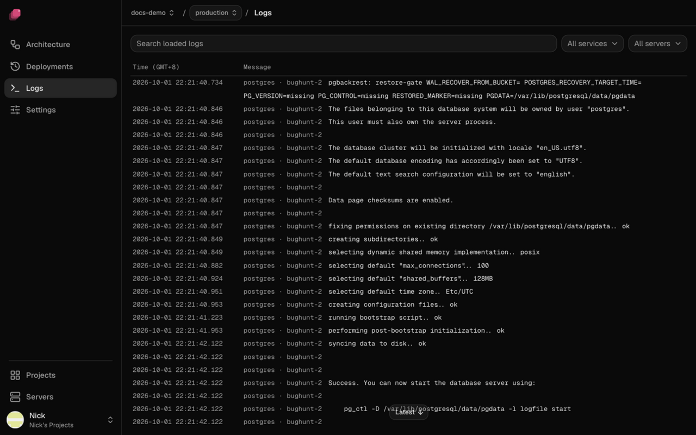
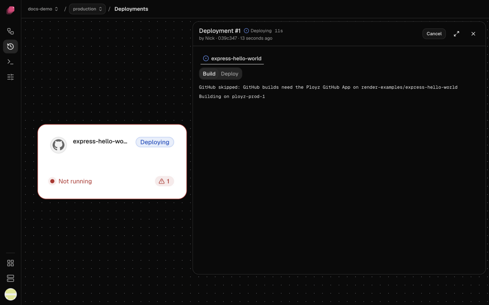

Ployz shows what your services print, live from your servers. Each deployment also keeps its
build output, so you can see why a build failed.

## See your logs

1. Open your environment.
2. Click **Logs** in the sidebar.

Lines from every service arrive as they're written. **All services** and **All servers** narrow
the list, **Search loaded logs** filters it, and **Error**, **Warn**, **Info** and **Debug** show
only lines at the levels you pick. Scroll up for older lines, back to the oldest your servers kept;
the page holds up to 30,000 lines at once.
New lines wait while you're scrolled up; **Latest** brings you back to the end and shows them.

For one service, click it on the canvas and open its **Logs** tab.

## See a deployment's logs

1. Open the deployment from **Deployments** in the sidebar, or from **Logs** in the bottom bar
   while it runs.
2. Click the service's build card for its build output. A Docker image service has no build.
3. Click the service's card for what its new containers printed, including the pre-deploy
   command, even after a later deploy replaced them.

See [Deployments](../deploy/deployments.md).

## Read retained logs from the CLI

`ployz logs app/api` reads retained logs without asking Docker to list containers.
This also works for a removed service. Every service argument must be qualified
as `namespace/name`, either explicitly or through project or deployment scope.
The command still needs a server observation and access to each selected server's
log store. Servers that do not answer are named, and partial results exit with code 3.

Read from your servers, `ployz logs` prints each line on the stream your app wrote it to, as
`docker logs` does: what it wrote to stdout goes to stdout, and what it wrote to stderr goes to
stderr. Many images, nginx among them, log to stderr, so add `2>&1` to pipe or save every line, as
in `ployz logs web 2>&1 | grep error`. With `--json`, every line goes to stdout, and its `stream`
says which one your app wrote it to. Logs Ployz Cloud reads for a token without server access,
and `--build` output, print every line on stdout, and their `--json` has no `stream`.

A name the environment doesn't have now, and that no retained line matches, fails with
`No Service named nosvc in Environment production` and lists the services you can name. This holds
whether Ployz reads your servers or Ployz Cloud reads them for a token without server access. It
exits with code 1, or with code 3 when lines for another name you gave already printed. When a
server doesn't answer, Ployz says so instead, since the missing lines may be on that server.
`--follow` needs a service the environment has now, deployed or not yet deployed, so it refuses any
other name before reading.
`ployz logs --follow --machine X` with no service named follows every service that runs on X and
skips the rest.
When a followed server stops answering, `--follow` names it within about 20 seconds and keeps following the
others. When its daemon restarts, it names it at once:
`machine-1 stopped answering; its lines are missing from here on.` When that is the server your
CLI connects through, every server whose lines came through it is named too. `ployz logs
--machine X` without `--follow` names a server the same way when its daemon restarts mid-read.
It ends once none still answers, and exits with code 3. It doesn't pick the server up again when
it comes back; run the command again.

Unqualified names without scope, service IDs, container selectors, commands with
no service arguments, and `--follow` still use live container discovery.

## Secrets in kept logs

Each server keeps a removed container's output, and the variables it ran with, so its logs still
read after a rollback or removal. Each log file stays up to 30 days after it was last written, so
a container's older lines can go first. They go sooner when logs and metrics fill their share of
the disk, or when the disk drops below 10% free (at least 2 GiB).

Everything Ployz captured from your app stays in those files, secrets included. The dashboard, an agent, and
`ployz logs` through Ployz Cloud hide Sealed values when they show a line. A value shorter than 6 bytes
is hidden only where its name labels it, as in `PIN=4821`. A multiline Sealed value with a line
of 1 to 5 bytes can't be hidden, so a deploy that uses one is refused. `ployz logs` run with
server access, and the files on the server, keep the line as printed. They live in
`/var/lib/docker/ployz-observe/v1/containers/<container id>/`, or under Docker's data directory
if you moved it. The log files keep Docker's own permissions, `0640` and owned by root on a
default Docker install. The `env.json` of variables is `0600`, and Ployz creates each container's
folder as `0700`.

Don't print secrets from your app. There's no setting today to delete kept logs early or keep them
for less time. Keeping no secrets in logs on disk is planned after 0.3.0 in
[#2688](https://github.com/getployz/ployz/issues/2688).

## Good to know

- **Log collection shares a CPU budget with retained-log reads.** By default, Ployz caps its log helper at
  10% of one CPU core. Some historical reads can take several seconds. The main daemon's
  work serving those reads has a separate CPU cost.
- **Logs stay on your servers after a deploy.** Each server keeps what its containers printed,
  so a service's card on an older deployment still shows its output. Ployz keeps up to 5% of the
  disk for them and for metrics, between 512 MiB and 5 GiB. Logs stay 30 days, and the oldest go
  first. It doesn't copy them anywhere else. To search or keep logs for longer, send them from your app to a log
  service.
- **A replica that failed keeps its output.** Its exit code appears when the server observed it,
  so you can see why it stopped. A replica that keeps restarting shows each exit, and an OOM kill
  reads **killed out of memory**.
- **Deleted environments and removed services keep their logs until retention removes them.**
  Recreating an environment with the same name can show its earlier logs. A service's card
  on a deployment shows only that deployment's output.
- **Containers started before your servers ran this release** keep Docker's old log settings, and
  their logs aren't kept, until their next deploy.
- **Levels come from the line.** A JSON `level`, `lvl` or `severity` field, a logfmt `level=`, or
  a leading `ERROR`, `WARN`, `INFO` or `DEBUG` (or a tag such as `[error]`), after any
  timestamp, sets it. A line without one counts as **Info**, stderr included.
- **The dashboard never shows a Sealed value.** It replaces each one with `[secret NAME]`, and a
  variable you seal while you watch is scrubbed from the next lines on. A variable whose `${{ … }}`
  reads a Sealed value is scrubbed whole too; one that reads only plain values shows as it is. A container a deploy
  removed is still checked against the variables it ran with, which its server kept beside its
  logs. Lines it couldn't check, say because your servers couldn't read the service's variables,
  show as **Hidden: couldn’t check these lines for Sealed values.** When a server fails, the
  banner says **Container logs are unavailable.** instead of quoting the server's error.
- **Detected gaps appear in the log**, saying the lines weren't captured or couldn't be read.
  Missing output can have no gap record, such as when a container ran entirely while log
  collection was down.
- **A server that doesn't answer is named** in a banner above the log, and the other servers'
  lines still show.
- **A server on an older Ployz shows no logs.** The page says **Upgrade web-1 to see its logs**
  and links to that server's page. Several such servers link to **Servers** instead. If other
  servers have lines, they still show, with a note naming the server to upgrade. Upgrade it from
  its page, then refresh the logs page.
- **When your servers are offline**, the page says **Your servers are offline** and keeps the
  last lines they sent. If the servers still answer but the log stream drops, it says
  **Couldn’t load logs** and retries.
- **Lines name where they came from** when that varies in view: the service, the server, and the
  container's short id when a deploy replaced a container on the same server, so the old copy's
  shutdown reads apart from the new one's start.
- **Leaving a log closes its stream.** Coming back reopens it and shows the latest lines.
