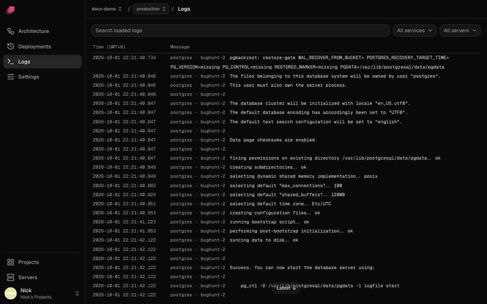
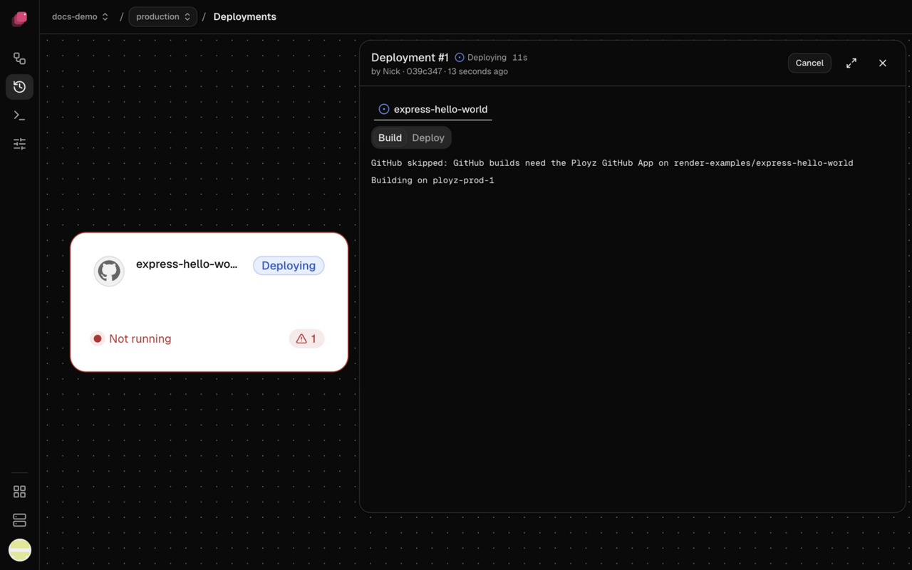

Ployz shows what your services print, live from your servers. Each deployment also keeps its
build output, so you can see why a build failed.

## See your logs

1. Open your environment.
2. Click **Logs** in the sidebar.

Lines from every service arrive as they're written. **All services** and **All servers** narrow
the list, and **Error**, **Warn**, **Info** and **Debug** show only lines at the levels you pick.
Scroll up for older lines, back to the oldest Ployz Cloud kept; the page holds up to 30,000 lines
at once. New lines wait while you're scrolled up; **Latest** brings you back to the end and
shows them.

**Search logs** looks through every line Cloud kept for what you selected, across all its servers,
and shows the matches in time order, newest at the bottom. Scroll up for older ones. Clear the search to follow live logs again. Without log
history, it filters only the lines loaded in the page.

For one service, click it on the canvas and open its **Logs** tab.

## See a deployment's logs

1. Open the deployment from **Deployments** in the sidebar, or from **Logs** in the bottom bar
   while it runs.
2. Click the service's build card for its build output. A Docker image service has no build.
3. Click the service's card for what its new containers printed, including the pre-deploy
   command, even after a later deploy replaced them.

See [Deployments](../deploy/deployments.md).

## Read logs from the CLI

`ployz logs app/api` reads what the service's containers print from Docker on each server, with
each [Sealed](../services/variables.md) value replaced by `[secret NAME]` on the server before it
reaches you. A container Docker still has reads in full, including a replica that failed.
`--tail 50` prints the newest 50 lines of everything it reads, not 50 per replica. Servers that
don't answer are named, and partial results exit with code 3.

A removed service has no container left on your servers. When your CLI is signed in to Ployz
Cloud, `ployz logs` reads its lines from Cloud's log history instead, newest 30 days at most,
and prints them oldest first. Without Cloud, it says the service's logs are not kept and exits
with code 1. Connect the servers to Cloud to keep them; see
[Logs sent to Ployz Cloud](#logs-sent-to-ployz-cloud).

Read from your servers, `ployz logs` prints each line on the stream your app wrote it to, as
`docker logs` does: what it wrote to stdout goes to stdout, and what it wrote to stderr goes to
stderr. Many images, nginx among them, log to stderr, so add `2>&1` to pipe or save every line, as
in `ployz logs web 2>&1 | grep error`. With `--json`, every line goes to stdout, and its `stream`
says which one your app wrote it to. Logs Ployz Cloud reads for a token without server access,
and `--build` output, print every line on stdout, and their `--json` has no `stream`.

A name the environment doesn't have now, and that Cloud's history has no line for, fails with
`No Service named nosvc in Environment production` and lists the services you can name. It exits
with code 1, or with code 3 when lines for another name you gave already printed. When a
server doesn't answer, Ployz says so instead, since the missing lines may be on that server.
`--follow` needs a service the environment has now, deployed or not yet deployed, so it refuses any
other name before reading. Followed across a redeploy, it moves onto the new container within
about 2 seconds.
`ployz logs --follow --machine X` with no service named follows every service that runs on X and
skips the rest.
When a followed server stops answering, `--follow` names it within about 20 seconds and keeps following the
others. When its daemon restarts, it names it at once:
`machine-1 stopped answering; its lines are missing from here on.` When that is the server your
CLI connects through, every server whose lines came through it is named too. `ployz logs
--machine X` without `--follow` names a server the same way when its daemon restarts mid-read.
It ends once none still answers, and exits with code 3. It doesn't pick the server up again when
it comes back; run the command again.

## Logs sent to Ployz Cloud

A server connected to Ployz Cloud runs a log collector beside your services. It reads what each
service prints and sends the lines to Cloud, with each [Sealed](../services/variables.md) value
replaced by `[secret NAME]`. A server that isn't connected to Cloud runs no collector and sends
nothing; live logs still work. When a server first connects, the collector also sends the output
its containers wrote before that, up to what each still has on disk.

Each service keeps up to 30 MB of its own output on the server, in three files of 10 MB. If Cloud
can't be reached, the collector resumes where it stopped and sends the lines it missed, unless
more than 30 MB were written in the meantime. A hard power cut on the server can lose one log
record, the one the collector hadn't saved yet.

Ployz hides your Sealed values before a line leaves the server. See
[Secrets in logs](#secrets-in-logs) for what it can miss.

## When logs are off

Live output always streams from your servers. Older lines and search come from Ployz Cloud's log
history. The Logs page says when Cloud has none, and a service's **Logs** tab says the rest:

- **Log history isn’t set up.** This Cloud has no ClickHouse. On
  [self-hosted](../self-hosting.md#keep-logs-metrics-and-traces-in-cloud-optional) Cloud, set
  `CLICKHOUSE_PASSWORD` and start with `--profile observe`. Live output still works, and search
  covers only the lines loaded in the page.
- **This service isn’t sending logs yet.** A container started before this release still uses
  Docker's old log settings, so its logs never reach Cloud. Click **Redeploy** to replace it.
  It deploys the whole environment.
- **A server hasn’t sent logs for 5 minutes.** Its log collector may be stopped or unable to reach
  Cloud, or the service may just be quiet. The page links to the server. Cloud can't tell a quiet
  service from a stopped collector yet, so a server that prints little can show this too. It goes
  away when the server sends a line.

A removed service keeps its logs in Cloud history for 30 days, with each Sealed value shown as
`[secret NAME]`. Open them from **Logs** with the service selected. Cloud history holds only what
a server sent while connected, so a service that never sent logs has none to show here.

## Secrets in logs

Ployz replaces each [Sealed](../services/variables.md) value with `[secret NAME]` on your server,
before the line reaches Ployz Cloud or your terminal. The Logs page, `ployz logs` and agents all
see it hidden. Docker's own log files on the server keep each line as your app wrote it.

Hiding is best effort. These can still reach Cloud's log history as your app printed them:

- a secret you didn't seal, since Ployz can't know it's secret;
- a Sealed value shorter than 6 bytes, unless its name labels it, as in `PIN=4821`;
- a Sealed value your app changed before printing it, such as base64 or a URL-encoded form;
- a Sealed value in a line longer than 16 KiB, which Docker splits into pieces;
- a Sealed value of a removed container, when another container printed it.

> [!WARNING]
> Don't print secrets from your app. If one shows up in your logs, rotate it.

A multiline Sealed value with a line of 1 to 5 bytes can't be hidden, so a deploy that uses one
fails. If a server can't open a container's Sealed values, for example after its Sealing Key
changed, it keeps hiding the ones it knows. A deploy that adds a Sealed value then pauses that
server's logs to Cloud until you redeploy or remove that container. The lines wait on the server.

## Good to know

- **Logs end with the container on your servers.** A rollback or removal replaces a container, and
  Docker drops its output with it. To keep logs longer, connect your servers to Cloud or
  send them from your app to a log service.
- **A replica that failed keeps its exit code.** The deploy output names the replica and the code
  it exited with, read from Docker before the container is removed, so you can see why it
  stopped. A replica that keeps restarting shows the code of its last run, and an OOM kill reads
  **killed out of memory**. A replica that failed to start is removed at once, so its lines are
  only in Ployz Cloud, which `ployz logs` reads for a service with no container left when your
  CLI is signed in to Cloud.
- **Removed services and deleted environments keep their lines in Cloud, not on your servers.**
  Recreating an environment with the same name can show its earlier logs. A service's card
  on a deployment shows only that deployment's output. Cloud's history doesn't cover a
  deployment's card yet, so there search reads only the lines loaded in the page.
- **Containers started before your servers ran this release** keep Docker's old log settings, and
  their logs aren't sent to Ployz Cloud until their next deploy. `ployz deploy` or **Redeploy** on
  the Logs page replaces them, even when nothing else about the service changed. The Ingress
  Proxy is no service of yours, so `ployz deploy` never replaces it: its container keeps Docker's
  old log settings, and its logs aren't sent to Cloud until Ployz replaces it.
- **Levels come from the line.** A JSON `level`, `lvl` or `severity` field, a logfmt `level=`, or
  a leading `ERROR`, `WARN`, `INFO` or `DEBUG` (or a tag such as `[error]`), after any
  timestamp, sets it. A line without one counts as **Info**, stderr included.
- **The dashboard never shows a Sealed value.** It replaces each one with `[secret NAME]`, and a
  variable you seal while you watch is scrubbed from the next lines on. A variable whose `${{ … }}`
  reads a Sealed value is scrubbed whole too; one that reads only plain values shows as it is. A container a deploy
  removed is still checked against the variables it ran with, which its server kept beside its
  logs. Lines it couldn't check, say because your servers couldn't read the service's variables,
  show as **Hidden: couldn’t check these lines for Sealed values.** When a server fails, the
  banner says **Container logs are unavailable.** instead of quoting the server's error.
- **A server that doesn't answer is named** in a banner above the log, and the other servers'
  lines still show.
- **A server on an older Ployz shows no logs.** The page says **Upgrade web-1 to see its logs**
  and links to that server's page. Several such servers link to **Servers** instead. If other
  servers have lines, they still show, with a note naming the server to upgrade. Upgrade it from
  its page, then refresh the logs page.
- **When your servers are offline**, the page says **Your servers are offline** and keeps the
  last lines they sent. If the servers still answer but the log stream drops, it says
  **Couldn’t load logs** and retries.
- **Lines name where they came from** when that varies in view: the service, the server, and the
  container's short id when a deploy replaced a container on the same server, so the old copy's
  shutdown reads apart from the new one's start.
- **Leaving a log closes its stream.** Coming back reopens it and shows the latest lines.
