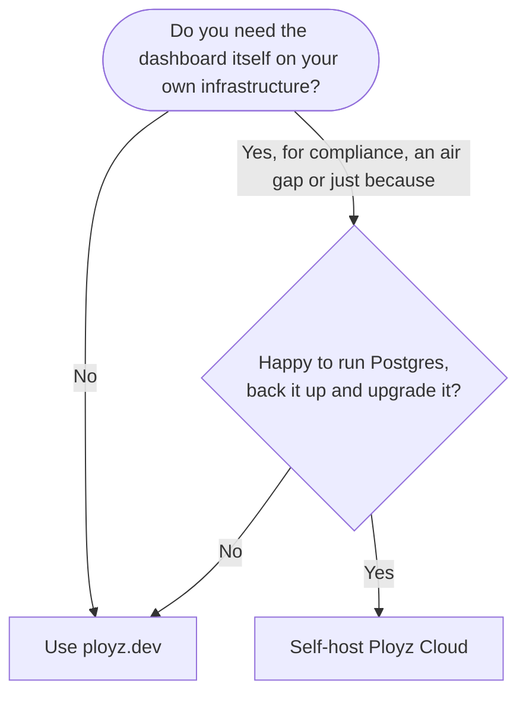

You can run Ployz Cloud, the dashboard at ployz.dev, on your own server instead of using ours.
Your apps still run on your servers either way. Self-hosting moves only the dashboard, which you
run with Docker Compose.

## Should you self-host?

Most people should use [ployz.dev](https://ployz.dev). It's free on your own servers, we run and upgrade
it, and your apps and data stay on your servers anyway. Secrets are sealed on your device and
opened only on your servers.



| | ployz.dev | Self-hosted |
| --- | --- | --- |
| Where your apps run | Your servers | Your servers |
| Who runs the dashboard | Ployz | You: setup, backups, upgrades |
| Price | Free on your own servers | Free, plus your server for the dashboard |
| Setup | Sign in with GitHub | Two GitHub apps, a server, a public https address |
| Still uses Ployz-hosted parts | All of them | The relay, hosted DNS, the installer and release binaries |

A self-hosted Ployz Cloud still reaches your servers through the relay at `relay.ployz.dev`,
gets each organization's generated domain from our hosted DNS, and installs from `ployz.sh`
and GitHub releases.

## Choose where it runs

Ployz Cloud's TLS proxy and a Ployz server that takes web traffic both need ports 80 and 443.
If both run on one server, the proxy wins: your domains show
**Something else answers on port 80 of …** and visitors get an SSL handshake error.

| Your setup | What to do |
| --- | --- |
| A separate server for Ployz Cloud | Put Caddy or nginx on it, as in step 3. |
| One server for everything | Skip the proxy. Publish Ployz Cloud with a [Cloudflare Tunnel](https://developers.cloudflare.com/cloudflare-one/networks/connectors/cloudflare-tunnel/) to `http://localhost:3000`, so ports 80 and 443 stay free for your apps. |
| A server where only Ployz Cloud's proxy uses 80 and 443 | On the server's page, turn off **Takes web traffic** under **Web traffic** and confirm **Stop**. Your apps' domains then need another server. |

You need:

- A Linux server with Docker Compose that can run `linux/amd64` images.
- A public https address for the dashboard, like `https://cloud.example.com`, from your proxy
  or tunnel.

## 1. Create the GitHub apps

Ployz Cloud needs two GitHub apps: an OAuth App for signing in, and a GitHub App for reading
repositories. In both, replace `https://cloud.example.com` with your address.

**OAuth App.** Create it under **Settings → Developer settings → OAuth Apps**:

| Field | Value |
| --- | --- |
| Homepage URL | `https://cloud.example.com` |
| Authorization callback URL | `https://cloud.example.com/api/auth/callback/github` |

Keep its **Client ID** and a new client secret for step 2.

**GitHub App.** Create it under **Settings → Developer settings → GitHub Apps**, on your account
or your GitHub organization:

| Field | Value |
| --- | --- |
| Homepage URL | `https://cloud.example.com` |
| Callback URL | `https://cloud.example.com/api/github/callback` |
| Request user authorization (OAuth) during installation | Checked |
| Webhook URL | `https://cloud.example.com/api/github/webhook`, with **Active** checked |
| Webhook secret | The output of `openssl rand -hex 32`. Keep it for step 2. |
| Repository permissions | Contents: Read-only. Checks: Read and write. Metadata: Read-only. Actions: Read and write. Pull requests: Read-only. |
| Organization permissions | Members: Read-only. Ployz Cloud uses it to check that the person connecting a GitHub organization is one of its owners. |
| Subscribe to events | Push, Check suite, Workflow run, Pull request |

Then generate a private key and a client secret on the app's page, and note its **App ID**, its
**Client ID**, and its slug, the name in its URL `github.com/apps/<slug>`. Ployz Cloud uses the
app's client ID and secret to ask GitHub which installations the person connecting owns.

**One app for both.** You can skip the OAuth App and sign in with the GitHub App: set
`GITHUB_CLIENT_ID` and `GITHUB_CLIENT_SECRET` to the GitHub App's client ID and secret. Then the
GitHub App needs the account permission Email addresses: Read-only, so it can read private
emails at sign-in, and both Callback URLs, with `https://cloud.example.com/api/github/callback` first
and `https://cloud.example.com/api/auth/callback/github` second. GitHub sends a fresh
installation back to the first Callback URL.

## 2. Configure

1. Download the compose file and the example settings from the latest
   [release](https://github.com/getployz/ployz/releases) into a new directory:

   ```sh
   mkdir ployz-cloud && cd ployz-cloud
   curl -fsSLo compose.yml https://github.com/getployz/ployz/releases/latest/download/ployz-cloud-compose.yml
   curl -fsSLo .env https://github.com/getployz/ployz/releases/latest/download/ployz-cloud.env.example
   ```

   `releases/latest` is the newest stable release. To run a prerelease, like a beta, replace
   `latest/download` with `download/<tag>`, for example `download/v0.3.0-beta.7`.

2. Generate the secrets, one per line:

   ```sh
   for name in POSTGRES_PASSWORD BETTER_AUTH_SECRET APP_ENCRYPTION_SECRET INNGEST_EVENT_KEY INNGEST_SIGNING_KEY; do
     echo "$name=$(openssl rand -hex 32)"
   done
   ```

3. Fill in `.env`:

   | Variable | Value |
   | --- | --- |
   | `APP_URL` | Your public address, like `https://cloud.example.com` |
   | `POSTGRES_PASSWORD`, `BETTER_AUTH_SECRET`, `APP_ENCRYPTION_SECRET`, `INNGEST_EVENT_KEY`, `INNGEST_SIGNING_KEY` | The generated secrets |
   | `GITHUB_CLIENT_ID`, `GITHUB_CLIENT_SECRET` | The OAuth App's client ID and secret |
   | `GITHUB_APP_ID`, `GITHUB_APP_SLUG` | The GitHub App's ID and slug |
   | `GITHUB_APP_CLIENT_ID`, `GITHUB_APP_CLIENT_SECRET` | The GitHub App's client ID and secret, not the OAuth App's |
   | `GITHUB_APP_WEBHOOK_SECRET` | The GitHub App's webhook secret |
   | `GITHUB_APP_PRIVATE_KEY` | The whole private key PEM, in quotes |
   | `PLOYZ_HOSTED_DNS_URL` | Optional. `compose.yml` sets `https://dns.ployz.app/` when it is unset |

   Leave every `POLAR_*` and `POSTHOG_*` variable unset: that turns off billing and product
   analytics. If a required value is missing or malformed, `web` and `worker` stop at startup,
   and `docker compose logs web worker` names each variable to fix.
   To turn on the [Ployz agent](account/agent-sidebar.md), set `ANTHROPIC_API_KEY`. To count
   visits on an environment's [Analytics](observe/analytics.md) page, set `ANALYTICS_ENABLED=true`.
   Email is optional too. Ployz Cloud sends none while `POSTSHIBA_API_KEY`, `POSTSHIBA_TEAM_ID`,
   `POSTSHIBA_CLUSTER_ID`, and `MAIL_FROM` are unset. Set all four to send through
   PostShiba. With only some of them set, `web` and `worker` stop at startup. Each person
   chooses which emails they get under [Account → Notifications](account/notifications.md).

> [!WARNING]
> Keep `APP_ENCRYPTION_SECRET` the same forever, and back it up with the Postgres volume
> `ployz-cloud-self-host_postgres-data`. It encrypts the credentials Ployz Cloud stores, such as
> registry credentials and domain tokens, so a new value makes them unreadable. Your variables
> don't use it.

### More than one install on a host

Compose uses `ployz-cloud-self-host` as the project name, even in another directory.
A second copy with that name replaces the first install's containers and reuses its database.
Before starting a second install, set a unique `COMPOSE_PROJECT_NAME` in its `.env`, such as
`COMPOSE_PROJECT_NAME=ployz-staging`. Compose uses it instead of the name in `compose.yml`.
Set a different `WEB_PORT` too.

Keep the project name unchanged for an existing install. Changing it selects a different
volume and makes the database appear empty. With a custom name, back up
`<COMPOSE_PROJECT_NAME>_postgres-data` and use the network `<COMPOSE_PROJECT_NAME>_default`
for a containerized proxy. The default names below still apply when you leave it unset.

## 3. Start it

1. Create the database tables, then start everything:

   ```sh
   docker compose run --rm web npm run db:migrate
   docker compose up -d
   ```

2. Point your proxy or tunnel at port 3000, or at `WEB_PORT` if you set it. With Caddy on the
   same server as Ployz Cloud, the whole config is:

   ```
   cloud.example.com {
     reverse_proxy localhost:3000
   }
   ```

   Ployz Cloud listens only on `127.0.0.1`, so other computers can't skip your proxy. If your
   proxy or `cloudflared` runs in a Docker container on this server, attach it to the
   `ployz-cloud-self-host_default` network and point it at `http://web:3000`. If your proxy
   runs on another server, set `WEB_BIND` in `.env` to a private address of this
   server that only the proxy can reach. Don't set it to `0.0.0.0`: ports that Docker publishes
   skip firewalls like UFW, so anyone could reach Ployz Cloud over plain http, past your
   proxy's TLS and rate limits.

3. Run `docker compose ps`. Ployz Cloud is ready when `worker` shows **healthy**.

## 4. Sign in and add a server

1. Open your address and sign in with GitHub.
2. Open **Organization → GitHub** and click **Connect GitHub**. GitHub asks you to install the
   app and to authorize it. See [Who owns the connection](deploy/github.md#who-owns-the-connection)
   for which GitHub accounts you can connect.
3. [Add a server](servers/add-a-server.md). You need one even if it's the server Ployz Cloud
   runs on: Ployz Cloud is only the dashboard, and your apps run on the servers you add. The
   command the dashboard gives you already points at your address.

To install a server with a [Fleet Token](servers/add-a-server.md#install-with-a-fleet-token), use the
install line **Add servers** or `ployz server token create` shows. Both already point at your
address. The **Add servers** line installs the release your Ployz Cloud runs. The
`ployz server token create` line installs the release of the `ployz` CLI that made it, so if your
CLI and your Ployz Cloud run different releases, use the dashboard's line or upgrade the CLI
first. To write the line yourself, add your address, or the server checks in with ployz.dev. An address that answers but isn't Ployz Cloud ends the
install with an error:

```sh
curl -fsSL https://ployz.sh | sudo PLOYZ_CLOUD_URL=https://cloud.example.com sh -s -- VERSION --enroll
```

The CLI signs in to ployz.dev unless you point it at yours:

```sh
ployz login --cloud-url https://cloud.example.com
```

In CI, set `PLOYZ_CLOUD_URL` next to `PLOYZ_TOKEN`; see
[Make an organization token](cli/overview.md#make-an-organization-token).

## Upgrade

Pick the release to move to on the [releases page](https://github.com/getployz/ployz/releases).
If you run a beta, pick the newest release marked **Pre-release**. Don't use `releases/latest`
here: it's the newest stable release, so it would move a beta back to an older release.
If the database contains migrations the image does not ship, `db:migrate`, `web`, and `worker`
refuse to start. The error names the image version and asks you to use a newer image.
To roll back to an older image anyway, set `PLOYZ_ALLOW_OLDER_IMAGE=1` in `.env`. It starts with
a warning, and requests that need the newer tables fail. Remove it once you run a newer image.

Set `VERSION` to that release's tag, then run the rest. It refuses a tag older than the one
you run now:

```sh
VERSION=vX.Y.Z
current=$(docker compose config --images | sed -n 's|^ghcr.io/getployz/ployz-cloud:||p' | head -n 1)
verdict=$(awk -v from="$current" -v to="$VERSION" '
  function key(tag, p, n) {
    if (tag !~ /^v[0-9]+\.[0-9]+\.[0-9]+(-[a-z]+\.[0-9]+)?$/) return ""
    n = split(substr(tag, 2), p, "[.-]")
    return sprintf("%06d.%06d.%06d.%s.%06d", p[1], p[2], p[3], n > 3 ? "a" p[4] : "z", p[5])
  }
  BEGIN {
    if (key(to) == "") print "Set VERSION to a release tag, like v1.2.3 or v1.2.3-beta.4."
    else if (key(from) == "") print "Could not read the current release from compose.yml."
    else if (key(to) < key(from)) print to " is older than " from ". Not downgrading."
  }')
if [ -n "$verdict" ]; then
  echo "$verdict"
else
  curl -fsSLo compose.yml "https://github.com/getployz/ployz/releases/download/$VERSION/ployz-cloud-compose.yml" &&
    docker compose pull &&
    docker compose run --rm web npm run db:migrate &&
    docker compose up -d
fi
```

Nothing migrates the database on start, so run the migration on every upgrade.
`docker compose up -d` can take up to 30 minutes: `worker` finishes the work it's running
before it stops.

## Good to know

- **No root, no cloud lookups.** `web` and `worker` run as the unprivileged `node` user, and by
  default don't contact a cloud provider's metadata address such as `169.254.169.254` at startup.
  When telemetry is on, setting `OTEL_NODE_RESOURCE_DETECTORS=all` turns those lookups back on.
- **No telemetry by default.** `web` starts the OpenTelemetry SDK only when you set an `OTEL_*`
  variable, such as `OTEL_EXPORTER_OTLP_ENDPOINT`, even to an empty value.
  `OTEL_NODE_RESOURCE_DETECTORS`, which the image sets, doesn't count. Without one, web starts no
  tracing and sends nothing.
- **Back up one volume.** Everything Ployz Cloud stores, your organizations, projects and
  settings included, is in `ployz-cloud-self-host_postgres-data`.
- **Restarting Postgres.** While it's down, pages say **This page couldn't load** and try again
  every few seconds. They come back by themselves within seconds of Postgres starting.
- **Rate-limit requests in your proxy.** Ployz Cloud limits only failed sign-ins from the
  `ployz` CLI, per address. If your instance is public, set a per-address request rate limit
  on `/api/` and `/auth/` in your proxy or tunnel. Leave out `/api/github/webhook`, since
  GitHub doesn't resend a rejected delivery, and leave room for Servers that share one address.
- **Pass each client's own address.** Ployz Cloud takes the client's address from
  `X-Forwarded-For` when your proxy reaches it from a private or local address, as in the setups
  above. Caddy and `cloudflared` add that header for you. Otherwise every client shares the
  proxy's address. Then someone guessing tokens can lock every `ployz` user out for up to an
  hour.
- **Adding a GitHub permission later.** Existing installations keep working without it until
  their owner approves the new permissions on GitHub.
- **No uptime checks yet.** Self-hosted Ployz Cloud doesn't run the uptime checker, so services
  show no up or down status. Their **Monitoring** tab shows CPU and memory, with no uptime checks
  or incidents.
- **Behind Cloudflare?** Your apps' domains need **SSL/TLS** set to **Full (strict)**. See
  [My domain is behind Cloudflare](troubleshooting/app-not-reachable.md#my-domain-is-behind-cloudflare). Your
  apps see the visitor's address, not Cloudflare's.
