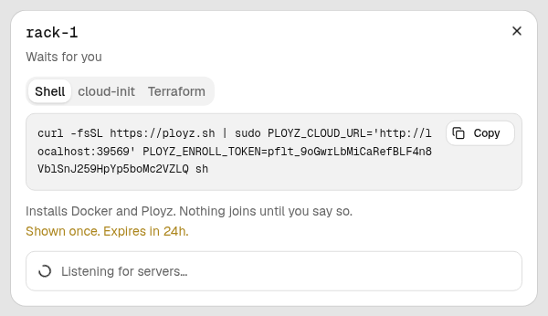

Your apps run on your own servers. To add one, you paste a single command into it, and it joins
your other servers on a private network.

## What you need

- **A Linux server with systemd**, amd64 or arm64, from any provider: a Hetzner Cloud server, a
  DigitalOcean Droplet, a bare-metal box.
- **cgroup v2** to run builds. Every current distribution uses it. A server on cgroup v1 joins and
  runs apps, but its builds fail.
- **Ubuntu LTS, Debian 12–13 or Amazon Linux 2023 on a VM or bare metal** for managed volumes.
  Anything else works [without them](#start-without-zfs).
- **A main disk of 30 GiB or more.** Ployz keeps a quarter of the disk, at least 10 GiB, free for
  the system. On EC2, raise the root volume from its 8 GB default when you launch the instance.
- **Root**, or a user that can run `sudo`.
- **Outbound internet access over IPv4**, and a **public IP address** on at least one server so
  visitors can reach your apps. A server with only IPv6 needs NAT64 and DNS64; see
  [IPv6-only servers](#ipv6-only-servers).

You don't need Docker: Ployz installs it if it's missing.

## Add one server that joins right away

From your own computer, signed in with `ployz login`:

```sh
ployz server add --command
```

It prints a line to paste on the server and an enrollment token beside it, then waits until the
server joins. Paste the line in a shell on the server, as root or as a user with `sudo`, and paste
the token when it asks. The prompt doesn't show what you paste, so the token never enters the
server's shell history or process list. The token works for 24 hours.

A script, such as cloud-init or `ssh host '...'`, has no terminal to answer the prompt. There,
`export PLOYZ_ENROLL_TOKEN=pmet_…` before the line: it keeps that variable through `sudo`. You can
also pipe the token to `sudo ployz server add --token-stdin` after the install part of the line.

The server takes its hostname as its name, lowercased, with anything else a name can't hold, such
as `_` or `.`, turned into `-`; `MY-SERVER` becomes `my-server`. The line prints the name it chose.
To choose another, run
`ployz server add --command --name web-1` and the printed line keeps the name. It keeps every other
flag that shapes the server too, such as `--storage`, `--label-add` or `--accepts-ingress`. When it
finishes, the server shows on the **Servers** page, ready for builds, services and web traffic. If
it doesn't show up, see [Troubleshooting servers](../troubleshooting/servers.md).

Add more servers the same way, even at different providers. Nothing moves onto a new server until
you deploy; see [Scaling](../services/scaling.md#add-a-server).

## Add a standalone server

To start a Cluster outside Ployz Cloud, run this on the Linux server:

```sh
sudo ployz server add --standalone --context NAME
```

From your computer, give the server's SSH destination instead:

```sh
ployz server add --standalone root@HOST --context NAME
```

No Cloud sign-in or enrollment token is needed. A new or empty context gets its first
Server and becomes the current context. To add another Server to a context that already
has connections, use the SSH form. It joins the existing Cluster.

## Add servers from the dashboard

Before your first server, the **Servers** page shows one card instead of a list. Click
**Get install command** and it makes a token that works for 24 hours and shows the install line
with the token under it, then **Shown once. Expires in 24h.** Copy the token now: Ployz can't show
it again. Paste the line in a shell on the server, as root or as a user with `sudo`, and paste the
token when it asks. The card then says **Listening for servers…** until the first one checks in.

Only an owner or admin, or [Ployz support](../account/organizations.md#let-ployz-support-in), can make a token. For a member, **Get install command** and **Add servers**
say so instead.

Once you have a server, or one is waiting, make more tokens with **Add servers**:

1. Go to **Servers** and click **Add servers**. While you have no server, the bottom bar of your
   environment offers it too.
2. Name the token, or leave the name blank and Ployz picks one. Choose how long it works: 1 day,
   7 days or 30 days.
3. Click **Create**. The **Shell** tab shows the install line and the token under it, then
   **Shown once. Expires in 24h.** Copy the token now: Ployz can't show it again.
4. Open a shell on the server, as root or as a user with `sudo`, and paste the line. When it asks
   for the Fleet Token, paste the token. The prompt doesn't show what you paste, so the token stays
   out of shell history and the process list. To put it in user data instead, take it from the
   **cloud-init** tab; it holds the same token. Not on Ubuntu, Debian or Amazon
   Linux, or can't run ZFS? See [Start without ZFS](#start-without-zfs).



Run the same line, and paste the same token, on as many servers as you like while the token
works. Each one installs Docker and Ployz and shows up under **Waiting to join** on the **Servers** page within seconds, in a tray
above your other servers. The tray shows only while a server waits or enrolls. Its header counts
the servers that are ready, preparing, blocked and offline, with a bar for the mix. New ones go
to the bottom of the list, and the list never reorders while you look at it. When your very first
server arrives ready, the tray names it and offers **Enroll** and **Reject** right in the header.

Select a waiting server and click **Enroll** to choose its name, storage and what it runs.
You can enroll while it prepares. Only an owner or admin, or [Ployz support](../account/organizations.md#let-ployz-support-in), can enroll or reject servers. For a member,
**Enroll** and **Reject** are disabled and say so. Follow [Add many servers](add-many-servers.md) for the full
review and enrollment flow.

Each row shows the server's name and operating system, the IP address Ployz Cloud saw it check in
from and its provider, its CPU, memory and main disk size, and its status. **Installing Docker** means it is
still getting ready, and **Ready** means Docker is in place. **Building ZFS** under **Ready** means
its ZFS build is still running, and an enrollment with ZFS volumes waits for it. **Blocked** rows say what
is wrong with the server, in the server's own words, such as `Disk is 20 GiB. Ployz needs 30 GiB.`
A server that still belongs to another organization is blocked until you run `ployz server rm` for it there. A server
where another program holds UDP port 51820, which Ployz needs for WireGuard, is blocked and names that program, for
example `UDP port 51820 is in use by avahi-daemon (pid 812).` Free the port and the block clears on its next
check-in.
**Offline** means it stopped checking in. You can't select a blocked server. Once more than ten
servers wait, filter the list by readiness, provider and token, or search by name or IP address.

Servers you enroll move to **Enrolling** in the same tray, with the step each one is on, until
they join.

Above your servers, **Fleet** counts how many are online, building, offline and unknown, and how
many need an upgrade.

Click a waiting row to see the server in full, with its CPU, memory, disks, Docker, the storage it would
get, its open ports and anything blocking it. **Reject** there turns the server away: it stops
checking in, and asking again with the same token gets it turned away.

### Your tokens

**Tokens** on the **Servers** page lists your Fleet Tokens with how many servers wait on each and
how many joined, when each expires and when it was last used. **Revoke** asks you to confirm,
then stops a token at once and drops the servers still waiting on it; the message after says how
many. Servers that already joined stay.

## Add many servers with a Fleet Token

A Fleet Token lets servers register under **Waiting** for you to review and enroll together.
See [Add many servers](add-many-servers.md). You can also make a token from your computer:

```sh
ployz server token create --expires 7d
```

It prints the token once, and an install line for the release of the `ployz` CLI you ran. Run
that line on each server and paste the token when it asks:

```sh
curl -fsSL https://ployz.sh | sudo sh -s -- VERSION --enroll
```

Keep the version it names. Without one, the script installs the stable release, which may not
match your Ployz Cloud. With `--json`, the token is in `fleet_token.token` and the line in
`install`.

- **Servers wait for you.** A server that runs the line checks in under **Waiting** until you enroll it from **Servers**.
- **It lasts 24 hours by default.** `--expires` takes `1d`, `7d` or `30d`.
- **Expiry and revoke stop servers that haven't joined.** Revoke drops waiting servers at once. After expiry, each waiting server is dropped when it next checks in. Enrollments already started finish, and servers already in stay.
- **Only your login makes or revokes one.** An organization token can't.

List your tokens, and revoke one by name:

```sh
ployz server token ls
ployz server token revoke amber-falcon
```

The [Tokens](#your-tokens) page on **Servers** shows the same list. Revoking also drops the servers
still waiting on that token. The prompt keeps the token out of shell history, sudo logs and the
server's process list. See [Install with a Fleet Token](#install-with-a-fleet-token) for cloud-init
and rerun outcomes.

## Use an empty spare disk for volumes

To put managed volumes on a spare disk, name it when you enroll the server:

```sh
sudo ployz server add --storage zfs:/dev/disk/by-id/virtio-data
```

A by-id path stays stable when the kernel renames disks after a reboot. You can also
name a kernel path such as `zfs:/dev/vdb`. The disk must
be an empty whole disk. Ployz refuses a disk with a filesystem, a partition table,
partitions, or mounts. It creates the `ployz-device` pool on the selected disk.
Retrying installation on the same disk also imports an exported pool before checking
whether the disk is empty. After a reboot, a volume lookup, mount, or storage request
imports that pool again. Ployz records device ownership before serving volumes,
including when the operating system already imported the pool. If the device is
unavailable, storage operations fail instead of creating a replacement pool on the
main disk.

With `--storage zfs` and no device, Ployz prepares ZFS and creates a file-backed pool
on the main disk when you deploy the first managed volume. A failed named-device
attempt that creates no pool leaves this option available. Existing file-backed
storage takes priority over pools found on attached disks. If a previously owned
device pool is missing, preparation refuses instead of forgetting it. For installer-only use,
`ployzd install --storage zfs:/dev/vdb` accepts the same device form.

## Start without ZFS

The command sets up managed volumes with ZFS, so every [volume](../services/volumes.md) gets a
storage limit. ZFS needs:

- Ubuntu LTS with its stock kernel, Debian 12 or 13, or Amazon Linux 2023.
- Secure Boot off, on Debian and Amazon Linux.
- A VM or bare metal, not an OpenVZ or unprivileged LXC container.
- Free space on the main disk for your volumes.

On Ubuntu, ZFS comes ready-made. On Debian and Amazon Linux, the server builds it, so the command
takes longer: 15–20 minutes on a 2-vCPU Amazon Linux Server, a few minutes on Debian. The build
tools stay installed, so ZFS can be rebuilt when the kernel updates.

If your server can't run ZFS, put `PLOYZ_SKIP_ZFS=1` after `sudo` in the install line, as in
`curl -fsSL https://ployz.sh | sudo PLOYZ_SKIP_ZFS=1 sh -s -- VERSION --enroll`. With
`ployz server add`, add `--storage none`.

The server then shows **Docker only**. If none of your servers has managed volumes, every new volume,
a database's included, fails to deploy until you open it and tick **Use a plain Docker volume
(not recommended)** under **Advanced**; see
[When your servers show Docker only](../services/volumes.md#when-your-servers-show-docker-only).

## Install with a Fleet Token

A Fleet Token starts with `pflt_`. Give it to the install script and the server asks to join
instead of joining. Use the version from the install line **Add servers** or
`ployz server token create` shows:

```sh
curl -fsSL https://ployz.sh | sudo sh -s -- VERSION --enroll
```

The script prints `Installs Docker and Ployz.` and asks for the
token at a `Fleet Token (from Servers in Ployz Cloud):` prompt that doesn't show what you paste. The token never appears on a
command line, so it stays out of `sudo`'s log, shell history and `ps`. The script checks that the
token looks like one before it changes anything. It installs the CLI and runs
`ployz server checkin --install`, which checks in with the token and only once Cloud has answered
writes it to `/etc/ployz/fleet-token`, readable by root only. That ends with
`Waiting for approval`, within seconds: Docker installs and ZFS builds in the background while the
server waits, and the server shows on the **Servers** page at once. Two first installs end without
it and still exit cleanly, with the service set up and checking in:

- **Cloud can't be reached.** Connection errors, timeouts and server errors print the reason and
  `The check-in service keeps trying.` The install writes the token without Cloud having answered
  it, and the server checks in every minute until Cloud does.
- **Cloud holds the check-in back.** Cloud's own message follows `Cloud held this check-in back:`,
  for example `This Fleet Token already has 5 waiting servers.` The server isn't on the
  **Servers** page yet. It asks again when Cloud says to.

When Cloud already has an enrollment ready for the server, as Enroll on arrival can on a rerun, the
install ends with `Cloud is ready to enroll this server. The check-in loop runs it.` instead. On a
server that already joined with that token, it ends `Already joined`. On a server that can't join
yet, it ends with a `Blocked.` line for each reason `ployz status` lists, such as `Blocked. Already
in another cluster. Remove it there first: ployz server rm web-1`. When the install starts
Docker's install again, an earlier failed Docker install is not one of them.

- **Without ZFS.** Put `PLOYZ_SKIP_ZFS=1` after `sudo`, as
  `curl -fsSL https://ployz.sh | sudo PLOYZ_SKIP_ZFS=1 sh -s -- VERSION --enroll`. It does what
  `--storage none` does for `ployz server add`.
- **From user data.** cloud-init runs user data as root with no terminal to prompt at, so pass the
  token in `PLOYZ_FLEET_TOKEN` instead:

  ```yaml
  #cloud-config
  runcmd:
    - curl -fsSL https://ployz.sh | PLOYZ_FLEET_TOKEN=pflt_… sh -s -- VERSION
  ```

  Any process on the server, containers included, can read user data from the provider's
  metadata service for as long as the server runs. Give a token you put there a short expiry.
- **Run it again.** The same line on the same server updates its token and keeps it one server.
  The server keeps `/etc/ployz/fleet-token` until Cloud takes the new token, even when that file
  doesn't hold a token. If Cloud can't be reached, is busy, or the probe fails, a rerun with a
  different token ends with `Until Cloud takes the new Fleet Token, this install keeps
  /etc/ployz/fleet-token and changes nothing else. Run the install again.` and an error. If the
  new token already has as many waiting servers as it allows, the rerun ends with `Cloud didn't
  take the new Fleet Token, so this install keeps /etc/ployz/fleet-token and changes nothing
  else.` and an error. Two installs at once take turns writing the file, so a token Cloud didn't
  take never replaces one it took. A rerun with the same token keeps trying, as a first install
  does.
- **A token file it can't read.** If `/etc/ployz/fleet-token` exists but can't be read, the
  install ends with `Could not read /etc/ployz/fleet-token` and an error before it writes
  anything. Fix or remove that file and run the install again.
- **An expired token** prints `Token expired.`, Cloud's reason, and `Run the install again with a
  new token.`, and the script exits with an error. A revoked one says so the same way.
- **A token Cloud doesn't know**, or a missing `PLOYZ_CLOUD_URL` when you
  [run your own Cloud](../self-hosting.md), ends the install with
  `Cloud at … refused this Fleet Token.` and an error. It says to check `PLOYZ_CLOUD_URL` only
  when you set it.
- **Something other than Ployz Cloud answers**, such as a 404 or a web page from a wrong
  `PLOYZ_CLOUD_URL`, a proxy or a firewall, the install ends with an error that names the URL it
  reached and says it `isn't how Ployz Cloud answers. A proxy or firewall in between may have
  answered instead`. It says to check `PLOYZ_CLOUD_URL` only when you set it.

When the install ends with an error because the token isn't shaped like one, Cloud refused it,
the clock is off, Cloud didn't answer or take a new token on a rerun, the token file couldn't be
read, or something other than Cloud answered, it has installed only the `ployz` CLI and started nothing. On a first install no
check-in service is set up and preparation never starts. On a server that already checks in, the
running service keeps its old token and goes on as before.

An error after Cloud has answered the token, such as systemd failing to start the service, leaves
a partial install. The new token is already in `/etc/ployz/fleet-token`, and the service files
and preparation may be set up. Fix the cause and run the install again.

Without `--enroll`, the script checks in only when `PLOYZ_FLEET_TOKEN` is set, and ends with
`A Fleet Token is pflt_ and 43 more letters, digits, - or _` when it holds anything else, followed
by how long the value was, or, at the right length, that it has other characters. It never prints
the value. It leaves `PLOYZ_ENROLL_TOKEN` to
`ployz server add`, and refuses a Fleet Token in it, which older install lines put there; use
`PLOYZ_FLEET_TOKEN` instead. If the server
waits longer than you expect, see
[A server waits for approval](../troubleshooting/servers.md#a-server-waits-for-approval-and-never-shows-up).

## Open the firewall

Ployz opens the ports it needs on the server itself. If your provider runs a firewall in front of
it, like a Hetzner Cloud Firewall, a DigitalOcean Cloud Firewall or an AWS security group, allow
these there:

| Port | From | Needed for |
| --- | --- | --- |
| TCP 80, TCP and UDP 443 | Anywhere | Your apps over https, and their certificates, on servers that take web traffic |
| UDP 51820 | Your other servers | Services on different servers reaching each other |

## IPv6-only servers

Ployz downloads its releases from github.com, which has no IPv6 address. When a server can't reach
github.com, the download goes through ployz.sh instead, which has one. So on a server whose only
route out is IPv6, the install line still installs `ployz`, and setup and upgrades still download
the Ployz daemon. Setting the server up needs more: it pulls some images from ghcr.io, which has
no IPv6 address either, so enrolling the server or running `ployz server add` can't finish. Do one
of these first:

- **Give the server an IPv4 address.** Most providers sell one as an add-on, such as a Hetzner
  Primary IPv4. The server is then dual-stack and installs like any other.
- **Use NAT64 and DNS64.** DNS64 answers an IPv6 address for names that only have IPv4 ones, and
  NAT64 carries that traffic to IPv4. You need both, and they must agree on the prefix: a DNS64
  resolver alone, such as a public one, gives addresses nothing answers unless a NAT64 gateway
  serves its prefix. Use your provider's NAT64 and DNS64, or a public service that runs both.
  With both in place, the install line works and a single server sets up and runs. The server
  advertises only its own IPv6 addresses, never the gateway's IPv4 one, and your services
  resolve names through Ployz as on any other server. A container you start yourself with
  `docker run` on Docker's default network has only IPv4, so it reaches neither its resolvers
  nor anything else. Run it with `--network host`, or on a Docker network with IPv6 turned on.

Keep the IPv4 address or NAT64 for as long as the server runs Ployz, because upgrades can pull new
images from ghcr.io.

## Good to know


- **Operating system updates stay with you.** Ployz doesn't install them.
- **Already running Docker?** Ployz keeps it and its settings, if it's Docker 29.2 or newer
  with buildx 0.18 or newer and the containerd image store turned on. Otherwise setup stops
  before changing anything; see
  [The install stops while checking Docker](../troubleshooting/servers.md#the-install-stops-while-checking-docker).
  Docker's default never rotates container logs, so they can fill the disk; see
  [The server's disk is filling up](../troubleshooting/servers.md#the-servers-disk-is-filling-up).
- **Pinning your own Caddy?** `--ingress-image` needs Caddy 2.8 or newer. Ployz refuses an older
  version tag.
- **A server that never joined doesn't hold up the next one.** If a token was used but its server
  never joined, `ployz server ls` lists it as down with no version. The next `ployz server add`
  doesn't wait on it: it warns `Server web-3 shows no sign it ever joined` and prints
  `ployz server forget <its ID> --confirm dead` to take it out. With `--json`, the result lists
  each such server under `unarrived`, with its `id`, `name` and that command as `next`. You get
  the warning, the command and the list even when the add then fails for another reason, such as
  a down server.
- **A failed add can be retried with other options.** If `ployz server add` fails after Cloud took
  the server, for example while downloading or installing the daemon, run it again on the same
  host with a new token. It may change options such as `--storage`. The retry finishes the same
  server and keeps its address, even after `ployz server forget`. Once the server has
  joined, a retry must keep its options; to change them, run `ployz-uninstall` and add it again.
- **Client IPs stay out of Ployz's web server logs, not your app's.** Caddy passes the client IP to
  your app in `X-Forwarded-For`, over IPv4 and IPv6. If your app logs requests, its logs, and the Log Store's copy of
  them, can hold client IPs and user agents. Those logs are yours to manage.

Next: [manage your servers](manage-servers.md).
