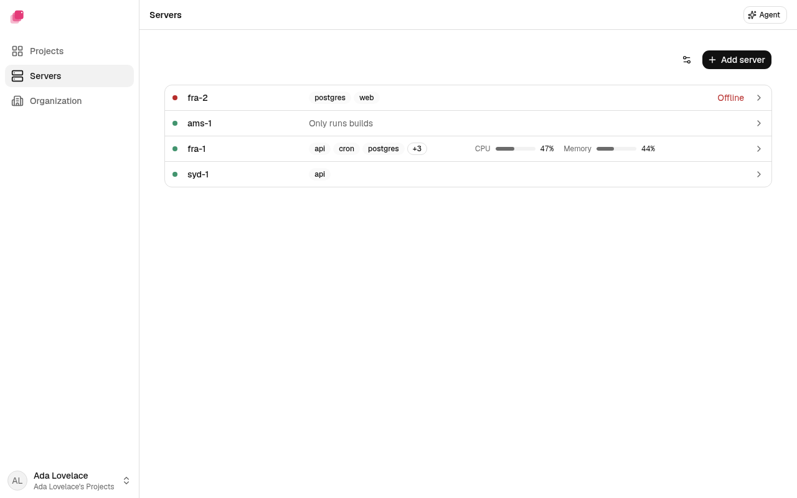
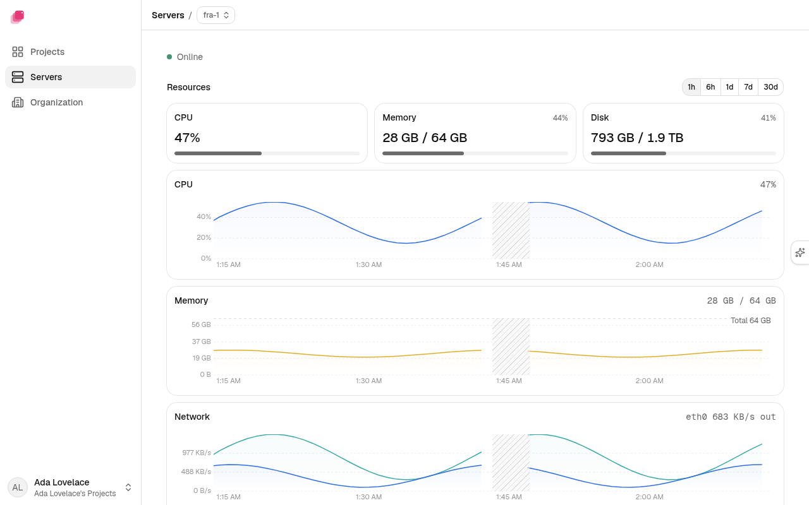
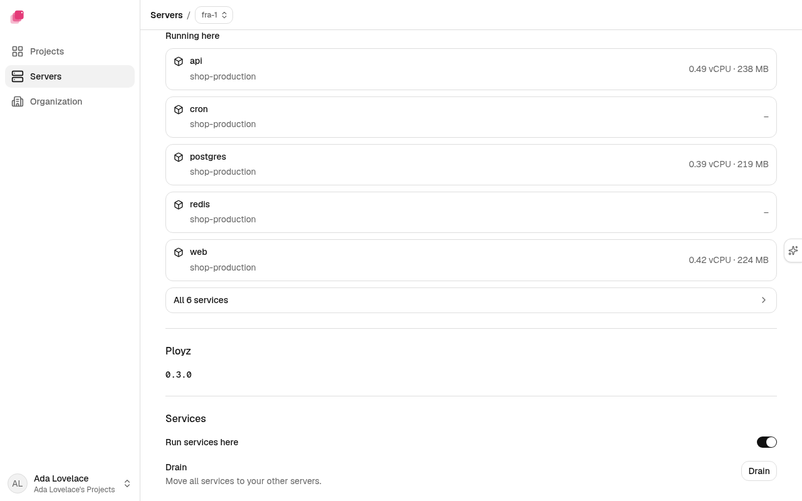

The **Servers** page lists every server in your organization. Open one to see what runs on it,
turn builds on or off, or remove it.

## Check your servers

Each row shows a server's name and the services on it, up to three by name and then a count like
**+2**. A green dot means the server is online, and the row says nothing more. A row names its
status only when someone should look.



| Status | What it means |
| --- | --- |
| Green dot, no word | The server is up and in touch with your other servers. |
| **Building** | Online, and running builds right now. |
| **Offline** | Your other servers can't reach it. See [A server shows Offline](../troubleshooting/servers.md#a-server-shows-offline). |
| **Unknown** | Ployz can't tell whether it's up. Check it as you would an offline one. |
| **Upgrading** | Ployz is upgrading it. See [Upgrade Ployz on a server](#upgrade-ployz-on-a-server). |
| **Upgrade failed** | Its last upgrade didn't install, and it went back to the release it ran before. |

When the list is wide enough, each row also shows how much of the server's CPU and memory is in
use right now. The meters stay empty until the server sends a reading, and an offline server shows
none. A dash means the server sent no recent reading for that meter. The server's page has disk
and the full picture.

A server that can hold [managed volumes](../services/volumes.md) shows nothing about storage.
**Docker only** means it was added with **Start without it** and holds plain Docker volumes only.
**Volume support unknown** means Ployz couldn't tell what it can store.

If the page shows **Can't reach your servers right now**, see
[Troubleshooting servers](../troubleshooting/servers.md#cant-reach-your-servers-right-now).

## See what runs on a server

Click a server. Its page shows its status and public IP address, then:

- **Resources**: meters for CPU, memory and disk now, then charts of CPU, memory and network over
  the range you pick, from **1h** to **30d**. The meters and the values above each chart always
  show the last few minutes, whatever the range; a dash means the server sent no recent reading.
  Network shows each interface in its own color, out as a solid line and in as a dashed one. The
  disk bar splits used space into **Volumes**, **Mirrors**, **Logs and metrics** and **Other**,
  then **Free**. Space the server couldn't attribute to one of those shows as **Used**. A stretch
  the server didn't measure is hatched **Not measured**. A server on an older Ployz version reads
  **Upgrade web-1 to see its metrics**. If it doesn't reply, the section reads **web-1 didn't answer**.
  While the server is offline, the page leaves Resources out.

  

- **Running here**: the server's services, with the CPU and memory each uses on this server now,
  refreshed when you open or return to the page. A service with no recent readings on this server
  shows **–**. Past five, **All 12 services** opens the
  full list, with a filter. While the server is offline, each one says whether it's **Still on**
  another server or **Down**.
- **Services**: **Run services here** and **Drain**. See
  [Change what a server does](#change-what-a-server-does).
- **Builds**: **Run builds here** and **Builds at once**. See
  [Where builds run](../builds/where-builds-run.md#build-on-your-servers).



An entry marked **Not in any Project** is left over from a deleted project or environment.
**Remove** deletes its containers and its volumes, data included, from every server.

## Change what a server does

Every server runs builds, runs services and takes web traffic. To turn one off, see
[Give servers different jobs](../services/scaling.md#give-servers-different-jobs). The
[Ployz agent](../account/agent-sidebar.md) can change these too, but it can't turn web traffic
back on: that starts the server's web server, which the switch below and `ployz server set` do.

Under **Services** on a server's page, turn off **Run services here** and nothing new starts on
the server. What already runs there stays until you drain it. Your next deploy also moves it.

To move everything off now, click **Drain** and confirm. The dialog lists what runs on the server and
badges what won't move: **Skipped** when no project owns it, which draining leaves where it is,
**Stays** when the last drain left it because its data is on the server, and **Stops** for a global
service that runs on no other server, which the drain removes.
Draining turns services off for the server and stops its global services there. Then it moves
each replicated service's containers to your other servers one at a time. Each new container runs
the same image, and each one starts and is healthy before the old container is removed.
Pre-deploy commands don't run again, and nothing is deployed. The drain starts once you confirm:
the dialog is the approval. If a global service's last other copy stopped while the dialog was open,
the drain doesn't start; open it again to see what stops now. Drains in one organization run one
at a time: a second one reads **Queued · Waiting on web-1**. While a drain runs, the
**Drain** row counts the services left to move and lists them as **Pending**; each one leaves the
list as it leaves the server. You can leave the page while one runs.

While a server drains, you can't turn **Run services here** back on for it: Cloud refuses the
change until the drain ends. Turning services on for another server waits until
the organization's drain ends. Other server settings, like **Run builds here**, never wait for a
drain.

A service stays running where it is, and is reported with the reason, when:

- it mounts a volume or a bind mount on the server (tmpfs mounts don't count);
- its containers run different versions, because a deploy hasn't finished: deploy it first;
- a server it involves can't be checked right now;
- no other server can take it.

When the drain ends, the **Drain** row counts what moved, stopped, stayed and failed, and how many
services no project owns it left alone. It lists each service with where it went or why it stayed.
A drain that stops early marks the service it was moving **Interrupted** and the ones it never
reached **Not attempted**; those still run on the server.
If anything stayed or failed, the drain stopped early, or it couldn't check what's left on the server, the button
reads **Drain again**. Turning services back on doesn't move anything back.

From the CLI, `ployz server drain web-2` does the same and prints the report. If anything stayed or
failed, it exits non-zero. When you're signed in, Ployz Cloud runs the drain, as it does for the
button. Unlike the button, it waits for approval first when a global service would run on no other server (see
[Destructive actions ask first](../account/organizations.md#destructive-actions-ask-first)).
The CLI stops waiting after 30 minutes and says so; the drain keeps running in Ployz Cloud. Add
`--context` to drain from your computer instead.

Under **Web traffic** on a server's page, **Takes web traffic** is a switch. On, the line under it
reads **Your domains point at 203.0.113.10**: the server's address. Turn it off and a dialog lists the
domains pointed at your servers. When another server takes web traffic, it keeps serving them; when
this is the only one, the dialog warns that they stop working. Confirm with **Stop**: the row reads
**Stopping…** while the web server on it stops, and then **Web traffic is off**. Your
generated addresses stop pointing at it within the hour, or when you click **Check again** under
**Domain** in **Organization → General**. Until then, anyone sent to it gets no answer on ports 80
and 443; to keep the internet out for good, also close them in its firewall.

Turn the switch on and the row reads **Starting the web server…** until the web server runs there,
then your domains point at it. When the web server can't start, say because something else on the
server holds port 80, the switch goes back off and the section says why: **Couldn't start web
traffic · Port 80 is in use on web-1. Free it, then try again.** Fix the cause and click **Retry**.

From the CLI, `ployz server set web-1 --accepts-ingress=false` turns the role off but leaves the web
server running; use the switch to stop it.

## Upgrade Ployz on a server

Each server's page shows the Ployz release it runs. When a newer release is out on your
organization's channel (Stable unless you [choose Beta](#choose-stable-or-beta-releases)) and a
server is behind, the top of the **Servers** page offers **Upgrade to `0.2.2`**.
Click it to upgrade every server that's behind, one at a time in name order. Your apps keep running
while they do. While an upgrade runs, the top of the page reads **Upgrading 1/4**, and the server
upgrading reads **Upgrading**.

### Turn on automatic upgrades

Automatic upgrades are off until you turn them on. Click the **Upgrade settings** icon at the top
of the **Servers** page and turn on **Upgrade automatically**. Any member can change it. Ployz
starts upgrading right away, then checks every hour. Turn the switch off to go back to upgrading by
hand.

Servers that are offline or building are skipped and upgrade at a later check. An offline server
that's behind reads **Upgrades to `0.2.2` when it's back** on its page.

If a server's upgrade doesn't install, that server goes back to the release it ran before, and the
other servers wait: automatic upgrades skip that release until a newer one is out. That server
reads **Upgrade failed**, and the top of the page offers **Upgrade to `0.2.2`** to carry on yourself.
On the server's page, **Show details** has the exact error to copy, and **Try again** retries. Once an upgrade of that release succeeds, automatic upgrades pick it up again.

Every member of the organization gets one email about it, naming the server, the release, and
whether it went back to the release it ran before. Members who set **Failed automatic upgrades** to **None** under
[Notifications](../account/notifications.md) don't. An upgrade you start by hand sends no email.

### Upgrade one server

To upgrade one server, open it: its **Ployz** section reads **`0.2.2` is out**. Click **Upgrade**.
Any member can upgrade servers while they're online and not building. One upgrade runs at a time
per organization, so **Upgrade** and **Try again** wait while one is running.

### Choose Stable or Beta releases

Click the **Upgrade settings** icon at the top of the **Servers** page and set **Releases** to
**Stable** or **Beta**. Stable is the default; Beta gets fixes early, as prereleases like `0.2.3-beta.1`. Any
member can change it, and it applies to every upgrade, automatic or by hand. The **Servers** page
and each server's page then show the newest release on that channel.

Switching back to Stable never downgrades a server. A server on a beta ahead of Stable reads as
current and waits until Stable catches up.

The same two settings from the CLI, when you're signed in:

```sh
ployz server upgrade-policy show
ployz server upgrade-policy set --channel beta --automatic true
```

Pass only the setting you're changing; the other stays as it is.

### New major lines

Upgrades stay on your servers' release line (`0.x`). When a new line like 1.0 is published, the top
of the **Servers** page links **Ployz 1.0 is out** to its release notes. Nothing installs the new
line for you: your servers stay on 0.x and keep getting its upgrades.

### Upgrade from the CLI

To upgrade from the CLI, name your organization's channel and the servers:

```sh
# on web-1 then web-2
ployz server upgrade stable web-1 web-2
```

When you're signed in, Ployz Cloud runs the upgrade, so it follows your organization's channel.
Naming the other channel fails with `channel_mismatch`. To pick an exact version like `0.2.0`,
add `--context` and upgrade from your computer instead. Ployz Cloud never moves a server to an
older release than it runs, so a downgrade also needs `--context`.

Ployz releases are signed, starting with the first release after 0.3.0-beta.2. A server checks
the signature before it installs a release, and refuses one that isn't signed by Ployz or that
claims a different version. Releases up to 0.3.0-beta.2 are unsigned, so a server can't install
them, even by exact version with `--context`.

`ployz server upgrade` works the same way whether automatic upgrades are on or off: your apps keep
running and private DNS keeps answering (with the exceptions in
[Private networking](../services/private-networking.md)), Ployz stops at the first server that fails, and a server whose upgrade fails goes back to
the release it ran before.
A server that doesn't answer within a minute counts as failed, so an offline server stops the
command quickly instead of waiting out the upgrade.

With Ployz Cloud, a server that's offline, building, or already taking another upgrade is skipped
instead: Ployz names it and says why, upgrades the rest, exits 3, and prints the command that
upgrades the skipped servers once they're free. A server already upgrading isn't upgraded twice;
the command follows the upgrade that's running.

## Servers on different versions

Ployz Cloud and the CLI keep working with servers that run an older Ployz release. The
**Servers** page shows each one and offers its upgrade, as in
[Upgrade Ployz on a server](#upgrade-ployz-on-a-server).

When a server's release can't serve a feature, the feature names that server:

- **Logs** show the lines from your other servers, with a note such as **web-2 needs an upgrade to
  show its logs** and a link to web-2. When no server can send its logs, the log reads **Upgrade
  web-2 to see its logs** with **Open web-2**, or **Upgrade 2 servers to see their logs** with
  **Open Servers**. Upgrade the server from its page, then refresh the logs page. See
  [Logs](../observe/logs.md).
- **Copies** on a volume names the servers to upgrade before any volume moves or mirrors. See
  [Move a volume](../services/move-a-volume.md).
- **`ployz volume move`** onto such a server fails. If the server already runs the newest release
  on your channel, a later release brings the feature, and the message reads:

  ```text
  Volume move is not in Ployz 0.2.4 on web-2 yet.
  ```
  Every volume move, mirror, sync, release, restore and mirror removal, and a Deploy that restores
  a volume onto a new server, also needs every server that holds or receives the volume to run a
  Ployz new enough to refuse a request from an older run. The message names what you ran and the
  server to upgrade: "Volume move needs a newer Ployz on web-1", "Mirror removal needs a newer
  Ployz on web-2".
- **Drain** in Ployz Cloud names the servers to upgrade before it changes anything:
  "Drains need a newer Ployz on web-1".
- **Upgrade** off Ployz 0.2.4 that stops partway while the old Ployz keeps running looks like it's
  still going: Cloud waits until the upgrade times out, then shows its result as unknown rather
  than interrupted. Start the upgrade again.

From the CLI, `ployz logs` prints the logs from your other servers, names each server that can't
send its own, and exits with code 3:

```text
$ ployz logs api
! Server web-2 needs a newer Ployz. It cannot serve ployz.logs.history.v2.
```

With `--follow`, the command stops at the first server that can't stream its logs and exits with
code 1. With `--json --follow`, it ends the output as a partial result and exits with code 3
instead. `ployz exec` into a container on such a server exits with code 1 and names the server:

```text
Server web-2 needs a newer Ployz. It cannot serve ployz.container.exec.v1.
```

`ployz drain` of a server on Ployz 0.2.4 turns its services off, then stops and names the server:

```text
Server web-2 needs a newer Ployz. It cannot serve ployz.container.ensure.v1.
```

Upgrade the server and run `ployz drain` again. The rerun finds services already off and carries
on.

## Remove a server

> [!WARNING]
> Volumes stay on the removed server's disk as copies, and your services lose them until you
> make a copy the writer again with `ployz volume restore`. The server's mirrors of volumes
> written on other servers are deleted, and so is a restore still copying there. A restore that
> finished copying stays as a copy. Copy off any data you need first.

1. Open the server and click **Remove server**.
2. Ployz lists the volumes on the server. Type the server's name and click **Remove**.

The server you remove and every server Ployz reaches it through must run a Ployz that can remove
servers. If one doesn't, the removal stops and says "Server removal
needs a newer Ployz on web-1". Upgrade that server, then remove again.

<!-- screenshot: the Remove web-2? dialog listing one volume, with the name typed -->

[Drain the server](#change-what-a-server-does) first to move its services off. While services still
run there, **Remove server** says how many, next to a **Drain** button. If only services whose
volume is on the server are left, it names them: draining won't move them. It also names services
no project owns, which draining leaves. `ployz server rm`
warns about services still running there and prints the drain command.
Otherwise services that ran only on that server stop. Your next deploy replaces its replicas on your other
servers, except for services whose volume was on it (see
[When a server goes down](../services/scaling.md#when-a-server-goes-down)). Removing your last
server stops everything; your projects and settings stay, and the bottom bar shows **Add a server**
until you [add one](add-a-server.md).

The reset first stops every copy in progress on the server. If one doesn't stop within 30 seconds,
the removal fails and names its volume; remove the server again.

If the server resets but your other servers can't forget it, `ployz server rm` says "Server web-2
reset but is still listed." and prints `ployz server forget web-2` to finish. Ployz Cloud
finishes such a removal on its own.

`sudo systemctl stop ployz.socket ployz` stops Ployz's control of the server. Stop the socket too:
any `ployz` command on the server starts Ployz again through it. Your services, their private DNS,
the private network and the server's place in the cluster keep running until the server reboots or
you remove it.

When Ployz Cloud manages the server and taking it out would destroy something, `ployz server rm`
and `ployz server forget` wait for an approval (see
[Destructive actions ask first](../account/organizations.md#destructive-actions-ask-first))
before they take the server out. One approval removes the server once, and approving a forget
doesn't approve a removal that resets the server.

Unlike `drain`, `upgrade` and `clean`, removing or forgetting a server Ployz Cloud manages always goes through
Ployz Cloud, even with `--context` or `--connect`: Cloud keeps a record of each server it manages,
and removing one behind its back would leave that record behind.
Ctrl-C stops following the removal but doesn't stop it: it keeps running in Ployz Cloud, and the
server stays in your context, since the removal can still fail.

Ployz stays installed on a removed server, so you can add it again later. To remove Ployz itself,
run `sudo ployz-uninstall` on the server after you remove it. Docker, your images and your volume
data stay on the disk.

## Forget a server that is gone

If a server is gone or can't be reset, forget it instead. Forgetting takes it out of the cluster
without reaching it, and its volumes can't be recovered.

When the server is offline, its page shows **Forget web-2** under **Danger**. Click **Forget
server**, type its name, then click **Forget**.

From the CLI, type the server's name to confirm. When the server doesn't answer within 10 seconds,
even if it still shows as up, type `dead` instead:

```sh
ployz server forget web-2 --confirm dead
```

Ployz refuses to forget a server that answers and holds a copy of any volume. Remove it with
`ployz server rm` instead, and the reset makes its copies read-only and deletes its mirrors.

A mirror that Ployz v0.3.0-beta.2 or earlier refreshed last stays on the server after the reset.
To have the reset delete it, the mirror must finish a pull from the writer before you run
`ployz server rm`. `ployz volume sync <volume> --full --wait` copies the whole volume to the
mirror again and returns only once the mirror holds the writer's newest data. Plain `ployz volume
sync <volume>` hands the mirror its pull and returns before the download ends, and removing the
server during the download stops the pull and keeps the mirror. It also pulls only what the
volume wrote since the mirror's last refresh, so the mirror of a volume that wrote nothing since
pulls nothing and stays.

A forgotten server doesn't know it was removed. If it comes back, its services may still be
running on its copy of a volume. When you've restored that volume on another server, the next
move, mirror, sync or release of that volume marks the returning copy old, makes it read-only and
stops there; run it again. If a service on the returning server still has the copy open, the copy
turns read-only but the run fails; run it again once that service stops. Anything written to the old copy in between is lost. Ployz no longer lists a forgotten server, so
`ployz server rm` can't reach it: run `sudo ployz-uninstall` on a server you don't mean to keep. It
stops the services Ployz runs there; Docker, your images and your volume data stay on the disk.

## Clean up after a deleted environment

If removing an environment stopped partway, its services and volumes can stay on your servers.
`ployz server clean` lists what's left of environments that no longer exist. To remove one, with
its volumes and their data, name it and type it again to confirm:

```sh
ployz server clean
ployz server clean --namespace my-app-staging --confirm my-app-staging
```

When you're signed in, Ployz Cloud does the removal. You still type the name to confirm, and the
confirmation names each volume as the approval does: by the services that used it and its server. Cloud
refuses anything an environment owns, including one an environment took over while the removal
waited, and it asks before it stops services or deletes volume data (see [Destructive actions ask first](../account/organizations.md#destructive-actions-ask-first)). The
CLI stops waiting after 30 minutes and says so; the removal keeps running in Ployz Cloud. Add
`--context` to clean up from your computer instead.

## Forget servers you deleted

If you deleted all your servers at your provider, forget them:

1. Go to **Organization** and, under **Danger**, click **Forget Servers**. When the **Servers**
   page can't reach your servers, **Forget them and start over.** opens the same dialog.
2. Ployz lists the servers and their volumes. Type your organization's slug and click **Forget
   Servers**.

Ployz refuses while any server answers. Your projects, settings and deployment history stay, but
volume data on the forgotten servers can't be recovered. When you add a server again, Ployz deploys
your environments to it.
