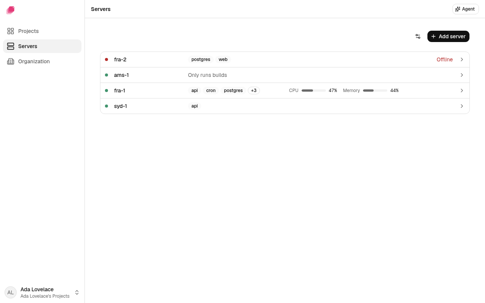
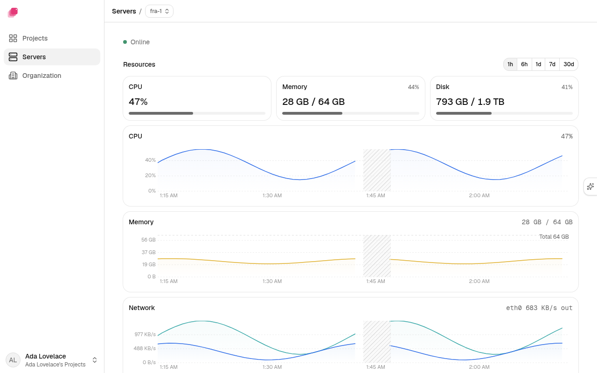
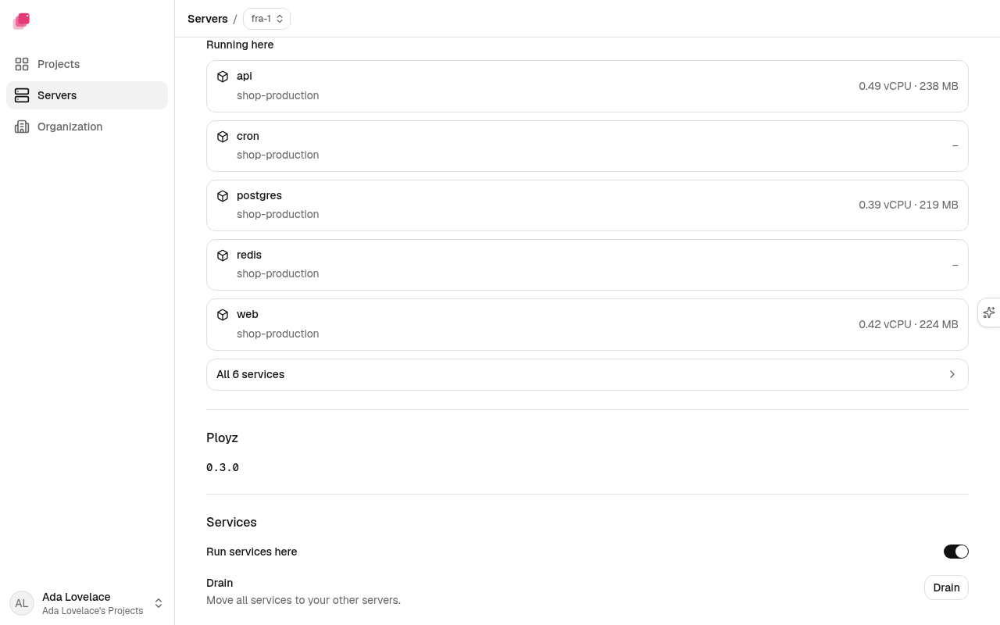

The **Servers** page lists every server in your organization. Open one to see what runs on it,
turn builds on or off, or remove it.

## Check your servers

Each row shows a server's name and the services on it, up to three by name and then a count like
**+2**. A green dot means the server is online, and the row says nothing more. A row names its
status only when someone should look.



| Status | What it means |
| --- | --- |
| Green dot, no word | The server is up and in touch with your other servers. |
| **Building** | Online, and running builds right now. |
| **Offline** | Your other servers can't reach it. See [A server shows Offline](../troubleshooting/servers.md#a-server-shows-offline). |
| **Unknown** | Ployz can't tell whether it's up. Check it as you would an offline one. |
| **Upgrading** | Ployz is upgrading it. See [Upgrade Ployz on a server](#upgrade-ployz-on-a-server). |
| **Upgrade failed** | Its last upgrade didn't finish: it failed, stopped partway, or Cloud couldn't tell how it ended. A failed upgrade goes back to the release it ran before. **Show details** on its page has where it stopped and any error. |

When the list is wide enough, each row also shows the name of the server's region, if it has one, and how much
of its CPU and memory is in use right now. The meters stay empty until the server sends a reading, and an offline server shows
none. A dash means no recent reading reached Ployz for that meter: the server sent none, or its
clock runs behind, so its readings look old. The server's page has disk and the full picture.

A server that can hold [managed volumes](../services/volumes.md) shows nothing about storage.
**Docker only** means it was added with **Docker only** storage, or fell back to it because it
can't run ZFS, and holds plain Docker volumes only. See
[Start without ZFS](add-a-server.md#start-without-zfs).
**Volume support unknown** means Ployz couldn't tell what it can store.

If the page shows **Can't reach your servers right now**, see
[Troubleshooting servers](../troubleshooting/servers.md#cant-reach-your-servers-right-now).

## Servers waiting to join

A server you installed with a Fleet Token checks in with Ployz Cloud and waits for you to enroll
it. [Add many servers](add-many-servers.md) shows how in the dashboard. From the CLI, list the
ones waiting:

```sh
ployz server ls --waiting
```

Each row shows the start of the server's id, its name, its provider, the IP address Ployz Cloud saw
it check in from, its status and how long ago it first checked in. **Installing Docker** and
**Building ZFS** mean it is still getting ready. You can enroll it already, and the enrollment
waits until it is ready for its storage. **Ready** means preparation has finished. **Docker install failed**
means Ployz couldn't install Docker there. **Blocked** means something on the server stops Ployz
from using it, and **Offline** means it stopped checking in.

To see one in full, with its CPU, memory, disks, Docker, the storage it would get and anything
blocking it:

```sh
ployz server show web-3
```

`ployz server show` shows a server that has joined the same way, so one command covers both: its
OS, versions, addresses, storage, CPU, memory and disk, and how long a round trip to each other
server takes over the mesh, the median of its last few minutes. Add `--json` for everything it knows, such as the features its daemon supports. It
also takes a waiting server's id, or the start of one at least 8 characters long, such as the
start the list prints. If two waiting servers share a name or the start you typed, it lists their
ids instead.

To enroll waiting servers, select their names or hostnames with a quoted glob:

```sh
ployz server enroll 'host-*' --name 'web-{n}' --status
```

Ployz Cloud plans the names, the first server and storage. The CLI prints that plan, source IPs
and anything skipped, then asks before starting. When your organization has no servers yet, the
oldest selected server goes first. Use `--first host-a` with a name glob or `--all` to choose
another selected server. Put the glob before `--first`.
Bare `--first` enrolls only the oldest match. `--all` selects every waiting server and prints
how many came from each provider, including **Unknown**.

`--name 'web-{n}'` numbers the planned names. Without it, each server is named after its
hostname, lowercased with other characters turned into hyphens (`MY-SERVER` becomes `my-server`).
Selection takes names or hostnames, never IDs. `--storage zfs` is the default. It uses a spare
disk when available and falls back to Docker volumes where ZFS cannot run. Add
`--no-spare-disk` to keep ZFS on the main disk, or `--no-fallback` to skip servers that cannot
use ZFS. `--storage none` uses Docker volumes. Each enrolled server runs services, takes web
traffic and runs builds.

Each server starts in the `default` region. `--region fsn` puts every server of this enrollment
in `fsn` instead, as the Enroll sheet's region picker does for each server. A `ployz` older than
this option can't pass it: it enrolls every server in `default`, and you can move one later
([Set a server's region](#set-a-servers-region)).

Add `--yes` to accept the printed plan without a prompt. Without a terminal or with `--json`,
Ployz requires `--yes` and otherwise returns the plan with `confirmation_required`.
To enroll every waiting server without a prompt, for example in a script:

```sh
ployz server enroll --all --yes --json
```

A command that skips any servers exits 3 and includes the reasons in its JSON result.
If Cloud starts different names or roles, or omits a planned server, the CLI reports the
changes and exits 3. Enrollment continues in Cloud.

`--status` follows each attempt and prints a line when its stage changes. **Queued** means
the server is still preparing its storage. **In line · 3 servers ahead** means it is waiting
for a join slot. If Cloud cannot see a current position, the CLI says **Join position unknown**.
A failed attempt prints the server's error. Ctrl-C stops following while enrollment continues.
With a selection, `--status` starts matching servers that are not already enrolling after
confirmation, then follows both existing and new attempts. Bare `--first --status` stays
limited to the oldest matching server. An unknown state makes the command exit 3 once the
other attempts end.
Resume open attempts without starting new ones:

```sh
ployz server enroll --status
ployz server enroll --status --json
```

To turn away servers you don't want, name them, give a pattern or give one server's id. The start
of an id works too, at least 8 characters long and matching only one server. A name rejects every
waiting server with that name. Patterns match names only, and case matters. An exact id wins over
a server whose name is that id, a server named exactly what you typed wins over an id that starts
that way, and either wins over the pattern it spells, so `db[1]` means that name. Ployz lists what
matches with each one's id and asks before it does anything:

```sh
ployz server reject 'web-*'
```

Answer `y` and it prints `2 rejected. They won't come back under the same Fleet Token.` A rejected
server stops checking in, and asking again with the same Fleet Token gets it turned away. To keep
out every server that holds a Fleet Token, revoke the token. If one left the list before Ployz
Cloud got to it, the count says so, as in `1 of 2 rejected; the rest had already left the list.`
Add `--yes` to skip the question, for example in a script. Without `--yes` outside a terminal it
fails with `confirmation_required` and rejects nothing.

A server whose enrollment has started has left the waiting list, but `ployz server reject` still
matches it by its planned name or its id. Rejecting it cancels the enrollment and turns the server
away under its Fleet Token, where Cancel in the dashboard returns it to Waiting. Once Ployz Cloud has sent its join, the server may already be in the Cluster, so Ployz
doesn't reject it. It prints `web-1 may already be in the Cluster: Cloud sent its join` and rejects
the rest. Once that server has joined, remove it with `ployz server rm`. `--json` lists the
enrollments it cancels under `enrolling` and the ones it left alone under `joining`.

`ployz server reject` sends servers to Ployz Cloud in batches of 1000. If Cloud refuses the first
batch, for example with a 403 because you are not a member, the reject fails with that error and
nothing was rejected. If a timeout, a dropped connection or a Cloud error stops a batch, the reject
stops with exit code 3 and prints how many went through, how many may or may not have been rejected
and how many were not. This includes a timeout on the first batch, which leaves that whole batch
uncertain. `--json` lists those ids under `uncertain` and `not_rejected`. Run the same reject again
to finish. If Cloud refuses a later batch, the reject also stops with exit code 3, and that batch
and the rest count as not rejected.

A name with characters a terminal would act on, such as color codes, prints with `�` in their place.
Copying it back from the screen won't match, so take the id or the exact name from
`ployz server ls --waiting --json`. A command Ployz suggests for such a name quotes it as `$'...'`,
which bash and zsh read but other shells may not.

## See what runs on a server

Click a server. Its page shows its status and public IP address, then:

- **Resources**: meters for CPU, memory and disk now, then charts of CPU, memory and network over
  the range you pick, from **1h** to **30d**. The meters and the values above each chart always
  show the last few minutes, whatever the range; a dash means no recent reading, either because the
  server sent none or because its clock runs behind.
  Network shows each interface in its own color, out as a solid line and in as a dashed one. The
  disk bar splits used space into **Volumes**, **Mirrors**, **Logs and metrics** and **Other**,
  then **Free**. Space the server couldn't attribute to one of those shows as **Used**. A stretch
  the server didn't measure is hatched **Not measured**. A server on an older Ployz version reads
  **Upgrade web-1 to see its metrics**. If it doesn't reply, the section reads **web-1 didn't answer**.
  While the server is offline, the page leaves Resources out.

  

- **Running here**: the server's services, with the CPU and memory each uses on this server now,
  refreshed when you open or return to the page. A service with no recent readings on this server
  shows **–**. Past five, **All 12 services** opens the
  full list, with a filter. While the server is offline, each one says whether it's **Still on**
  another server or **Down**.
- **Services**: **Run services here** and **Drain**. See
  [Change what a server does](#change-what-a-server-does).
- **Builds**: **Run builds here** and **Builds at once**. See
  [Where builds run](../builds/where-builds-run.md#build-on-your-servers).
- **Region**: where the server sits. See [Set a server's region](#set-a-servers-region).



An entry marked **Not in any Project** is left over from a deleted project or environment; see
[Clean up after a deleted environment](#clean-up-after-a-deleted-environment).

When you restore a server from a snapshot of its disk, Ployz picks its services and web server back
up as they were when the snapshot was taken. Your next deploy updates them as usual.

## Reach a server from the CLI

When the CLI reaches your servers through Ployz Cloud, only owners and admins can run these commands:
`exec`, `service start`, `service stop`, `service restart`,
`service port-forward`, `server ls`, `server show`, `server logs`, `server set`,
`server drain`, `server upgrade`, `server rm`, `server forget <server>` and `server clean`
without `--namespace`. A member who runs one gets this, and the command exits 1:

```text
Server access needs an admin. Ask an owner or admin of acme.
```

Members can still deploy, and still see logs and restart services on these pages. `logs`, `ps`
and `metrics` still work for them in the CLI: Ployz Cloud reads the servers for them and shows
each server's newest 200 lines at most, so `logs --follow` needs an owner or admin. An admin
moved to member loses this access within 5 minutes.

### Approve a device

`exec` and `service port-forward` need an approved device. Until yours is approved, they refuse
and point you at `ployz device request`. Every other command works as before.

Ployz 0.3.4 and earlier have no `device` command. Once your servers run 0.3.5, an older CLI's
`exec` and `service port-forward` through Ployz Cloud are refused with `needs Full access`.
Over `--connect ssh://` they still work.
[Upgrade the CLI](../cli/overview.md#install-the-cli) first, then run `ployz device request`.

```sh
ployz device request
```

It prints a 20-character code, such as `mmg42-klgyq-p3w7d-xa5re`. Anyone in the Organization can
request one. An owner or admin approves it from a device that's already approved:

```sh
ployz device approve mmg42-klgyq-p3w7d-xa5re
```

`approve` takes the code with or without dashes, in any case. It refuses a 10-character code from
an older CLI. Run `ployz device request` again with this version to get the full code.

For your first device, approve it over SSH on a server. Run `ployz login` there first, then the
same `ployz device approve`. A request lasts 24 hours.

To approve your computer's own device, run this on your computer, connecting to any one of your
servers:

```sh
ployz device approve --this-device --connect ssh://root@HOST
```

It makes the device key if your computer has none and adds it to every server it reaches through
that one. With
`--connect`, the server's first key trusts only your computer and the server's SSH. Run on a
server's own terminal, it refuses: a device made there would stay trusted after the server is
gone.

`approve` refuses a key from Ployz Cloud that doesn't hash to the code you typed. It says the
device gets Full access to every server you approve it on, and asks first. Pass `--yes` to skip
the question. Take the code from the person who ran `ployz device request`, not from a web page.
It then adds the device to every server and lists what each server did. A server that's down when you approve doesn't get the device.
Run `approve` again once it's back.

```sh
ployz device ls
ployz device rm mmg42klgyq
```

`device ls` shows this computer's device and each passkey by its full code, and other devices by
the first 10 characters of theirs. `device rm` takes either form and removes the device from every server
that answers. A server that doesn't answer is listed under failures, and one with no direct
connection under omissions. Either way the command exits 3.

A removal is for good: a server that removed a key never trusts it again, even when someone
approves it later. A command from that device that a server is still working on stops at its next
step and changes nothing more. That covers a command waiting behind another one, a removal waiting
for a service's connections to drain, and a volume change waiting behind another volume change. A
volume step already running on a server, such as a move's switch or a resize whose command was
cancelled, finishes first: the removal waits for it there, so once `device rm` returns, nothing that
device asked for is still changing the server. The one exception is a volume step the server's
storage plugin is still working on after 2 minutes: the server stops waiting for it, so the removal
can return before it does, and a resize like that can still finish afterward. If the same key also holds another connection slot on
that server, such as Ployz Cloud's, the command goes on with Operator access only, so it can't start
a container that only that device approved.
What that device left running on a server stops there before `device rm` returns, even when its
key holds another slot: an `exec`, with or without `--detach`, a `port-forward`, a build, queued or
running, and a build grant, including an image push still on its way to the server. If any of it
doesn't confirm it stopped within 90 seconds, for example because Docker stopped answering, that
server reports the removal as failed and names each thing that didn't stop. The same goes for work
that ended earlier without confirming it stopped, such as a build whose builder Docker couldn't
remove. The device is removed there all the same, and every later key change on that server, such
as another `device rm` or `ployz key add`, reports the same work again until the server sees it
stopped. An image push whose last step got no answer stops being reported once the server finds
the image stored, and the next key change names it as stored after the removal, once. It also
stops once the server process that took the push has restarted without storing it. An `exec`
that Docker lost track of by restarting before the server saw the command start stays reported,
because the command may still run. A build that can't confirm it stopped has the secret values it opened deleted at once,
and starts no further step. For an `exec`, "stops" means the command's own process. A child it
started in the background, for example with `&` or `nohup`, can keep running in the container after
the command exits; to be sure nothing a removed device started is left, redeploy the service.
Every server that answers marks the key removed, including one that never
trusted it, so an approval of that key still on its way there is refused. If no server can name
the key in full, for example because every server that trusted or removed it is away, a server that never held
it shows `not marked removed` and the command exits 3; run it again once those servers answer.
A server that removed the key while it still ran 0.3 doesn't keep the full key. If it was the last
one that knew the key, a retry keeps showing `not marked removed`. That only matters while an
approval of that key is still on its way and hasn't expired.
A server that is still joining when you remove the key that approved its join is refused too. If
it still waits for approval, approve the join again with another key; if it had already used its
approval, install it fresh: run `sudo ployz-uninstall` on it and add it again. A server refuses to remove
the last device or passkey it trusts; approve another one first.
Removing this computer's own device warns first. To manage your servers from it again, delete the
`device.key` file the warning names, then run
`ployz device approve --this-device --connect ssh://root@HOST`.

### Pin your cluster's key

`ployz private-access on`, `ployz ingress use tunnel` and sealed variables seal the secret on
your computer, to your cluster's key. Before the CLI seals through Ployz Cloud, it checks the key Ployz Cloud sends
against one it read from a server itself. Read it once per organization, over SSH or on a server:

```sh
ployz device pin --connect ssh://root@203.0.113.10
```

`pin` reads the key from that server, never through Ployz Cloud, and keeps it on this computer
for the organization you're signed in to. It reads only over SSH or the server's local socket,
and refuses a plain TCP connection or one Ployz Cloud chose. It also refuses a server whose key
isn't the one Ployz Cloud has for that organization.

Until you pin the key, the CLI refuses to seal through Ployz Cloud and names `ployz device pin`.
If Ployz Cloud later sends a different key, the CLI refuses too, and the secret never leaves your
computer. If your cluster's key really changed, for example because you started a new cluster,
run `pin` again. Over `--connect ssh://`, `ployz private-access on` and `ployz ingress use tunnel`
read the key from that server and need no pin.

### Add a passkey

A passkey approves an [automatic deploy rule](../deploy/github.md#approve-a-rule-for-deploys-on-push),
a Private Access key, a new server's [join](add-a-server.md#approve-a-join), and restoring or
deleting the entries you pick in one server's [trash](../services/volumes.md#get-deleted-data-back)
from your browser, and nothing else: it can't deploy, open a connection, run `exec`, or approve a device.

In Ployz Cloud, open **Account** in your Organization and choose **Add passkey**. Your browser
asks for a fingerprint, face or security key. That files the passkey with Ployz Cloud, which
approves nothing by itself: a passkey counts on a server only once that server trusts it, and
**Account** shows which servers do.

A server you add trusts the passkeys of the server that admits it; see
[Approve a join](add-a-server.md#approve-a-join). While your servers trust no passkey of yours,
the dashboard shows no install line when you add a server. It shows the command that makes a
server trust your passkey instead. Run it as root on the server:

```sh
sudo ployz key add pk1_…
```

It changes only the server you run it on, and names the servers that still don't trust the key.
Run it on each of them. It also takes a device's key, as `ployz server add --command` prints it.
It reaches the server through its local socket, which admits root and members of the `ployz`
group, so anyone in that group can add a key. Until a server trusts your passkey, deploy from an
approved device with `ployz deploy`, which also signs the automatic deploy rule unless you turned
it off, and turn Private Access on with `ployz private-access on`.

`ployz device ls` lists each passkey under your devices as `passkey, approve-only`, with its
account and who approved it on each server: a device, or `on <server>` for that server's own
terminal. `ployz device rm <code>` removes the device or passkey under the code from every server
that answers, and shows which one each server removed, or `not present`. A server refuses a passkey and a device with the same key, so a code names one of
them.

When someone leaves the Organization, run `ployz device rm` on each of their passkeys as well as
their devices.

### Add a CI or agent key

A CI or agent key lets a pipeline or an agent ship new images of services a person approved,
with no terminal and no device. Make one from your approved device:

```sh
ployz key add --ci --env production --name github-actions
```

- `--ci` or `--agent` says who holds it.
- `--env` names an environment the key can deploy to. Every key needs at least one; repeat it for
  more. A key deploys only to the environments it names, never to every environment.
- `--service web` limits the key to that one service, in the one `--env` you name.
- `--volume db/data` lets the key's deploys mount the `data` volume of `db`, in each `--env`, by
  the name `ployz volume ls` shows. `db` needs a deploy a person approved first.
- `--name` is a label for the key, such as the pipeline that holds it.

With `--ci` or `--agent`, `ployz key add` shows the key's code, each environment and volume it
can reach, and the servers that will trust it, then asks. It needs a terminal and every server to answer over your own
connection: with `--connect`, name every server. It prints
`PLOYZ_KEY=...` once. Store it as a secret where the key deploys from; see
[Deploy from CI with a key](../deploy/deployments.md#deploy-from-ci-with-a-key).

`ployz key ls` lists each key with its kind, name, where it can deploy, its volumes and the
servers that trust it.

A CI key made with no `--env`, before every key had to name its environments, no longer deploys
anywhere. Servers refuse its deploys, `ployz key ls` shows it deploying nowhere, and it can't be
rotated. Make a new key with `--env`, put its `PLOYZ_KEY` in CI, then remove the old one with
`ployz key rm <code>`.

To change where a key can deploy, run `ployz key scope` with its code and the new flags:

```sh
ployz key scope mmg42klgyq --env production --service web
```

The flags name the whole new grant. A volume or a name the key holds that you leave out is
dropped, so name them again to keep them. `ployz key scope` always prints what the key holds now
on each server and what it becomes.

A change that only narrows the key goes through without asking. One that widens it, drops a
volume or the name, or that a server doesn't answer for, asks first, and `--yes` makes it fail
instead of asking. If a server's copy of the key changed while the command ran, it reads the key
again, prints the change again and asks again if it needs to. A server that doesn't answer is
named in the result, and the command exits 3.

To swap a key for a new one with the same scope, for example on a schedule, run
`ployz key rotate <code>`. It lists each service that runs a version the old key signed, with its
image, when it was signed and its digest, and asks. Then it gives every server the new key,
prints the new `PLOYZ_KEY=...`, redeploys those services under the new key and follows each
deploy to the end. A service they only reference ships with them under the version a person approved, and keeps
its container when nothing about it changed. Update the `PLOYZ_KEY` secret your CI deploys with before you rotate, or right
after the new key prints: until the old key is removed, a deploy signed with it still lands. Before
it removes the old key, the rotation looks again for services running a version only the old key
signed, such as one CI shipped while it ran, and redeploys those too. If a deploy with the old key
keeps landing after three looks, it keeps the old key, names those services and exits 3; put the
new key in that CI secret and run the command again. It removes the old key only once every deploy
applied on every server and each server still holds both keys as the rotation left them. Until
then the old key keeps working. If
it stops before that, run the same command again on the same computer: it carries on with the
same new key, skips services whose redeploy applied on every server, and redeploys the rest. If
someone changed the key's scope while it ran, it stops and says so; check `ployz key ls` and run
it again. If the scope changed on a server just as the rotation removed the old key there, that
server keeps the old key and the command names it and exits 3; match the new key's scope with
`ployz key scope`, then run `ployz key rm` on the old one. Once `key rm` removes the old key from
every server, it also deletes the new key the rotation kept on this computer.

`ployz key rm <code>` removes only CI and agent keys. It refuses a device's or passkey's code;
remove those with `ployz device rm`. Each server checks this too, so a server that holds the
code as a device refuses the removal. If no server that answered holds the key, but some didn't
answer, it names those servers, removes nothing and exits 3.

If a key leaks, run `ployz key rm <code>`, then deploy from a terminal. Don't rotate a leaked
key: a rotation signs again whatever the old key deployed, including anything someone shipped
with it. After `key rm`, a container the key approved keeps running until it stops, and then its
server refuses to start it again with
`The key that approved this was rotated or removed; deploy again.` The one exception is a container
whose exact spec a person signed, in any version they deployed, not only the one the key's deploy
built on: it still starts.

Removing the device that approved a version also stops CI and agent deploys built on that
version, until a person deploys from a terminal again.

### What needs an approved device

A server checks these itself, whoever asks. Ployz Cloud carries a signature but can't make one.

- **Deploys.** A server runs a service that opens a sealed value, mounts a volume, pulls its
  image with a login, or asks for more of its server than a plain container gets only from a
  spec an approved device signed, or under an
  [automatic deploy rule](../deploy/github.md#approve-a-rule-for-deploys-on-push).
  `ployz deploy` from an approved device signs what it deploys; see
  [Deploy from an approved device](../deploy/deployments.md#deploy-from-an-approved-device).
  The dashboard's **Deploy** signs nothing. It sends the signature of a version a device
  signed, for a rollback or a change of only replicas, placement or limits. A server runs any
  other only for a service that reaches none of those.
  It refuses any other container with `ployz.container.signed-version.v1` and names
  `ployz deploy from an approved device`.
- **Builds.** A server refuses a build Ployz Cloud starts with
  `This server runs only builds an approved device starts.`, before the build opens any
  credential. A build started over a device's own connection runs, and so does a push under an
  automatic deploy rule or the build of a service that reaches no data. See
  [Which builds need an approved device or a rule](../builds/where-builds-run.md#which-builds-need-an-approved-device-or-a-rule).
- **Joins.** An approved device authorizes a new server's identity, keys, allocation and initial
  devices. See [Approve a join](add-a-server.md#approve-a-join). An approval names one existing
  server that may admit the join, so another cluster can't use it even if it shares a Sealing
  public key. Each server keeps an approved server as a member once it has seen it.
- **`exec`, `service port-forward` and approving devices.** These use a direct authenticated
  connection to each target server. A connection through the mesh has Operator access only.
  With `--connect`, `device approve` and `device rm` affect that server only. To approve the
  first device through SSH, repeat the command on each server.
- **An exact release.** Only SSH, the server itself or an approved device can name an exact
  version to upgrade to. Ployz Cloud can name only `stable` or `beta`, and no server takes a
  downgrade from it.

These need no signature, from the dashboard or the CLI: restarting, stopping and starting a
service that already runs, deleting a service, a volume or an environment, removing or
forgetting a server, upgrading along a Release Channel, and mirroring, syncing, restoring or
resizing a volume. Each still asks what it asked before: a typed name, a yes, or, in a
[Protected Environment](../environments/environments.md), an owner or admin.

`ployz volume move` needs no signature either, unless the volume's service runs in a region and
the move leaves it. See [Move a volume](../services/move-a-volume.md).

`ployz server rm` and `ployz server forget <server>` work only from an approved device or over
SSH on a server. Elsewhere they stop before changing anything and name the server that needs an
approved device. Ployz Cloud drops a server you removed from the CLI once the Cluster no longer
lists it, within minutes. Ingress doors still change from the dashboard, and a server runs only
Ployz's own images for them. Private Access turns on from the dashboard once a passkey your
servers trust approves the key, or with `ployz private-access on` from an approved device. Over
`--connect ssh://` to that server, both change as before.

## Change what a server does

Every server runs builds, runs services and takes web traffic. To turn one off, see
[Give servers different jobs](../services/scaling.md#give-servers-different-jobs). The
[Ployz agent](../account/agent-sidebar.md) can change these too, but it can't turn web traffic
back on: that starts the server's web server, which the switch below and `ployz server set` do.

When `ployz server set` changes a label, `--accepts-builds`, `--accepts-services` or
`--accepts-ingress`, it waits for the Server your CLI connects through to list the change before
reporting the update. An immediate deploy through that same Server then sees it. If that Server
answers but doesn't list the change in time, the command warns you. When it turned web traffic on
and that setting is what went unlisted, or the wait lost its connection, it also reports the web
server start as unfinished. The target Server's record
may have changed; check `ployz server ls` before deploying. A deploy through another Server, or from
Ployz Cloud, can still plan from the old settings until that Server lists the change.

Under **Services** on a server's page, turn off **Run services here** and nothing new starts on
the server. What already runs there stays until you drain it, or until your next deploy moves it
to your other servers. If no other server runs services, deploys fail until you turn the switch
back on or add a server.

A drain sends each copy it moves with the signatures Ployz Cloud keeps for that copy's version,
so the other server runs it even if it never ran that version. A copy an
[automatic deploy rule](../deploy/github.md#approve-a-rule-for-deploys-on-push) built moves with
what a server answered when it first checked that build with GitHub, while the rule's approval
stands. A copy of a version nobody signed
moves only if it [reaches no data](../deploy/deployments.md#deploy-from-the-dashboard). The drain
reports any other as failed and leaves it where it runs. Turn off **Run services here**, then
run `ployz deploy` from an approved device to move those off. A service whose volume is on the
server moves with its data when it can; see [Services with a volume](#services-with-a-volume).

`ployz server drain` sends the same signatures, read from Ployz Cloud, even with `--connect`.
Signed out, it changes nothing when any copy could move to a server that enforces device
approval: such a server starts a moved copy only from a signed version, since the move brings its
image along instead of pulling it. A drain whose copies can only go to servers that don't enforce
it, that stay because nothing can take them, or that only removes old copies, goes ahead:

```text
error: Nothing drained from web-1: shop-production/api needs a device's signature to start on another server, and a signed-out ployz can't read it.
next: ployz login
```

To move everything off now, click **Drain** and confirm. The dialog lists what runs on the server and
badges what won't move as planned: **Moves with data** when its volume moves with it, **Skipped**
when no project owns it, which draining leaves where it is, **Stays** with the reason when its
data can't move with it, and **Global** for a service that runs on every server, in a project or
not, which stops the drain, as below.
Draining turns services off for the server, then moves each replicated service's containers to
your other servers one at a time. Each new container runs
the same image, and each one starts, is healthy and is routed by every server's proxy before the
old container is taken out of routing and removed. Anonymous volumes of the containers a drain
removes, such as the one a `postgres` image makes when no volume in Ployz is mounted at its data
directory, stay on the drained server. `ployz server volumes <server>` lists them, and
[`prune`](../services/services.md#delete-the-volumes-a-server-kept) deletes them.

A service set to run on every server, from a Compose file with `deploy.mode: global` deployed
before 0.1.2-beta.42, stops the drain before it moves anything, because its copy on this server
could be the last one working. The drain also stops when Ployz can't ask the server what it runs:

```text
error: Server web-2 runs `shop-production/metrics` on every Server, and draining could stop its last working copy. Remove it, deploy, then add it back with a replica count.
```

[Move that service off `deploy.mode: global`](../troubleshooting/servers.md#move-a-service-off-deploymode-global),
then drain again.

Ployz Cloud won't start a drain until it hears the server answer, since a server that doesn't
answer may run a service it hasn't reported. It waits up to 20 seconds, both when you confirm and
when the drain's turn comes, then says `web-2 isn't answering, so Cloud can't tell what draining it
would stop. Try again once it answers.` Through a server on an older release, Cloud can't tell
whether the server answered, so the drain goes ahead and stops if Ployz can't ask the server what
it runs.

A drain that stops after turning the server's services off, for any reason, ends its error with
`Services are now off on web-2: turn them back on to let it run services again.` The server takes no
new services until you turn **Run services here** back on, or run
`ployz server set web-2 --accepts-services=true`.

If the server never answers the request to turn its services off, or you cancel while it's
pending, the drain can't tell whether the change landed. Its error then ends with
`Services may now be off on web-2: if they are, turn them back on to let it run services again.`
Check **Run services here** on the server, and turn it back on if it's off.

The new container runs exactly the image the old one ran, even when its tag, like `app:v1`, names
another image on the other server by then. A service whose image is named by a tag therefore moves
only to a server on this release of Ployz or later; one named by digest (`app@sha256:…`) can move
to any server. The image is kept on the other server under a name like `app:ployz-sha256-…`, which
image cleanup leaves alone while a container uses it. A drain from the CLI over SSH or on the
server itself also gives the image its tag on the server you connected to, when the old server's
own tag names that same image and the server you connected to has no image under that tag yet. A
later deploy with `pull: never` runs whatever image the
server holds under the tag.
Pre-deploy commands don't run again, and nothing is deployed. The drain starts once you confirm:
the dialog is the approval. Drains in one organization run one
at a time: a second one reads **Queued · Waiting on web-1**. While a drain waits on a
[volume it moves](#services-with-a-volume), another can run. While a drain runs, the
**Drain** row counts the services left to move and lists them as **Pending**; each one leaves the
list as it leaves the server. You can leave the page while one runs.
If your servers don't answer when a drain's turn comes, as while one restarts, the drain reads
**Waiting for your servers to answer** and tries again 20 seconds after each try. It starts once
they answer. While it waits, it doesn't hold up the organization's other drains: they can start and
run, and it keeps that label rather than **Queued**. It waits up to 15 minutes from when you
confirmed, and other drains ending don't extend that. If your servers still don't answer by
then, the drain doesn't start and reads **Drain didn't start. Try again.** Nothing on the server
changed. A drain whose turn comes more than 15 minutes after you confirmed still starts if your
servers answer at once. If they don't, it doesn't start.

While a server drains, you can't turn **Run services here** back on for it: Cloud refuses the
change until the drain ends. Turning services on for another server waits until
the organization's drain ends. Other server settings, like **Run builds here**, never wait for a
drain.

A service stays running where it is, and is reported with the reason, when:

- it mounts a bind mount or a Docker volume on the server (tmpfs mounts don't count), or a volume
  the drain can't move (see [below](#services-with-a-volume));
- its containers run different versions, because a deploy hasn't finished: deploy it first. A
  replica a deploy left on its old version in a
  [region with no server that can run it](../services/regions.md#when-no-server-is-in-the-region)
  doesn't count;
- a server it involves can't be checked right now;
- no other server can take it;
- its image is named by a tag and only servers on an older Ployz could take it: upgrade them with
  `ployz server upgrade` (the dashboard says **Upgrade web-3 to move it**), then drain again;
- you stopped it with `ployz service stop`: start or remove it first;
- its container here is the last one serving: deploy it to another server first.

### Services with a volume

When the replicated services have moved, the drain moves each service whose
[volume](../services/volumes.md) is on the server, one at a time, the same way
[`ployz volume move`](../services/move-a-volume.md) does: the volume copies while the service keeps
running, then the service stops while its last changes copy and starts on the other server. It
goes to a server that answers, runs services, isn't draining, has managed storage and is in a
region the service may run in. A server that already holds a mirror of the volume comes first,
then servers in the drained server's region, each by name. If one would refuse the move, the drain
asks the next. While a volume moves, the **Drain** row reads **Draining · Moving data to web-3**,
the service's line names the run, and `ployz volume runs data` lists it.

A service stays where it is, and its line says why, when:

- it mounts more than one volume;
- another service, or a container on another server, uses its volume;
- more than one of its containers runs on the volume, or none runs;
- its volume allows shared writes;
- another run on the volume hasn't finished;
- the drained server runs an older Ployz: the line reads **Upgrade web-1 to move data with the drain**;
- no server can take it, or each one that could would refuse the move: the line gives the reason.

If you stop the service, or start another container on its volume, while it moves, the move ends
before the service stops and the service stays as you left it. If a move fails, its line says why
and names the release run that follows it: the release puts the volume back on the drained server
and starts the service there when its container is still there, or, when it had already started on
the other server, the release finishes it there and the service reads moved. When Ployz Cloud can't confirm where it runs, the line names the run and the
`ployz volume release data` line that finishes it. The drain moves volumes for up to a day after it started; one it had no time for
reads **Not tried**.

While a volume moves to `web-3`, or a moved service still has to start there, Ployz Cloud refuses
to drain `web-3` or turn off **Run services here** for it:

```text
data is moving to this server. Wait for run 0193… to finish.
```

When the drain ends, the **Drain** row counts what moved, stopped, stayed and failed, and how many
services no project owns it left alone. It lists each service with where it went or why it stayed.
A drain that stops early marks the service it was moving **Interrupted** and the ones it never
reached **Not attempted**; those still run on the server. Each move names its new container with a
key no one else uses, and keeps that key when it has to ask the other server again. When a move
fails, the drain removes the container under that key and nothing else, so a container another
tool or an older CLI left on the other server stays where it is. When a request to the other server
got no answer, or the drain stopped while one was out, the dashboard's row says the new container
**may still be there**: that server can still make it after the drain ends. With `--json`, a failed
move's `replacement_removed` is `true` only when the other server confirmed the new container is gone
and no request can still make one. When a drain stopped after the new container came into service but
before the old one was retired, drain again: it finds that container, starts no second one, and
retires the old one. If that container runs another image or is failing its health check, the old one
keeps serving and the row says why. If that container has already left service, the drain moves the
old one again from the start.
If a server's proxy doesn't confirm the switch in time, the moved service's old container keeps
running on the drained server and the row says so; the next drain removes it, along with any old container an earlier drain left there. While an old
container is out of routing but still running, `ployz ps` marks it **draining**. `ployz status`
names a draining container only when the service has too few others serving.
If anything stayed or failed, the drain stopped early, or it couldn't check what's left on the server, the button
reads **Drain again**. One failure doesn't count: a drain also moves containers off other servers whose
services are off, and when one of those moves fails without leaving anything behind, its row says the
service still runs on that server, but that failure alone doesn't make this server's drain incomplete. Turning services back on doesn't
move anything back.

`ployz server drain web-2` does the same from the CLI, moves volumes too, and exits non-zero if
anything stayed or failed, apart from that other server's move. A service that moved with its data
counts as moved. It follows the drain for as long as Ployz Cloud runs it, up to a day while volumes
move. A global service stops it before it starts, as in the dialog.

Under **Web traffic** on a server's page, **Takes web traffic** is a switch. On, the line under it
reads **Your domains point at 203.0.113.10**: the server's address. Turn it off and a dialog lists the
domains pointed at your servers. When another server takes web traffic, it keeps serving them; when
this is the only one, the dialog warns that they stop working. Confirm with **Stop**: the row reads
**Stopping…** while the web server on it stops, and then **Web traffic is off**. Your
generated addresses stop pointing at it within the hour, or when you click **Check again** under
**Domain** in **Organization → General**. Until then, anyone sent to it gets no answer on ports 80
and 443; to keep the internet out for good, also close them in its firewall.

Turn the switch on and the row reads **Starting the web server…** until the web server runs there,
then your domains point at it. The web server is two containers: `ingress-holder` holds ports 80
and 443, and `ingress` is Caddy, which shares its network. `docker ps` on the server lists both,
with the ports on `ingress-holder`. When the web server can't start, say because something else on the
server holds port 80, the switch goes back off and the section says why: **Couldn't start web
traffic · Port 80 is in use on web-1. Free it, then try again.** Fix the cause and click **Retry**.
If it still can't start, the section says why again and the switch stays off.

From the CLI, `ployz server set web-1 --accepts-ingress=false` turns the role off but leaves the web
server running; use the switch to stop it. `--accepts-ingress=true` turns the role on before it
starts the web server, so while the web server starts, the line under the switch reads **The web server
isn't running, so your domains don't point here.** When the role was off and the command sees that no
web server is left on the server, it turns the role back off and says why. That happens when something
else holds the port: `Web traffic stays off on web-1: port 80 or 443 is in use. Free it, then try
again.` The
command exits with code 3, and the line under the switch reads **Web traffic is off**. If turning the
role back off fails too, it says so and prints the command that turns it off.

Any other failed start leaves the role on, says `Server updated; the Ingress Proxy did not follow`
with the cause, and exits with code 3. That covers an image that won't pull, any other error from
Docker, a web server that keeps crashing (the cause names the `docker logs` command that shows why),
a server that stopped answering, and a role that was already on. It also covers a server that still has a web server after the failure: an older one Ployz
started again, or one another `ployz` or Ployz Cloud started there meanwhile. Until a web server runs
there, the page reads **The web server isn't running, so your domains don't point here.** To try again
from Ployz Cloud, turn the switch off, then on.

In both cases the `next:`, `inspect:` and `retry:` lines select the server the way you typed it, and
the command leaves out a `retry:` that would repeat its `next:`. They use its Machine ID when the same
command renamed it with `--name`, since the name you typed no longer selects it. `inspect:` and
`retry:` also use the Machine ID for another server, since two servers can share a name.

## Set a server's region

A region is a label on the server named `region`, like `fsn` or `lhr`. The Servers list shows the
region's name in its own column, such as **Falkenstein** for `fsn` once you
[rename it](#list-and-rename-regions). Servers with no region leave it blank.

On a server's page, under **Placement**, open **Region** and pick a region by its name, **No
region** to clear it, or **New region…** to name a new one. Type its name, like `Sydney`, and press
Enter or click the check. Its key comes from the name, here `sydney`. A name whose key a region
already has, in any case, is refused under the field with that region's name, such as
**Region Falkenstein (fsn) already exists.**, and nothing changes.

When a service on the server belongs to an environment that runs in another region, the change
asks first. **Move web-2 to Sydney** lists each service the change affects, with its environment
and what the next deploy does with it. A service that another server in its region can run shows
that server, such as **→ web-3**. A service whose region the change leaves with no server shows
**Waits for a server in Falkenstein**. The next deploy doesn't start it there, and it keeps running
on web-2 until a server is in that region. A server that is offline isn't offered as one a service
goes to. **Move server** changes the region (**Clear region**, when you clear it), and **Cancel**
keeps the old one. When nothing would leave, the region changes at once.

While what runs on the server loads, and when it can't be read, the field says so and changes
nothing, whether you pick a region, name a new one or confirm a question that was already open.
When one environment's services can't be read, the question says so and names it.

The page shows the region you picked and **Queued** until the server reports it, then the server's
own value. If the server hasn't reported it after a minute, the page goes back to what the server
reports and says so. Changing a region only changes the label: nothing restarts and no service
moves until your next deploy. Only an owner or admin can change it; other members see the field read-only.

The CLI sets the same label, and the list shows it on its next refresh:

```sh
ployz server set web-1 --label-add region=fsn
```

`ployz server ls` shows each server's region in its **REGION** column, `-` for a server with none.

Cloud can't set or clear a label other than `region`, and the
[Ployz agent](../account/agent-sidebar.md) can't set a region yet.

## List and rename regions

A region has a key and a name. The key is the `region` label its servers carry, such as `default`
or `fsn`. The name is what Ployz shows: **Default** for `default` and the key for any other, until
you rename it. List regions with their servers:

```sh
ployz region ls
```

```
REGION        KEY       SERVERS
Falkenstein   default   web-1, web-2
syd           syd       syd-1
```

A server with no region, such as one that joined on an older release, is listed below the table
with the `ployz server set` command that puts it in one.

Rename a region by its key:

```sh
ployz region rename default Falkenstein
```

It prints `Renamed default to Falkenstein. Nothing restarts.` Only the name changes. The key, each
server's label and every environment stay as they are, so no service moves or restarts. A name is
1 to 40 characters on one line. A name outside that, or one that another region already shows, is
refused under the field, and the dialog keeps what you typed. Renaming needs `servers:operate`, which owners and admins have.
Both commands need `ployz login`.

In the dashboard, click **Rename region** on the **Servers** page. Pick the region, type its new
name and click **Rename region**. The dialog shows the key the CLI takes, such as
`--region default`. The Servers list and each server's page show the new name at once. For a
member who isn't an owner or admin, the button is disabled and says why. The
[Ployz agent](../account/agent-sidebar.md) can list and rename regions too.

## Upgrade Ployz on a server

Each server's page shows the Ployz release it runs. When a newer release is out on your
organization's channel (Stable unless you [choose Beta](#choose-stable-or-beta-releases)) and a
server is behind, the top of the **Servers** page offers **Upgrade to `0.3.1`**.
Click it to upgrade every server that's behind, one at a time in name order. Your apps keep running
while they do. While an upgrade runs, the top of the page reads **Upgrading 1/4**, and the server
upgrading reads **Upgrading**.

When you upgrade from `0.3.0-beta.6`, where [the first server needs
SSH](#servers-on-02-or-030-beta6-and-earlier), upgrade every server back to back: upgraded servers don't
route traffic to apps on a server still on `0.3.0-beta.6` until it upgrades too
([#2892](https://github.com/getployz/ployz/issues/2892)). As each server restarts, its domains can
answer `503` briefly, for about 6 seconds when the app runs on another server.

A server that enforces device approval starts a container made before its upgrade only from a
signed deploy. After you upgrade one, deploy each of its services once with a current `ployz`.
See [After a server upgrade, deploy each service once](../deploy/deployments.md#after-a-server-upgrade-deploy-each-service-once).

### Turn on automatic upgrades

Automatic upgrades are off until you turn them on. Click the **Upgrade settings** icon at the top
of the **Servers** page and turn on **Upgrade automatically**. Only an owner or admin, or [Ployz support](../account/organizations.md#let-ployz-support-in), can change it. Ployz
starts upgrading right away, then checks every hour. Turn the switch off to go back to upgrading by
hand.

Automatic upgrades wait until a release has been out for 3 days, so a new release reaches your
servers up to 3 days after it ships. To take a release sooner, upgrade by hand.

Servers that are offline or building are skipped and upgrade at a later check. An offline server
that's behind reads **Upgrades to `0.3.1` when it's back** on its page.

If a server's upgrade doesn't install, that server goes back to the release it ran before, and the
other servers wait: automatic upgrades skip that release until a newer one is out. That server
reads **Upgrade failed**, and the top of the page offers **Upgrade to `0.3.1`** to carry on yourself.
On the server's page, **Show details** has the exact error to copy, and **Try again** retries. Once an upgrade of that release succeeds, automatic upgrades pick it up again.

Every member of the organization gets one email about it, naming the server, the release, and
whether it went back to the release it ran before. Members who set **Failed automatic upgrades** to **None** under
[Notifications](../account/notifications.md) don't. An upgrade you start by hand sends no email.

### Upgrade one server

To upgrade one server, open it: its **Ployz** section reads **`0.3.1` is out**. Click **Upgrade**.
Only an owner or admin, or [Ployz support](../account/organizations.md#let-ployz-support-in), can upgrade servers, and only while they're online and not building. For a
member, **Upgrade** and **Try again** are disabled and say so. One upgrade runs at a time
per organization, so **Upgrade** and **Try again** wait while one is running.

### Choose Stable or Beta releases

Click the **Upgrade settings** icon at the top of the **Servers** page and set **Releases** to
**Stable** or **Beta**. Stable is the default; Beta gets fixes early, as prereleases like `0.3.2-beta.1`. Only an
owner or admin, or [Ployz support](../account/organizations.md#let-ployz-support-in), can change it, and it applies to every upgrade, automatic or by hand. The **Servers** page
and each server's page then show the newest release on that channel.

Switching back to Stable never downgrades a server. A server on a beta ahead of Stable reads as
current and waits until Stable catches up.

From the CLI, `ployz server upgrade-policy show` reads the same two settings, and
`ployz server upgrade-policy set --channel beta` or `--automatic true` changes them.

### New major lines

Upgrades stay on your servers' release line (`0.x`). When a new line like 1.0 is published, the top
of the **Servers** page links **Ployz 1.0 is out** to its release notes. Nothing installs the new
line for you: your servers stay on 0.x and keep getting its upgrades.

### Upgrade from the CLI

`ployz server upgrade stable web-1 web-2` upgrades web-1, then web-2. When you're signed in,
Ployz Cloud runs the upgrade, so it follows your organization's channel. Naming the other channel fails with `channel_mismatch`. Ployz Cloud upgrades only to the newest
release on that channel and never moves a server to an older release than it runs. To get
prereleases, [choose Beta](#choose-stable-or-beta-releases).

With `--connect` and a server's SSH address, the upgrade runs from your computer instead of Ployz
Cloud. There you can name an exact version like `0.3.0-beta.7`, even one older than the server
runs:

```sh
ployz server upgrade 0.3.0-beta.7 web-1 --connect ssh://root@203.0.113.10
```

Only SSH, the server itself, or an [approved device](#approve-a-device) can name an exact version.
Ployz Cloud, or a CLI that isn't an approved device, can name only the version `stable` or `beta`
leads to now. A server refuses any other version with
`ployz.machine.upgrade.exact.v1 needs Full access`, so Ployz Cloud can't choose which release your
servers run. Run it over SSH, or from a device approved with `ployz device request`.

A version older than the server runs is a downgrade, and Ployz asks before it starts. A newer CLI
or Ployz Cloud may need something the older release lacks. On 0.3.0-beta.6 or earlier, they can't
reach the server through the relay at all, and upgrading it again may take
[SSH](#servers-on-02-or-030-beta6-and-earlier). In a script, under
`--json` or without a terminal, Ployz refuses the downgrade unless you pass `--allow-downgrade`.

Ployz releases are signed, starting with the first release after 0.3.0-beta.2. A server checks
the signature before it installs a release, and refuses one that isn't signed by Ployz or that
claims a different version. Releases up to 0.3.0-beta.2 are unsigned, so a server can't install
them, even by exact version.

To test a release before it's published, point the downloads at another copy of its assets, as
`install.sh` does. Set `PLOYZ_GITHUB_URL` to a repository's base URL, such as
`https://github.com/<owner>/<repo>`; Ployz downloads `<base>/releases/download/v<version>/...`.
`PLOYZ_FALLBACK_URL` replaces `https://ployz.sh`, which Ployz uses only when the first can't be
reached. `PLOYZ_CHANNEL_URL` replaces `https://ployz.sh` where `stable` and `beta` resolve, so
`ployz server upgrade stable` can follow a test channel's `v0/stable` pointer. All three must be
`https://` URLs, and must hold no credentials: the server passes them to its upgrade process on
the command line. Set them in `/etc/default/ployz` on the server and run
`sudo systemctl restart ployz` for `ployz server upgrade`, and in your shell for
`ployz server add --ssh` or `ployz server checkin --install`. The server still checks the
release's signature.

`ployz server upgrade` works the same way whether automatic upgrades are on or off: your apps keep
running and private DNS keeps answering (with the exceptions in
[Private networking](../services/private-networking.md)), Ployz stops at the first server that fails, and a server whose upgrade fails goes back to
the release it ran before.
The command prints one line per server it tried, the failed one included. The error after it, on
stderr, says why that server failed.
It exits 1 when a server's upgrade failed before any server moved to another release, and 3
when some did first, or when a server took the upgrade and then stopped answering, since it may
still finish. A version that was never released fails with `No Ployz release 9.9.9.`
and `not_found` in JSON. The CLI reports the Server's release lookup failure, so the CLI computer
does not need its own connection to GitHub.
A server that already runs the newest release on the channel you name, or a newer one, says
`already runs 0.3.0-beta.7`, and a server on this release or later is left alone: nothing is
reinstalled or restarted. An exact version it already runs says `Server machine-1 already runs 0.3.1.`
A downgrade says `Downgraded Server machine-1 from 0.3.1 to 0.3.0.` The Ingress Proxy follow-up
reports whether any Service changes are needed without claiming that every Server is current.
Ctrl-C stops the command, not the upgrade: the server finishes it on its own, and
`ployz server show` says how it ended.
With `--json`, each entry in `attempts` names its server's id under `server`, and `unattempted`
lists the ids of the servers the command never reached. Direct upgrades also include `from_version`,
the daemon version observed before the request. When that version is known, successful attempts
include `change` as `upgraded`, `downgraded`, or `unchanged`. Otherwise the command says the Server
`now runs` the returned version and leaves out `change`.
A server that doesn't answer within a minute counts as failed, so an offline server stops the
command quickly instead of waiting out the upgrade. Once a server has taken the upgrade, it gets
up to 5 minutes to answer again, the time its daemon has to restart, within the command's overall
16 minutes. Without Ployz Cloud, a server that powers off or loses its network while it upgrades
stops the command after those 5 minutes with
`Server machine-1 stopped answering during upgrade …`, and exits 3. Once it's back,
`ployz server show` says how the upgrade ended.

An upgrade doesn't always replace the web server Ployz runs on each server. One created by an
earlier release can hang a request for about 15 minutes when a server running one of your
replicas powers off. See [This app didn't respond](../troubleshooting/app-not-reachable.md#this-app-didnt-respond)
to replace it.

With Ployz Cloud, a server that's offline, building, or already taking another upgrade is skipped
instead: Ployz names it and says why, upgrades the rest, exits 3, and prints the command that
upgrades the skipped servers once they're free. A server already upgrading isn't upgraded twice;
the command follows the upgrade that's running.

## Servers on different versions

Ployz Cloud and the CLI keep working with servers that run an older Ployz release, back to the
first release after 0.3.0-beta.6. The **Servers** page shows each one and offers its upgrade, as in
[Upgrade Ployz on a server](#upgrade-ployz-on-a-server). A server on 0.2 or 0.3.0-beta.6 and earlier is
the exception: see [Servers on 0.2 or 0.3.0-beta.6 and earlier](#servers-on-02-or-030-beta6-and-earlier).

When a server's release can't serve a feature, the feature names that server:

- **Logs** show the lines from your other servers, with a note such as **web-2 needs an upgrade to
  show its logs** and a link to web-2. When no server can send its logs, the log reads **Upgrade
  web-2 to see its logs** with **Open web-2**, or **Upgrade 2 servers to see their logs** with
  **Open Servers**. Upgrade the server from its page, then refresh the logs page. See
  [Logs](../observe/logs.md).
- **Copies** on a volume names the servers to upgrade before any volume moves or mirrors. See
  [Move a volume](../services/move-a-volume.md).
- **`ployz volume move`** onto such a server fails. If the server already runs the newest release
  on your channel, a later release brings the feature, and the message reads:

  ```text
  Volume move is not in Ployz 0.2.4 on web-2 yet.
  ```
  Every volume move, mirror, sync, release, restore and mirror removal, and a Deploy that restores
  a volume onto a new server, also needs every server that holds or receives the volume to run a
  Ployz new enough to refuse a request from an older run. The message names what you ran and the
  server: "Volume move needs a newer Ployz on web-1, which runs 0.3.0. Upgrade it to 0.3.1." when
  that server's release is behind your channel's. When Ployz can't tell, it says only what is
  missing: "Mirror removal is not in Ployz 0.3.0 on web-2."
  A volume move onto a server on 0.3.0-beta.6 is refused before any data moves: that release can
  take the volume, but can't put the moved service back in web traffic. A move that already reached
  such a server waits at "Starting" until you upgrade it, then finishes.
- **Drain** in Ployz Cloud names the servers to upgrade before it changes anything:
  "Drains need a newer Ployz on web-1".
- **Upgrade** off Ployz 0.2.4 that stops partway while the old Ployz keeps running looks like it's
  still going: Cloud waits until the upgrade times out, then shows its result as unknown rather
  than interrupted. Start the upgrade again.

From the CLI, `ployz logs` prints the logs from your other servers, names each server that can't
send its own, and exits with code 3:

```text
$ ployz logs api
! Server web-2 needs a newer Ployz. It cannot serve ployz.logs.tail.v1.
```

With `--follow`, the command stops at the first server that can't stream its logs and exits with
code 1. With `--json --follow`, it ends the output as a partial result and exits with code 3
instead. `ployz exec` into a container on such a server exits with code 1 and names the server:

```text
Server web-2 needs a newer Ployz. It cannot serve ployz.container.exec.v1.
```

`ployz server drain` of a server on Ployz 0.2.4 turns its services off, then stops and names the server:

```text
Server web-2 needs a newer Ployz. It cannot serve ployz.container.ensure.v1.
```

Upgrade the server and run `ployz server drain` again. The rerun finds services already off and carries
on.

### Servers on 0.2 or 0.3.0-beta.6 and earlier

Starting with the first release after 0.3.0-beta.6, Ployz Cloud and the CLI prove their access in a
new way on every connection, and servers on 0.2 or 0.3.0-beta.6 and earlier don't understand it. Through
Ployz's relay, Cloud and a newer CLI can't connect to such a server directly. The server keeps
running your apps. When Cloud's last try to reach your servers lands on such a server, the
**Servers** page reads **Upgrade your server over SSH** and shows the commands below. When the CLI can't reach a server on a newer
release first, it stops with:

```text
This Server runs Ployz 0.2 or a 0.3.0 beta up to beta.6, which this release can't reach through the relay.
```

Every 0.2 release, 0.2.4 included, is on this side of the boundary. A server on 0.2 upgrades to
0.3.0 in place the same way: it keeps its apps, volumes and place among your servers, and doesn't need to be
enrolled again. Upgrade it with the newest CLI, not with a 0.2 CLI's `ployz server upgrade`: that
installs 0.3.0 but can't confirm the result once the server restarts.

Upgrade the first server over SSH from your computer. Install the newest CLI, then run it with
`--connect` and the server's SSH address:

```sh
curl -fsSL https://ployz.sh | sh
ployz server upgrade stable web-1 --connect ssh://root@203.0.113.10
```

The server installs the newest release on the channel you name. Then Cloud and the CLI reach it
through the relay again. If the upgrade fails, the server goes back to the release it ran before
and keeps running; run the command again.

Once one server runs the newer release, Cloud and the CLI can reach the others through it, so you
can upgrade the rest from the **Servers** page or with `ployz server upgrade`. Do it right away:
see [Upgrade Ployz on a server](#upgrade-ployz-on-a-server) for why. If a server still stops with
the message above, upgrade it over SSH too.

Without SSH from your computer, say with only your provider's console, upgrade a server on the
server itself:

```sh
sudo ployzd install --version stable --software-only
```

`--software-only` replaces Ployz and leaves Docker, packages and storage as they are.

The same boundary holds the other way: a CLI on 0.2 or 0.3.0-beta.6 and earlier can't reach a server
on a later release. Install the newer CLI with `curl -fsSL https://ployz.sh | sh`.

### Servers on 0.3.2 and earlier

Servers before 0.3.3 can't show that they belong to your Organization's cluster, so Cloud and the
CLI use them only through a server on a newer release. While every newer server is down, the
**Servers** page reads **Upgrade your server over SSH**, and the CLI says:

```text
Machine 0123… runs Ployz 0.3.2, which can't show which Cluster it belongs to. Upgrade it to 0.3.3 or later over SSH: ployz server upgrade stable SERVER --connect ssh://<USER>@HOST
```

The server keeps running your apps, so don't forget it. Upgrade it over SSH, as for a server on 0.2
above, or wait for a newer server to come back and upgrade it from the **Servers** page.

After the upgrade, the server still needs your cluster's key, which only a server that holds it can
share. A server without your cluster's key is used once a key holder is back online. Until then the
**Servers** page reads **Waiting for a server that holds your cluster's key** or **Can't reach your
servers right now**. Either way, keep the server running and don't forget it.

A server on 0.3.2 or earlier can't finish joining a cluster that already has a key. It joins the
mesh, then `ployz server add` stops with:

```text
error: Cloud enrollment completion failed; rerun the same ployz server add command without --reset (keep all other options).
  cause: enroll HTTP 503: enrollment completion rejected
```

Rerunning alone fails the same way. Ployz Cloud's own answer says
`This Server runs Ployz 0.3.2, which can't finish joining a cluster that has a Sealing Key.`, with
the steps below. A newer `ployz` prints that sentence as the cause, but the `ployz` on a 0.3.2
server is too old to, so it shows only `enrollment completion rejected`.

`ployz server add` puts the server's daemon on the release of the `ployz` that runs it, so update
`ployz` wherever this add runs:

- On the server: `curl -fsSL https://ployz.sh | sudo sh`.
- On your computer too, if you ran `ployz server add` there, over SSH:
  `curl -fsSL https://ployz.sh | sh`.

Then rerun `ployz server add`:

- From the line `ployz server add --command` printed, rerun only its part after `&&`, in a shell
  where `PLOYZ_ENROLL_TOKEN` is still set. The part before it pins the old release
  (`sh -s -- 0.3.2`).
- Over SSH, rerun without `--no-install`, and without any `--version` or `PLOYZ_DAEMON_VERSION`
  that names 0.3.2 or earlier. Only the install puts the new daemon on the server.

A server that holds your cluster's key must be online for that join. Upgrading the server over SSH
alone isn't enough here: the rerun with the old `ployz` puts the old daemon back.

## Remove a server

> [!WARNING]
> Removing a server takes it out of your cluster and revokes its keys. A volume whose only copy is
> on that server is lost to your cluster with it. Ployz never reaches the removed server: it keeps
> running its containers, and its disk stays as it is. Copy off any data you need first.

1. Open the server and click **Remove server**.
2. Ployz lists the volumes only that server holds: each of your volumes by its name and its
   project and environment, such as `pg-data` in `shop/production`. A volume with a writer or a
   mirror on another server isn't listed. A volume Docker made with no name shows as
   **Anonymous volume**. Type the server's name and click **Remove**.

Every server Ployz reaches the removed one through must run a Ployz that can forget servers. If
one doesn't, the removal stops and says "Server removal needs a newer Ployz on web-1". Upgrade that
server, then remove again.

<!-- screenshot: the Remove web-2? dialog listing one volume, with the name typed -->

[Drain the server](#change-what-a-server-does) first to move its services off. While services still
run there, **Remove server** says how many, next to a **Drain** button. If only services the last
drain left for their data on the server are left, it names them. It also names services
no project owns, which draining leaves. `ployz server rm`
warns about services a drain could still move off it and, while it still asks you to confirm,
prints the drain command. With `--confirm` it doesn't ask, so it keeps the warning but leaves out
the drain command. The warning leaves out what a drain won't move: services with a volume or bind
mount on the server, global services, and Ployz's own web server. On your last server it skips that
warning. After the removal it warns which replicated services now run no replicas, because all of
them were on that server, and prints `ployz deploy` as the next step. It warns separately which
other replicated services may now run short of replicas. A deploy that still has work on that
server when the removal finishes fails on its turn with `Server machine-2 was removed while the
deploy ran`, and the deploy's web traffic check doesn't count the removed server as unchecked.
That needs Ployz 0.3.4 or later on the server the CLI connects through; an older one names the
server's ID instead. While the removal runs, a deploy doesn't add a missing web server to the
leaving server, and its web traffic check doesn't count the leaving server as unchecked when it
stops answering partway through the removal. That needs Ployz 0.3.4 or later on the server being
removed and on the server the CLI connects through. Once the removal is done, `ployz ps` and the other listings that were still asking it
warn `machine-2 was removed while this ran; its rows are missing.` and exit 3; that needs 0.3.4 or
later on the server the CLI connects through. With `--json` the removal lists every
service left short as `under_replicated`. It also lists a service as `no_copies` when every other
server answered and none showed a replica of it. If a server didn't answer, the service is listed
only as `under_replicated`. `ployz status` keeps naming a service with no replicas until a deploy
starts one; see
[Status says a service runs no copies](../troubleshooting/deployments.md#status-says-a-service-runs-no-copies).
Without a terminal, the first `ployz server rm` refusal names the Volumes requiring loss
acceptance before it gives the command to confirm. If the Server has none (builder-cache Volumes
don't count), drop `--accept-volume-loss`; supplying it still exits 2. An empty Server name also exits 2 and asks you
to name a Server. On a Server Ployz Cloud does not manage, `--approval` has no effect and prints a
warning, also included in JSON `warnings`. The warning does not change the exit code.

Ployz's build cache isn't one of the volumes you confirm losing.
Your next deploy replaces the replicas that ran on that server on your other servers, except for
services whose volume was on it (see
[When a server goes down](../services/scaling.md#when-a-server-goes-down)).

Removing your last server sends it nothing: Ployz Cloud lets go of your cluster and drops its keys.
Your projects and settings stay, and the bottom bar shows **Add servers** until you
[add one](add-a-server.md). The server keeps running its containers, so `ployz server rm` and the
dashboard say so: run `sudo ployz-uninstall` on it to stop them, or `ployz server add --reset` to
use it again. With `--json`, `still_running` is `true`.

A removed or forgotten server stays out. Each of your servers that has seen it go refuses it
from then on, even if Ployz Cloud or a rerun of `ployz server add` asks for it again. To add the
same host again, run `ployz server add --reset` with a new token; if it never finished joining,
reinstall it first. A server cut off from the rest when you removed it learns of it once it
reaches them again.

If a standalone context has no Servers left, runtime commands say which context is empty
and print `ployz server add --standalone --context NAME` as the next step. This starts a
new standalone Cluster in that empty context without signing in to Cloud. Run it on the
Linux server, or append `root@HOST` to install over SSH from your computer. See
[Add a standalone server](add-a-server.md#add-a-standalone-server).

Your other servers also forget which replicas the removed server was sending requests to, so
`ployz status` never names it as a server that hasn't picked up a service's new version.

`sudo systemctl stop ployz.socket ployz` stops Ployz's control of the server. Stop the socket too:
any `ployz` command on the server starts Ployz again through it. Your services, their private DNS,
the private network and the server's place among your servers keep running until the server reboots or
you remove it.

When Ployz Cloud manages the server, `ployz server rm` and `ployz server forget` always show what
they take out and ask yes or no first (see
[Destructive actions ask first](../account/organizations.md#destructive-actions-ask-first)). An
agent can't remove or forget one. The **Remove server** and **Forget server** dialogs don't ask:
confirming one is your yes. An [agent sandbox](../account/try-without-an-account.md) that no person
has claimed yet doesn't ask either, since no one could answer. One yes removes the server once, and
a yes to a forget doesn't cover a removal.

If a volume's other copy goes while you confirm, so that the server now holds its only copy, the
removal stops and changes nothing; confirm it again.

Removing or forgetting a server Ployz Cloud manages always goes through Ployz Cloud, even with
`--context` or `--connect`: Cloud keeps a record of each server it manages, and removing one behind
its back would leave that record behind.
While other servers are listed, one of them forgets the server, since a server can't forget itself.
If none of the others answers Ployz Cloud, the removal fails on its first try, names them, and
changes nothing: bring one back online, or forget the ones that are gone, then remove the server
again.
Ctrl-C stops following the removal but doesn't stop it: it keeps running in Ployz Cloud, and the
server stays listed, since the removal can still fail.

If Ployz Cloud runs out of retries, `ployz server rm` and the **Remove** dialog show the failure.
Check `ployz server ls`: if the server is still listed, remove it again. While Ployz Cloud works,
`ployz server rm` and `ployz server forget` say why after 30 seconds, then print a line each minute.
They stop following a removal after 20 minutes. They then say the removal keeps running in Ployz
Cloud.

Ployz stays installed on a removed server, and its containers keep running. To stop them and remove
Ployz itself, run `sudo ployz-uninstall` on the server. Docker, your images and your volume data
stay on the disk. It also removes the server's Fleet Token and its check-in identity, so
installing it again with a Fleet Token checks it in as a new host, as on any other server. If it says `Ployz mutation or installation is active; retry uninstall`,
wait for the upgrade or install to finish and run it again. Nothing was removed.

## Forget a server that is gone

If a server is gone, forget it. Forgetting takes it out of your cluster as a removal does, and
never reaches it. The volumes it held come back only where they have a
[mirror](../services/volumes.md#when-its-server-goes-down); the rest are lost with it.

When the server is offline, its page shows **Forget web-2** under **Danger**. Click **Forget
server**, type its name, then click **Forget**.

The dashboard offers **Forget server** only while the server shows as offline. When it still
shows as up but doesn't answer within 10 seconds, forget it from the CLI and type `dead` to
confirm:

```sh
ployz server forget web-2 --confirm dead
```

What Ployz Cloud shows before you say yes names the server and each volume whose only copy is on
it, as those are lost with it. A volume with a mirror or a writer on another server isn't listed.
Without Ployz Cloud, `--accept-volume-loss` names those volumes, as with `ployz server rm`.

Once you say yes, forgetting an offline server takes seconds. Forgetting one that is still up but
doesn't answer takes Ployz Cloud about 12 minutes, even when the server holds only mirrors.
Ployz Cloud can't tell which volumes a server writes until it answers, so it retries the server
first in case it still writes one. `ployz server forget` says why after 30 seconds, then prints a
line each minute so you can follow along, and says `Forgot Server web-2.` once it's done.

`ployz server rm` on a server that doesn't answer stops before it changes anything and asks you to
type `dead`. When Ployz Cloud itself doesn't answer, it says to run `ployz server rm` again instead.

When it is your only server, Ployz Cloud forgets it as it [forgets servers you
deleted](#forget-servers-you-deleted). When none of several servers answers, forget them all that
way.

`ployz server forget` warns about replicated services as `ployz server rm` does, with one
difference. A forgotten server may still run its replicas, so for a service with every replica on
it, forget says "No copies of Replicated Services were seen on the remaining Servers" rather than
that the service runs none. With `--json` it lists them as `no_copies` all the same.

To add a forgotten server back, run `ployz server add --reset` for it with a new token. A plain
`ployz server add` is refused, and the token that add used can't add it again; see
[A forgotten server is refused when you add it again](../troubleshooting/servers.md#a-forgotten-server-is-refused-when-you-add-it-again).
`--reset` resets the server first and asks before it does; `--yes` skips the question.
That reset can delete the server's mirrors, so don't use it while a mirror there may be the last copy
of a volume.

Before Ployz 0.3.11, that refused plain `ployz server add` still put the forgotten server back on
your list, under its old id, and a second add leaves two servers with the same name. To clear it,
forget the old one by its id, `ployz server forget <old id>`, with the `--confirm` value the command
asks for: `dead` once the server is down, or its name while it still runs. From 0.3.11 the refused
add changes nothing, as long as every server you have left runs 0.3.11 or later.

The server you add back must run Ployz 0.3.10 or later. Update `ployz` on your computer first, then
let `ployz server add` install, which it does by default: it installs the release of the `ployz` you
run. With `--no-install`, upgrade Ployz on that server first. On 0.3.9 or earlier, even a plain
`ployz server add` can delete the server's mirrors, including one that is the last copy of a
volume, so restore or copy that data first.

### A forgotten server on 0.3.9 or earlier comes back

When the server you forget still runs Ployz 0.3.9 or earlier, it can put itself back on your list
of servers. `ployz server ls` lists it as `up` with `Volume support unknown`, and prints
`! web-2 did not answer; its rows are missing.`; the **Servers** page shows it **Online**.
Forgetting it again ends the same way. It keeps running its services, and deploys still place
replicas on it. Those replicas fail, and the deploy can run for 15 minutes or more.

What keeps a forgotten server off the list runs on that server, from Ployz 0.3.10. Upgrading your
other servers doesn't help.

It doesn't always come back: check `ployz server ls` first. If `web-2` is listed, take it off the
list: stop Ployz on the server, then forget it again. On `web-2`:

```sh
sudo systemctl stop ployz.socket ployz
```

Then, from your computer:

```sh
ployz server forget web-2 --confirm dead
```

The forget can take about 10 minutes and still end with
`error: Cloud is still removing Server web-2`. Once Ployz Cloud finishes, `ployz server ls` no
longer lists `web-2`, and it stays off. A forget that starts just as Ployz Cloud finishes prints
`Server web-2 was already forgotten. Nothing to do.` Stopping Ployz leaves its services running, so
decide what happens to the server next, as described above.

To avoid this, [upgrade](#upgrade-ployz-on-a-server) a server to 0.3.10 or later before you forget
it while it still runs.

## Clean up after a deleted environment

If removing an environment stopped partway, its services and volumes can stay on your servers.
Open the server: under **Running here**, **Namespaces no Project owns** lists what's left of
deleted environments, each marked **Not in any Project**. Click **Remove** on one,
type its name and confirm. That deletes its containers and its volumes, data included, from every
server.

From the CLI, `ployz server clean` lists the same, and
`ployz server clean --namespace my-app-staging --confirm my-app-staging` removes one. It asks yes
or no before it stops services or deletes volume data (see
[Destructive actions ask first](../account/organizations.md#destructive-actions-ask-first)), and
works only when you're signed in, without `--context` or `--connect`, because only Ployz Cloud
knows which environments still exist.

## Forget servers you deleted

If you deleted all your servers at your provider, forget them:

1. Go to **Organization** and, under **Danger**, click **Forget servers**. When the **Servers**
   page can't reach your servers, **Forget them and start over.** opens the same dialog. Only an
   owner or admin, or [Ployz support](../account/organizations.md#let-ployz-support-in), can forget
   servers. For a member the button is disabled.
2. Ployz lists the servers and their volumes. Type your organization's slug and click **Forget
   servers**.

Ployz refuses while any server answers. Your projects, settings and deployment history stay, but
volume data on the forgotten servers can't be recovered. Forgetting also deletes your organization's
enrollment tokens, so a `ployz server add` line you printed earlier stops working: make a new one
for each server you add. When you add a server again, Ployz deploys
your environments to it. If your organization has a [recovery code](recovery-code.md), that
server shows **Needs recovery** until you give it the code with `ployz recover`.
