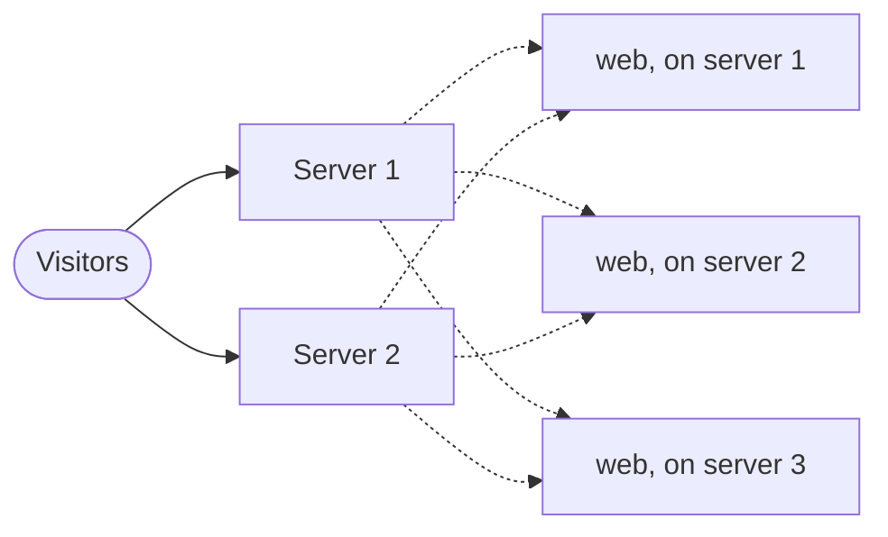
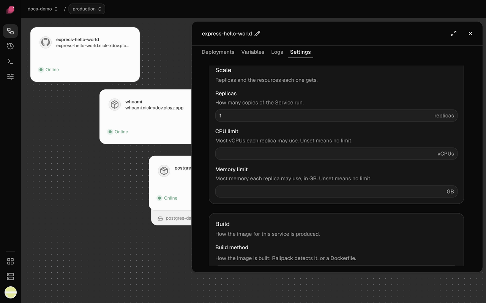

When one copy of your app isn't enough, run more. Each copy is a replica, and Ployz spreads
replicas over your servers. Think of your servers as one pool: a visitor can land on any of
them, and that server hands the request to a healthy replica wherever it runs.



## Run more replicas

1. Open your service and go to **Settings → Scale**.
2. Set **Replicas**, up to 50.
3. Click **Deploy**.



Ployz gives each server one replica before any server gets a second. A replica that crashes gets
no traffic until it recovers. A new replica gets none until it passes its
[healthcheck](settings.md#healthcheck); once it has, it keeps getting traffic if the check fails
later, and the dashboard warns.

**CPU limit** and **Memory limit** in the same section cap what each replica can use. Ployz
doesn't check that a server has room for them, so leave some headroom.

## Add a server

1. [Add a server](../servers/add-a-server.md#add-one-server-that-joins-right-away). It joins your other servers and takes web
   traffic, like the rest.
2. Deploy again to spread your replicas onto it. Replicas only move when you deploy, and the
   dashboard's **Deploy** needs a staged change, so for now this takes the CLI:

   ```sh
   ployz deploy
   ```

To see what runs where, open a server on the **Servers** page. **Running here** lists its
services.

## Give servers different jobs

Every server runs builds, runs services and takes web traffic. Turn jobs off to split the
work, for example a build server that keeps builds away from your app, or a database server
the internet can't reach. **Run builds here**, **Run services here** and **Takes web traffic** are
on each server's page. The [Ployz agent](../account/agent-sidebar.md) turns web traffic off but
not on.

For a build server, also turn off **Run builds here** on your other servers. Running replicas
move on your next deploy, or right away when you click **Drain** on the server's page (see
[Change what a server does](../servers/manage-servers.md#change-what-a-server-does)). Keep services on for a server that holds a volume: the services that
use it can only run there. While its services are off, a deploy doesn't attempt those services,
for example "db: Volume data is on db-1, which doesn't run services. Turn them back on with
ployz server set db-1 --accepts-services=true". The rest of the deploy still goes
ahead, and the deployment reads Failed. While a drain runs, wait for it to end before you turn
services back on.

Turning **Takes web traffic** off drops the server from your generated addresses and stops its web
server. `ployz server set --accepts-ingress=false` only drops it from your addresses, and leaves it
serving anyone who reaches the server directly until you remove the server. To keep the internet
out, also close ports 80 and 443 in its firewall.

When no other online server with a public IP takes web traffic, turning it off takes your domains
dark, so the CLI asks first. Add `--yes` to skip the question. Without a terminal, or with `--json`,
it refuses and names the command with `--yes`. Turning web traffic on never asks.

## When a server goes down

> [!WARNING]
> Ployz has no automatic failover. A database lives on one server: while that server is
> down, so is the database, and if the server is lost, so is its data. Keep your own
> [backups](databases.md#back-up-a-database).

The **Servers** page shows the server **Offline**. Replicas on your other servers keep
serving, though some requests are slower for a while, and for up to an hour some visitors may
still be sent to the offline server. Services that ran only there are down.

If `ployz exec -T db -- true` cannot find a running container while a server is not answering,
it names the missing servers and exits 3. The service may still run there, so an incomplete
answer does not mean it is gone. `ployz ps` and `ployz logs` also name servers that did not answer.

To bring services back:

1. Deploy. Services that don't use a volume on the offline server start on your other servers.
   A service whose volume is on the offline server isn't started: the deploy reports it, and
   every service that depends on it, as **Not attempted**, naming the server, and the deployment
   ends **Failed**. This works from **Deploy** in the dashboard or `ployz deploy`. To deploy only
   some services, name them:

   ```sh
   ployz deploy web worker
   ```

   A server that stopped answering moments ago may not show **Offline** yet. The deploy skips it
   the same way: it names the server, starts nothing there, and exits 3. The new replicas start
   serving on your other servers, but the deploy finishes only once they mark that server
   offline. If that takes more than 5 minutes, the service fails and the deploy names the server.
   A service with a Docker volume isn't attempted when no answering server holds the volume,
   because it may be on that server. From 0.3.10 the same holds for an online server whose volume
   list doesn't arrive: only the services with a volume on it aren't attempted, where before the
   whole deploy failed. Any service fails before it changes anything when the deploy
   can't read which replicas that server runs.
   A server the others still count as online but that doesn't answer fails the deploy. From 0.3.8,
   one whose silence is explained, because
   [large packets to it are dropped](../troubleshooting/servers.md#large-packets-to-a-server-are-dropped),
   is skipped the same way instead.
2. When the server comes back, its replicas start again. Within a few minutes it takes each
   replica the deploy in step 1 replaced out of traffic, but the replica keeps running until your
   next deploy removes it. It takes out only its own replicas, so an extra one on another server
   keeps answering until that server restarts. If it can't confirm the new replica, the old one
   answers beside it. See
   [Old and new versions answer at once](../troubleshooting/deployments.md#old-and-new-versions-answer-at-once).
3. If it's gone for good, [forget it](../servers/manage-servers.md#forget-a-server-that-is-gone)
   with **Forget server** on its page or `ployz server forget web-2 --confirm dead`. Then bring
   each of its volumes back from its mirror with **Use mirror** under the volume's **Copies**, see
   [When its server goes down](volumes.md#when-its-server-goes-down), and the others from your
   backups.

## Good to know

- **A service with a volume runs one replica**, on the volume's server, unless the volume
  [allows shared writes](volumes.md#share-a-volume).
- **Nothing scales on its own.** There's no autoscaling: you choose the number of replicas.
- **Preview environments run one replica** of each service, whatever you set here.
- **Update your own A records.** If your custom domain's root points at your servers with A
  records, change them when you add or lose a server that takes web traffic. Generated
  addresses and CNAME records follow along on their own. See
  [Domains](domains.md#point-dns-at-your-servers).
