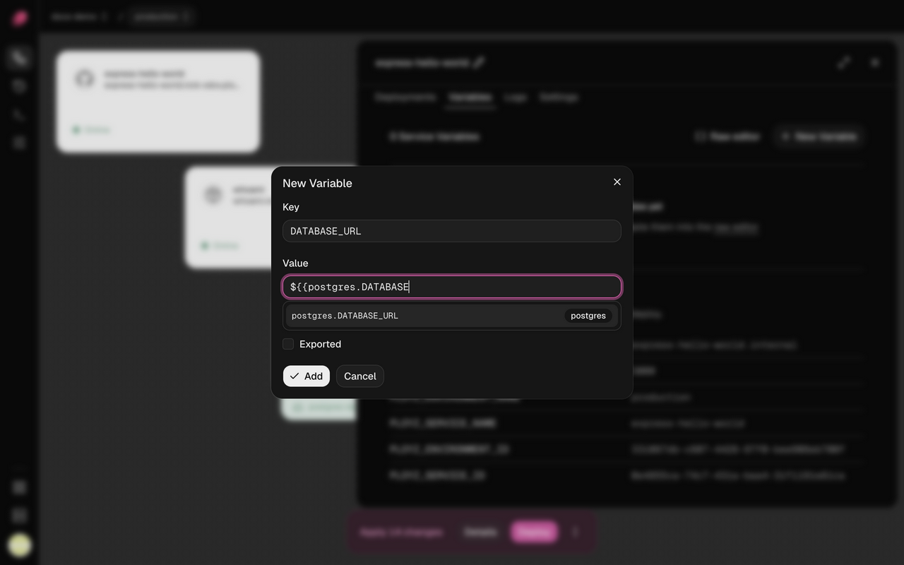

Variables are the environment variables your service starts with: settings, API keys, your
database's URL. Each service has its own, and a variable can point at another service's, so
your app always gets the database of the environment it runs in.

## Add a variable

1. Open your service and go to the **Variables** tab.
2. Click **New Variable**, and enter a **Key** and a **Value**.
3. Tick **Sealed** for a secret: you can't read it back or unseal it. Leave it unticked for a
   value you want to see, or one that holds a [reference](#reference-another-services-variable).
   Click **Add**.
4. Click **Deploy**.

<!-- screenshot: the Variables tab with a few variables, Raw editor and New Variable -->

To change or remove a variable, open the menu at the end of its row.

Your running service keeps its old values until you deploy. Changing a variable
[rebuilds](../builds/overview.md) a service built from GitHub on that deploy.

## Paste many at once

Click **Raw editor** to see the service's variables as a `.env` file (**ENV**) or as **JSON**.
Paste or edit them, then click **Update variables**.

- Deleting a line deletes that variable.
- Sealed variables aren't shown and stay as they are.
- Values you save here are plain text. Seal secrets afterwards from their menu.

## Rename a variable

From the CLI, `ployz set web.env.API_URL --rename PUBLIC_API_URL` renames a variable. Its value
moves with it, and a sealed variable stays sealed. Deploy to give your service the new name.

In Ployz Cloud, open the variable's menu in the service's Variables tab and choose Rename. If
Ployz refuses the new name, the dashboard shows why.

- Ployz refuses a new name another variable of the service already has, and leaves both as
  they are. Rename or remove that one first.

### Rename a variable other variables use

When other variables reference the one you rename, such as `${{ API_URL }}` in the same service
or `${{ web.API_URL }}` in another, they switch to the new name in the same change.

In Ployz Cloud, the Rename variable dialog lists them under **Also updates 2 references**.
Choose Rename to rename the variable and update them.

From the CLI, add `--update-references`:

```sh
ployz set web.env.API_URL --rename PUBLIC_API_URL --update-references
```

Without it, Ployz refuses to rename a referenced variable, lists the variables that use it, and
prints the command to run with `--update-references`. Nothing changes until you run it.

The [Ployz agent](../account/agent-sidebar.md) and `ployz mcp` can rename a referenced variable
too. Ask them to rename it, and they update its references in the same change. Like any rename,
it's staged until you deploy.

Only references in this environment's variables switch. Text that only looks like a reference,
such as an escaped `$${{ web.API_URL }}` or a sealed value, stays as it is. A Config file that
references the variable still blocks the rename: change that file first.

## Seal a secret

A sealed variable is encrypted when you save it, and the dashboard never shows its value again.
Your service still gets the real value when it deploys.

- New variables are plain unless you tick **Sealed**.
- To seal a plain variable, choose **Seal** from its menu. You can't unseal it. Saving the
  sealed value removes its earlier values from History too, so older versions show **Sealed**.
  A retried deployment of an older version gets the sealed value, not the one it had.
- To change a sealed value, delete the variable and add it again. Setting a sealed variable to
  a plain value is refused, so a secret never turns into plain text by mistake.
- Undo or Roll back in History never brings back an old sealed value. A sealed variable that
  History brings back comes back **Not set**: choose **Set value** to give it one. Until then,
  deploys leave it out of your service.
- A sealed value is stored exactly as typed, so it can't hold a
  [reference](#reference-another-services-variable).

## Reference another service's variable

A reference fills a variable with another variable's value. Write `${{ SERVICE.KEY }}` for
another service's variable and `${{ KEY }}` for one of this service's own:

```sh
DATABASE_URL=${{ postgres.DATABASE_URL }}
WEB_URL=http://${{ web.PLOYZ_PRIVATE_DOMAIN }}:${{ web.PORT }}
```

Leave **Sealed** unticked, then type `${{` in the value. The dashboard suggests this service's
variables, the [variables Ployz provides](#variables-ployz-provides), and other services'
exported variables. Tick **Exported** on a variable to add it to the suggestions; you can type a
reference to any variable either way.



- A reference reads the service of that name in the same environment. In staging,
  `${{ postgres.DATABASE_URL }}` is staging's database.
- A reference to a sealed variable keeps the secret hidden. Your service gets the real value.
- A service that references another starts after it on every deploy.
- Ployz refuses a reference to a service or variable that doesn't exist, and won't delete one
  that something references. Remove the reference first.
- Write `$${{` for a literal `${{`.

## Variables Ployz provides

| Variable | Value |
| --- | --- |
| `PORT` | `8080`, unless you set it. Your domains and health check reach your app on this port. |
| `PLOYZ_PRIVATE_DOMAIN` | The service's [private address](private-networking.md), like `web.internal` |
| `PLOYZ_SERVICE_NAME` | The service's private name, like `web` |
| `PLOYZ_ENVIRONMENT_NAME` | The environment's name, like `production` |
| `PLOYZ_SERVICE_ID`, `PLOYZ_ENVIRONMENT_ID` | The service's and the environment's IDs |

Only `PORT` reaches your app on its own. To read another one, reference it in a variable of
your own, like `SELF_HOST=${{ PLOYZ_PRIVATE_DOMAIN }}`. The **Variables** tab lists them, with
their values, under your own variables.

## Good to know

- **Builds see your variables, sealed ones included.** A Dockerfile can keep what it reads in
  the image, so don't pass long-lived secrets to it as `ARG`s. See
  [Use variables at build time](../builds/railpack-and-dockerfiles.md#use-variables-at-build-time).
- **Branches copy variables.** A separate copy of a service in a
  [branch](../environments/environments.md) starts with its parent's variables, sealed values
  included, and changing them leaves the parent alone. A reference to a service the branch
  shares with its parent reads the parent's values.

Next: [add a database](databases.md).
