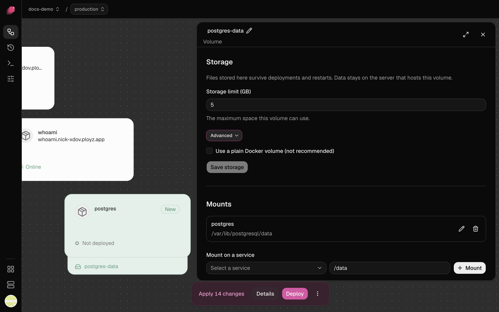

A deploy can replace your service's containers. A volume is a folder that survives:
whatever your service writes there is still there after deploys and restarts. Use one for
uploads, a SQLite file or a database's data. [Databases](databases.md) come with one.

Think of a volume as a disk plugged into one of your servers: every service that mounts it
runs on that server.

## Add a volume

1. Open your environment and click **Create**, then **Volume**. Right-clicking the canvas
   works too.
2. Enter a **Name**, like `uploads`, and a **Storage limit (GB)**. Names use lowercase letters,
   digits and hyphens. Anything else is converted, and the field shows the name it saves as. With
   Ployz Cloud you can [grow the limit](#choose-the-storage-limit) after you deploy. Click
   **Create volume**.
3. Click the new volume, then **Mount on a service**. Pick the service, enter a **Directory** inside
   its containers, like `/app/uploads`, and click **Mount**.
4. Click **Deploy**.



The volume shows as a tray under the service's card, and your app reads and writes files at
that directory. Open the menu at the end of the mount's row and choose **Edit directory** to move it.
Manage mounts from the volume's panel. Mount forms appear when you choose an action, and keep
your entered directory if a write fails.
Each directory holds one volume or config, so choose another directory if the service already
mounts one there; `/data/` and `/data` are the same directory. A volume can't mount under `/proc`,
`/sys` or `/dev`, which the kernel fills. These rules hold for every change, not only the one you
type: a discard, a sync from another environment or a restore from history that would break one is
refused the same way. A mount saved before these rules existed doesn't block your other changes.

## Choose the storage limit

The limit starts at 5 GB. A volume can't grow past it: once it's full, writes fail. The whole
limit is set aside on the server's disk, so a deploy fails if no server has room for it.
Volumes a deploy deletes free their space only after it succeeds, so they don't make room for new
volumes in the same deploy. To make room, remove the new volumes, deploy, then add them again.
`--size` refuses a limit under 0.1 GB, whether you add a volume or change one.

You can change the limit in the volume's **Settings**, under **Space**, or with
`ployz volume set data --size 10`, until a deploy starts creating the volume. A deploy refused
before it starts, for example because its plan finds no server with room, leaves the limit
editable, and so does a deploy while no service mounts the volume. Once a deploy starts creating
the volume, the limit is fixed in the panel. If that deploy then fails before any server holds the
volume, `ployz volume set data --size 10` still changes it: Ployz checks every server, finds no
copy, and your next deploy creates the volume at the new limit. It refuses while a deploy is under
way and for 10 minutes after one ends, however it ended, since a server may still be creating the
volume; run it again after that. It also
refuses while a server reports no managed storage, since Ployz can't tell whether that server holds
a copy. If a deploy creates the volume while the change is in progress, Ployz resizes the copy that
deploy made instead, or, if that deploy is still under way or just ended, stops and asks you to run
it again in a few minutes. Once the volume deploys, you
can grow it on Ployz Cloud while its service keeps running. Type a larger **Storage limit** there
and click **Grow**. The panel shows the resize until it ends. Before you confirm,
it refuses a smaller limit, a server whose Ployz is too old to grow it or that isn't reporting to
Cloud, and a size a server reports no room for. You can also grow it from the CLI, which goes through
Ployz Cloud too:

```sh
# Grow the data volume to 20 GB on every server that holds a copy
ployz volume set data --size 20 --wait
```

Without Ployz Cloud, a deployed volume keeps its limit: `ployz volume set --size` refuses and
says so.

Ployz grows each mirror first and the copy your service writes to last. If one server holding
a copy has no room, Ployz refuses the whole resize, names that server, and the volume keeps its
old limit. `ployz volume runs data` shows how a resize went. The new limit isn't a staged
change: `ployz diff` shows nothing, and your next deploy leaves the service's container alone.
In a [Protected environment](../environments/environments.md#protect-an-environment), a member's
grow from the dashboard or resize from the CLI waits for an owner or admin to approve it.
A Docker volume has no limit to grow. A version saved before a resize, grow or shrink, deploys
at the size the volume holds now.

To shrink a deployed volume, run the same command with a smaller number:

```sh
# Shrink the data volume to 8 GB on every server that holds a copy
ployz volume set data --size 8 --wait
```

Ployz shrinks the copy your service writes to first, then each mirror. A volume can't shrink
below what it holds plus some headroom: 10% or 1 GB, whichever is larger. If a server's copy
holds too much for the new limit, Ployz names the server and the smallest size it accepts,
rounded up to a whole GB, and stops; a server whose Ployz is too old to shrink is named too. If the
copy your service writes to refuses, the volume keeps its old limit. If a mirror refuses after that
copy shrank, the volume has its new limit: free space in it, run `ployz volume sync data` so the
mirror's copy follows, then run the same `ployz volume set` again. A shrink asked while a deploy
of the environment is in flight is refused before any copy changes and names that deployment: run
the same command again when it ends. A shrunk volume has less free space, so it may fill up sooner.

Running `ployz volume set data --size 8` with the size the volume already has asks every server
to hold that size. That is how to finish a shrink a mirror refused or one that was interrupted:
a copy still larger is shrunk to it. It only lowers a copy, judged from Ployz's latest reading of
each server's copy. If a server holds less than the
volume's limit, Ployz refuses and tells you to run `ployz volume set` with the size that server
holds, then again with the size you want, to grow it. If Ployz has no fresh reading of a server's copy,
it refuses and asks you to try again in a moment.

The dashboard doesn't show how full a volume is yet:

```sh
# CLI-only for now: how full is web's volume?
ployz exec web -- df -h /app/uploads
```

## Share a volume

By default, only one container writes to a volume. A service with a volume runs one replica, and no
other service can mount it. To run more replicas, or to mount it in several services, turn on
**Allow shared writes** in the volume's **Settings** tab, under **Space**. It applies at once,
without a deploy. From the CLI:

```sh
ployz volume set uploads --shared-writes
```

Do this only if your app copes with several writers at once; a database's data directory
doesn't. Everything that mounts the volume still runs on its server.

## When its server goes down

The services that mount the volume stop until the server is back. Nothing moves to another
server on its own, and neither the CLI nor Ployz Cloud [moves](move-a-volume.md) a volume while
its server is down: that server may still be writing to it. With a mirror, the volume's
**Copies** says "web-1 is not answering", which changes are lost, like "Changes after 10:36
lost", and that the mirror can take over once web-1 is forgotten. Under **Live**, web-1 reads **Not answering** instead of
**Live**. It names no time: Ployz doesn't know when web-1 stopped.

1. Wait if web-1 is coming back. When it answers again, its services start and nothing is lost.
2. If it's gone for good, an owner or admin
   [forgets it](../servers/manage-servers.md#forget-a-server-that-is-gone) on its server page.
   Copies links there. If web-1 runs again as it is, its services keep writing to its own copy,
   and Ployz never brings that back:
   [uninstall Ployz on it](../servers/manage-servers.md#forget-a-server-that-is-gone) as soon as
   it boots.
3. Back under **Copies**, click **Use mirror**. It stages the mirror as the primary and says
   which changes are lost: the writes since the mirror's last refresh. The button shows only
   while the mirror is the volume's last copy. If an old copy from an earlier move also remains,
   Copies says so instead of offering it: delete that copy first, with
   `ployz volume mirror rm data-web-3 --if-old-copy --confirm data`, and **Use mirror** appears.
   `--confirm` names the volume because, with no writer, the mirror and that old copy are all
   that is left of it; without the flag the command refuses and prints this line.
4. Deploy. The deploy asks you to confirm **Data loss**, makes the mirror the volume, and starts
   the services that mount it on that server.

To keep deploying your other services meanwhile, see
[When a server goes down](scaling.md#when-a-server-goes-down).

> [!WARNING]
> A volume lives on one server. Add a [mirror](mirror-a-volume.md) to keep a backup
> of it on another of your servers. A mirror holds the data as of its last refresh, nothing
> newer, and Ployz doesn't switch to it on its own. A snapshot isn't a backup: it stays on the
> volume's own server and is lost with it.
>
> A mirror isn't an offsite backup either. Your servers often share one provider and one account.
> For a copy that survives losing them, see [Back up a database](databases.md#back-up-a-database).

## Copies

A volume's copies are the places its data lives besides the server that writes it. With Ployz
Cloud a volume can have a mirror, a read-only copy on a second server that refreshes on every
deploy and every 15 minutes. A move leaves an old copy on the server it left. Open the volume and
look under **Copies**. An old copy never refreshes, so it doesn't protect the data. Each server
records which of its copies is a mirror and which is an old copy, so a mirror made with
`ployz volume mirror` refreshes like any other, and a move from the CLI leaves an old copy too. A
mirror's age turns amber with a **⚠** once it is more than an hour old. When the mirror's server
doesn't report it, its row says why beside that age at once, like "9 minutes ago · Not answering",
**Can't report this copy** or **Needs a newer Ployz**. The age is when the mirror last matched, not
when the server stopped.

While a server's report is still on its way, Copies doesn't say the server is down. A primary on
it reads **Waiting for its report**, and a mirror on it says it is waiting for its server's report.
That server may still hold the primary, so Copies names it under **Live** before a server that
isn't answering. While any server's report is on its way, Copies offers no way to forget a server.

When the primary's server answers but can't report its copy, Copies says so, like "web-1 can't
report this copy" or "web-1 needs a newer Ployz", and offers neither a Forget nor **Use mirror**:
web-1 is up, and may still hold the volume. Copies names such a server under **Live** before one
that isn't answering. A server the volume records as its mirror is named under **Live** only when
no other server is likelier to hold the volume. One staged to become the primary counts as one
that may hold it, as a failed move returns there. Otherwise it is listed under **Elsewhere**, even
when it is staged to become the primary. While a change you stage would keep that server as the
primary, its row offers no **Make primary** or **Remove mirror**.

Under **Live**, the primary reads **Live** only while its server reports it writable. During a
move, while writes pause on the server it leaves, it reads **Read-only**. A server whose Ployz is
behind the latest release reads **Needs a newer Ployz**. One that can't report the copy for
another reason reads **Can't report this copy**.

Copy changes, like a new mirror or a restore, go out with your next deploy. **Redeploy** on a past
deployment ships what that deployment froze, so it leaves them staged and says **Copies wait for
Deploy**. A restore that failed is taken back, and that deployment can't be redeployed. Restore
again instead.

A restore, or discarding one, is refused with "A Deploy or restore is starting. Try again." while
a deploy in the same environment is starting. Once a deploy has taken a restore, you can't discard
the restore until that deploy ends.

## Move a volume

With Ployz Cloud, **Make primary** on a mirror or `ployz volume move data --to web-2` moves a
volume and the service that mounts it to another server, stopping the service only for the last
copy. See [Move a volume](move-a-volume.md).

## When a volume has no writer

Each volume has one writer, the server that mounts it. A server you remove or reinstall turns
every volume it held into a copy, so the volume keeps its data but has no writer. A deploy does
not start a service that mounts such a volume. It deploys the other services, reports that
service and every service that depends on it as **Not attempted**, and the deployment ends
**Failed** with the reason, which names where the data is:

```
Volume data has no writer; web-2 holds its only copy. Make it the writer: ployz volume restore data --from web-2
```

Run the `ployz volume restore` line it prints to make that copy the writer again, then deploy.
When none of your servers holds a copy, for example because the only one is on a server you
removed, the deploy still won't start the service on a new, empty volume:

```
Volume data was deployed, but no Server in this Cluster holds a copy of it. If a Server you removed still holds its data, add that Server back, then run ployz volume restore data --from <server>
```

To start over with an empty volume instead, remove it with `ployz volume rm data`, which deletes
its data, add it again and deploy.

Without Ployz Cloud, `ployz volume restore` runs from the CLI, and the reason prints the same
line. It asks every server what it holds first, and it refuses while one of them doesn't answer,
since a copy there could become a second writer. It also refuses while another server holds a
copy, because a restore needs the only one, and while a server holding a copy runs a Ployz too old
for it. Then it makes the copy the writer and names the
snapshot it restored from:

```
$ ployz volume restore data --from web-2
Restored data on web-2 from 2026-10-22 20:58:27 UTC; writes after that time are lost.
Deploy to start the Services that use it.
next: ployz deploy
```

Run it again and it says `data's writer is already on web-2; nothing to restore.` and exits 0.

In Ployz Cloud, when the surviving copy is a mirror, the volume's **Copies** lists it and
**Use mirror** stages the same restore for your next deploy. An old copy gets no button there:
run the `ployz volume restore` line. While one of your servers is offline, the deploy can't tell whether that
server holds the writer, so it names that server instead and suggests no restore. See
[When its server goes down](#when-its-server-goes-down).
If several servers hold copies, it names them. Keep the newest. In Ployz Cloud, the volume's
**Copies** shows whether each is a mirror or an old copy. Delete an old copy with the × on its
row, and a mirror with **Remove mirror**. The error prints
no `ployz volume mirror rm` line for them, because such a line run later could delete a copy that
has since become the mirror. A volume that is [mid-move](../troubleshooting/volumes.md#a-move-failed-partway) blocks its service too, and names the
`ployz volume release` line that stops the move. A move that stopped before its first snapshot
has nothing to release, so it names the `ployz volume move` line that runs the move again.
Without Ployz Cloud, the error for several copies says to keep the newest, remove each other
server from the Cluster with `ployz server rm`, which takes its services off it too, then run
`ployz volume restore`. Or start over empty with `ployz volume rm data`. A mid-move volume says only that stopping the move needs Ployz Cloud.

Services that share a volume are blocked together: when any volume one of them mounts can't be
mounted, all of them are blocked with that reason, and so is every service that depends on one of
them. The rest of the deploy still goes ahead.

## When your servers show Docker only

A volume needs a server that shows **Managed volumes available** on the **Servers** page. A
server added with **Docker only**, or one that fell back to it because it can't run ZFS, shows
**Docker only** instead. See [Start without ZFS](../servers/add-a-server.md#start-without-zfs).
If none of your servers has managed volumes, deploying a volume fails, including the one a
database gets.

[Add a server](../servers/add-a-server.md) with managed volumes. Or, before you deploy, open the
volume's **Settings** and turn on **Plain Docker volume** under **Space**. When you create a
volume, tick **Use a plain Docker volume (not recommended)** under **Advanced** instead. A plain Docker volume has no storage limit, so it
can fill the server's disk.

## Detach a volume

In the volume's panel, open the menu at the end of a mount's row
and choose **Unmount**, then deploy. The detached row shows what the next deploy removes.
The volume and its data stay.

## Delete a volume

Deleting a deployed volume deletes its data from your servers for good.

1. Open the volume and click **Delete volume** under **Danger**. **Keep volume** undoes it.
2. Click **Delete data**, or **Deploy**.
3. Ployz shows **Deletes data** with what goes. Type your `project/environment`, like
   `my-app/production`, and click **Deploy**.

If deleting the data fails, the deployment says why, like `uploads: deleting its data failed:
it is still in use on Server web-1`. Deploying again deletes the data without asking again,
because your confirmation stays with the change. See
[Confirm a deploy that deletes data](../deploy/deployments.md#confirm-a-deploy-that-deletes-data).

A volume that was never deployed holds no data, so it goes on your next deploy without asking.
A mounted volume whose first deploy is still running counts as deployed, since that deploy may
already have created it. Saving or deploying its deletion asks first, the same way.

## Good to know

- **A branch gets an empty volume.** A [branch](../environments/environments.md) that copies
  a volume starts with no data, not a copy of yours.
- **Deleting a service keeps its volumes.** The exception is a [database](databases.md)
  deleted from the dashboard, which takes its volume with it.
